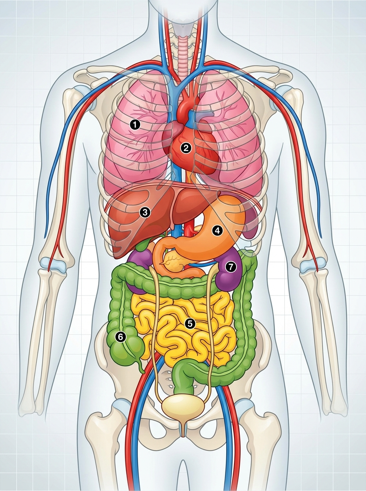

# UD2: Nivells d'Organització de la Matèria i la Funció de Nutrició (Biologia)

  

    

      PDI · Pissarra Digital
      🎯 5 Reptes Interactius d'Arrastrar i Soltar de UD2
    

    
Practica a la pissarra de classe amb pantalles tàctils o des de tauletes amb sons i autocorrecció immediata.

  

  <a href="../pissarra-interactiva.html" onclick="localStorage.setItem('pdi-target-unit', 'ud2')" style="background: linear-gradient(135deg, #059669, #0d9488); color: #fff !important; font-weight: 800; padding: 10px 18px; border-radius: 10px; text-decoration: none !important; box-shadow: 0 4px 12px rgba(5, 150, 105, 0.3); display: inline-flex; align-items: center; gap: 6px;">
    🖥️ Obrir Reptes PDI
    →
  </a>

Benvingut/da a la **Unitat Didàctica 2** de Ciències Aplicades I (bloc de Biologia). Aquesta unitat ha estat organitzada en **micro-sessions didàctiques de 1 sessió = 1 apartat**, cadascuna acompanyada del seu resum visual i la seua pròpia bateria completa d'activitats d'avaluació interactiva i lliurament per a Aules.

---

## 📑 Planificació de Subunitats Didàctiques (1 Sessió per Apartat)

| Sessió | Subunitat | Contingut Principal de la Sessió | Bateria d'Activitats | Enllaç Directe |
| :---: | :---: | :--- | :---: | :---: |
| **Sessió 1** | **2.1** | **Els Nivells d'Organització de la Matèria:** Escala des d'àtoms i bioelements (CHONPS) fins a la biosfera. | MCQ, V/F, Vocabulari, Raonament i Aules | [**📖 Anar a la Sessió 2.1 →**](./ut0201.html) |
| **Sessió 2** | **2.2** | **La Cèl·lula i la Teoria Cel·lular:** Descobriment, procariotes vs eucariotes, cèl·lula animal/vegetal i virus. | MCQ, V/F, Vocabulari, Raonament i Aules | [**📖 Anar a la Sessió 2.2 →**](./ut0202.html) |
| **Sessió 3** | **2.3** | **Els Teixits Fonamentals del Cos Humà:** Epitelial, connectiu (adipós/ossi), muscular i nerviós (neurones/glia). | MCQ, V/F, Vocabulari, Raonament i Aules | [**📖 Anar a la Sessió 2.3 →**](./ut0203.html) |
| **Sessió 4** | **2.4** | **La Funció de Nutrició i l'Aparell Digestiu:** Tub digestiu, glàndules annexes (fetge/pàncrees), bol, quim i quil. | MCQ, V/F, Vocabulari, Raonament i Aules | [**📖 Anar a la Sessió 2.4 →**](./ut0204.html) |
| **Sessió 5** | **2.5** | **L'Aparell Respiratori i la Ventilació:** Vies respiratòries, pulmons, mecànica del diafragma i alvèols (hematosi). | MCQ, V/F, Vocabulari, Raonament i Aules | [**📖 Anar a la Sessió 2.5 →**](./ut0205.html) |
| **Sessió 6** | **2.6** | **L'Aparell Circulatori Cardiovascular:** Sang (glòbuls/plaquetes), artèries, venes, el cor i circulació doble/completa. | MCQ, V/F, Vocabulari, Raonament i Aules | [**📖 Anar a la Sessió 2.6 →**](./ut0206.html) |
| **Sessió 7** | **2.7** | **L'Aparell Excretor Humà:** Excreció vs defecació, ronyons, nefrones (filtració/reabsorció 99%) i formació d'orina. | MCQ, V/F, Vocabulari, Raonament i Aules | [**📖 Anar a la Sessió 2.7 →**](./ut0207.html) |
| **Sessió 8** | **2.8** | **Hàbits Saludables, Dieta i Prevenció:** Aterosclerosi, hipertensió, infarts, cistitis, càlculs renals i decàleg de salut. | MCQ, V/F, Vocabulari, Raonament i Aules | [**📖 Anar a la Sessió 2.8 →**](./ut0208.html) |
| **Sessió 9** | **2.9** | **Quadern de Laboratori i Reptes Pràctics:** Càlcul de TMB i DET, anàlisi d'etiquetes, freqüència cardíaca i microscòpia. | Butlletí de problemes i reptes experimentals | [**🔬 Anar al Laboratori 2.9 →**](./ut0209.html) |

---

  
  
<em>Esquema integral dels aparells digestiu, respiratori, circulatori i excretor coordinats per a la nutrició cel·lular</em>

