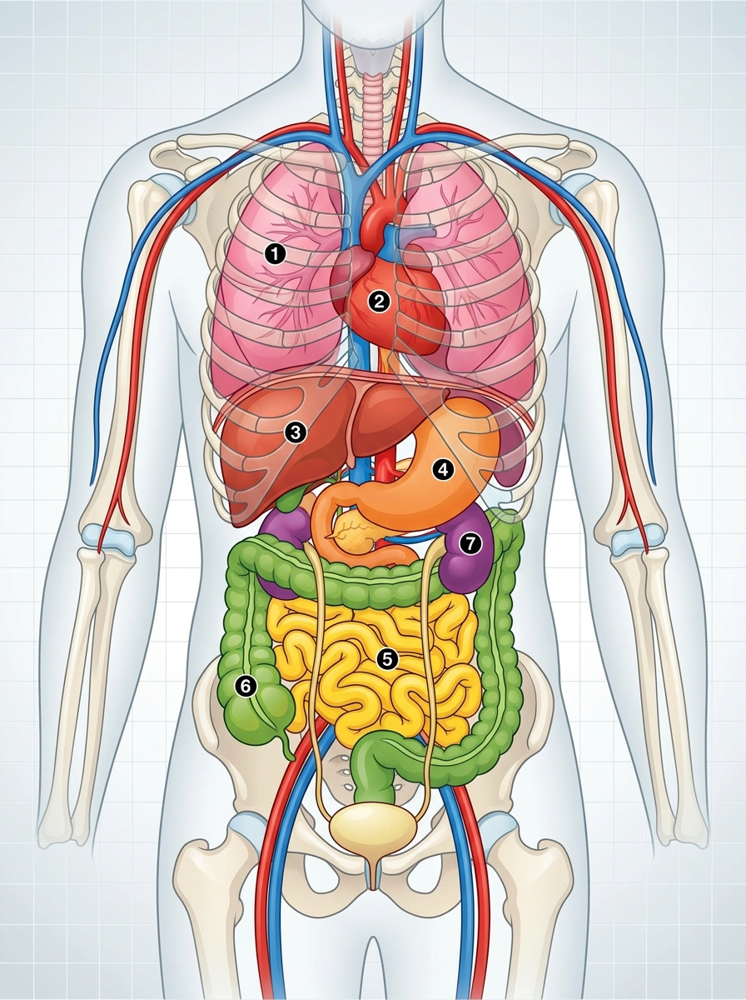

# UD2: Nivells d'Organització de la Matèria i la Funció de Nutrició (Biologia i Geologia)

Benvingut/da a la **Unitat Didàctica 2** de Ciències Aplicades I (bloc de Biologia). En aquesta unitat explorarem l'organització de la matèria viva des dels àtoms fins a la biosfera, aprofundirem en l'estructura de la cèl·lula i els teixits, i analitzarem com treballen en equip els quatre grans sistemes de la nutrició humana: digestiu, respiratori, circulatori i excretor.

<div style="margin: 2rem 0; overflow-x: auto; text-align: center;">
<svg viewBox="0 0 860 260" xmlns="http://www.w3.org/2000/svg" style="max-width: 100%; height: auto; font-family: 'Segoe UI', system-ui, sans-serif; background: linear-gradient(135deg, #0f172a 0%, #1e293b 100%); border-radius: 12px; border: 1px solid #334155; box-shadow: 0 10px 25px -5px rgba(0, 0, 0, 0.4);">
  <defs>
    <linearGradient id="g-niv" x1="0%" y1="0%" x2="100%" y2="100%">
      <stop offset="0%" stop-color="#38bdf8" stop-opacity="0.25"/>
      <stop offset="100%" stop-color="#0284c7" stop-opacity="0.05"/>
    </linearGradient>
    <linearGradient id="g-dig" x1="0%" y1="0%" x2="100%" y2="100%">
      <stop offset="0%" stop-color="#818cf8" stop-opacity="0.25"/>
      <stop offset="100%" stop-color="#4f46e5" stop-opacity="0.05"/>
    </linearGradient>
    <linearGradient id="g-cir" x1="0%" y1="0%" x2="100%" y2="100%">
      <stop offset="0%" stop-color="#f43f5e" stop-opacity="0.25"/>
      <stop offset="100%" stop-color="#be123c" stop-opacity="0.05"/>
    </linearGradient>
    <linearGradient id="g-exc" x1="0%" y1="0%" x2="100%" y2="100%">
      <stop offset="0%" stop-color="#34d399" stop-opacity="0.25"/>
      <stop offset="100%" stop-color="#059669" stop-opacity="0.05"/>
    </linearGradient>
  </defs>

  <!-- Capçalera -->
  <text x="430" y="32" text-anchor="middle" fill="#f8fafc" font-size="16" font-weight="700" letter-spacing="1">ORGANITZACIÓ DE LA MATÈRIA I LA NUTRICIÓ: CEL·LULA, SISTEMES I FISIOLOGIA</text>
  <text x="430" y="50" text-anchor="middle" fill="#94a3b8" font-size="12">De l'àtom a l'organisme, digestió de nutrients, hematosi, hemodinàmica i filtració renal</text>

  <!-- Bloc 1: Nivells d'Organització -->
  <g transform="translate(25, 70)">
    <rect width="185" height="165" rx="10" fill="url(#g-niv)" stroke="#38bdf8" stroke-width="1.5"/>
    <rect x="15" y="14" width="28" height="28" rx="6" fill="#38bdf8" fill-opacity="0.2"/>
    <text x="29" y="33" text-anchor="middle" fill="#38bdf8" font-size="14" font-weight="bold">🔬</text>
    <text x="52" y="33" fill="#f8fafc" font-size="13" font-weight="bold">Nivells Biològics</text>
    <text x="15" y="62" fill="#38bdf8" font-size="11" font-weight="600">Escala de la Vida</text>
    <text x="15" y="84" fill="#cbd5e1" font-size="11">• Àtoms (C,H,O,N) i molècules</text>
    <text x="15" y="104" fill="#cbd5e1" font-size="11">• Cèl·lula: Procariota/Eucariota</text>
    <text x="15" y="124" fill="#cbd5e1" font-size="11">• Teixits i Òrgans especials</text>
    <text x="15" y="144" fill="#cbd5e1" font-size="11">• Aparells integrats (Nutrició)</text>
  </g>

  <!-- Bloc 2: Aparell Digestiu -->
  <g transform="translate(230, 70)">
    <rect width="185" height="165" rx="10" fill="url(#g-dig)" stroke="#818cf8" stroke-width="1.5"/>
    <rect x="15" y="14" width="28" height="28" rx="6" fill="#818cf8" fill-opacity="0.2"/>
    <text x="29" y="33" text-anchor="middle" fill="#818cf8" font-size="14" font-weight="bold">🥗</text>
    <text x="52" y="33" fill="#f8fafc" font-size="13" font-weight="bold">Aparell Digestiu</text>
    <text x="15" y="62" fill="#818cf8" font-size="11" font-weight="600">Transformació Química</text>
    <text x="15" y="84" fill="#cbd5e1" font-size="11">• Bol (boca) ➔ Quim (estómac)</text>
    <text x="15" y="104" fill="#cbd5e1" font-size="11">• Quil (duodè + bilis + pàncrees)</text>
    <text x="15" y="124" fill="#cbd5e1" font-size="11">• Absorció: Microvellositats</text>
    <text x="15" y="144" fill="#cbd5e1" font-size="11">• Intestí gros: Aigua i fibra</text>
  </g>

  <!-- Bloc 3: Respiratori i Circulatori -->
  <g transform="translate(435, 70)">
    <rect width="185" height="165" rx="10" fill="url(#g-cir)" stroke="#f43f5e" stroke-width="1.5"/>
    <rect x="15" y="14" width="28" height="28" rx="6" fill="#f43f5e" fill-opacity="0.2"/>
    <text x="29" y="33" text-anchor="middle" fill="#f43f5e" font-size="14" font-weight="bold">🫀</text>
    <text x="52" y="33" fill="#f8fafc" font-size="13" font-weight="bold">Respiratori & Cor</text>
    <text x="15" y="62" fill="#f43f5e" font-size="11" font-weight="600">Gasos i Transport</text>
    <text x="15" y="84" fill="#cbd5e1" font-size="11">• Alvèols: Hematosi O₂ / CO₂</text>
    <text x="15" y="104" fill="#cbd5e1" font-size="11">• Cor: 4 cambres (aur/ventr)</text>
    <text x="15" y="124" fill="#cbd5e1" font-size="11">• Circulació doble i completa</text>
    <text x="15" y="144" fill="#cbd5e1" font-size="11">• Grups: 0⁻ universal, AB⁺</text>
  </g>

  <!-- Bloc 4: Excreció i Salut -->
  <g transform="translate(640, 70)">
    <rect width="195" height="165" rx="10" fill="url(#g-exc)" stroke="#34d399" stroke-width="1.5"/>
    <rect x="15" y="14" width="28" height="28" rx="6" fill="#34d399" fill-opacity="0.2"/>
    <text x="29" y="33" text-anchor="middle" fill="#34d399" font-size="14" font-weight="bold">💧</text>
    <text x="52" y="33" fill="#f8fafc" font-size="13" font-weight="bold">Excreció & Salut</text>
    <text x="15" y="62" fill="#34d399" font-size="11" font-weight="600">Depuració i Nefrona</text>
    <text x="15" y="84" fill="#cbd5e1" font-size="11">• Ronyons: Nefrona (1M c/u)</text>
    <text x="15" y="104" fill="#cbd5e1" font-size="11">• Filtració + Reabsorció 99%</text>
    <text x="15" y="124" fill="#cbd5e1" font-size="11">• Excreció d'urea i toxines</text>
    <text x="15" y="144" fill="#cbd5e1" font-size="11">• Hàbits: Hidratació i exercici</text>
  </g>
</svg>
</div>

---

## 📑 Índex d'Apartats de la Unitat {#index-unitat}

<div style="background: var(--code-bg); border: 1px solid var(--border); border-radius: 8px; padding: 16px 20px; margin: 1.5rem 0;">
  <p style="margin: 0 0 10px 0; font-weight: 600; color: var(--primary);">Accés ràpid als apartats complets d'aquesta unitat:</p>
  <ol style="margin: 0; padding-left: 20px; line-height: 2.1;">
    <li><a href="#sec2-1"><strong>2.1 Nivells d'Organització de la Matèria, la Cèl·lula i els Teixits</strong></a></li>
    <li><a href="#sec2-2"><strong>2.2 La Funció de Nutrició i l'Aparell Digestiu</strong></a></li>
    <li><a href="#sec2-3"><strong>2.3 Els Aparells Respiratori, Circulatori i Sistema Limfàtic</strong></a></li>
    <li><a href="#sec2-4"><strong>2.4 L'Aparell Excretor, Hàbits de Salut i Activitats</strong></a></li>
    <li><a href="#sec2-5"><strong>2.5 Quadern d'Activitats Pràctiques i Reptes de Laboratori</strong></a></li>
  </ol>
</div>

---

## 📌 2.1 Nivells d'Organització de la Matèria, la Cèl·lula i els Teixits {#sec2-1}

La matèria que forma el nostre univers i tots els éssers vius està organitzada en diferents **graus de complexitat creixent**, des de les partícules elementals fins a tot el planeta Terra.

---

### 1. Els Nivells d'Organització de la Matèria

Podem dividir els nivells d'organització en dos grans blocs: **nivells abiòtics** (sense vida pròpia) i **nivells biòtics** (a partir dels quals comença la vida).

```
Subatòmic ➔ Atòmic ➔ Molecular ➔ Cel·lular ➔ Tissular ➔ Òrgans ➔ Sistemes ➔ Organisme ➔ Població ➔ Comunitat ➔ Ecosistema ➔ Biosfera
```

#### Nivells Abiòtics (Inerts)
1. **Nivell Subatòmic:** Format per les partícules elementals que constitueixen l'àtom: protons, neutrons i electrons.
2. **Nivell Atòmic:** Els àtoms dels diferents elements químics (bioelements essencials com el carboni $\text{C}$, hidrogen $\text{H}$, oxigen $\text{O}$, nitrogen $\text{N}$, fòsfor $\text{P}$ i sofre $\text{S}$).
3. **Nivell Molecular:** Unió d'àtoms mitjançant enllaços químics per a formar biomolècules:
   - **Inorgàniques:** Aigua ($\text{H}_2\text{O}$) i sals minerals.
   - **Orgàniques:** Glúcids (sucres), lípids (greixos), proteïnes i àcids nucleics (ADN i ARN).

#### Nivells Biòtics (Vius)
4. **Nivell Cel·lular:** La cèl·lula és el primer nivell amb vida pròpia capaç de realitzar les tres funcions vitals (nutrició, relació i reproducció).
5. **Nivell Tissular (Teixits):** Conjunt de cèl·lules similars especialitzades que col·laboren en una funció comuna (per exemple, el teixit muscular o ossi).
6. **Òrgans:** Unió de diferents teixits coordinats per fer una acció concreta (cor, estómac, ronyó).
7. **Aparells i Sistemes:** Conjunt d'òrgans coordinats que realitzen una funció complexa (aparell digestiu, sistema nerviós).
8. **Organisme (Individu):** L'ésser viu complet integrat (un ésser humà, un gos, un arbre).
9. **Població, Comunitat, Ecosistema i Biosfera:** Nivells ecològics que agrupen individus de la mateixa espècie, comunitats biològiques i la totalitat de la vida a la Terra.

---

### 2. La Cèl·lula: El Descobriment i la Teoria Cel·lular

La **cèl·lula** és la unitat morfològica, estructural i funcional de tots els éssers vius. És l'estructura ordenada i viva més menuda que es coneix. La gran majoria són microscòpiques, encara que algunes (com l'òvul humà) poden observar-se quasi a simple vista.

#### Història del Descobriment
- A principis del segle XVII es van desenvolupar les primeres lents d'augment i microscopis.
- En **1664**, el científic anglès **Robert Hooke** va observar amb un microscopi primitiu un tall fi de suro. Va apreciar una estructura en forma de bresca d'abella formada per petites cambretes buides a les quals va anomenar **cel·les o cèl·lules** (*cellulae*).
- Anys més tard, **Antoni van Leeuwenhoek** va perfeccionar les lents i va ser el primer a observar microorganismes vius en una gota d'aigua ("animàlculs") i cèl·lules sanguínies.

> [!IMPORTANT]
> ### Els Tres Principis de la Teoria Cel·lular
> A mitjan segle XIX, els científics Matthias Schleiden, Theodor Schwann i Rudolf Virchow van establir la **Teoria Cel·lular moderna**:
> 1. **Unitat estructural:** Tots els éssers vius estan formats per una o més cèl·lules.
> 2. **Unitat funcional:** La cèl·lula és la unitat fisiològica mínima capaç de realitzar les funcions vitals.
> 3. **Unitat d'origen:** Tota cèl·lula prové necessàriament de la divisió d'una altra cèl·lula preexistent (*omnis cellula e cellula*).

---

### 3. Classificació Cel·lular: Procariotes vs Eucariotes

Segons si el material genètic està aïllat per una membrana nuclear o no, distingim dos grans tipus cel·lulars:

| Característica | Cèl·lula Procariota | Cèl·lula Eucariota |
| :--- | :--- | :--- |
| **Nucli diferenciat** | **No en té** (sense membrana nuclear). | **Sí en té** (amb membrana nuclear que protegeix l'ADN). |
| **Localització de l'ADN** | Dispers pel citoplasma en una regió anomenada nucleoide. | Tancat i protegit dins del nucli cel·lular. |
| **Complexitat i orgànuls** | Molt senzilla; té ribosomes però manca d'orgànuls membranosos. | Molt complexa; té múltiples orgànuls membranosos especialitzats. |
| **Mida aproximada** | Petita ($0{,}5 - 5\,\mu\text{m}$). | Gran ($10 - 100\,\mu\text{m}$). |
| **Organismes** | Unicel·lulars: **Bacteris** i **Arquees**. | Unicel·lulars o pluricel·lulars: **Animals, plantes, fongs i protoctists**. |

#### Els Bacteris: Microorganismes Essencials
Els bacteris són els éssers vius més abundants del planeta. Menys de l'**1%** dels bacteris existents són perjudicials per als humans causant malalties. La immensa majoria són beneficiosos i indispensables:
- **Flora intestinal:** Bacteris com *Lactobacillus* i *Bifidobacterium* ajuden a la digestió, síntesi de vitamines (B i K) i frenen el creixement de bacteris patògens (*Escherichia coli*, *Salmonella*).
- **Reciclatge d'elements i fixació del nitrogen:** L'atmosfera té un $78\%$ de nitrogen gasós ($\text{N}_2$), però plantes i animals no podem respirar-lo directament per sintetitzar proteïnes i ADN. Els bacteris del sòl el "fixen" en sals minerals que les plantes absorbeixen per les arrels.

---

### 4. Cèl·lules Animals vs Cèl·lules Vegetals

Les dues són eucariotes, però presenten adaptacions i orgànuls exclusius segons el seu estil de vida:

| Estructura / Orgànul | Cèl·lula Animal | Cèl·lula Vegetal | Funció principal |
| :--- | :---: | :---: | :--- |
| **Membrana plasmàtica** | Sí | Sí | Barrera selectiva que regula l'entrada de nutrients i eixida de deixalles. |
| **Paret cel·lular** | **No** | **Sí** (de cel·lulosa) | Capa rígida externa que dóna protecció, resistència i forma prismàtica. |
| **Nucli** | Sí | Sí | Conté l'ADN i coordina tota l'activitat de la cèl·lula. |
| **Citoplasma** | Sí | Sí | Medi aquós intern on suren els orgànuls cel·lulars. |
| **Mitocondris** | Sí | Sí | Centrals energètiques: fan la respiració cel·lular per produir energia (ATP). |
| **Cloroplasts** | **No** | **Sí** (amb clorofil·la) | Realitzen la **fotosíntesi**, captant la llum solar per crear matèria orgànica. |
| **Vacúols** | Menuts i escassos | Un gran vacúol central | Emmagatzema aigua, sals minerals i substàncies de reserva. |
| **Centríols** | Sí | No | Participen en la divisió cel·lular i formació del fus mitòtic. |

---

### 5. Formes Acel·lulars: Els Virus i les Vacunes

Els **virus** (terme llatí que significa "verí" o "toxina") són estructures microscòpiques que se situen en la frontera del que considerem viu. 

```
Estructura bàsica d'un virus:
┌─────────────────────────────────┐
│     Envoltura / Càpside         │  (coberta externa de proteïnes)
│     ┌─────────────────────┐     │
│     │   Genoma víric      │     │  (ADN o ARN amb la informació)
│     └─────────────────────┘     │
└─────────────────────────────────┘
```

> [!WARNING]
> ### Per què els virus no són cèl·lules ni es consideren éssers vius complets?
> - **Són acel·lulars:** No tenen membrana plasmàtica, ni citoplasma, ni orgànuls, ni metabolisme propi.
> - **Paràsits intracel·lulars obligats:** Fora d'una cèl·lula hoste són partícules inerts anomenades **virions**.
> - **No es poden reproduir per ells mateixos:** Necessiten injectar el seu material genètic en una cèl·lula hoste i "segrestar" la maquinària d'aquesta per produir nous virus, destruint sovint la cèl·lula.

#### Les Vacunes i la Immunitat
Per a combatre les infeccions víriques no serveixen els antibiòtics (que només maten bacteris). L'eina fonamental de prevenció són les **vacunes**:
1. **Com funcionen:** S'introdueix en el cos un fragment inofensiu del virus o un patogen atenuat/inactivat.
2. **Reconeixement immunitari:** El nostre sistema immunitari (glòbuls blancs i limfòcits) detecta les proteïnes de l'invasor i fabrica **anticossos** específics.
3. **Memòria immunitària:** Quan el patogen real intenta infectar-nos, les nostres defenses el reconeixen ràpidament i el destrueixen abans que desenvolupe la malaltia.
4. **Història:** La primera vacuna la va desenvolupar **Edward Jenner** a finals del segle XVIII contra la verola, salvant centenars de milions de vides.

---

### 6. Els Teixits en el Cos Humà

En els organismes pluricel·lulars, les cèl·lules s'especialitzen i s'associen formant **teixits**. En el cos humà es distingeixen 4 tipus principals de teixits:

1. **Teixit Epitelial:** 
   - **Funció:** Cobreix les superfícies externes del cos (epidermis de la pell) i recobreix les cavitats internes (epiteli de l'estómac, vies respiratòries). 
   - També forma les glàndules secretores (teixit glandular).
2. **Teixit Connectiu (o Conjuntiu):**
   - **Funció:** Uneix, sosté i protegeix els altres teixits.
   - **Varietats:** Teixit ossi (ossos), teixit cartilaginós (cartílags), teixit adipós (greix de reserva i aïllant) i teixit sanguini (la sang).
3. **Teixit Muscular:**
   - **Funció:** Format per cèl·lules allargades (fibres musculars) capaces de contraure's per generar moviment i força.
   - **Tipus:** Múscul esquelètic (voluntari, unit als ossos), múscul cardíac (involuntari, al cor) i múscul llis (involuntari, a les parets del tub digestiu i vasos sanguinis).
4. **Teixit Nerviós:**
   - **Funció:** Captar estímuls sensorials, transmetre impulsos elèctrics i coordinar la resposta de l'organisme.
   - **Cèl·lules:** Neurones (transmissió de l'impuls nerviós) i cèl·lules de la glia (suport, nutrició i protecció de les neurones).

---

### 💡 Resum de Conceptes Clau

- La matèria s'organitza des del nivell subatòmic fins a la biosfera; la vida comença en el **nivell cel·lular**.
- La cèl·lula és la unitat estructural, funcional i d'origen de tot ésser viu (**Teoria Cel·lular**).
- Les **procariotes** no tenen nucli diferenciat (bacteris); les **eucariotes** tenen nucli amb membrana (animals i vegetals).
- Les **cèl·lules vegetals** tenen paret cel·lular i cloroplasts per fer la fotosíntesi; les **animals** no en tenen.
- Els **virus** són estructures acel·lulars paràsites que es combaten eficaçment amb la prevenció mitjançant **vacunes**.
- Els **teixits** humans principals són l'epitelial, connectiu, muscular i nerviós.

<div style="text-align: right; margin: 1.5rem 0 2rem 0;">
  <a href="#index-unitat" class="page-nav-btn" style="display: inline-block; padding: 4px 14px; font-size: 0.85rem;">⬆️ Pujar a l'Índex</a>
</div>

---

## 📌 2.2 La Funció de Nutrició i l'Aparell Digestiu {#sec2-2}

La **funció de nutrició** és el conjunt de processos biològics mitjançant els quals els organismes obtenen la matèria i l'energia necessàries per construir i renovar les seues estructures cel·lulars i dur a terme totes les activitats vitals.

---

### 1. Concepte de Nutrició: Alimentació vs Nutrició

És fonamental no confondre els termes **alimentació** i **nutrició**:

- **Alimentació:** És un acte **voluntari, conscient i educable**, que consisteix a triar, preparar i ingerir els aliments del nostre entorn.
- **Nutrició:** És un procés **involuntari i inconscient**, que comprén tots els mecanismes fisiològics pels quals el cos descompon els aliments, n'absorbeix els nutrients químics (glucosa, àcids grassos, aminoàcids, vitamines, minerals i aigua) i els transporta a cadascuna de les cèl·lules.

#### Tipus de Nutrició en els Éssers Vius
- **Nutrició Autòtrofa:** Fabriquen la seua pròpia matèria orgànica a partir de substàncies inorgàniques simples com el diòxid de carboni ($\text{CO}_2$) i l'aigua, utilitzant una font externa d'energia com la llum solar (plantes, algues i bacteris fotosintètics).
- **Nutrició Heteròtrofa:** No poden fabricar la seua pròpia matèria orgànica i han d'alimentar-se consumint altres éssers vius o les seues restes (animals, fongs, protozous i la majoria de bacteris).

> [!NOTE]
> ### Els 4 Aparells Coordinats en la Nutrició Humana
> Per a realitzar la nutrició en el cos humà, quatre grans aparells treballen de manera sincronitzada:
> 1. **Aparell Digestiu:** Transforma els aliments en nutrients senzills i els absorbeix cap a la sang.
> 2. **Aparell Respiratori:** Capta l'oxigen ($\text{O}_2$) de l'aire per a la respiració cel·lular i expulsa el diòxid de carboni ($\text{CO}_2$).
> 3. **Aparell Circulatori:** Transporta els nutrients i l'oxigen fins a cadascuna de les cèl·lules, i arreplega els residus metabòlics.
> 4. **Aparell Excretor:** Depura la sang eliminant els productes de rebuig tòxics cel·lulars (urea, àcid úric) a través de l'orina i la suor.


*Figura 2.1: Disposició dels principals òrgans interns en el tronc humà: **(1)** Pulmons (respiratori), **(2)** Cor (circulatori), **(3)** Fetge (glàndula digestiva), **(4)** Estómac (digestiu), **(5)** Intestí prim (absorció de nutrients), **(6)** Intestí gros (absorció d'aigua), **(7)** Ronyons (excretor).*

---

### 2. Anatomia de l'Aparell Digestiu

L'aparell digestiu humà està format per dues parts fonamentals: el **tub digestiu** i les **glàndules annexes**.

```
Boca ➔ Faringe ➔ Esòfag ➔ Estómac ➔ Intestí Prim ➔ Intestí Gros ➔ Recte/Anus
  ▲                         ▲             ▲
Glàndules Salivals          Fetge      Pàncrees
```

#### A) El Tub Digestiu
És un conducte musculós continu d'uns 10 metres de longitud que s'estén des de l'orifici d'entrada (boca) fins a l'orifici d'eixida (anus):

1. **La Boca:**
   - **Dents:** Estructures dures que trituren el menjar. Els adults tenen **32 peces dentals** (16 a dalt i 16 a baix): 8 incisius (tallen), 4 canins (esquincen), 8 premolars i 12 molars (trituren i molen).
   - **Llengua:** Múscul molt potent recobert de **papil·les gustatives** que percep els sabors (dolç, salat, àcid, amarg i umami) i ajuda a barrejar el menjar amb la saliva.
2. **La Faringe:**
   - Cavitat compartida entre els sistemes digestiu i respiratori.
   - Posseeix una vàlvula cartilaginosa anomenada **epiglotis**, que tanca l'entrada a la laringe durant la deglució per impedir que el menjar passe a les vies respiratòries (ennuegament).
3. **L'Esòfag:**
   - Tub musculós d'uns 25 cm que connecta la faringe amb l'estómac. Condueix el menjar mitjançant contraccions musculars automàtiques anomenades **moviments peristàltics**.
4. **L'Estómac:**
   - Eixamplament del tub digestiu en forma de bossa amb una capacitat d'aproximadament $1{,}5$ litres.
   - Posseeix dues vàlvules d'obertura i tancament: el **càrdies** (a l'entrada, venint de l'esòfag) i el **pílor** (a l'eixida, cap a l'intestí prim).
5. **L'Intestí Prim:**
   - Tub llarg i replegat d'uns 6 a 7 metres de longitud. Es divideix en tres trams:
     - **Duodè:** Tram inicial on desemboquen les secrecions del fetge i del pàncrees.
     - **Jejú:** Tram intermedi on es produeix la màxima absorció de nutrients.
     - **Ili:** Tram final que connecta amb l'intestí gros mitjançant la vàlvula ileocecal.
   - La paret interna està recoberta de milions de replecs diminuts anomenats **vellositats i microvellositats intestinals**, que multipliquen la superfície d'absorció.
6. **L'Intestí Gros:**
   - Tub d'aproximadament $1{,}5$ metres de longitud i major diàmetre. Consta de tres regions:
     - **Cec:** Bossa inicial de la qual sobreix l'**apèndix vermiforme**.
     - **Còlon:** Es divideix en ascendent, transvers i descendent. Acull la microbiota intestinal (flora bacteriana).
     - **Recte i Anus:** Tram final on s'emmagatzemen les femtes abans de ser expulsades a l'exterior pel control de l'esfínter anal.

---

#### B) Les Glàndules Digestives Annexes
Òrgans que produeixen líquids rics en enzims digestius i els aboquen al tub digestiu:

| Glàndula | Localització i Secreció | Funció Principal |
| :--- | :--- | :--- |
| **Glàndules Salivals** | 3 parells a la boca (paròtides, submaxil·lars i sublinguals). Secreten **saliva**. | Humitegen l'aliment, contenen lisozima (bactericida) i **amilasa**, enzim que comença la digestió dels glúcids (midó). |
| **Fetge** | Glàndula més voluminosa del cos, situada a la dreta sota el diafragma. Produeix la **bilis**. | La bilis s'emmagatzema a la **vesícula biliar** i s'aboca al duodè per a emulsionar els greixos (trencar-los en gotetes menudes perquè puguen ser atacats pels enzims). A més, el fetge emmagatzema glucogen i ferro, i desintoxica la sang. |
| **Pàncrees** | Rere i sota l'estómac. Produeix el **suc pancreàtic** i hormones. | El suc pancreàtic abocat al duodè conté enzims que digereixen proteïnes, lípids i sucres. A més, secreta a la sang la **insulina** (abaixa el sucre en sang) i el **glucagó** (apuja el sucre). |

> [!IMPORTANT]
> ### El Pàncrees i la Diabetis
> La glucosa és el combustible energètic primordial de les cèl·lules. La **insulina** permet que la glucosa passe de la sang a l'interior de les cèl·lules.
> Quan una persona pateix **diabetis**, el seu pàncrees no produeix suficient insulina o les cèl·lules no responen adequadament. Com a resultat, la glucosa s'acumula en excés en la sang (hiperglucèmia), la qual cosa pot danyar greument el cor, els ronyons i la vista si no es controla amb dieta, exercici i medicació o injeccions d'insulina.

---

### 3. El Procés Digestiu Pas a Pas

El procés de transformació del menjar comprén accions mecàniques (triturar i barrejar) i accions químiques (ruptura molecular per enzims):

#### Pas 1: Digestió Bucal
- **Masticació i insalivació:** Les dents trenquen els aliments i la llengua els barreja amb la saliva.
- **Acció enzimàtica:** L'amilasa comença a digerir els glúcids.
- **Resultat:** Es forma una massa pastosa homogènia anomenada **bol alimentari**.

#### Pas 2: Deglució i Pas per l'Esòfag
- La llengua empeny el bol alimentari cap a la faringe. L'epiglotis es tanca protegint la tràquea.
- El bol descendeix per l'esòfag gràcies als moviments peristàltics fins a traspassar el càrdies.

#### Pas 3: Digestió Gàstrica (a l'Estómac)
- Les parets de l'estómac alliberen **àcid clorhídric ($\text{HCl}$)**, que destrueix microorganismes patògens, i **pepsina**, que descompon les proteïnes.
- Les fortes contraccions musculars de l'estómac baten el menjar durant 2 a 4 hores.
- **Resultat:** El bol es transforma en una farineta semilíquida i àcida anomenada **quim**. El pílor s'obri deixant-lo passar cap al duodè en xicotetes quantitats.

#### Pas 4: Digestió Intestinal (al Duodè)
- Al duodè s'aboquen simultàniament: la **bilis** (del fetge), el **suc pancreàtic** (del pàncrees) i el **suc intestinal** (fabricat per les glàndules de la pròpia paret intestinal).
- Tots els nutrients queden reduïts a molècules bàsiques senzilles: glucosa, aminoàcids, àcids grassos i glicerol.
- **Resultat:** El quim es transforma en un líquid lletós i ric en nutrients absorbibles anomenat **quil**.

#### Pas 5: Absorció Intestinal (al Jejú i Ili)
- Els nutrients travessen les fines parets de les **vellositats intestinals** i entren als capil·lars sanguinis (i als vasos quilífers limfàtics en el cas dels greixos).
- La sang s'encarrega llavors de transportar els nutrients a totes les cèl·lules de l'organisme.

#### Pas 6: Formació de Femtes i Defecació (a l'Intestí Gros)
- Les substàncies que no han pogut ser digerides (com la fibra vegetal / cel·lulosa) avancen pel còlon.
- L'intestí gros reabsorbeix la major part de l'aigua i sals minerals, compactant els residus.
- La microbiota bacteriana fermenta restes orgàniques generant gasos i sintetitzant certes vitamines.
- Els residus sòlids formen les **femtes**, que passen al recte i són expulsades a l'exterior a través de l'anus en l'acte de la **defecació** (egestió).

---

### 4. Malalties i Hàbits Saludables de l'Aparell Digestiu

- **Càries Dental:** Destrucció de l'esmalt i la dentina per àcids alliberats per bacteris bucals en fermentar sucres. Prevenció: rentar-se les dents després de cada àpat i visites al dentista.
- **Gastritis i Úlcera Gàstrica:** Inflamació o ferida oberta a la mucosa de l'estómac provocada per estrès, medicaments o el bacteri *Helicobacter pylori*.
- **Restrenyiment:** Dificultat per evacuar la femta per falta de mobilitat intestinal o per femtes massa seques. Millora menjant fibra (fruita, verdura, cereals integrals) i bevent abundant aigua.
- **Intolerància a la Lactosa i Celiaquia:** Dificultat digestiva per manca de lactasa (lactosa) o reacció autoimmune al gluten que fa malbé les vellositats intestinals (celiaquia).

---

### 💡 Resum de Conceptes Clau

- La **nutrició** és un conjunt de processos involuntaris per obtenir matèria i energia; l'**alimentació** és l'acte conscient d'ingerir aliments.
- El tub digestiu inclou boca, faringe, esòfag, estómac, intestí prim, intestí gros i anus.
- Les glàndules annexes són les glàndules salivals, el fetge (bilis) i el pàncrees (suc pancreàtic i insulina).
- Transformació del menjar: **Bol alimentari** (boca) ➔ **Quim** (estómac) ➔ **Quil** (intestí prim).
- L'absorció de la majoria dels nutrients té lloc a l'**intestí prim** a través de les **vellositats intestinals**.
- L'aigua es reabsorbeix a l'**intestí gros**, formant la femta que s'expulsa per l'anus.

<div style="text-align: right; margin: 1.5rem 0 2rem 0;">
  <a href="#index-unitat" class="page-nav-btn" style="display: inline-block; padding: 4px 14px; font-size: 0.85rem;">⬆️ Pujar a l'Índex</a>
</div>

---

## 📌 2.3 Els Aparells Respiratori, Circulatori i Sistema Limfàtic {#sec2-3}

Per tal que els nutrients arribats pel sistema digestiu puguen ser aprofitats per les nostres cèl·lules, cal combinar-los amb **oxigen ($\text{O}_2$)** mitjançant la respiració cel·lular i distribuir-los ràpidament per tot el cos a través del sistema circulatori.

---

### 1. L'Aparell Respiratori

L'aparell respiratori és l'encarregat de captar l'oxigen de l'aire atmosfèric i transportar-lo fins a la sang, alhora que recull el **diòxid de carboni ($\text{CO}_2$)** residual de les cèl·lules i l'expulsa a l'exterior.

```
Aire exterior ➔ Fosses nasals ➔ Faringe ➔ Laringe ➔ Tràquea ➔ Bronquis ➔ Bronquíols ➔ Alvèols Pulmonars ➔ [Sang]
```

#### Anatomia de les Vies Respiratòries i Pulmons
1. **Fosses Nasals:** Dues cavitats que comuniquen amb l'exterior. Tenen pèls que retenen la pols i una mucosa molt vascularitzada (la pituïtària roja) que **escalfa, humiteja i filtra** l'aire inspirat.
2. **Faringe:** Conducte comú que connecta el nas i la boca amb la laringe.
3. **Laringe:** Tub curt que conté les **cordes vocals** (responsables de la veu en vibrar amb l'aire) i la nou o poma d'Adan. A l'entrada hi ha l'epiglotis.
4. **Tràquea:** Conducte d'uns 12 cm format per anells de cartílag incomplets en forma de "C" que eviten que el tub es tanque i permeten el pas permanent de l'aire.
5. **Bronquis i Bronquíols:** La tràquea es bifurca en dos **bronquis principals** (un per a cada pulmó), que es ramifiquen successivament dins dels pulmons en tubs cada vegada més fins anomenats **bronquíols** (l'arbre bronquial).
6. **Els Pulmons:**
   - Dues masses esponjoses i elàstiques situades a la cavitat toràcica a banda i banda del cor, protegides per les costelles.
   - El **pulmó dret té tres lòbuls**, mentre que l'**esquerre en té dos** per deixar espai al cor.
   - Estan recoberts per una doble membrana protectora plena de líquid lubrificant: la **pleura**.
7. **Els Alvèols Pulmonars:**
   - Són xicotets sacs terminals d'una sola capa de cèl·lules, envoltats per una densa xarxa de capil·lars sanguinis.
   - Tenim vora 300 milions d'alvèols a cada pulmó, oferint una superfície gegant d'intercanvi d'uns $100\,\text{m}^2$.

#### Mecànica Ventilatòria i Intercanvi de Gasos (Hematosi)
- **Inspiració (Entrada d'aire):** El diafragma (múscul que separa el tòrax de l'abdomen) es contrau i baixa, i els músculs intercostals eleven les costelles. La caixa toràcica s'eixampla, la pressió interna baixa i l'aire entra des de l'exterior als pulmons.
- **Espiració (Eixida d'aire):** El diafragma i els intercostals es relaxen i tornen a la posició inicial. La caixa toràcica es redueix, la pressió augmenta i l'aire és expulsat a l'exterior.
- **L'Intercanvi de Gasos (Hematosi):** Té lloc als alvèols per un procés físic passiu anomenat **difusió** (les molècules es desplacen de la zona de més concentració a la de menys concentració):
  - L'$\text{O}_2$ de l'aire alvèolar travessa cap a la sang dels capil·lars i s'uneix als glòbuls vermells.
  - El $\text{CO}_2$ que la sang transportava des de les cèl·lules travessa cap a l'interior dels alvèols per ser expulsat en l'espiració.

---

### 2. L'Aparell Circulatori Cardiovascular

L'aparell circulatori és el circuit tancat que mobilitza la sang per tot l'organisme. Està format pel **cor**, els **vasos sanguinis** i la **sang**.

#### A) La Sang i els Seus Components
La sang és un teixit connectiu líquid fonamental (un adult té uns 5 litres de sang). Es divideix en dues fraccions:

| Fracció | Component | Descripció i Funció |
| :--- | :--- | :--- |
| **Líquida ($55\%$)** | **Plasma Sanguini** | Líquid de color groguenc format per aigua ($90\%$), proteïnes (albúmina, factors de coagulació, anticossos), sals minerals, nutrients (glucosa) i deixalles cel·lulars (urea, àcid úric). |
| **Cel·lular ($45\%$)** | **Glòbuls Vermells** (Eritròcits o Hematies) | Cèl·lules sense nucli en forma de disc bicòncau. Contenen **hemoglobina**, una proteïna rica en ferro que s'uneix a l'oxigen donant a la sang el seu color vermell. N'hi ha uns 5 milions per $\text{mm}^3$. |
| | **Glòbuls Blancs** (Leucòcits) | Cèl·lules amb nucli encarregades de la defensa immunitària contra bacteris, virus i infeccions (fagòcits i limfòcits). N'hi ha entre 6.000 i 10.000 per $\text{mm}^3$. |
| | **Plaquetes** (Trombòcits) | Fragments cel·lulars que intervenen activament en la **coagulació sanguínia** formant un tap que impedeix hemorràgies quan es trenca un vas. N'hi ha entre 150.000 i 400.000 per $\text{mm}^3$. |

---

#### B) Els Vasos Sanguinis: Artèries, Venes i Capil·lars

```
Cor ➔ Artèries ➔ Arteríoles ➔ Capil·lars [Intercanvi cel·lular] ➔ Vènules ➔ Venes ➔ Cor
```

- **Artèries:** Vasos amb parets gruixudes, elàstiques i musculars que **surtent del cor** i porten sang a alta pressió cap a tots els òrgans.
- **Venes:** Vasos amb parets més fines que **tornen la sang al cor**. A causa de la baixa pressió, posseeixen **vàlvules semilunars** internes que impedeixen que la sang retrocedisca per la força de la gravetat.
- **Capil·lars:** Vasos microscòpics amb una paret ultrafina (d'una sola capa de cèl·lules, l'endoteli) que arriben a totes les cèl·lules del cos, permetent l'intercanvi de nutrients, oxigen i residus.

> [!NOTE]
> ### Per què es dibuixen de color roig i blau als esquemes anatòmics?
> La sang mai és de color blau dins del cos humà. En els diagrames s'utilitza el **roig** per a la sang rica en oxigen (que té un to roig escarlata brillant) i el **blau** per a la sang pobra en oxigen i rica en diòxid de carboni (que en realitat és de color roig fosc granat), per a facilitar la identificació de la direcció del flux sanguini.

---

#### C) El Cor i el Cicle Cardíac

El **cor** és un òrgan buit de teixit muscular especialitzat (miocardi), de la mida d'un puny, situat al mig del tòrax lleugerament desplaçat a l'esquerra. Actua com una bomba impulsora contínua:

1. **Les 4 Cavitats:**
   - **Aurícula dreta (AD):** Rep sang desoxigenada del cos a través de les dues **venes caves** (superior i inferior).
   - **Ventricle dret (VD):** Rep la sang de l'aurícula dreta i la bombeja cap als pulmons per l'**artèria pulmonar**.
   - **Aurícula esquerra (AE):** Rep sang oxigenada dels pulmons per les 4 **venes pulmonars**.
   - **Ventricle esquerre (VE):** Amb una paret muscular molt més grossa i potent, bombeja la sang oxigenada a tot el cos per l'**artèria aorta**.
2. **Les Vàlvules Cardíaques:** Garanteixen que la sang circule sempre en un únic sentit:
   - **Vàlvula Tricúspide:** Comunica l'aurícula dreta amb el ventricle dret.
   - **Vàlvula Mitral (o Bicúspide):** Comunica l'aurícula esquerra amb el ventricle esquerre.
   - **Vàlvules Sigmoides o Semilunars:** A l'eixida dels ventricles cap a l'artèria pulmonar i l'artèria aorta.
3. **El Cicle Cardíac (Batec):**
   - **Diàstole:** El cor es relaxa i les aurícules s'omplin de sang procedent de les venes.
   - **Sístole auricular:** Les aurícules es contrauen i injecten la sang als ventricles a través de les vàlvules tricúspide i mitral.
   - **Sístole ventricular:** Els ventricles es contrauen amb força, les vàlvules aurículo-ventriculars es tanquen de colp (primer so del cor) i la sang és expulsada amb potència cap a les artèries (pulmonar i aorta).

---

#### D) La Circulació Sanguínia Humana: Doble i Completa

La circulació en l'ésser humà és:
- **Doble:** Perquè la sang passa dues vegades pel cor en fer un circuit complet pel cos, formant dos circuits connectats:
  1. **Circulació Menor (o Pulmonar):** Ventricle dret ➔ Artèria pulmonar ➔ Pulmons (s'oxigena als alvèols) ➔ Venes pulmonars ➔ Aurícula esquerra.
  2. **Circulació Major (o Sistèmica):** Ventricle esquerre ➔ Artèria Aorta ➔ Tota la xarxa d'artèries i capil·lars del cos (cedeix oxigen i arreplega deixalles) ➔ Venes caves ➔ Aurícula dreta.
- **Completa:** Perquè la sang rica en oxigen (costat esquerre) no es barreja mai amb la sang pobra en oxigen (costat dret), gràcies a l'envà muscular central (septe cardíac).

---

### 3. Els Grups Sanguinis i el Factor Rh

A la membrana dels glòbuls vermells existeixen unes proteïnes marcadores anomenades **antígens**, i al plasma circulen **anticossos**:

| Grup Sanguini | Antígens en glòbuls vermells | Anticossos al plasma | Pot donar sang a... | Pot rebre sang de... |
| :---: | :---: | :---: | :--- | :--- |
| **A** | Antigen A | Anti-B | A, AB | A, 0 |
| **B** | Antigen B | Anti-A | B, AB | B, 0 |
| **AB** | Antígens A i B | Cap | **AB** | **A, B, AB, 0 (Receptor Universal)** |
| **0** | Cap | Anti-A i Anti-B | **A, B, AB, 0 (Donant Universal)** | **0** |

#### El Factor Rh
- **$\text{Rh}^+$:** Tenen la proteïna Rh a la superfície dels eritròcits ($85\%$ de la població). Poden rebre sang $\text{Rh}^+$ o $\text{Rh}^-$.
- **$\text{Rh}^-$:** No tenen la proteïna Rh ($15\%$ de la població). Només poden rebre sang $\text{Rh}^-$.
- Per tant:
  - **$\text{0}^-$** és el **Donant Universal absolut**.
  - **$\text{AB}^+$** és el **Receptor Universal absolut**.

---

### 4. El Sistema Limfàtic

El **sistema limfàtic** és una xarxa secundària de vasos i òrgans que circula en paral·lel al sistema sanguini:

1. **La Limfa:** Líquid transparent i blanquinós procedent del líquid intersticial que banya les cèl·lules.
2. **Vasos Limfàtics:** Conductes cecs que drenen l'excés de líquid dels teixits i el retornen a les venes de la sang. A l'intestí prim, els vasos quilífers absorbeixen els greixos (el quil).
3. **Òrgans Limfàtics:**
   - **Primaris:** El **moll de l'os** (on es fabriquen totes les cèl·lules sanguínies i immunitàries) i el **tim** (on maduren els limfòcits T).
   - **Secundaris:** La **melsa** (filtra la sang i destrueix eritròcits vells) i els **ganglis limfàtics** (nòduls situats al coll, aixelles i engonal que filtren la limfa, retenen bacteris i cèl·lules tumorals, i produeixen glòbuls blancs; s'inflamen durant una infecció).

---

### 5. Malalties Cardiovasculars i Hàbits Saludables

- **Aterotrombosi / Arterioesclerosi:** Acumulació de plaques de colesterol i greix a la paret interior de les artèries, endurint-les i estrenyent-les.
- **Angina de Pit:** Dolor toràcic intens provocat per falta temporal de reg sanguini al cor per estretor de les artèries coronàries.
- **Infart de Miocardi (Atac de Cor):** Obstrucció completa i sobtada d'una artèria coronària que causa la mort del teixit cardíac afectat per manca d'oxigen.
- **Hipertensió Arterial:** Pressió excessivament alta de la sang contra les parets de les artèries de manera continuada (per damunt de $140/90\,\text{mmHg}$).
- **Varius:** Dilatacions anormals de les venes (habitualment a les cames) causades per fallada de les vàlvules venoses internes.

---

### 💡 Resum de Conceptes Clau

- L'aparell respiratori capta $\text{O}_2$ i elimina $\text{CO}_2$ per **difusió** als **alvèols pulmonars** (hematosi).
- La sang té **plasma** ($55\%$) i elements cel·lulars: **glòbuls vermells** (oxigen), **glòbuls blancs** (defensa) i **plaquetes** (coagulació).
- Les **artèries** trauen sang del cor; les **venes** porten sang cap al cor (amb vàlvules); els **capil·lars** connecten amb les cèl·lules.
- La circulació humana és **doble** (pulmonar i general) i **completa** (mai es barreja la sang oxigenada amb la desoxigenada).
- El grup **$\text{0}^-$** és donant universal i **$\text{AB}^+$** és receptor universal.
- El **sistema limfàtic** drena líquids, transporta greixos i constitueix una peça clau de les defenses immunitàries.

<div style="text-align: right; margin: 1.5rem 0 2rem 0;">
  <a href="#index-unitat" class="page-nav-btn" style="display: inline-block; padding: 4px 14px; font-size: 0.85rem;">⬆️ Pujar a l'Índex</a>
</div>

---

## 📌 2.4 L'Aparell Excretor, Hàbits de Salut i Activitats {#sec2-4}

La digestió, la respiració cel·lular i les reaccions metabòliques produeixen de manera continuada substàncies residuals tòxiques com la urea i l'àcid úric. L'**excreció** és el procés vital encarregat d'eliminar aquests residus de la sang per mantenir l'equilibri intern de l'organisme (homeòstasi).

---

### 1. Concepte d'Excreció: Excreció vs Defecació

> [!WARNING]
> ### Diferència biològica clau
> - **Defecació (Egestió):** Expulsió pel tub digestiu de les restes d'aliments que **mai han entrat a la sang ni han estat utilitzats per les cèl·lules** (com la fibra vegetal).
> - **Excreció:** Eliminació de substàncies tòxiques que **procedeixen de l'activitat metabòlica cel·lular**, que les cèl·lules han abocat a la sang i que han de ser filtrades i expulsades fora del cos.

---

### 2. L'Aparell Urinari Humà

L'aparell urinari és el principal responsable de filtrar la sang i generar l'orina. Està format pels **dos ronyons** i les **vies urinàries**.

```
Sang bruta (Artèria renal) ➔ Ronyons [Filtratge a les Nefrones] ➔ Sang neta (Vena renal)
                                 │
                               Orina
                                 ▼
                              Urèters
                                 ▼
                          Bufeta urinària
                                 ▼
                              Uretra ➔ Exterior (Micció)
```

#### A) Els Ronyons
- Dues estructures de color rogenc fosc amb forma de fesol d'uns 10 a 12 cm de longitud, situades a la part posterior de l'abdomen a banda i banda de la columna vertebral.
- A cada ronyó es distingeixen tres capes:
  1. **Escorça renal:** Capa exterior d'aspecte granular on s'allotgen els glomèruls de les nefrones.
  2. **Medul·la renal:** Zona intermèdia formada per estructures triangulars anomenades **piràmides renals**.
  3. **Pelvis renal:** Embut central que arreplega l'orina formada i la condueix cap a l'urèter.

#### B) La Nefrona: Unitat Funcional del Ronyó
Cada ronyó humà conté més d'**un milió de nefrones**, diminuts tubs microscòpics que actuen com a filtres d'alta precisió:

1. **Glomèrul de Malpighi i Càpsula de Bowman:** Un cabdell de capil·lars sanguinis envoltat per una càpsula en forma de copa.
2. **Túbuls Renals:** Un conducte replegat dividit en el túbul contort proximal, la **nansa de Henle** i el túbul contort distal, que desemboca en un tub col·lector comú.

```
Fases de formació de l'orina a la nefrona:
1. FILTRACIÓ (Glomèrul)     ➔ L'aigua i xicotetes molècules passen de la sang a la càpsula.
2. REABSORCIÓ (Túbuls)      ➔ El 99% de l'aigua i substàncies útils (glucosa) tornen a la sang.
3. EXCRECIÓ (Tub col·lector)➔ S'obté l'orina concentrada final (aigua, sals, urea).
```

- **Filtració Glomerular:** La sang arriba a gran pressió per l'artèria renal. A l'interior del glomèrul, gran part del líquid del plasma (aigua, glucosa, sals minerals, urea) es filtra cap a l'interior de la càpsula de Bowman. Les cèl·lules sanguínies i les grans proteïnes no poden passar.
- **Reabsorció Tubular:** A mesura que el líquid filtrat avança pels túbuls, el cos **recupera el $99\%$ de l'aigua i pràcticament el $100\%$ dels nutrients útils** (glucosa, aminoàcids) retornant-los als capil·lars sanguinis veïns.
- **Orina Final:** Les substàncies residuals no desitjades (urea, àcid úric i excés de sals) queden a l'interior del conducte amb una xicoteta quantitat d'aigua formant l'**orina** (aproximadament $1{,}5$ litres al dia).

---

#### C) Les Vies Urinàries
1. **Urèters:** Dos conductes d'uns 25 cm que transporten l'orina des de la pelvis de cada ronyó fins a la bufeta mitjançant peristaltisme.
2. **Bufeta Urinària:** Bossa muscular i elàstica capaç d'emmagatzemar fins a 500-800 ml d'orina. Quan acumula uns 250-300 ml, els seus receptors de pressió envien un senyal al cervell provocant el reflex de la **micció**.
3. **Uretra:** Conducte que condueix l'orina des de la bufeta fins a l'exterior. En les dones fa uns 4 cm i s'obre en la vulva; en els homes fa uns 20 cm i recorre l'interior del penis, servint també de via d'eixida per al semen.

---

### 3. Altres Òrgans Excretors del Cos Humà

A més de l'aparell urinari, altres òrgans col·laboren en la depuració:
- **Glàndules Sudorípares (a la pell):** Produeixen la **suor** (aigua, sals minerals i restes d'urea). A més de funció excretora secundària, té una funció primordial de **termoregulació**: refredar el cos en evaporar-se sobre la pell quan fa calor.
- **Pulmons:** Expulsen contínuament el gas tòxic **$\text{CO}_2$** i vapor d'aigua generats en la combustió de la glucosa.
- **Fetge:** Elimina fàrmacs, toxines i pigments biliars (com la bilirubina, que dóna el color marró característic a les femtes).

---

### 4. Malalties de l'Aparell Excretor i Tractaments

| Malaltia | Símptomes i Causes | Tractament i Prevenció |
| :--- | :--- | :--- |
| **Cistitis (Infecció d'Orina)** | Inflamació de la bufeta causada pel bacteri *Escherichia coli*. Provoca coïssor intensa en orinar, ganes freqüents d'anar al lavabo i orina tèrbola. Més freqüent en dones per tindre una uretra més curta. | Tractament amb antibiòtics prescrits pel metge. Beure molta aigua diàriament i bona higiene íntima. |
| **Càlculs Renals (Pedres)** | Cristalls minerals (com l'oxalat de calci) que sedimenten i formen pedres a l'interior dels ronyons o vies urinàries. Bloquegen el pas de l'orina provocant un dolor agut insuportable anomenat **còlic nefrític**. | Hidratació abundant, analgèsics, ultrasons per trencar els càlculs (litotrícia) o cirurgia en casos greus. |
| **Incontinència Urinària** | Pèrdua involuntària del control de l'esfínter de la bufeta. | Exercicis de reforç del sòl pelvià, hàbits miccionals i tractament mèdic. |
| **Insuficiència Renal** | Incapacitat dels dos ronyons per a filtrar i netejar la sang de toxines. Si no es tracta és mortal en pocs dies. | **Hemodiàlisi:** La sang del pacient passa a través d'una màquina (ronyó artificial) tres vegades per setmana per depurar-la. En fase crònica irreversible, **trasplantament de ronyó**. |

---

### 5. Decàleg d'Hàbits Saludables per a la Nutrició

Per a cuidar de manera integral els quatre aparells (digestiu, respiratori, circulatori i excretor):

1. **Beure suficient aigua:** Consumir entre $1{,}5$ i 2 litres d'aigua al dia per facilitar el filtratge renal i la digestió.
2. **Dieta equilibrada:** Rica en fruites, verdures i fibra (prevé restrenyiment i colesterol), moderant els sucres refinats i els greixos saturats.
3. **No abusar de la sal:** L'excés de sodi eleva la tensió arterial i sobrecarrega els ronyons.
4. **Mastegar a poc a poc:** Facilita la insalivació i redueix el treball mecànic de l'estómac.
5. **No fumar:** El tabac destrueix els alvèols pulmonars, provoca càncer i multiplica el risc d'infart cardíac.
6. **Exercici físic regular:** Enforteix el múscul del cor, oxigena els teixits i manté a ratlla la glucosa.
7. **Bona higiene bucodental:** Rentar-se les dents després de cada àpat per evitar càries i infeccions bacterianes.
8. **No aguantar-se la micció:** Buidar la bufeta quan es tenen ganes per evitar la proliferació de bacteris a les vies urinàries.

---

### 📝 Butlletí d'Activitats i Avaluació


<div class="interactive-progress-tracker">
  <div class="tracker-header">
    <span>🎮 <strong>Zona d'Entrenament FPB:</strong> <span class="tracker-count">0 reptes resolts</span></span>
    <span class="tracker-pts">⭐ 0 punts</span>
  </div>
  <div class="tracker-bar"><div class="tracker-fill" style="width: 0%;"></div></div>
</div>


#### 1. Activitats de Vertader (V) o Fals (F)

Fes clic sobre **V** o **F** per comprovar el teu diagnòstic biomèdic:


<div class="interactive-vf" data-quiz-id="ca1_u2_vf1" data-answer="F" data-hint="FALS: La sang mai és blava; la sang desoxigenada és d'un color roig fosc granat.">
  <span class="vf-statement"><strong>a) La sang rica en diòxid de carboni és de color blau a l'interior dels vasos sanguinis.</strong></span>
  <div class="vf-buttons">
    <button type="button" class="btn-vf" data-opt="V">V</button>
    <button type="button" class="btn-vf" data-opt="F">F</button>
  </div>
  <div class="quiz-feedback"></div>
</div>


<div class="interactive-vf" data-quiz-id="ca1_u2_vf2" data-answer="V" data-hint="VERTADER: Cada ronyó compta amb més d'un milió de nefrones de filtració.">
  <span class="vf-statement"><strong>b) La nefrona és la unitat microscòpica funcional del ronyó on es produeix l'orina.</strong></span>
  <div class="vf-buttons">
    <button type="button" class="btn-vf" data-opt="V">V</button>
    <button type="button" class="btn-vf" data-opt="F">F</button>
  </div>
  <div class="quiz-feedback"></div>
</div>


<div class="interactive-vf" data-quiz-id="ca1_u2_vf3" data-answer="F" data-hint="FALS: El grup 0⁻ és donant universal, però com que té anticossos anti-A i anti-B només pot rebre sang del seu mateix grup (0⁻).">
  <span class="vf-statement"><strong>c) Una persona amb grup sanguini 0⁻ pot rebre sang de qualsevol grup sanguini.</strong></span>
  <div class="vf-buttons">
    <button type="button" class="btn-vf" data-opt="V">V</button>
    <button type="button" class="btn-vf" data-opt="F">F</button>
  </div>
  <div class="quiz-feedback"></div>
</div>


<div class="interactive-vf" data-quiz-id="ca1_u2_vf4" data-answer="V" data-hint="VERTADER: El fetge produeix la bilis, que s'emmagatzema a la vesícula biliar i emulsiona els lípids.">
  <span class="vf-statement"><strong>d) La bilis la produeix el fetge i ajuda a emulsionar els greixos al duodè.</strong></span>
  <div class="vf-buttons">
    <button type="button" class="btn-vf" data-opt="V">V</button>
    <button type="button" class="btn-vf" data-opt="F">F</button>
  </div>
  <div class="quiz-feedback"></div>
</div>


---

#### 2. Qüestionari d'Autoavaluació Tipus Test

Tria l'opció correcta per a cadascuna de les preguntes clíniques:


<div class="interactive-mcq" data-quiz-id="ca1_u2_mcq1" data-answer="B" data-hint="L'absorció de nutrients es produeix a les vellositats de l'intestí prim.">
  <p class="mcq-question"><strong>1. On té lloc la major part de l'absorció dels nutrients cap a la sang?</strong></p>
  <div class="mcq-options">
    <button type="button" class="btn-mcq-opt" data-opt="A">A) A l'estómac</button>
    <button type="button" class="btn-mcq-opt" data-opt="B">B) A l'intestí prim (duodè i jejú)</button>
    <button type="button" class="btn-mcq-opt" data-opt="C">C) A l'intestí gros</button>
    <button type="button" class="btn-mcq-opt" data-opt="D">D) A l'esòfag</button>
  </div>
  <div class="quiz-feedback"></div>
</div>


<div class="interactive-mcq" data-quiz-id="ca1_u2_mcq2" data-answer="A" data-hint="L'artèria aorta sorgeix del ventricle esquerre i distribueix la sang oxigenada per tot l'organisme.">
  <p class="mcq-question"><strong>2. Quin vas sanguini transporta sang oxigenada des del cor cap a tot el cos?</strong></p>
  <div class="mcq-options">
    <button type="button" class="btn-mcq-opt" data-opt="A">A) L'artèria aorta</button>
    <button type="button" class="btn-mcq-opt" data-opt="B">B) L'artèria pulmonar</button>
    <button type="button" class="btn-mcq-opt" data-opt="C">C) La vena cava superior</button>
    <button type="button" class="btn-mcq-opt" data-opt="D">D) La vena porta</button>
  </div>
  <div class="quiz-feedback"></div>
</div>


<div class="interactive-mcq" data-quiz-id="ca1_u2_mcq3" data-answer="B" data-hint="La reabsorció recupera el 99% de l'aigua i nutrients per evitar la deshidratació.">
  <p class="mcq-question"><strong>3. Què succeeix a la nefrona durant la fase de reabsorció tubular?</strong></p>
  <div class="mcq-options">
    <button type="button" class="btn-mcq-opt" data-opt="A">A) Es fabriquen noves cèl·lules sanguínies</button>
    <button type="button" class="btn-mcq-opt" data-opt="B">B) El 99% de l'aigua i substàncies útils filtrades tornen cap a la sang</button>
    <button type="button" class="btn-mcq-opt" data-opt="C">C) S'expulsa directament l'orina cap a l'exterior</button>
    <button type="button" class="btn-mcq-opt" data-opt="D">D) Es destrueixen els glòbuls blancs</button>
  </div>
  <div class="quiz-feedback"></div>
</div>


<div class="interactive-mcq" data-quiz-id="ca1_u2_mcq4" data-answer="C" data-hint="Pot rebre del seu mateix grup (A) i del grup donant (0), tant positius com negatius.">
  <p class="mcq-question"><strong>4. Una persona amb sang del grup A⁺ necessita una transfusió urgent. Quina sang pot rebre amb seguretat?</strong></p>
  <div class="mcq-options">
    <button type="button" class="btn-mcq-opt" data-opt="A">A) Només de B⁺ o AB⁺</button>
    <button type="button" class="btn-mcq-opt" data-opt="B">B) De qualsevol persona perquè és receptor universal</button>
    <button type="button" class="btn-mcq-opt" data-opt="C">C) De persones dels grups A⁺, A⁻, 0⁺ o 0⁻</button>
    <button type="button" class="btn-mcq-opt" data-opt="D">D) Només de 0⁻</button>
  </div>
  <div class="quiz-feedback"></div>
</div>


---

#### 3. Cas Pràctic d'Aplicació Clínica

> **Cas d'estudi: Anàlisi clínica d'urgència**  
> Un metge analitza els resultats d'una anàlisi d'orina d'un pacient adult:  
> - Volum d'orina: 1,6 L/dia (Normal)  
> - Color: Groc clar transparent (Normal)  
> - Glucosa en orina: 180 mg/dL (Anormal, no hauria d'aparèixer glucosa en l'orina).


<div class="interactive-quiz" data-quiz-id="ca1_u2_cas_q1" data-answer="reabsorcio|reabsorció" data-hint="A la fase de reabsorció tubular dels túbuls renals.">
  <div class="quiz-question">✍️ En quina fase de la nefrona s'hauria d'haver recuperat tota la glucosa per tornar-la a la sang?</div>
  <div class="quiz-controls">
    <input type="text" class="quiz-input" placeholder="El teu resultat...">
    <button type="button" class="btn-quiz-check">Comprovar</button>
  </div>
  <div class="quiz-feedback"></div>
</div>


<div class="interactive-quiz" data-quiz-id="ca1_u2_cas_q2" data-answer="pancrees|pàncrees" data-hint="El pàncrees és la glàndula mixta encarregada de segregar la insulina.">
  <div class="quiz-question">✍️ Quin òrgan de l'aparell digestiu secreta l'hormona que regula la glucosa (insulina)?</div>
  <div class="quiz-controls">
    <input type="text" class="quiz-input" placeholder="El teu resultat...">
    <button type="button" class="btn-quiz-check">Comprovar</button>
  </div>
  <div class="quiz-feedback"></div>
</div>


<div class="interactive-quiz" data-quiz-id="ca1_u2_cas_q3" data-answer="diabetis|diabetes" data-hint="La presència de glucosa a l'orina (glucosúria) és un símptoma clàssic de la diabetis.">
  <div class="quiz-question">✍️ Quina malaltia crònica és molt probable que pateixi aquest pacient?</div>
  <div class="quiz-controls">
    <input type="text" class="quiz-input" placeholder="El teu resultat...">
    <button type="button" class="btn-quiz-check">Comprovar</button>
  </div>
  <div class="quiz-feedback"></div>
</div>


---

> [!TIP]
> ### 🔬 Continua amb els Reptes Pràctics de Laboratori
> Les pràctiques experimentals de la unitat (càlcul de la **Taxa Metabòlica Basal - TMB**, mesura de la **freqüència cardíaca i tensió arterial**, auditoria de sucres i compatibilitat sanguínia) es troben al següent apartat:  
> 👉 [**2.5 Quadern d'Activitats Pràctiques i Reptes de Laboratori**](ut0205.html)

<div style="text-align: right; margin: 1.5rem 0 2rem 0;">
  <a href="#index-unitat" class="page-nav-btn" style="display: inline-block; padding: 4px 14px; font-size: 0.85rem;">⬆️ Pujar a l'Índex</a>
</div>

---

## 📌 2.5 Quadern d'Activitats Pràctiques i Reptes de Laboratori {#sec2-5}

Aquest quadern recull les activitats aplicades de càlcul biomètric, nutrició i els reptes pràctics experimentals de laboratori corresponents a la **Unitat 2: Organització de la Matèria i la Nutrició Humana**.

---

### 📝 Quadern d'Activitats Pràctiques i Reptes de Laboratori

<div class="interactive-progress-tracker">
  <div class="tracker-header">
    <span>🎮 <strong>Zona d'Entrenament FPB:</strong> <span class="tracker-count">0 reptes resolts</span></span>
    <span class="tracker-pts">⭐ 0 punts</span>
  </div>
  <div class="tracker-bar"><div class="tracker-fill" style="width: 0%;"></div></div>
</div>

#### Bloc A: Fonaments, Dimensionament i Diagnòstic Tècnic

##### Exercici 1: Càlcul de la taxa metabòlica basal (TMB) i balanç calòric
La nutrició cel·lular requereix energia per mantindre les funcions vitals (respiració, batecs del cor, filtració renal). La fórmula simplificada de l'Organització Mundial de la Salut (OMS) per estimar la **Taxa Metabòlica Basal (TMB)** en joves de 10 a 18 anys és:
$$\text{TMB (Nois)} = (17{,}5 \cdot m) + 651 \quad (\text{kcal/dia})$$
$$\text{TMB (Noies)} = (12{,}2 \cdot m) + 746 \quad (\text{kcal/dia})$$
(on $m$ és la massa corporal en quilograms). La **Despesa Energètica Total (DET)** s'obté multiplicant la TMB pel factor d'activitat física ($FA = 1{,}4$ per a activitat lleugera/estudiant; $FA = 1{,}6$ per a activitat moderada/esportiva).

1. Calcula la TMB d'un alumne amb una massa de $64\text{ kg}$ i la d'una alumna amb una massa de $56\text{ kg}$.
2. Si ambdós practiquen activitat moderada ($FA = 1{,}6$), quina és la seua despesa energètica total diària en quilocalories?
3. Segons la piràmide nutricional equilibrada, les calories diàries s'han de repartir en:
   - Glúcids (hidrats de carboni): $55\%$
   - Lípids (greixos): $30\%$
   - Proteïnes: $15\%$
   Calcula quantes quilocalories han de provindre de cadascun d'aquests tres grups per a l'alumne de $64\text{ kg}$.

---


<div class="interactive-quiz" data-quiz-id="ca1_u2_5_ex1_1" data-answer="1771" data-hint="TMB = 1.120 + 651 = 1.771 kcal/dia.">
  <div class="quiz-question">✍️ Exercici 1.1: Calcula la TMB d'un noi de 64 kg amb la fórmula OMS: (17,5 × 64) + 651</div>
  <div class="quiz-controls">
    <input type="text" class="quiz-input" placeholder="El teu resultat...">
    <button type="button" class="btn-quiz-check">Comprovar</button>
  </div>
  <div class="quiz-feedback"></div>
</div>


<div class="interactive-quiz" data-quiz-id="ca1_u2_5_ex1_2" data-answer="2833.6|2834|2833,6" data-hint="1.771 × 1,6 = 2.833,6 kcal/dia (aprox. 2.834 kcal).">
  <div class="quiz-question">✍️ Exercici 1.2: Si té activitat moderada (FA = 1,6), quina és la seua despesa energètica total diària (GET = 1.771 × 1,6)?</div>
  <div class="quiz-controls">
    <input type="text" class="quiz-input" placeholder="El teu resultat...">
    <button type="button" class="btn-quiz-check">Comprovar</button>
  </div>
  <div class="quiz-feedback"></div>
</div>


##### Exercici 2: Hemodinàmica cardíaca i volum de sang bombat
El cor humà funciona com una bomba impel·lent doble. En cada batec sistòlic, el ventricle esquerre impulsa un volum mitjà de sang conegut com a **volum sistòlic** ($V_s \approx 70\text{ mL} = 0{,}07\text{ L}$).
El **Cabal Cardíac ($Q_c$)** és el volum total de sang expulsat per minut:
$$Q_c = V_s \cdot FC \quad (\text{en L/min})$$
(on $FC$ és la Freqüència Cardíaca en batecs per minut, $\text{bpm}$).

1. Calcula el cabal cardíac per minut d'una persona adulta en repòs amb una freqüència de $72\text{ bpm}$.
2. Quants litres de sang bombeja el cor d'aquesta persona al llarg d'una hora? I al llarg d'un dia complet de 24 hores?
3. Durant una sessió d'exercici intens, la freqüència cardíaca s'eleva a $150\text{ bpm}$ i el volum sistòlic augmenta a $90\text{ mL}$. Quin és el nou cabal cardíac en $\text{L/min}$? Quantes vegades s'ha multiplicat el volum d'oxigen i nutrients enviat als músculs?

---


<div class="interactive-quiz" data-quiz-id="ca1_u2_5_ex2_1" data-answer="5.04|5,04|5" data-hint="Qc = 0,07 L × 72 bpm = 5,04 L/min.">
  <div class="quiz-question">✍️ Exercici 2.1: Cabal cardíac en repòs en L/min (70 mL × 72 bpm = 0,07 L × 72):</div>
  <div class="quiz-controls">
    <input type="text" class="quiz-input" placeholder="El teu resultat...">
    <button type="button" class="btn-quiz-check">Comprovar</button>
  </div>
  <div class="quiz-feedback"></div>
</div>


<div class="interactive-quiz" data-quiz-id="ca1_u2_5_ex2_2" data-answer="7257.6|7258|7257,6" data-hint="5,04 × 60 × 24 = 7.257,6 litres al dia.">
  <div class="quiz-question">✍️ Exercici 2.2: Quants litres de sang bombeja el cor en un dia complet de 24 hores (5,04 L/min × 60 min × 24 h)?</div>
  <div class="quiz-controls">
    <input type="text" class="quiz-input" placeholder="El teu resultat...">
    <button type="button" class="btn-quiz-check">Comprovar</button>
  </div>
  <div class="quiz-feedback"></div>
</div>


##### Exercici 3: Balanç hídric i filtració glomerular de la nefrona
Cada dia, els ronyons humans reben aproximadament el $20\%$ de tot el cabal sanguini que surt del cor.
- Els glomèruls de les nefrones filtren un volum de plasma de $180\text{ litres al dia}$.
- Els túbuls renals duen a terme una **reabsorció tubular del $99\%$** d'aquesta aigua filtrada cap al torrent sanguini per evitar la deshidratació immediata.
- La fracció no reabsorbida ($1\%$) constitueix l'orina definitiva que s'aboca a la bufeta.

1. Calcula quants litres d'orina s'expulsen al dia en condicions fisiològiques normals:
   $$\text{Volum d'orina (L)} = 180\text{ L} \cdot (1 - 0{,}99)$$
2. Si una persona pateix una intoxicació o patologia renal greu i la seua taxa de reabsorció tubular cau al $96\%$, quants litres d'orina produiria al dia? Quina conseqüència clínica greu patiria en poques hores si no rep atenció mèdica urgent?
3. Per què la presència de glucosa (sucre) o proteïnes a l'anàlisi d'orina és un indicador de malaltia (com la diabetis o fallada renal), si a la filtració inicial sí que passen a la càpsula de Bowman?

---


<div class="interactive-quiz" data-quiz-id="ca1_u2_5_ex3_1" data-answer="1.8|1,8" data-hint="180 L × 0,01 = 1,8 litres d'orina al dia.">
  <div class="quiz-question">✍️ Exercici 3.1: Quants litres d'orina produeix el cos en condicions normals (180 L filtrats × 0,01 fracció no reabsorbida)?</div>
  <div class="quiz-controls">
    <input type="text" class="quiz-input" placeholder="El teu resultat...">
    <button type="button" class="btn-quiz-check">Comprovar</button>
  </div>
  <div class="quiz-feedback"></div>
</div>


<div class="interactive-quiz" data-quiz-id="ca1_u2_5_ex3_2" data-answer="7.2|7,2" data-hint="180 L × 0,04 = 7,2 litres al dia (provocaria deshidratació extrema).">
  <div class="quiz-question">✍️ Exercici 3.2: Si per fallada renal la reabsorció cau al 96% (es perd el 4%), quants litres d'orina s'abocarien (180 L × 0,04)?</div>
  <div class="quiz-controls">
    <input type="text" class="quiz-input" placeholder="El teu resultat...">
    <button type="button" class="btn-quiz-check">Comprovar</button>
  </div>
  <div class="quiz-feedback"></div>
</div>


#### Bloc B: Reptes Pràctics de Laboratori i Taller / Comandes

<div class="lab-widget">
  <div class="lab-widget-title">🔬 Calculadora de Laboratori: Taxa Metabòlica Basal (TMB), GET i IMC</div>
  <p style="margin: 0 0 12px 0; font-size: 0.88rem; color: var(--text-muted);">
    Introdueix les dades biomètriques per determinar la despesa energètica diària (fórmula de Mifflin-St Jeor) i l'Índex de Massa Corporal:
  </p>
  <div class="lab-form-grid">
    <div class="lab-field">
      <label for="tmb-sexe">Sexe biològic:</label>
      <select id="tmb-sexe">
        <option value="home">Home / Xic</option>
        <option value="dona">Dona / Xica</option>
      </select>
    </div>
    <div class="lab-field">
      <label for="tmb-pes">Pes corporal (kg):</label>
      <input type="number" id="tmb-pes" value="65" min="20" max="250" step="0.5">
    </div>
    <div class="lab-field">
      <label for="tmb-alcada">Alçada (cm):</label>
      <input type="number" id="tmb-alcada" value="170" min="100" max="240">
    </div>
    <div class="lab-field">
      <label for="tmb-edat">Edat (anys):</label>
      <input type="number" id="tmb-edat" value="16" min="10" max="100">
    </div>
    <div class="lab-field">
      <label for="tmb-activitat">Nivell d'activitat física:</label>
      <select id="tmb-activitat">
        <option value="1.2">Sedentari (poc o gens d'exercici)</option>
        <option value="1.375" selected>Lleuger (esport 1-3 dies/setmana)</option>
        <option value="1.55">Moderat (esport 3-5 dies/setmana)</option>
        <option value="1.725">Molt actiu (entrenament intens 6-7 dies)</option>
      </select>
    </div>
  </div>
  <button type="button" class="btn-lab-action" onclick="runCalcTMB()">⚡ Calcular Balanç Energètic i IMC</button>
  <div class="lab-result-box" id="tmb-res">
    <em>Ompli les dades i prem el botó per calcular la teua TMB, despesa diària i estat d'IMC.</em>
  </div>
</div>

---

##### Repte 1: Mesura i monitoratge de la freqüència cardíaca i tensió arterial
- **Objectiu:** Registrar les constants vitals cardiovasculars en repòs i avaluar la resposta fisiològica a l'esforç físic.
- **Materials:** Cronòmetre i tensiòmetre digital de braç (o polsador d'oximetria).
- **Procediment experimental:**
  1. Seu a la cadira de laboratori durant 3 minuts en repòs absolut.
  2. Localitza el pols a l'artèria radial (al canell, sota la base del dit polze) utilitzant els dits índex i mig (mai el polze perquè té pols propi).
  3. Compta els batecs durant 30 segons i multiplica per 2 per obtindre la **FC en repòs** en batecs per minut ($\text{bpm}$).
  4. Mesura la tensió arterial amb el tensiòmetre: anota la pressió sistòlica (màxima, típicament $\approx 120\text{ mmHg}$) i diastòlica (mínima, $\approx 80\text{ mmHg}$).
  5. Realitza 25 flexions o salts en el lloc durant 1 minut i torna a mesurar immediatament la FC.
  6. Cronometra quants minuts triga el pols a tornar al valor inicial de repòs (**temps de recuperació cardíaca**).

---

##### Repte 2: Auditoria nutricional d'etiquetes i control de sucres ocults
- **Objectiu:** Desxifrar la informació nutricional d'aliments industrials ultraprocessats i contrastar-la amb els límits saludables de l'OMS.
- **Materials:** 2 envasos reals de productes comercials (per exemple, una llauna de refresc de cola de $330\text{ mL}$ i un paquet de galetes o brioixeria) i bàscula de precisió o terrons de sucre.
- **Protocol d'anàlisi:**
  1. Localitza la taula d'informació nutricional a la part posterior de l'envàs (valors per $100\text{ g}$ o $100\text{ mL}$).
  2. Identifica els valors de: Valor energètic ($\text{kcal}$), Greixos saturats ($\text{g}$), Sucres simples ($\text{g}$) i Sal ($\text{g}$).
  3. Calcula la quantitat total de sucre que conté la ració completa consumida:
     $$\text{Sucre total (g)} = \frac{\text{Sucre per 100 g} \cdot \text{Massa de la ració (g)}}{100}$$
  4. L'OMS recomana no superar els **$25\text{ grams}$ de sucres afegits al dia** en adolescents. Quin percentatge d'aquest límit diari cobreix una sola llauna de refresc?
  5. Pesa en la bàscula els grams equivalents en sucre blanc o compta els terrons (1 terró $\approx 4\text{ grams}$) per visualitzar la quantitat real ingerida.

---


<div class="interactive-quiz" data-quiz-id="ca1_u2_5_rep2_4" data-answer="140" data-hint="(35 : 25) × 100 = 140% (supera en un 40% el màxim diari recomanat).">
  <div class="quiz-question">✍️ Repte 2.4: Si una llauna de refresc conté 35 g de sucre, quin percentatge (%) del límit diari saludable de l'OMS (25 g) cobreix aquesta única llauna?</div>
  <div class="quiz-controls">
    <input type="text" class="quiz-input" placeholder="El teu resultat...">
    <button type="button" class="btn-quiz-check">Comprovar</button>
  </div>
  <div class="quiz-feedback"></div>
</div>


##### Repte 3: Determinació de compatibilitat sanguínia en el sistema AB0 i Rh
- **Objectiu:** Resoldre situacions clíniques d'urgència transfusional aplicant les regles d'aglutinació d'antígens i anticossos.
- **Taula de referència:**
  - Grup **A:** Antígen A als glòbuls vermells | Anticossos anti-B al plasma.
  - Grup **B:** Antígen B als glòbuls vermells | Anticossos anti-A al plasma.
  - Grup **AB:** Antígens A i B | Sense anticossos (Receptor universal per a glòbuls vermells).
  - Grup **0:** Sense antígens | Anticossos anti-A i anti-B (Donant universal).
  - Factor Rh: $\text{Rh}^+$ té l'antigen D; $\text{Rh}^-$ no el té i produeix anti-D si rep sang positiva.
- **Resolució de casos d'urgència:**
  - *Cas 1:* Un pacient accidentat de grup **$0^+$** necessita una transfusió urgent de concentrat de glòbuls vermells. Quins grups sanguinis pot rebre sense risc d'hemòlisi?
  - *Cas 2:* Un receptor de grup **$B^-$** pot rebre sang d'un donant **$AB^-$**? Raona la resposta analitzant els anticossos del receptor.
  - *Cas 3:* Per què el grup **$0^-$** és l'únic que es pot transfundir a qualsevol persona sense conèixer prèviament el seu grup en una ambulància d'emergències?

---

#### 🎯 Reptes d'Autocomprovació Interactiva (Self-Check)

Introdueix els teus resultats numèrics i comprova immediatament si la teua resposta és correcta:

<div class="interactive-quiz" data-quiz-id="ca1_ud2_q1" data-answer="180" data-hint="Recorda la conversió: 1 gram de glúcids aporta 4 kcal. Multiplica 45 × 4.">
  <div class="quiz-question">✍️ Repte interactiu: Quantes quilocalories (kcal) aporten 45 grams de carbohidrats/glúcids en un menú de dinar?</div>
  <div class="quiz-controls">
    <input type="text" class="quiz-input" placeholder="El teu resultat...">
    <button type="button" class="btn-quiz-check">Comprovar</button>
  </div>
  <div class="quiz-feedback"></div>
</div>

<div class="interactive-quiz" data-quiz-id="ca1_ud2_q2" data-answer="4" data-hint="El cor humà es divideix en 2 aurícules (superiors) i 2 ventricles (inferiors).">
  <div class="quiz-question">✍️ Repte interactiu: Quantes cambres musculars internes té el cor humà en total (aurícules i ventricles)?</div>
  <div class="quiz-controls">
    <input type="text" class="quiz-input" placeholder="El teu resultat...">
    <button type="button" class="btn-quiz-check">Comprovar</button>
  </div>
  <div class="quiz-feedback"></div>
</div>

<div class="interactive-quiz" data-quiz-id="ca1_ud2_q3" data-answer="2100" data-hint="Multiplica 60 kg × 35 ml/kg = 2.100 ml (2,1 litres).">
  <div class="quiz-question">✍️ Repte interactiu: Quants mil·lilitres (ml) d'aigua diària ha de consumir un jove de 60 kg segons la pauta de 35 ml/kg?</div>
  <div class="quiz-controls">
    <input type="text" class="quiz-input" placeholder="El teu resultat...">
    <button type="button" class="btn-quiz-check">Comprovar</button>
  </div>
  <div class="quiz-feedback"></div>
</div>

<div class="interactive-quiz" data-quiz-id="ca1_ud2_q4" data-answer="1" data-hint="Cada ronyó humà conté aproximadament 1 milió de nefrones funcionals.">
  <div class="quiz-question">✍️ Repte interactiu: Aproximadament quants milions de nefrones de filtració conté cadascun dels dos ronyons humans?</div>
  <div class="quiz-controls">
    <input type="text" class="quiz-input" placeholder="El teu resultat...">
    <button type="button" class="btn-quiz-check">Comprovar</button>
  </div>
  <div class="quiz-feedback"></div>
</div>

---

#### Bloc C: Llista de Verificació i Rúbrica d'Avaluació Competencial

##### Llista de comprovació per a l'alumnat
- [ ] He calculat la despesa energètica basal (TMB) i el repartiment calòric de macronutrients.
- [ ] He calculat el cabal cardíac en repòs i en exercici comprenent el paper de l'hemodinàmica.
- [ ] He entès com funciona la nefrona diferenciant entre filtració glomerular i reabsorció tubular.
- [ ] He mesurat la freqüència cardíaca de forma pràctica i he avaluat el temps de recuperació.
- [ ] He auditat etiquetes d'aliments comparant la quantitat de sucre amb el límit recomanat per l'OMS.
- [ ] He resolt casos de compatibilitat transfusional en el sistema AB0 i Rh prevenint reaccions adverses.

##### Rúbrica d'avaluació d'aprenentatge

| Criteri d'Avaluació | Excel·lent (9-10) | Notable (7-8) | Aprovat (5-6) | No Assolit (0-4) |
| :--- | :--- | :--- | :--- | :--- |
| **Balanç energètic i nutrició (TMB)** | Calcula la TMB, despesa diària i percentatges de glúcids/lípids/proteïnes amb rigor matemàtic i criteri saludable. | Calcula la TMB i despesa total correctament amb petits errors en el repartiment de nutrients. | Aplica la fórmula bàsica de la TMB però té dificultats per aplicar el factor d'activitat física. | No sap calcular la despesa calòrica ni comprèn la diferència entre alimentació i nutrició. |
| **Hemodinàmica i fisiologia del cor** | Domina el cicle cardíac, cabal sanguini, circuits menor/major i calcula volums bombats amb exactitud. | Calcula el cabal cardíac correctament i explica la circulació doble i completa. | Coneix les 4 cavitats del cor i calcula el cabal bàsic amb suport en les unitats de volum. | Confon artèries amb venes o no sap com funciona el bombament cardíac. |
| **Fisiologia renal i nefrona** | Explica detalladament la filtració i el 99% de reabsorció tubular a la nefrona i calcula volums d'orina. | Comprèn la funció depuradora del ronyó i calcula el volum d'orina normal. | Reconeix que el ronyó filtra la sang però confon excreció amb defecació. | Desconeix la unitat funcional de la nefrona i el procés d'eliminació de toxines. |
| **Mesura de constants i hàbits saludables** | Mesura el pols radial i tensió amb precisió, analitza etiquetes de sucres i proposa hàbits preventius. | Registra la freqüència cardíaca i analitza etiquetes d'aliments de forma correcta. | Pren el pols amb dificultat i identifica els sucres d'una etiqueta sense calcular la ració. | Incapaç de localitzar el pols arterial o interpretar una etiqueta nutricional bàsica. |
| **Compatibilitat de grups sanguinis (AB0/Rh)** | Justifica amb claredat la relació antigen-anticòs en transfusions i resol els casos clínics d'urgència sense error. | Identifica correctament el donant universal $0^-$ i receptor universal $AB^+$ en els casos pràctics. | Reconeix els quatre grups sanguinis bàsics però dubta en la compatibilitat del factor Rh. | Confon grups sanguinis o recomana transfusions incompatibles amb risc per a la vida. |

---

<div class="aules-delivery-card">
  <h3>📤 Comprovant de Lliurament per a Aules</h3>
  <p>En acabar els reptes interactius i la llista de comprovació, genera el teu informe oficial per adjuntar-lo o enganxar-lo al lliurament de la tasca d'Aules:</p>
  <div class="aules-student-field">
    <label for="aules-student-name">Nom i Cognoms de l'alumne/a:</label>
    <input type="text" id="aules-student-name" placeholder="Ex: Pere Martí Soler">
  </div>
  <div class="aules-score-badge">
    <span class="aules-score-count">Calculant resultats dels reptes...</span>
  </div>
  <div class="aules-actions">
    <button type="button" class="btn-aules-copy">📋 Copiar Resum per a Aules</button>
    <button type="button" class="btn-aules-dl">📄 Descarregar Comprovant (.pdf)</button>
  </div>
  <div class="aules-toast"></div>
</div>

<div style="text-align: right; margin: 1.5rem 0 2rem 0;">
  <a href="#index-unitat" class="page-nav-btn" style="display: inline-block; padding: 4px 14px; font-size: 0.85rem;">⬆️ Pujar a l'Índex</a>
</div>

---
