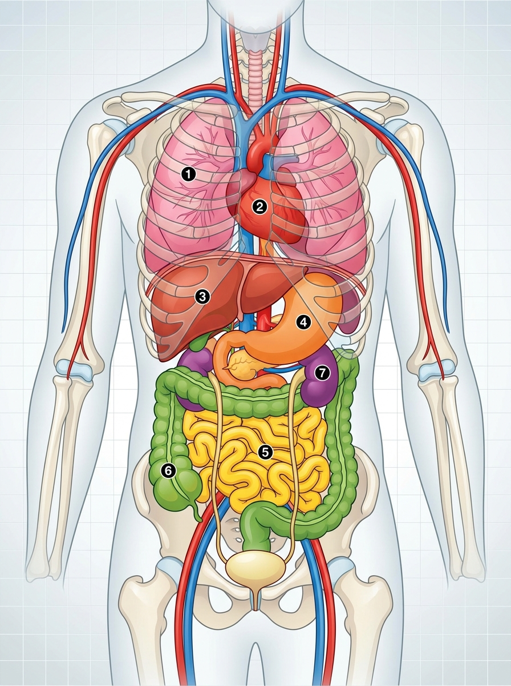

<div class="interactive-progress-tracker" style="background:var(--bg-card); border:1px solid var(--border); border-radius:8px; padding:16px; margin:20px 0;">
  <div style="display:flex; justify-content:space-between; align-items:center;">
    <span style="font-weight:700; color:var(--text-color);">⚡ Progrés d'aprenentatge (2.1)</span>
    <span class="tracker-count" style="font-weight:700; color:#2563eb;">0 / 3 reptes resolts</span>
  </div>
  <div style="background:#e2e8f0; border-radius:999px; height:8px; overflow:hidden; margin-top:10px;">
    <div class="tracker-fill" style="background:#2563eb; width:0%; height:100%; transition:width 0.3s ease;"></div>
  </div>
</div>

# 2.1 Els Nivells d'Organització de la Matèria

Tota la matèria que existeix a l'univers, tant la que no té vida (una barra d'acer al taller, l'aigua d'un riu o una roca volcànica) com la que forma els éssers vius (un bacteri microscòpic, una olivera centenària o un alumne a classe), està estructurada en **graus de complexitat creixent**. 

Aquest concepte s'anomena **jerarquia biològica**: cada nivell s'alça sobre l'anterior incorporant noves característiques i capacitats funcionals que els components aïllats per si mateixos mai podrien tindre. Per exemple, un àtom de carboni o una molècula d'aigua no estan vius, però quan milers de milions d'ells s'organitzen amb precisió extrema formen una **cèl·lula viva**.

---

## 1. L'Escala Jeràrquica: D'allò Subatòmic a la Biosfera

Per a estudiar la naturalesa amb claredat, dividim l'escala d'organització en dos dominis fonamentals:
1. **Nivells Abiòtics (Inerts):** No tenen vida pròpia. Els trobem tant en el món mineral inorgànic com formant part dels cossos vius.
2. **Nivells Biòtics (Vius):** Comencen estrictament a partir del nivell cel·lular, ja que la cèl·lula és l'estructura més menuda capaç de nodrir-se, relacionar-se i reproduir-se de forma autònoma.

<div class="science-figure" style="text-align: center; margin: 24px 0;">
  
  <p style="font-size: 0.9rem; color: var(--text-muted); margin-top: 8px;"><em>Figura 2.1: Integració dels nivells d'organització en el cos humà</em></p>
</div>

```mermaid
flowchart TD
  subgraph NIVELLS ABIÒTICS (Sense vida pròpia)
    A["1. Subatòmic
(Protons, neutrons, electrons)"] --> B["2. Atòmic
(Bioelements: C, H, O, N, P, S)"]
    B --> C["3. Molecular
(Biomolècules inorgàniques i orgàniques)"]
  end
  subgraph NIVELLS BIÒTICS (Estructures amb vida)
    C --> D["4. Cel·lular ⭐
(La unitat bàsica de la vida)"]
    D --> E["5. Tissular (Teixits)
(Conjunt de cèl·lules similars especialitzades)"]
    E --> F["6. Òrgans
(Unió de teixits coordinats: cor, fetge)"]
    F --> G["7. Aparells i Sistemes
(Equips d'òrgans: digestiu, circulatori)"]
    G --> H["8. Organisme (Individu)
(L'ésser humà integrat)"]
    H --> I["9. Població i Ecosistema
(Comunitats i medi ambient)"]
    I --> J["10. Biosfera
(La pell viva del planeta Terra)"]
  end
```

---

## 2. Els Nivells Abiòtics: Les Peces Fonamentals de la Matèria

### 1. Nivell Subatòmic
És l'esglaó més menut de la matèria coneguda. Comprèn les partícules elementals que formen els àtoms:
- **Protons ($p^+$):** Partícules amb càrrega elèctrica positiva, situades al nucli atòmic.
- **Neutrons ($n^0$):** Partícules sense càrrega elèctrica (neutres), que aporten estabilitat al nucli.
- **Electrons ($e^-$):** Partícules molt lleugeres amb càrrega negativa, que orbiten a gran velocitat al voltant del nucli formant l'escorça electrònica. Els enllaços químics entre àtoms es produeixen compartint o transferint aquests electrons.

### 2. Nivell Atòmic: Els Bioelements
Dels 118 elements químics de la taula periòdica, uns 70 formen part dels éssers vius, i reben el nom de **bioelements**:
- **Bioelements primaris (més del 96% de la massa d'un ésser viu):**
  - **Carboni ($	ext{C}$):** L'element rei de la vida. Gràcies a la seua capacitat de formar fins a **4 enllaços covalents estables**, pot construir cadenes llargues lineals, ramificades i anells que serveixen d'esquelet a totes les molècules biològiques.
  - **Hidrogen ($	ext{H}$) i Oxigen ($	ext{O}$):** Molt abundants en formar l'aigua i participar en les reaccions d'obtenció d'energia cel·lular.
  - **Nitrogen ($	ext{N}$):** Component fonamental dels aminoàcids (que formen les proteïnes) i de les bases nitrogenades de l'ADN.
  - **Fòsfor ($	ext{P}$):** Present als àcids nucleics, les membranes cel·lulars (fosfolípids) i la molècula d'energia $	ext{ATP}$.
  - **Sofre ($	ext{S}$):** Dona estabilitat a l'estructura tridimensional de les proteïnes mitjançant ponts disulfur.
- **Bioelements secundaris (al voltant del 3-4%):** Calci ($	ext{Ca}$, ossos, dents i contracció muscular), Sodi ($	ext{Na}$) i Potassi ($	ext{K}$, transmissió de l'impuls nerviós), Clor ($	ext{Cl}$) i Magnesi ($	ext{Mg}$).
- **Oligoelements (menys del 0,1%, però indispensables):** El ferro ($	ext{Fe}$, sense el qual no podem transportar oxigen a la sang), el iode ($	ext{I}$, necessari per a les hormones del tiroide) o el fluor ($	ext{F}$, per a l'esmalt dental).

### 3. Nivell Molecular: Les Biomolècules
Quan dos o més àtoms s'uneixen mitjançant enllaços químics, formen **molècules**. En els éssers vius distingim:
- **Biomolècules inorgàniques (presents també en el món inert):**
  - **Aigua ($	ext{H}_2	ext{O}$):** Representa entre el **65% i el 75%** del pes corporal humà (i més del 90% en un nadó o en una medusa). És el medi on tenen lloc totes les reaccions químiques, transporta nutrients i desfeta, lubrica les articulacions i regula la temperatura corporal mitjançant la suor.
  - **Sals minerals ($	ext{NaCl}, 	ext{CaCO}_3$):** Poden estar en forma sòlida precipitada (formant els ossos i les dents) o dissoltes en ions ($	ext{Na}^+, 	ext{K}^+, 	ext{Ca}^{2+}, 	ext{Cl}^-$) regulant la pressió osmòtica i la transmissió elèctrica dels nervis.
- **Biomolècules orgàniques (exclusives dels éssers vius, amb esquelet de carboni):**
  - **Glúcids (hidrats de carboni o sucres):** Proporcionen **energia immediata** a les cèl·lules. Exemples: la glucosa (el combustible directe de les cèl·lules) i el glicogen (reserva d'energia al fetge i músculs).
  - **Lípids (greixos i olis):** Són molècules insolubles en aigua. Actuen com a **reserva energètica a llarg termini** (triglicèrids al teixit adipós), formen les membranes cel·lulars (fosfolípids) i actuen com a aïllant tèrmic contra el fred.
  - **Proteïnes:** Cadenes llargues d'aminoàcids. Són les màquines de treball del cos: formen estructures (col·lagen a la pell i tendons, queratina als cabells), transporten oxigen (hemoglobina), defensen l'organisme (anticossos) o acceleren les reaccions químiques (**enzims** digestius).
  - **Àcids nucleics ($	ext{ADN}$ i $	ext{ARN}$):** Emmagatzemen i transmeten la informació genètica necessària per a fabricar totes les proteïnes i coordinar el funcionament del cos.

---

## 3. Els Nivells Biòtics: La Vida en Acció

* **4. Nivell Cel·lular:** La **cèl·lula** és la primera frontera viva. És l'estructura ordenada més menuda que realitza autònomament la nutrició, la relació i la reproducció. Un sol bacteri és una cèl·lula completa capaç de sobreviure i multiplicar-se.
* **5. Nivell Tissular (Teixits):** En els éssers pluricel·lulars, les cèl·lules no treballen solitàries. S'especialitzen i s'agrupen en teixits (com el teixit muscular per a generar força mecànica o el teixit ossi per a suportar el pes).
* **6. Nivell d'Òrgans:** Agrupació estructurada de diversos teixits que actuen coordinadament per a realitzar una tasca concreta. Per exemple, el **cor** conté teixit muscular cardíac (per a bategar), teixit epitelial intern o endocardi (perquè la sang llisque sense fricció), teixit connectiu (vàlvules) i teixit nerviós (que regula el ritme dels batecs).
* **7. Nivell d'Aparells i Sistemes:** Conjunt d'òrgans coordinats que desenvolupen una funció biològica complexa:
  - **Sistema:** Format per òrgans constituïts pel mateix tipus de teixit (sistema muscular, sistema ossi, sistema nerviós).
  - **Aparell:** Format per òrgans molt diferents morfològicament que cooperen per a un fi comú (aparell digestiu, aparell respiratori, aparell excretor).
* **8. Nivell d'Organisme (Individu):** L'ésser viu complet integrat per tots els seus aparells i sistemes funcionant harmònicament (un tècnic de taller, un gos, un taronger).
* **9. Nivells Ecològics:** 
  - **Població:** Conjunt d'individus de la mateixa espècie que comparteixen un mateix hàbitat (tots els conills d'una serra).
  - **Comunitat i Ecosistema:** Conjunt d'éssers vius de diferents espècies que conviuen i interactuen amb el medi físic (sòl, clima, aigua, llum).
  - **Biosfera:** El conjunt de tots els ecosistemes del planeta Terra, des del fons marí fins a la troposfera.

---

> [!TIP]
> ### 🔍 Connexió amb el Taller i la Salut: Per què cal menjar ferro?
> Si a un operari li falta un sol oligoelement a la dieta, com el **ferro ($	ext{Fe}$)**, no pot sintetitzar suficients molècules d'hemoglobina (nivell molecular). Com a conseqüència, els seus glòbuls vermells (nivell cel·lular) transportaran menys oxigen. Els músculs (nivell tissular) no rebran prou energia, i l'organisme sencer patirà **anèmia**, cansament crònic, marejos i baix rendiment al lloc de treball. Una fallada en el nivell atòmic col·lapsa l'individu sencer!

---

> [!NOTE]
> ### 💡 Resum de Conceptes Clau
> - La matèria s'ordena jeràrquicament: cada nivell emergent té propietats superiors a la suma de les seues parts.
> - Els bioelements primaris ($	ext{C}, 	ext{H}, 	ext{O}, 	ext{N}, 	ext{P}, 	ext{S}$) formen més del 96% de la massa viva gràcies a la versatilitat dels 4 enllaços del carboni.
> - Les biomolècules es divideixen en inorgàniques (aigua i sals) i orgàniques (glúcids, lípids, proteïnes i àcids nucleics).
> - La cèl·lula és la frontera biològica: per sota no hi ha vida autònoma; per damunt, la cooperació cel·lular construeix teixits, òrgans i organismes.

---

## 🎯 Activitats i Autoavaluació Interactiva

<div class="interactive-progress-tracker">
  <div class="tracker-header">
    <span>🎮 <strong>Zona d'Entrenament FPB:</strong> <span class="tracker-count">0 reptes resolts</span></span>
    <span class="tracker-pts">⭐ 0 punts</span>
  </div>
  <div class="tracker-bar"><div class="tracker-fill" style="width: 0%;"></div></div>
</div>

### 1. Qüestionari d'Autoavaluació Tipus Test (MCQ)

<div class="interactive-mcq" data-quiz-id="ca1_u2_1_mcq1" data-answer="A" data-hint="La cèl·lula és la unitat estructural i funcional mínima amb les tres funcions vitals autònomes.">
  <p class="mcq-question"><strong>1. A quin nivell d'organització de la matèria s'inicia pròpiament la vida segons la biologia moderna?</strong></p>
  <div class="mcq-options">
    <button type="button" class="btn-mcq-opt" data-opt="A">A) Al nivell cel·lular (la cèl·lula és la unitat mínima capaç de fer nutrició, relació i reproducció)</button>
    <button type="button" class="btn-mcq-opt" data-opt="B">B) Al nivell atòmic (els àtoms individuals com el carboni estan vius)</button>
    <button type="button" class="btn-mcq-opt" data-opt="C">C) Al nivell molecular (l'aigua i les proteïnes tenen vida pròpia)</button>
    <button type="button" class="btn-mcq-opt" data-opt="D">D) Únicament al nivell d'organisme complet</button>
  </div>
  <div class="quiz-feedback"></div>
</div>

<div class="interactive-mcq" data-quiz-id="ca1_u2_1_mcq2" data-answer="C" data-hint="Són els sis bioelements primaris essencials que formen glúcids, lípids, proteïnes i àcids nucleics.">
  <p class="mcq-question"><strong>2. Quins són els sis elements químics (bioelements primaris) que formen més del 95% de la massa d'un ésser viu?</strong></p>
  <div class="mcq-options">
    <button type="button" class="btn-mcq-opt" data-opt="A">A) Ferro, Coure, Plom, Mercuri, Sodi i Clor</button>
    <button type="button" class="btn-mcq-opt" data-opt="B">B) Heli, Neó, Argó, Kriptó, Xenó i Radó</button>
    <button type="button" class="btn-mcq-opt" data-opt="C">C) Carboni, Hidrogen, Oxigen, Nitrogen, Fòsfor i Sofre (CHONPS)</button>
    <button type="button" class="btn-mcq-opt" data-opt="D">D) Aigua, Glucosa, Calci, Magnesi i Vitamines</button>
  </div>
  <div class="quiz-feedback"></div>
</div>

---

### 2. Activitats de Vertader (V) o Fals (F)

<div class="interactive-vf" data-quiz-id="ca1_u2_1_vf1" data-answer="F" data-hint="FALS: L'aigua és una biomolècula abiòtica essencial, però no és un ésser viu per si mateixa; necessita integrar-se en una cèl·lula viva.">
  <span class="vf-statement"><strong>a) Una molècula d'aigua pura ($	ext{H}_2	ext{O}$) té vida pròpia perquè és capaç de reproduir-se i nodrir-se fora de la cèl·lula.</strong></span>
  <div class="vf-buttons">
    <button type="button" class="btn-vf" data-opt="V">V</button>
    <button type="button" class="btn-vf" data-opt="F">F</button>
  </div>
  <div class="quiz-feedback"></div>
</div>

<div class="interactive-vf" data-quiz-id="ca1_u2_1_vf2" data-answer="V" data-hint="VERTADER: Els òrgans estan constituïts per la cooperació de diversos tipus de teixits cel·lulars (per exemple l'estómac conté teixit epitelial, muscular, connectiu i nerviós).">
  <span class="vf-statement"><strong>b) Un òrgan com el cor o l'estómac està format per la cooperació de diversos teixits cel·lulars diferents.</strong></span>
  <div class="vf-buttons">
    <button type="button" class="btn-vf" data-opt="V">V</button>
    <button type="button" class="btn-vf" data-opt="F">F</button>
  </div>
  <div class="quiz-feedback"></div>
</div>

---

### 3. Exercicis de Resposta Breu i Vocabulari Tècnic

<div class="interactive-quiz" data-quiz-id="ca1_u2_1_q1" data-answer="bioelements|bioelement" data-hint="Són els elements de la taula periòdica presents a la matèria viva.">
  <div class="quiz-question">✍️ Com s'anomenen genèricament els elements químics que formen part de la matèria viva?</div>
  <div class="quiz-controls">
    <input type="text" class="quiz-input" placeholder="Escriu el terme científic...">
    <button type="button" class="btn-quiz-check">Comprovar</button>
  </div>
  <div class="quiz-feedback"></div>
</div>

<div class="interactive-quiz" data-quiz-id="ca1_u2_1_q2" data-answer="aparell|sistema|aparells|sistemes" data-hint="Exemples: digestiu, respiratori, circulatori.">
  <div class="quiz-question">✍️ Quin nivell d'organització immediatament superior als òrgans està format per un conjunt d'òrgans coordinats per a una funció complexa?</div>
  <div class="quiz-controls">
    <input type="text" class="quiz-input" placeholder="Escriu el nivell...">
    <button type="button" class="btn-quiz-check">Comprovar</button>
  </div>
  <div class="quiz-feedback"></div>
</div>

---

### 4. Pregunta de Raonament i Desenvolupament Escrit

<div class="interactive-open-response" data-question-id="ca1_u2_1_open1">
  <div class="open-question">✍️ <strong>L'escala biològica al cos humà:</strong> Tria un exemple real d'òrgan humà (com el cor, el pulmó o l'estómac). Descriu de manera seqüencial com està estructurat des dels àtoms fins a arribar a l'organisme sencer, passant per molècules, cèl·lules, teixits i aparell.</div>
  <textarea class="open-response-input" rows="4" placeholder="Exemple: Els àtoms de carboni i oxigen formen biomolècules com les proteïnes; aquestes formen cèl·lules musculars..."></textarea>
</div>

---

<div class="aules-delivery-card" style="border:2px dashed #0284c7; border-radius:8px; padding:16px; background:#f0f9ff; margin:24px 0;">
  <h3 style="margin-top:0; color:#0369a1;">📦 Lliurament d'Activitats d'Aules (Act 2.1)</h3>
  <p>Genera el teu document de tasca d'aquest apartat amb el teu nom i puntuació obtinguda.</p>
  <div style="display:flex; gap:12px; align-items:center; flex-wrap:wrap;">
    <input type="text" class="aules-student-name" placeholder="Cognoms, Nom de l'Alumne/a" style="padding:8px 12px; border:1px solid #94a3b8; border-radius:4px; flex-grow:1; min-width:240px;">
    <button class="btn-generate-aules-pdf" data-unit="UD02" data-activity="Act01" data-module="CA" style="padding:8px 16px; background:#0284c7; color:#fff; border:none; border-radius:4px; font-weight:600; cursor:pointer;">📄 Descarregar PDF per a Aules</button>
  </div>
</div>
