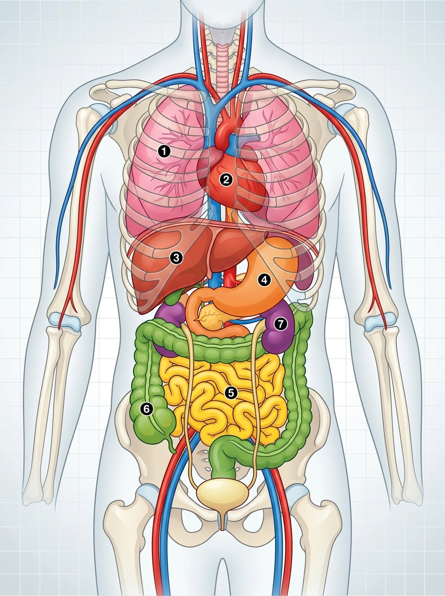

  

    ⚡ Progrés d'aprenentatge (2.1)
    0 / 3 reptes resolts
  

  

    

  

# 2.1 Nivells d'Organització de la Matèria, la Cèl·lula i els Teixits

La matèria que forma el nostre univers i tots els éssers vius està organitzada en diferents **graus de complexitat creixent**, des de les partícules elementals fins a tot el planeta Terra.

---

## 1. Els Nivells d'Organització de la Matèria

Podem dividir els nivells d'organització en dos grans blocs: **nivells abiòtics** (sense vida pròpia) i **nivells biòtics** (a partir dels quals comença la vida).

  
  
<em>Figura 2.1: Nivells d'organització biològica i integració dels principals sistemes del cos humà</em>

### Nivells Abiòtics (Inerts)
1. **Nivell Subatòmic:** Format per les partícules elementals que constitueixen l'àtom: protons, neutrons i electrons.
2. **Nivell Atòmic:** Els àtoms dels diferents elements químics (bioelements essencials com el carboni $\text{C}$, hidrogen $\text{H}$, oxigen $\text{O}$, nitrogen $\text{N}$, fòsfor $\text{P}$ i sofre $\text{S}$).
3. **Nivell Molecular:** Unió d'àtoms mitjançant enllaços químics per a formar biomolècules:
   - **Inorgàniques:** Aigua ($\text{H}_2\text{O}$) i sals minerals.
   - **Orgàniques:** Glúcids (sucres), lípids (greixos), proteïnes i àcids nucleics (ADN i ARN).

### Nivells Biòtics (Vius)
4. **Nivell Cel·lular:** La cèl·lula és el primer nivell amb vida pròpia capaç de realitzar les tres funcions vitals (nutrició, relació i reproducció).
5. **Nivell Tissular (Teixits):** Conjunt de cèl·lules similars especialitzades que col·laboren en una funció comuna (per exemple, el teixit muscular o ossi).
6. **Òrgans:** Unió de diferents teixits coordinats per fer una acció concreta (cor, estómac, ronyó).
7. **Aparells i Sistemes:** Conjunt d'òrgans coordinats que realitzen una funció complexa (aparell digestiu, sistema nerviós).
8. **Organisme (Individu):** L'ésser viu complet integrat (un ésser humà, un gos, un arbre).
9. **Població, Comunitat, Ecosistema i Biosfera:** Nivells ecològics que agrupen individus de la mateixa espècie, comunitats biològiques i la totalitat de la vida a la Terra.

---

## 2. La Cèl·lula: El Descobriment i la Teoria Cel·lular

La **cèl·lula** és la unitat morfològica, estructural i funcional de tots els éssers vius. És l'estructura ordenada i viva més menuda que es coneix. La gran majoria són microscòpiques, encara que algunes (com l'òvul humà) poden observar-se quasi a simple vista.

### Història del Descobriment
- A principis del segle XVII es van desenvolupar les primeres lents d'augment i microscopis.
- En **1664**, el científic anglès **Robert Hooke** va observar amb un microscopi primitiu un tall fi de suro. Va apreciar una estructura en forma de bresca d'abella formada per petites cambretes buides a les quals va anomenar **cel·les o cèl·lules** (*cellulae*).
- Anys més tard, **Antoni van Leeuwenhoek** va perfeccionar les lents i va ser el primer a observar microorganismes vius en una gota d'aigua ("animàlculs") i cèl·lules sanguínies.

> [!IMPORTANT]
> ### Els Tres Principis de la Teoria Cel·lular
> A mitjan segle XIX, els científics Matthias Schleiden, Theodor Schwann i Rudolf Virchow van establir la **Teoria Cel·lular moderna**:
> 1. **Unitat estructural:** Tots els éssers vius estan formats per una o més cèl·lules.
> 2. **Unitat funcional:** La cèl·lula és la unitat fisiològica mínima capaç de realitzar les funcions vitals.
> 3. **Unitat d'origen:** Tota cèl·lula prové necessàriament de la divisió d'una altra cèl·lula preexistent (*omnis cellula e cellula*).

---

## 3. Classificació Cel·lular: Procariotes vs Eucariotes

Segons si el material genètic està aïllat per una membrana nuclear o no, distingim dos grans tipus cel·lulars:

| Característica | Cèl·lula Procariota | Cèl·lula Eucariota |
| :--- | :--- | :--- |
| **Nucli diferenciat** | **No en té** (sense membrana nuclear). | **Sí en té** (amb membrana nuclear que protegeix l'ADN). |
| **Localització de l'ADN** | Dispers pel citoplasma en una regió anomenada nucleoide. | Tancat i protegit dins del nucli cel·lular. |
| **Complexitat i orgànuls** | Molt senzilla; té ribosomes però manca d'orgànuls membranosos. | Molt complexa; té múltiples orgànuls membranosos especialitzats. |
| **Mida aproximada** | Petita ($0{,}5 - 5\,\mu\text{m}$). | Gran ($10 - 100\,\mu\text{m}$). |
| **Organismes** | Unicel·lulars: **Bacteris** i **Arquees**. | Unicel·lulars o pluricel·lulars: **Animals, plantes, fongs i protoctists**. |

### Els Bacteris: Microorganismes Essencials
Els bacteris són els éssers vius més abundants del planeta. Menys de l'**1%** dels bacteris existents són perjudicials per als humans causant malalties. La immensa majoria són beneficiosos i indispensables:
- **Flora intestinal:** Bacteris com *Lactobacillus* i *Bifidobacterium* ajuden a la digestió, síntesi de vitamines (B i K) i frenen el creixement de bacteris patògens (*Escherichia coli*, *Salmonella*).
- **Reciclatge d'elements i fixació del nitrogen:** L'atmosfera té un $78\%$ de nitrogen gasós ($\text{N}_2$), però plantes i animals no podem respirar-lo directament per sintetitzar proteïnes i ADN. Els bacteris del sòl el "fixen" en sals minerals que les plantes absorbeixen per les arrels.

---

## 4. Cèl·lules Animals vs Cèl·lules Vegetals

Les dues són eucariotes, però presenten adaptacions i orgànuls exclusius segons el seu estil de vida:

| Estructura / Orgànul | Cèl·lula Animal | Cèl·lula Vegetal | Funció principal |
| :--- | :---: | :---: | :--- |
| **Membrana plasmàtica** | Sí | Sí | Barrera selectiva que regula l'entrada de nutrients i eixida de deixalles. |
| **Paret cel·lular** | **No** | **Sí** (de cel·lulosa) | Capa rígida externa que dóna protecció, resistència i forma prismàtica. |
| **Nucli** | Sí | Sí | Conté l'ADN i coordina tota l'activitat de la cèl·lula. |
| **Citoplasma** | Sí | Sí | Medi aquós intern on suren els orgànuls cel·lulars. |
| **Mitocondris** | Sí | Sí | Centrals energètiques: fan la respiració cel·lular per produir energia (ATP). |
| **Cloroplasts** | **No** | **Sí** (amb clorofil·la) | Realitzen la **fotosíntesi**, captant la llum solar per crear matèria orgànica. |
| **Vacúols** | Menuts i escassos | Un gran vacúol central | Emmagatzema aigua, sals minerals i substàncies de reserva. |
| **Centríols** | Sí | No | Participen en la divisió cel·lular i formació del fus mitòtic. |

---

## 5. Formes Acel·lulars: Els Virus i les Vacunes

Els **virus** (terme llatí que significa "verí" o "toxina") són estructures microscòpiques que se situen en la frontera del que considerem viu. 

  

    🦠 Anatomia Funcional d'un Virus
  

  

    

      <strong style="color:#6d28d9;">1. Càpside / Envoltura:</strong> 
      Capa externa de proteïnes que protegeix el material genètic i li dóna forma geomètrica.
    

    

      <strong style="color:#6d28d9;">2. Genoma Víric:</strong> 
      Àcid nucleic que conté les instruccions (ADN o ARN, mai tots dos alhora).
    

    

      <strong style="color:#6d28d9;">3. Espícules d'Adhesió:</strong> 
      Glicoproteïnes que actuen com a claus per reconèixer i infectar la cèl·lula hoste.
    

  

> [!WARNING]
> ### Per què els virus no són cèl·lules ni es consideren éssers vius complets?
> - **Són acel·lulars:** No tenen membrana plasmàtica, ni citoplasma, ni orgànuls, ni metabolisme propi.
> - **Paràsits intracel·lulars obligats:** Fora d'una cèl·lula hoste són partícules inerts anomenades **virions**.
> - **No es poden reproduir per ells mateixos:** Necessiten injectar el seu material genètic en una cèl·lula hoste i "segrestar" la maquinària d'aquesta per produir nous virus, destruint sovint la cèl·lula.

### Les Vacunes i la Immunitat
Per a combatre les infeccions víriques no serveixen els antibiòtics (que només maten bacteris). L'eina fonamental de prevenció són les **vacunes**:
1. **Com funcionen:** S'introdueix en el cos un fragment inofensiu del virus o un patogen atenuat/inactivat.
2. **Reconeixement immunitari:** El nostre sistema immunitari (glòbuls blancs i limfòcits) detecta les proteïnes de l'invasor i fabrica **anticossos** específics.
3. **Memòria immunitària:** Quan el patogen real intenta infectar-nos, les nostres defenses el reconeixen ràpidament i el destrueixen abans que desenvolupe la malaltia.
4. **Història:** La primera vacuna la va desenvolupar **Edward Jenner** a finals del segle XVIII contra la verola, salvant centenars de milions de vides.

---

## 6. Els Teixits en el Cos Humà

En els organismes pluricel·lulars, les cèl·lules s'especialitzen i s'associen formant **teixits**. En el cos humà es distingeixen 4 tipus principals de teixits:

1. **Teixit Epitelial:** 
   - **Funció:** Cobreix les superfícies externes del cos (epidermis de la pell) i recobreix les cavitats internes (epiteli de l'estómac, vies respiratòries). 
   - També forma les glàndules secretores (teixit glandular).
2. **Teixit Connectiu (o Conjuntiu):**
   - **Funció:** Uneix, sosté i protegeix els altres teixits.
   - **Varietats:** Teixit ossi (ossos), teixit cartilaginós (cartílags), teixit adipós (greix de reserva i aïllant) i teixit sanguini (la sang).
3. **Teixit Muscular:**
   - **Funció:** Format per cèl·lules allargades (fibres musculars) capaces de contraure's per generar moviment i força.
   - **Tipus:** Múscul esquelètic (voluntari, unit als ossos), múscul cardíac (involuntari, al cor) i múscul llis (involuntari, a les parets del tub digestiu i vasos sanguinis).
4. **Teixit Nerviós:**
   - **Funció:** Captar estímuls sensorials, transmetre impulsos elèctrics i coordinar la resposta de l'organisme.
   - **Cèl·lules:** Neurones (transmissió de l'impuls nerviós) i cèl·lules de la glia (suport, nutrició i protecció de les neurones).

---

## 💡 Resum de Conceptes Clau

- La matèria s'organitza des del nivell subatòmic fins a la biosfera; la vida comença en el **nivell cel·lular**.
- La cèl·lula és la unitat estructural, funcional i d'origen de tot ésser viu (**Teoria Cel·lular**).
- Les **procariotes** no tenen nucli diferenciat (bacteris); les **eucariotes** tenen nucli amb membrana (animals i vegetals).
- Les **cèl·lules vegetals** tenen paret cel·lular i cloroplasts per fer la fotosíntesi; les **animals** no en tenen.
- Els **virus** són estructures acel·lulars paràsites que es combaten eficaçment amb la prevenció mitjançant **vacunes**.
- Els **teixits** humans principals són l'epitelial, connectiu, muscular i nerviós.

## 🎯 Activitats i Autoavaluació Interactiva

  

    🎮 <strong>Zona d'Entrenament FPB:</strong> 0 reptes resolts
    ⭐ 0 punts
  

  

### 1. Qüestionari d'Autoavaluació Tipus Test (MCQ)

  
<strong>1. A quin nivell d'organització de la matèria s'inicia pròpiament la vida segons la teoria cel·lular?</strong>

  

    <button type="button" class="btn-mcq-opt" data-opt="A">A) Al nivell cel·lular (la cèl·lula és la unitat bàsica amb vida)</button>
    <button type="button" class="btn-mcq-opt" data-opt="B">B) Al nivell atòmic (bioelements primaris)</button>
    <button type="button" class="btn-mcq-opt" data-opt="C">C) Al nivell molecular (biomolecules com l'aigua i lípids)</button>
    <button type="button" class="btn-mcq-opt" data-opt="D">D) Al nivell d'òrgans</button>
  

  

  
<strong>2. Quina característica fonamental distingeix una cèl·lula procariota d'una cèl·lula eucariota?</strong>

  

    <button type="button" class="btn-mcq-opt" data-opt="A">A) Les cèl·lules procariotes tenen nucli i mitocondris molt desenvolupats</button>
    <button type="button" class="btn-mcq-opt" data-opt="B">B) Les cèl·lules procariotes no tenen nucli diferenciat ni orgànuls membranosos</button>
    <button type="button" class="btn-mcq-opt" data-opt="C">C) Les procariotes són sempre pluricel·lulars</button>
    <button type="button" class="btn-mcq-opt" data-opt="D">D) Les cèl·lules eucariotes no tenen material genètic (ADN)</button>
  

  

---

### 2. Activitats de Vertader (V) o Fals (F)

  <strong>a) Els mitocondris són els orgànuls cel·lulars encarregats de generar energia química (respiració cel·lular).</strong>
  

    <button type="button" class="btn-vf" data-opt="V">V</button>
    <button type="button" class="btn-vf" data-opt="F">F</button>
  

  

  <strong>b) Els virus són cèl·lules eucariotes gegants amb capacitat de reproduir-se per si mateixes sense hoste.</strong>
  

    <button type="button" class="btn-vf" data-opt="V">V</button>
    <button type="button" class="btn-vf" data-opt="F">F</button>
  

  

---

### 3. Exercicis de Resposta Breu i Identificació

  
✍️ Quin orgànul exclusiu de les cèl·lules vegetals permet dur a terme la fotosíntesi?

  

    <input type="text" class="quiz-input" placeholder="El teu resultat...">
    <button type="button" class="btn-quiz-check">Comprovar</button>
  

  

  
✍️ Quin teixit humà té la funció de revestiment i protecció de superfícies i secreció de substàncies?

  

    <input type="text" class="quiz-input" placeholder="El teu resultat...">
    <button type="button" class="btn-quiz-check">Comprovar</button>
  

  

---

### 4. Pregunta de Raonament i Desenvolupament Escrit

  
✍️ <strong>Cèl·lula Animal vs Vegetal al Taller de Ciències:</strong> Esmenta dues estructures que estiguen presents a la cèl·lula vegetal però absents a l'animal, i explica quina utilitat tenen per a la supervivència de les plantes.

  <textarea class="open-response-input" rows="3" placeholder="Escriu ací la teua resposta (p. ex., paret cel·lular, cloroplasts, vacúols...)..."></textarea>

---

  <h3 style="margin-top:0; color:#0369a1;">📦 Lliurament d'Activitats d'Aules (Act 2.1)</h3>
  
Genera el teu document de tasca d'aquest apartat amb el teu nom i puntuació obtinguda.

  

    <input type="text" class="aules-student-name" placeholder="Cognoms, Nom de l'Alumne/a" style="padding:8px 12px; border:1px solid #94a3b8; border-radius:4px; flex-grow:1; min-width:240px;">
    <button class="btn-generate-aules-pdf" data-unit="UD02" data-activity="Act01" data-module="CA" style="padding:8px 16px; background:#0284c7; color:#fff; border:none; border-radius:4px; font-weight:600; cursor:pointer;">📄 Descarregar PDF per a Aules</button>
  

