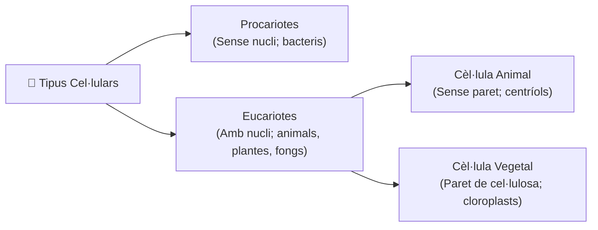

  

    ⚡ Progrés d'aprenentatge (2.2)
    0 / 3 reptes resolts
  

  

    

  

# 2.2 La Cèl·lula i la Teoria Cel·lular: Procariotes i Eucariotes

La **cèl·lula** és la unitat bàsica morfològica, funcional i genètica de tots els éssers vius. És l'estructura ordenada més menuda que reuneix totes les propietats de la vida: s'alimenta incorporant nutrients de l'exterior (**nutrició**), respon a estímuls del medi físic o químic (**relació**) i és capaç de generar còpies idèntiques de si mateixa dividint-se (**reproducció**).

---

## 1. El Descobriment Històric de la Cèl·lula

Durant milers d'anys, la humanitat va ignorar per complet l'existència de les cèl·lules perquè la majoria mesuren entre 1 i 100 micròmetres ($1\,\mu	ext{m} = 0{,}001	ext{ mm}$), totalment invisibles a l'ull nu.

* **Robert Hooke (1665):** Aquest científic anglès va polir lents per construir un dels primers microscopis compostos. En tallar una làmina fina de suro d'una surera, va observar una xarxa geomètrica de petites cavitats buides semblants a les cel·les d'un rusc d'abelles. Va batejar cadascuna d'aquelles cambretes com a **cèl·lula** (*cellulae*, petita cel·la). Allò que Hooke veia eren en realitat les parets cel·lulars buides de cèl·lules vegetals mortes.
* **Anton van Leeuwenhoek (1674):** Comerciant de teixits holandès que fabricava lents simples de gran augment. Va ser la primera persona a observar cèl·lules **vives en moviment**: microorganismes en aigua estancada ("animàlculs", avui anomenats bacteris i protozous), espermatozoides humans i glòbuls vermells a la sang.

> [!IMPORTANT]
> ### Els Tres Postulats Fonamentals de la Teoria Cel·lular
> A mitjan segle XIX, els científics Matthias Schleiden (botànic), Theodor Schwann (zoòleg) i Rudolf Virchow (metge) van formular la **Teoria Cel·lular moderna**:
> 1. **Unitat Estructural:** Tots els éssers vius, des del bacteri més simple fins a l'ésser humà, estan constituïts per una o més cèl·lules.
> 2. **Unitat Funcional:** La cèl·lula és la unitat fisiològica mínima capaç de mantindre el metabolisme i dur a terme les funcions vitals per si mateixa.
> 3. **Unitat Genètica i d'Origen:** Tota cèl·lula viva prové necessàriament de la divisió d'una altra cèl·lula viva preexistent (*Omnis cellula e cellula*). No existeix la generació espontània.

---

## 2. Anatomia Universal de Tota Cèl·lula

Totes les cèl·lules del planeta comparteixen tres components estructurals bàsics:
1. **Membrana plasmàtica:** Fina bicapa de lípids (fosfolípids) amb proteïnes incrustades que delimita la cèl·lula. Té **permeabilitat selectiva**: decideix quines substàncies entren (nutrients, oxigen) i quines surten (toxines, diòxid de carboni).
2. **Citoplasma:** Medi intern fluid anomenat **citosol** (aigua amb sals minerals, proteïnes i sucres dissolts) on es troben suspesos els orgànuls i on es produeixen milers de reaccions químiques metabòliques.
3. **Material genètic ($	ext{ADN}$):** Àcid desoxiribonucleic que conté les instruccions en clau química per a fabricar proteïnes i coordinar tot el funcionament cel·lular.

---

## 3. Classificació Cel·lular: Procariotes vs Eucariotes

Segons la localització del seu $	ext{ADN}$ i la seua complexitat interna, distingim dos grans models cel·lulars:

| Criteri Comparatiu | Cèl·lula Procariota | Cèl·lula Eucariota |
| :--- | :--- | :--- |
| **Nucli Cel·lular** | **Absent.** L'ADN circular està lliure pel citoplasma (regió dita **nucleoide**). | **Present.** L'ADN lineal està tancat i protegit per una **doble membrana nuclear amb porus**. |
| **Mida Mitjana** | Molt menuda ($0{,}5 - 5\,\mu	ext{m}$). | Gran ($10 - 100\,\mu	ext{m}$, unes 10 vegades major). |
| **Orgànuls Interns** | Només té **ribosomes** per a sintetitzar proteïnes. | Múltiples orgànuls especialitzats delimitats per membranes. |
| **Paret Cel·lular** | Present i rígida, formada per **peptidoglicà**. | Absent en animals; present en plantes (**cel·lulosa**) i fongs (**quitina**). |
| **Organismes** | Sempre unicel·lulars: **Bacteris** i arqueobacteris. | Unicel·lulars o pluricel·lulars: **Animals, plantes, fongs i protoctists**. |

### Els Bacteris: Màquines de Supervivència
Els bacteris són els habitants més nombrosos i antics de la Terra. Poden tindre forma de bola (**cocs**), bastó (**bacils**), tirabuixó (**espirils**) o coma (**vibrions**).
- **La gran majoria són beneficiosos:** La **microbiota intestinal** humana conté més de 100 bilions de bacteris (com *Lactobacillus* i *Bifidobacterium*) que sintetitzen vitamines (B i K), digereixen fibra vegetal i bloquegen l'entrada de gèrmens dolents. A la indústria alimentària fan el iogurt, el formatge o el vinagre.
- **Bacteris patògens:** Menys de l'1% causen malalties (com el tètanus, la salmonel·losi o la pneumònia). Es tracten eficaçment amb **antibiòtics** (com l'amoxicil·lina), que trenquen la seua paret bacteriana o bloquegen els seus ribosomes sense danyar les cèl·lules humanes.

---

## 4. Orgànuls de la Cèl·lula Eucariota: Una Fàbrica en Miniatura

Dins d'una cèl·lula eucariota humana, cada orgànul actua com una secció especialitzada d'un taller industrial:
* **Nucli:** El despatx de direcció. Conté els cromosomes d'ADN i el **nuclèol** (on es fabriquen els ribosomes).
* **Mitocondris:** Les centrals elèctriques. Tenen doble membrana amb crestes internes. Realitzen la **respiració cel·lular**: cremen glucosa utilitzant oxigen per produir energia química en forma d'$	ext{ATP}$ ($	ext{Glucosa} + 	ext{O}_2 
ightarrow 	ext{CO}_2 + 	ext{H}_2	ext{O} + 	ext{ATP}$).
* **Ribosomes:** Les impressores de peces. Acoblen aminoàcids per a fabricar proteïnes seguint les ordres de l'ARN missatger.
* **Reticle Endoplasmàtic (RE):** Xarxa de sacs i canals:
  - **RE Rugós (RER):** Té ribosomes adherits; plega i transporta proteïnes.
  - **RE Llis (REL):** Sense ribosomes; sintetitza greixos (lípids) i neteja toxines (alcohol, drogues). Molt abundant al fetge.
* **Aparell de Golgi:** El magatzem d'embalatge i enviaments. Modifica, empaqueta en vesícules i envia proteïnes i lípids a l'exterior o a altres orgànuls.
* **Lisosomes:** El servei de reciclatge i neteja. Vesícules plenes d'enzims digestius àcids que degraden restes cel·lulars velles o bacteris invasors.
* **Centrosoma (amb Centríols):** Exclusiu de la cèl·lula animal. Coordina el citoesquelet intern i guia la separació dels cromosomes durant la divisió cel·lular.

---

## 5. Cèl·lula Animal vs Cèl·lula Vegetal

Les plantes són éssers autòtrofs (fabriquen el seu propi aliment amb la llum solar) i no poden moure's per fugir. Per això tenen estructures que les cèl·lules humanes no tenim:
1. **Paret cel·lular vegetal:** Coberta externa molt gruixuda i rígida de **cel·lulosa** per fora de la membrana. Dona suport mecànic a la planta (perquè els arbres es mantinguen drets sense esquelet) i evita que la cèl·lula esclate en absorbir molta aigua.
2. **Cloroplasts:** Orgànuls verds amb clorofil·la. Fan la **fotosíntesi**: utilitzen aigua, sals minerals, diòxid de carboni ($	ext{CO}_2$) i llum solar per a fabricar glucosa i alliberar oxigen pur ($	ext{O}_2$).
3. **Gran vacúol central:** Una gran bossa d'aigua que ocupa fins al 90% del volum cel·lular. Manté la cèl·lula inflada i turgent; quan la planta no té aigua, el vacúol es buida i la planta es marceix.

---

## 6. Formes Acel·lulars: El Cas dels Virus

Els **virus** (grip, refredat, SARS-CoV-2, varicel·la, VIH) **no són éssers vius ni cèl·lules**.
- No tenen citoplasma, ni orgànuls, ni membrana pròpia, ni metabolisme. Són simplement una xicoteta càpsula de proteïnes (**càpsida**) que tanca un fragment d'àcid genètic ($	ext{ADN}$ o $	ext{ARN}$).
- Són **paràsits intracel·lulars obligats**: com que no poden alimentar-se ni fabricar proteïnes per si mateixos, necessiten injectar el seu genoma dins d'una cèl·lula viva per a "segrestar" els seus ribosomes i obligar-la a fabricar milers de nous virus fins que la cèl·lula rebenta (**lisi cel·lular**).

> [!WARNING]
> ### 💊 Importantíssim per a la Salut Pública: Antibiòtics vs Virus
> Els antibiòtics actuen atacant la paret de peptidoglicà o els enzims dels bacteris. Com que els virus no tenen paret, ni ribosomes, ni metabolisme propi, **els antibiòtics no tenen cap efecte contra ells**. Prendre antibiòtics per a una grip o refredat només serveix per a destruir la nostra flora intestinal beneficiosa i generar bacteris resistents molt perillosos. Contra els virus només són efectives les **vacunes preventives** (que ensenyen al sistema immunitari a fabricar anticossos abans d'infectar-nos) i el descans amb hidratació.

---

> [!NOTE]
> ### 💡 Resum de Conceptes Clau
> - La cèl·lula és la unitat morfològica, funcional i d'origen de la vida.
> - Procariotes (bacteris): sense nucli, ADN lliure, molt menudes i sense orgànuls membranosos.
> - Eucariotes (animals i plantes): amb nucli diferenciat que protegeix l'ADN i múltiples orgànuls especialitzats.
> - La cèl·lula vegetal té paret de cel·lulosa, cloroplasts fotosintètics i gran vacúol central.
> - Els virus no són cèl·lules; són paràsits genètics que no es curen amb antibiòtics.

---

## 🎯 Activitats i Autoavaluació Interactiva

  

    🎮 <strong>Zona d'Entrenament FPB:</strong> 0 reptes resolts
    ⭐ 0 punts
  

  

### 1. Qüestionari d'Autoavaluació Tipus Test (MCQ)

  
<strong>1. Quina diferència estructural bàsica permet classificar un bacteri com a procariota en lloc d'eucariota?</strong>

  

    <button type="button" class="btn-mcq-opt" data-opt="A">A) Que el bacteri té un nucli gegant i molts mitocondris</button>
    <button type="button" class="btn-mcq-opt" data-opt="B">B) Que no té una membrana nuclear que envolte i aïlle el seu ADN</button>
    <button type="button" class="btn-mcq-opt" data-opt="C">C) Que els bacteris són pluricel·lulars i tenen teixits musculars</button>
    <button type="button" class="btn-mcq-opt" data-opt="D">D) Que la cèl·lula procariota no té membrana plasmàtica externa</button>
  

  

  
<strong>2. Quin d'aquests elements és exclusiu de la cèl·lula vegetal i no es troba mai en una cèl·lula animal?</strong>

  

    <button type="button" class="btn-mcq-opt" data-opt="A">A) Els mitocondris energètics</button>
    <button type="button" class="btn-mcq-opt" data-opt="B">B) La membrana plasmàtica</button>
    <button type="button" class="btn-mcq-opt" data-opt="C">C) El nucli cel·lular amb ADN</button>
    <button type="button" class="btn-mcq-opt" data-opt="D">D) Els cloroplasts amb clorofil·la i la paret de cel·lulosa</button>
  

  

---

### 2. Activitats de Vertader (V) o Fals (F)

  <strong>a) Si tens la grip o un refredat causat per un virus, prendre antibiòtics sense recepta és el tractament mèdic recomanat per matar el virus ràpidament.</strong>
  

    <button type="button" class="btn-vf" data-opt="V">V</button>
    <button type="button" class="btn-vf" data-opt="F">F</button>
  

  

  <strong>b) Els mitocondris són les centrals energètiques de les cèl·lules eucariotes on es realitza la respiració cel·lular.</strong>
  

    <button type="button" class="btn-vf" data-opt="V">V</button>
    <button type="button" class="btn-vf" data-opt="F">F</button>
  

  

---

### 3. Exercicis de Resposta Breu i Vocabulari Tècnic

  
✍️ Quin orgànul exclusiu de les cèl·lules vegetals és responsable de fabricar aliment mitjançant la fotosíntesi?

  

    <input type="text" class="quiz-input" placeholder="Escriu l'orgànul...">
    <button type="button" class="btn-quiz-check">Comprovar</button>
  

  

  
✍️ Quin científic va utilitzar per primera vegada la paraula 'cèl·lula' en descriure l'estructura d'una làmina de suro?

  

    <input type="text" class="quiz-input" placeholder="Cognom o nom complet...">
    <button type="button" class="btn-quiz-check">Comprovar</button>
  

  

---

### 4. Pregunta de Raonament i Desenvolupament Escrit

  
✍️ <strong>Bacteris vs Virus al taller i la salut:</strong> Explica clarament dues diferències biològiques fonamentals entre un bacteri i un virus. Per què els metges insisteixen tant que no hem de prendre antibiòtics davant d'una infecció viral com la grip?

  <textarea class="open-response-input" rows="4" placeholder="Raona la resposta: estructura, presència de cèl·lula pròpia i efecte dels fàrmacs..."></textarea>

---

  <h3 style="margin-top:0; color:#0369a1;">📦 Lliurament d'Activitats d'Aules (Act 2.2)</h3>
  
Genera el teu document de tasca d'aquest apartat amb el teu nom i puntuació obtinguda.

  

    <input type="text" class="aules-student-name" placeholder="Cognoms, Nom de l'Alumne/a" style="padding:8px 12px; border:1px solid #94a3b8; border-radius:4px; flex-grow:1; min-width:240px;">
    <button class="btn-generate-aules-pdf" data-unit="UD02" data-activity="Act02" data-module="CA" style="padding:8px 16px; background:#0284c7; color:#fff; border:none; border-radius:4px; font-weight:600; cursor:pointer;">📄 Descarregar PDF per a Aules</button>
  

