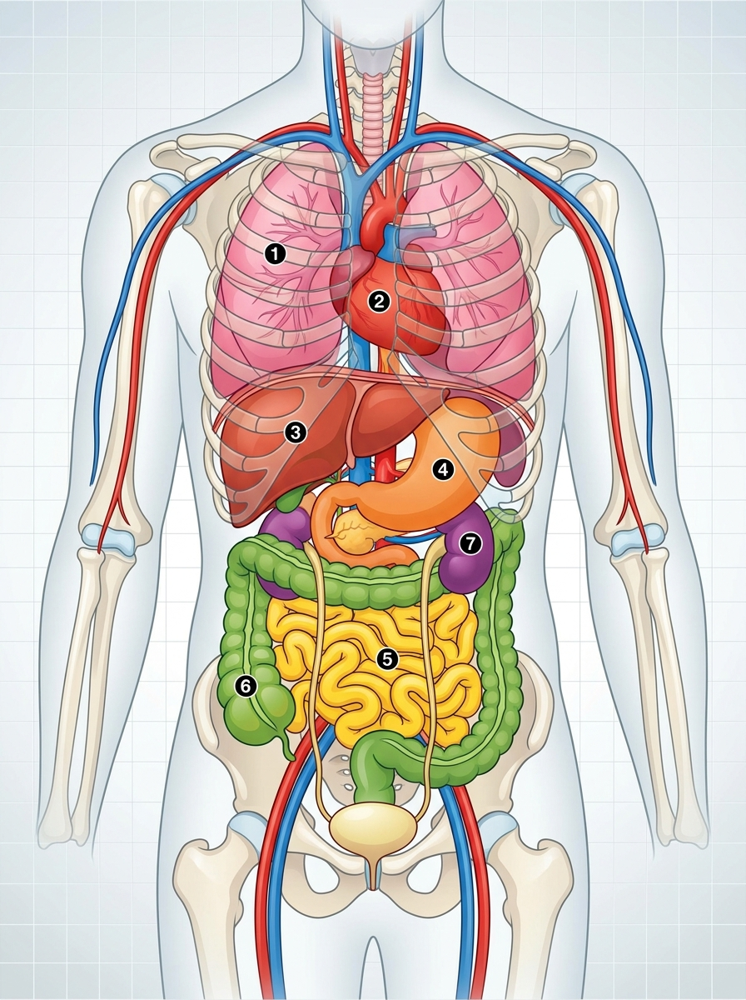

# 2.2 La Funció de Nutrició i l'Aparell Digestiu

La **funció de nutrició** és el conjunt de processos biològics mitjançant els quals els organismes obtenen la matèria i l'energia necessàries per construir i renovar les seues estructures cel·lulars i dur a terme totes les activitats vitals.

---

## 1. Concepte de Nutrició: Alimentació vs Nutrició

És fonamental no confondre els termes **alimentació** i **nutrició**:

- **Alimentació:** És un acte **voluntari, conscient i educable**, que consisteix a triar, preparar i ingerir els aliments del nostre entorn.
- **Nutrició:** És un procés **involuntari i inconscient**, que comprén tots els mecanismes fisiològics pels quals el cos descompon els aliments, n'absorbeix els nutrients químics (glucosa, àcids grassos, aminoàcids, vitamines, minerals i aigua) i els transporta a cadascuna de les cèl·lules.

### Tipus de Nutrició en els Éssers Vius
- **Nutrició Autòtrofa:** Fabriquen la seua pròpia matèria orgànica a partir de substàncies inorgàniques simples com el diòxid de carboni ($\text{CO}_2$) i l'aigua, utilitzant una font externa d'energia com la llum solar (plantes, algues i bacteris fotosintètics).
- **Nutrició Heteròtrofa:** No poden fabricar la seua pròpia matèria orgànica i han d'alimentar-se consumint altres éssers vius o les seues restes (animals, fongs, protozous i la majoria de bacteris).

> [!NOTE]
> ### Els 4 Aparells Coordinats en la Nutrició Humana
> Per a realitzar la nutrició en el cos humà, quatre grans aparells treballen de manera sincronitzada:
> 1. **Aparell Digestiu:** Transforma els aliments en nutrients senzills i els absorbeix cap a la sang.
> 2. **Aparell Respiratori:** Capta l'oxigen ($\text{O}_2$) de l'aire per a la respiració cel·lular i expulsa el diòxid de carboni ($\text{CO}_2$).
> 3. **Aparell Circulatori:** Transporta els nutrients i l'oxigen fins a cadascuna de les cèl·lules, i arreplega els residus metabòlics.
> 4. **Aparell Excretor:** Depura la sang eliminant els productes de rebuig tòxics cel·lulars (urea, àcid úric) a través de l'orina i la suor.


*Figura 2.1: Disposició dels principals òrgans interns en el tronc humà: **(1)** Pulmons (respiratori), **(2)** Cor (circulatori), **(3)** Fetge (glàndula digestiva), **(4)** Estómac (digestiu), **(5)** Intestí prim (absorció de nutrients), **(6)** Intestí gros (absorció d'aigua), **(7)** Ronyons (excretor).*

---

## 2. Anatomia de l'Aparell Digestiu

L'aparell digestiu humà està format per dues parts fonamentals: el **tub digestiu** i les **glàndules annexes**.

```
Boca ➔ Faringe ➔ Esòfag ➔ Estómac ➔ Intestí Prim ➔ Intestí Gros ➔ Recte/Anus
  ▲                         ▲             ▲
Glàndules Salivals          Fetge      Pàncrees
```

### A) El Tub Digestiu
És un conducte musculós continu d'uns 10 metres de longitud que s'estén des de l'orifici d'entrada (boca) fins a l'orifici d'eixida (anus):

1. **La Boca:**
   - **Dents:** Estructures dures que trituren el menjar. Els adults tenen **32 peces dentals** (16 a dalt i 16 a baix): 8 incisius (tallen), 4 canins (esquincen), 8 premolars i 12 molars (trituren i molen).
   - **Llengua:** Múscul molt potent recobert de **papil·les gustatives** que percep els sabors (dolç, salat, àcid, amarg i umami) i ajuda a barrejar el menjar amb la saliva.
2. **La Faringe:**
   - Cavitat compartida entre els sistemes digestiu i respiratori.
   - Posseeix una vàlvula cartilaginosa anomenada **epiglotis**, que tanca l'entrada a la laringe durant la deglució per impedir que el menjar passe a les vies respiratòries (ennuegament).
3. **L'Esòfag:**
   - Tub musculós d'uns 25 cm que connecta la faringe amb l'estómac. Condueix el menjar mitjançant contraccions musculars automàtiques anomenades **moviments peristàltics**.
4. **L'Estómac:**
   - Eixamplament del tub digestiu en forma de bossa amb una capacitat d'aproximadament $1{,}5$ litres.
   - Posseeix dues vàlvules d'obertura i tancament: el **càrdies** (a l'entrada, venint de l'esòfag) i el **pílor** (a l'eixida, cap a l'intestí prim).
5. **L'Intestí Prim:**
   - Tub llarg i replegat d'uns 6 a 7 metres de longitud. Es divideix en tres trams:
     - **Duodè:** Tram inicial on desemboquen les secrecions del fetge i del pàncrees.
     - **Jejú:** Tram intermedi on es produeix la màxima absorció de nutrients.
     - **Ili:** Tram final que connecta amb l'intestí gros mitjançant la vàlvula ileocecal.
   - La paret interna està recoberta de milions de replecs diminuts anomenats **vellositats i microvellositats intestinals**, que multipliquen la superfície d'absorció.
6. **L'Intestí Gros:**
   - Tub d'aproximadament $1{,}5$ metres de longitud i major diàmetre. Consta de tres regions:
     - **Cec:** Bossa inicial de la qual sobreix l'**apèndix vermiforme**.
     - **Còlon:** Es divideix en ascendent, transvers i descendent. Acull la microbiota intestinal (flora bacteriana).
     - **Recte i Anus:** Tram final on s'emmagatzemen les femtes abans de ser expulsades a l'exterior pel control de l'esfínter anal.

---

### B) Les Glàndules Digestives Annexes
Òrgans que produeixen líquids rics en enzims digestius i els aboquen al tub digestiu:

| Glàndula | Localització i Secreció | Funció Principal |
| :--- | :--- | :--- |
| **Glàndules Salivals** | 3 parells a la boca (paròtides, submaxil·lars i sublinguals). Secreten **saliva**. | Humitegen l'aliment, contenen lisozima (bactericida) i **amilasa**, enzim que comença la digestió dels glúcids (midó). |
| **Fetge** | Glàndula més voluminosa del cos, situada a la dreta sota el diafragma. Produeix la **bilis**. | La bilis s'emmagatzema a la **vesícula biliar** i s'aboca al duodè per a emulsionar els greixos (trencar-los en gotetes menudes perquè puguen ser atacats pels enzims). A més, el fetge emmagatzema glucogen i ferro, i desintoxica la sang. |
| **Pàncrees** | Rere i sota l'estómac. Produeix el **suc pancreàtic** i hormones. | El suc pancreàtic abocat al duodè conté enzims que digereixen proteïnes, lípids i sucres. A més, secreta a la sang la **insulina** (abaixa el sucre en sang) i el **glucagó** (apuja el sucre). |

> [!IMPORTANT]
> ### El Pàncrees i la Diabetis
> La glucosa és el combustible energètic primordial de les cèl·lules. La **insulina** permet que la glucosa passe de la sang a l'interior de les cèl·lules.
> Quan una persona pateix **diabetis**, el seu pàncrees no produeix suficient insulina o les cèl·lules no responen adequadament. Com a resultat, la glucosa s'acumula en excés en la sang (hiperglucèmia), la qual cosa pot danyar greument el cor, els ronyons i la vista si no es controla amb dieta, exercici i medicació o injeccions d'insulina.

---

## 3. El Procés Digestiu Pas a Pas

El procés de transformació del menjar comprén accions mecàniques (triturar i barrejar) i accions químiques (ruptura molecular per enzims):

### Pas 1: Digestió Bucal
- **Masticació i insalivació:** Les dents trenquen els aliments i la llengua els barreja amb la saliva.
- **Acció enzimàtica:** L'amilasa comença a digerir els glúcids.
- **Resultat:** Es forma una massa pastosa homogènia anomenada **bol alimentari**.

### Pas 2: Deglució i Pas per l'Esòfag
- La llengua empeny el bol alimentari cap a la faringe. L'epiglotis es tanca protegint la tràquea.
- El bol descendeix per l'esòfag gràcies als moviments peristàltics fins a traspassar el càrdies.

### Pas 3: Digestió Gàstrica (a l'Estómac)
- Les parets de l'estómac alliberen **àcid clorhídric ($\text{HCl}$)**, que destrueix microorganismes patògens, i **pepsina**, que descompon les proteïnes.
- Les fortes contraccions musculars de l'estómac baten el menjar durant 2 a 4 hores.
- **Resultat:** El bol es transforma en una farineta semilíquida i àcida anomenada **quim**. El pílor s'obri deixant-lo passar cap al duodè en xicotetes quantitats.

### Pas 4: Digestió Intestinal (al Duodè)
- Al duodè s'aboquen simultàniament: la **bilis** (del fetge), el **suc pancreàtic** (del pàncrees) i el **suc intestinal** (fabricat per les glàndules de la pròpia paret intestinal).
- Tots els nutrients queden reduïts a molècules bàsiques senzilles: glucosa, aminoàcids, àcids grassos i glicerol.
- **Resultat:** El quim es transforma en un líquid lletós i ric en nutrients absorbibles anomenat **quil**.

### Pas 5: Absorció Intestinal (al Jejú i Ili)
- Els nutrients travessen les fines parets de les **vellositats intestinals** i entren als capil·lars sanguinis (i als vasos quilífers limfàtics en el cas dels greixos).
- La sang s'encarrega llavors de transportar els nutrients a totes les cèl·lules de l'organisme.

### Pas 6: Formació de Femtes i Defecació (a l'Intestí Gros)
- Les substàncies que no han pogut ser digerides (com la fibra vegetal / cel·lulosa) avancen pel còlon.
- L'intestí gros reabsorbeix la major part de l'aigua i sals minerals, compactant els residus.
- La microbiota bacteriana fermenta restes orgàniques generant gasos i sintetitzant certes vitamines.
- Els residus sòlids formen les **femtes**, que passen al recte i són expulsades a l'exterior a través de l'anus en l'acte de la **defecació** (egestió).

---

## 4. Malalties i Hàbits Saludables de l'Aparell Digestiu

- **Càries Dental:** Destrucció de l'esmalt i la dentina per àcids alliberats per bacteris bucals en fermentar sucres. Prevenció: rentar-se les dents després de cada àpat i visites al dentista.
- **Gastritis i Úlcera Gàstrica:** Inflamació o ferida oberta a la mucosa de l'estómac provocada per estrès, medicaments o el bacteri *Helicobacter pylori*.
- **Restrenyiment:** Dificultat per evacuar la femta per falta de mobilitat intestinal o per femtes massa seques. Millora menjant fibra (fruita, verdura, cereals integrals) i bevent abundant aigua.
- **Intolerància a la Lactosa i Celiaquia:** Dificultat digestiva per manca de lactasa (lactosa) o reacció autoimmune al gluten que fa malbé les vellositats intestinals (celiaquia).

---

## 💡 Resum de Conceptes Clau

- La **nutrició** és un conjunt de processos involuntaris per obtenir matèria i energia; l'**alimentació** és l'acte conscient d'ingerir aliments.
- El tub digestiu inclou boca, faringe, esòfag, estómac, intestí prim, intestí gros i anus.
- Les glàndules annexes són les glàndules salivals, el fetge (bilis) i el pàncrees (suc pancreàtic i insulina).
- Transformació del menjar: **Bol alimentari** (boca) ➔ **Quim** (estómac) ➔ **Quil** (intestí prim).
- L'absorció de la majoria dels nutrients té lloc a l'**intestí prim** a través de les **vellositats intestinals**.
- L'aigua es reabsorbeix a l'**intestí gros**, formant la femta que s'expulsa per l'anus.
