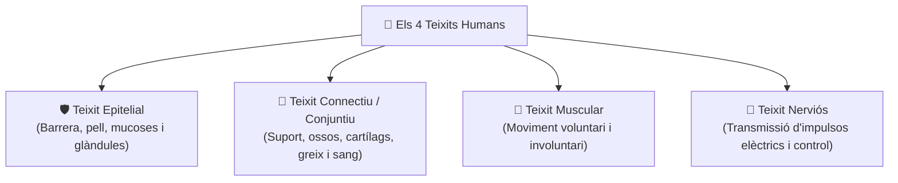
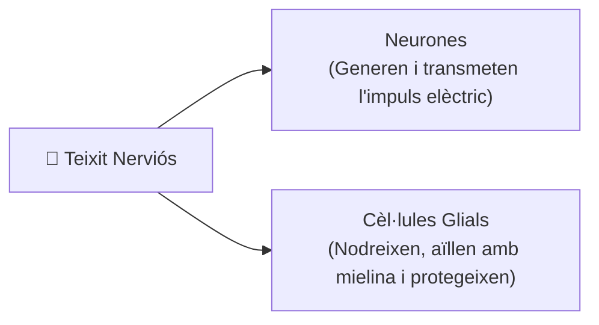

  

    ⚡ Progrés d'aprenentatge (2.3)
    0 / 3 reptes resolts
  

  

    

  

# 2.3 Els Teixits Fonamentals del Cos Humà

En els éssers pluricel·lulars complexos com nosaltres, un ésser humà adult està format per més de **30 bilions de cèl·lules**. Tanmateix, aquestes cèl·lules no són totes idèntiques ni treballen aïllades.

Mitjançant el procés de **diferenciació cel·lular**, les cèl·lules embrionàries s'especialitzen en una forma i funció determinades, activant uns gens i apagant-ne d'altres. Les cèl·lules amb la mateixa especialització s'agrupen i sintetitzen una matriu extracel·lular comuna per a formar **teixits**. La ciència biològica que estudia els teixits sota el microscopi s'anomena **histologia**.

Al cos humà existeixen centenars de subtipus, però tots s'agrupen en **quatre grans famílies de teixits**.

---

## 1. Els Quatre Grans Teixits Humans

---

## 2. Teixit Epitelial: La Primera Línia de Defensa i Secreció

Les cèl·lules epitelials estan íntimament unides entre si, pràcticament sense substància intercel·lular, formant capes contínues que actuen com a barreres protectores impermeables.
* **1. Epitelis de revestiment:**
  - **Simples (monocapa):** Una sola capa de cèl·lules aplanades. Es troben allà on cal que les substàncies es difonguen a gran velocitat: a la paret dels **capil·lars sanguinis** (endoteli) i als **alvèols pulmonars**.
  - **Estratificats (multicapa):** Múltiples capes de cèl·lules superposades per a suportar fricció, desgast i agressions físiques o químiques. El millor exemple és la capa exterior de la pell (**epidermis**), que conté una proteïna dura i impermeable anomenada **queratina**. Les capes més superficials moren i es desprenen contínuament en rentar-nos.
  - **Mucoses internes:** Epitelis humits que recobreixen l'interior de la boca, l'estómac, la tràquea o els budells. Tenen cèl·lules secretores de **moc protector** i, a les vies respiratòries, milions de **cilis mòbils** que escombren la pols cap a fora.
* **2. Epitelis glandulars:** Cèl·lules especialitzades a sintetitzar i alliberar productes químics:
  - **Glàndules exocrines:** Aboquen la seua substància a través d'un conducte cap a l'exterior del cos o cap a una cavitat interna. Exemples: glàndules sudorípares (suor), sebàcies (greix protector de la pell), salivals (saliva a la boca) o gàstriques (àcid clorhídric a l'estómac).
  - **Glàndules endocrines:** Mànquen de conducte excretor; aboquen directament a la sang substàncies missatgeres anomenades **hormones**. Exemples: el tiroide, la hipòfisi o el pàncrees (que aboca insulina a la sang).

---

## 3. Teixits Connectius: Els Pilars de Suport, Unió i Reserva

Són els teixits més abundants i variats de l'organisme. A diferència de l'epitelial, les seues cèl·lules estan separades entre si per una abundant **matriu extracel·lular** plena de fibres proteiques de **col·lagen** (que aporten gran resistència a la tracció) i d'**elastina** (que aporta elasticitat).

| Tipus de Teixit Connectiu | Cèl·lules principals | Matriu extracel·lular | Funcions fisiològiques vitals |
| :--- | :--- | :--- | :--- |
| **Conjuntiu pròpiament dit** | Fibroblasts | Rica en fibres de col·lagen i líquid | Uneix òrgans i omple espais buits. Forma els **tendons** (que subjecten el múscul a l'os) i els **lligaments** (que uneixen ossos a les articulacions). |
| **Adipós (greix)** | Adipòcits (plens de gotes de greix) | Escassa | **Reserva d'energia** a llarg termini, esmorteïdor de colps al voltant dels ronyons i el cor, i excel·lent **aïllant tèrmic** contra el fred sota la pell. |
| **Cartilaginós** | Condròcits | Sòlida però flexible i elàstica | Forma l'esquelet del nas, el pavelló de les orelles, la tràquea i els extrems protectors dels ossos a les articulacions per evitar el fregament. **No té vasos sanguinis propis**, per la qual cosa una lesió de cartílag (com el menisc del genoll) tarda mesos a cicatritzar. |
| **Ossi (els ossos)** | Osteòcits (cèl·lules madures) i osteoblasts | Rígida i mineralitzada amb sals de fosfat de calci | Forma els ossos de l'esquelet. Protegeix òrgans vitals (crani protegeix cervell; caixa toràcica protegeix cor i pulmons), permet el moviment fent de palanca i emmagatzema calci. Al seu interior s'allotja la **medul·la òssia roja**, la fàbrica on neixen tots els glòbuls de la sang. |
| **Sanguini (la sang)** | Glòbuls vermells, blancs i plaquetes | Líquida: el **plasma sanguini** | Transport d'oxigen, nutrients, hormones, defensa immunitària i regulació de la temperatura. |

---

## 4. Teixit Muscular: El Generador de Moviment i Força

Està constituït per cèl·lules allargades anomenades **fibres musculars**. A l'interior del seu citoplasma contenen milers de filaments proteics d'**actina** i **miosina** que llisquen entre si provocant la contracció mecànica quan reben un estímul elèctric.

Distingim tres varietats musculars amb funcions molt clares:
1. **Muscular Estriat Esquelètic:** Les seues fibres presenten bandes o estries transversals sota el microscopi i tenen diversos nuclis. Estan units als ossos mitjançant tendons. La seua contracció és **ràpida, potent i de control VOLUNTARI**: nosaltres decidim conscientment quan moure els braços per manipular una màquina o caminar. Si treballen sense prou oxigen, acumulen àcid làctic i produeixen agulletes o rampes.
2. **Muscular Estriat Cardíac (Miocardi):** Forma exclusivament les parets del cor. Les seues cèl·lules estan interconnectades per discs especials que transmeten l'impuls elèctric d'una cèl·lula a una altra de manera instantània. La seua contracció és rítmica, incansable i **TOTALMENT INVOLUNTÀRIA**.
3. **Muscular Llis:** Cèl·lules fusiformes (amb forma de fus, amples al centre i punxegudes als extrems) amb un sol nucli i sense estries. Forma la paret dels òrgans interns buits: l'estómac, els intestins, la bufeta urinària i les artèries. La seua contracció és lenta, sostinguda en el temps i **INVOLUNTÀRIA** (nosaltres no hem de pensar per fer moure el menjar pel budell).

---

## 5. Teixit Nerviós: El Sistema de Control i Comunicacions

S'encarrega de detectar canvis en el medi extern (llum, so, calor, perill) i intern (pressió sanguínia, dolor), processar aquesta informació al cervell i enviar ordres precises als músculs i glàndules. Conté dos tipus de cèl·lules:

### A) Les Neurones: Les Especialistes Elèctriques
Són cèl·lules que han perdut la capacitat de dividir-se en la seua immensa majoria. Tenen tres parts:
- **Cos cel·lular o soma:** Conté el nucli i els orgànuls que fabriquen neurotransmissors.
- **Dendrites:** Múltiples prolongacions curtes i molt ramificades que actuen com a antenes receptores de senyals d'altres neurones.
- **Axó:** Prolongació única, molt llarga (pot fer des d'uns mil·límetres fins a més d'un metre en el nervi ciàtic que baixa a la cama). Transmet l'impuls elèctric d'eixida cap a la següent neurona o múscul mitjançant la **sinapsi**.

### B) Les Cèl·lules de la Glia: L'Equip de Suport Vital
Per cada neurona hi ha entre 5 i 10 cèl·lules glials:
- **Cèl·lules de Schwann i Oligodendròcits:** Fabriquen una capa blanca i grassa anomenada **beina de mielina** al voltant de l'axó. La mielina actua com el plàstic aïllant d'un cable elèctric, aconseguint que l'impuls nerviós viatge a salts a més de **400 km/h** ($120	ext{ m/s}$).
- **Astròcits:** Cèl·lules amb forma d'estrella que capturen nutrients dels capil·lars sanguinis i alimenten les neurones, a més de filtrar drogues i toxines (barrera hematoencefàlica).
- **Micròglia:** Neteja i destrueix cèl·lules mortes o gèrmens.

---

> [!NOTE]
> ### 💡 Resum de Conceptes Clau
> - **Epitelial:** Revestiment impermeable (pell, mucoses) i secreció (glàndules exocrines i endocrines).
> - **Connectiu:** Suport i unió amb abundant matriu de col·lagen (adipós = greix/reserva; ossi = duresa/calci; cartilaginós = flexibilitat; sang = líquid de transport).
> - **Muscular:** Contracció per actina i miosina (esquelètic = voluntari; cardíac i llis = involuntari).
> - **Nerviós:** Xarxa de control basada en neurones conductores i cèl·lules de la glia protectores amb beina de mielina.

---

## 🎯 Activitats i Autoavaluació Interactiva

  

    🎮 <strong>Zona d'Entrenament FPB:</strong> 0 reptes resolts
    ⭐ 0 punts
  

  

### 1. Qüestionari d'Autoavaluació Tipus Test (MCQ)

  
<strong>1. Quin tipus de teixit muscular forma la paret del cor humà i com es caracteritza la seua contracció?</strong>

  

    <button type="button" class="btn-mcq-opt" data-opt="A">A) Teixit muscular estriat esquelètic de control voluntari</button>
    <button type="button" class="btn-mcq-opt" data-opt="B">B) Teixit muscular cardíac (miocardi) de contracció rítmica i involuntària</button>
    <button type="button" class="btn-mcq-opt" data-opt="C">C) Teixit connectiu rígid sense capacitat de contracció</button>
    <button type="button" class="btn-mcq-opt" data-opt="D">D) Teixit epitelial de secreció</button>
  

  

  
<strong>2. Quines funcions vitals compleix el teixit adipós a l'organisme humà?</strong>

  

    <button type="button" class="btn-mcq-opt" data-opt="A">A) Transmetre impulsos elèctrics ràpids cap al cervell</button>
    <button type="button" class="btn-mcq-opt" data-opt="B">B) Fabricar l'esmalt de les dents i els ossos llargs</button>
    <button type="button" class="btn-mcq-opt" data-opt="C">C) Reserva energètica a llarg termini, protecció mecànica i aïllant tèrmic contra el fred</button>
    <button type="button" class="btn-mcq-opt" data-opt="D">D) Fabricar sucs digestius com l'àcid clorhídric</button>
  

  

---

### 2. Activitats de Vertader (V) o Fals (F)

  <strong>a) El teixit ossi és un teixit viu amb cèl·lules que rep nutrients a través de vasos sanguinis que el travessen.</strong>
  

    <button type="button" class="btn-vf" data-opt="V">V</button>
    <button type="button" class="btn-vf" data-opt="F">F</button>
  

  

  <strong>b) Al teixit nerviós, les neurones són les úniques cèl·lules existents, ja que no necessiten cap altra cèl·lula d'acompanyament ni suport.</strong>
  

    <button type="button" class="btn-vf" data-opt="V">V</button>
    <button type="button" class="btn-vf" data-opt="F">F</button>
  

  

---

### 3. Exercicis de Resposta Breu i Vocabulari Tècnic

  
✍️ Com s'anomena la prolongació llarga de la neurona que transmet el senyal elèctric cap a la següent cèl·lula o múscul?

  

    <input type="text" class="quiz-input" placeholder="Escriu el terme anatòmic...">
    <button type="button" class="btn-quiz-check">Comprovar</button>
  

  

  
✍️ Quin teixit té la funció primordial de protegir les superfícies externes i internes del nostre cos davant agressions i infeccions?

  

    <input type="text" class="quiz-input" placeholder="Escriu el tipus de teixit...">
    <button type="button" class="btn-quiz-check">Comprovar</button>
  

  

---

### 4. Pregunta de Raonament i Desenvolupament Escrit

  
✍️ <strong>Seguretat i salut laboral al taller:</strong> Quan un operari pateix una cremada greu a la pell o un tall profund amb una eina, s'ha danyat el teixit epitelial. Explica per quins dos motius mèdics greus la pèrdua d'aquesta barrera posa en risc immediat la salut de la persona.

  <textarea class="open-response-input" rows="4" placeholder="Raona sobre infeccions bacterianes i pèrdua de líquids corporals..."></textarea>

---

  <h3 style="margin-top:0; color:#0369a1;">📦 Lliurament d'Activitats d'Aules (Act 2.3)</h3>
  
Genera el teu document de tasca d'aquest apartat amb el teu nom i puntuació obtinguda.

  

    <input type="text" class="aules-student-name" placeholder="Cognoms, Nom de l'Alumne/a" style="padding:8px 12px; border:1px solid #94a3b8; border-radius:4px; flex-grow:1; min-width:240px;">
    <button class="btn-generate-aules-pdf" data-unit="UD02" data-activity="Act03" data-module="CA" style="padding:8px 16px; background:#0284c7; color:#fff; border:none; border-radius:4px; font-weight:600; cursor:pointer;">📄 Descarregar PDF per a Aules</button>
  

