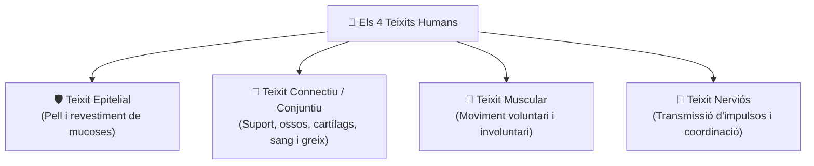

  

    ⚡ Progrés d'aprenentatge (2.3)
    0 / 3 reptes resolts
  

  

    

  

# 2.3 Els Teixits Fonamentals del Cos Humà

En els organismes pluricel·lulars com nosaltres, les cèl·lules no treballen aïllades. S'especialitzen en formes i funcions concretes i s'agrupen per formar **teixits**. 

Un **teixit** és un conjunt coordinat de cèl·lules similars especialitzades que col·laboren per desenvolupar una mateixa activitat fisiològica. En el cos humà distingim **quatre grans famílies de teixits**.

---

## 1. Els Quatre Grans Teixits Humans

---

## 2. Característiques i Funcions de Cada Teixit

### 1. Teixit Epitelial: La Barrera Protectora
- **Estructura:** Cèl·lules molt unides entre si sense espais buits, formant capes protectores.
- **Tipus principals:**
  - **Epitelis de revestiment:** Cobreixen la superfície externa del cos (la capa superficial de la **pell** o epidermis) i les cavitats internes (l'interior de la boca, l'estómac, la tràquea o la bufeta).
  - **Epitelis glandulars:** Cèl·lules especialitzades a fabricar i alliberar substàncies químiques (com la suor, la saliva, les llàgrimes o hormones com la insulina).

### 2. Teixits Connectius (o Conjuntius): Els Teixits de Suport i Unió
Són els més abundants del cos. Tenen cèl·lules separades per una substància intercel·lular (matriu) rica en fibres de col·lagen. Comprenen diverses varietats:
- **Teixit conjuntiu pròpiament dit:** Uneix òrgans i omple espais (torns de tendons i lligaments).
- **Teixit adipós:** Format per adipòcits plens de greix. Actua com a **reserva d'energia a llarg termini**, esmorteïdor de colps i excel·lent **aïllant tèrmic** contra el fred.
- **Teixit cartilaginós:** Matriu elàstica i resistent. Forma l'esquelet del nas, les orelles i els extrems protectors dels ossos a les articulacions per evitar el desgast.
- **Teixit ossi:** El més rígid i dur gràcies a dipòsits de sals minerals (fosfat de calci). Conté cèl·lules vives anomenades **osteòcits**. Forma els ossos de l'esquelet.
- **Teixit sanguini (la sang):** L'únic teixit líquid del cos, amb plasma i cèl·lules sanguínies flotant.

### 3. Teixit Muscular: El Motor del Cos
Format per cèl·lules allargades anomenades **fibres musculars**, capaces de contreure's i relaxar-se gràcies a proteïnes contràctils (actina i miosina):
- **Muscular estriat esquelètic:** Unit als ossos mitjançant tendons. La seua contracció és **ràpida i voluntària** (nosaltres decidim quan moure un braç o una cama).
- **Muscular cardíac (miocardi):** Forma les parets musculars del cor. La seua contracció és rítmica, incansable i **totalment involuntària**.
- **Muscular llis:** Es troba a les parets dels vasos sanguinis i dels òrgans interns buits (estómac, intestins, bufeta). La seua contracció és lenta i **involuntària**.

### 4. Teixit Nerviós: La Xarxa de Telecomunicacions
S'encarrega de captar estímuls del medi, processar la informació i enviar ordres als músculs i òrgans:
- **Neurones:** Cèl·lules conductores d'impulsos elèctrics. Tenen un cos cel·lular, múltiples prolongacions curtes de recepció (**dendrites**) i una llarga prolongació d'eixida anomenada **axó**.
- **Cèl·lules de la glia:** Cèl·lules acompanyants que nodreixen, netegen, protegeixen i aïllen elèctricament les neurones (formant la beina de mielina).

---

> [!NOTE]
> ### 💡 Resum de Conceptes Clau
> - **Epitelial:** Revestiment protector i secreció glandular.
> - **Connectiu:** Suport i unió (adipós = greix/aïllament; ossi = duresa/esquelet; cartilaginós = flexibilitat).
> - **Muscular:** Contracció mecànica (esquelètic = voluntari; cardíac i llis = involuntari).
> - **Nerviós:** Captació i transmissió d'impulsos elèctrics (neurones i glia).

---

## 🎯 Activitats i Autoavaluació Interactiva

  

    🎮 <strong>Zona d'Entrenament FPB:</strong> 0 reptes resolts
    ⭐ 0 punts
  

  

### 1. Qüestionari d'Autoavaluació Tipus Test (MCQ)

  
<strong>1. Quin tipus de teixit muscular forma la paret del cor humà i com es caracteritza la seua contracció?</strong>

  

    <button type="button" class="btn-mcq-opt" data-opt="A">A) Teixit muscular estriat esquelètic de control voluntari</button>
    <button type="button" class="btn-mcq-opt" data-opt="B">B) Teixit muscular cardíac (miocardi) de contracció rítmica i involuntària</button>
    <button type="button" class="btn-mcq-opt" data-opt="C">C) Teixit connectiu rígid sense capacitat de contracció</button>
    <button type="button" class="btn-mcq-opt" data-opt="D">D) Teixit epitelial de secreció</button>
  

  

  
<strong>2. Quines funcions vitals compleix el teixit adipós a l'organisme humà?</strong>

  

    <button type="button" class="btn-mcq-opt" data-opt="A">A) Transmetre impulsos elèctrics ràpids cap al cervell</button>
    <button type="button" class="btn-mcq-opt" data-opt="B">B) Fabricar l'esmalt de les dents i els ossos llargs</button>
    <button type="button" class="btn-mcq-opt" data-opt="C">C) Reserva energètica a llarg termini, protecció mecànica i aïllant tèrmic contra el fred</button>
    <button type="button" class="btn-mcq-opt" data-opt="D">D) Fabricar sucs digestius com l'àcid clorhídric</button>
  

  

---

### 2. Activitats de Vertader (V) o Fals (F)

  <strong>a) El teixit ossi és un teixit viu amb cèl·lules que rep nutrients a través de vasos sanguinis que el travessen.</strong>
  

    <button type="button" class="btn-vf" data-opt="V">V</button>
    <button type="button" class="btn-vf" data-opt="F">F</button>
  

  

  <strong>b) Al teixit nerviós, les neurones són les úniques cèl·lules existents, ja que no necessiten cap altra cèl·lula d'acompanyament ni suport.</strong>
  

    <button type="button" class="btn-vf" data-opt="V">V</button>
    <button type="button" class="btn-vf" data-opt="F">F</button>
  

  

---

### 3. Exercicis de Resposta Breu i Vocabulari Tècnic

  
✍️ Com s'anomena la prolongació llarga de la neurona que transmet el senyal elèctric cap a la següent cèl·lula o múscul?

  

    <input type="text" class="quiz-input" placeholder="Escriu el terme anatòmic...">
    <button type="button" class="btn-quiz-check">Comprovar</button>
  

  

  
✍️ Quin teixit té la funció primordial de protegir les superfícies externes i internes del nostre cos davant agressions i infeccions?

  

    <input type="text" class="quiz-input" placeholder="Escriu el tipus de teixit...">
    <button type="button" class="btn-quiz-check">Comprovar</button>
  

  

---

### 4. Pregunta de Raonament i Desenvolupament Escrit

  
✍️ <strong>Seguretat i salut laboral al taller:</strong> Quan un operari pateix una cremada greu a la pell o un tall profund amb una eina, s'ha danyat el teixit epitelial. Explica per quins dos motius mèdics greus la pèrdua d'aquesta barrera posa en risc immediat la salut de la persona.

  <textarea class="open-response-input" rows="4" placeholder="Raona sobre infeccions bacterianes i pèrdua de líquids corporals..."></textarea>

---

  <h3 style="margin-top:0; color:#0369a1;">📦 Lliurament d'Activitats d'Aules (Act 2.3)</h3>
  
Genera el teu document de tasca d'aquest apartat amb el teu nom i puntuació obtinguda.

  

    <input type="text" class="aules-student-name" placeholder="Cognoms, Nom de l'Alumne/a" style="padding:8px 12px; border:1px solid #94a3b8; border-radius:4px; flex-grow:1; min-width:240px;">
    <button class="btn-generate-aules-pdf" data-unit="UD02" data-activity="Act03" data-module="CA" style="padding:8px 16px; background:#0284c7; color:#fff; border:none; border-radius:4px; font-weight:600; cursor:pointer;">📄 Descarregar PDF per a Aules</button>
  

