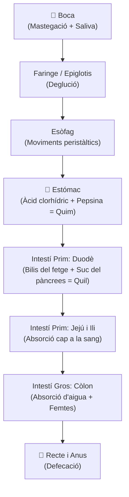

  

    ⚡ Progrés d'aprenentatge (2.4)
    0 / 3 reptes resolts
  

  

    

  

# 2.4 La Funció de Nutrició i l'Aparell Digestiu

Totes les cèl·lules del nostre cos necessiten energia per a viure i materials per a créixer i reparar teixits desgastats. Aquesta energia i matèria s'obtenen mitjançant la **funció de nutrició**.

---

## 1. Concepte de Nutrició: Menjar no és el mateix que Nutrir-se

Sovint confonem aquests dos termes, però en biologia són molt diferents:
- **Alimentació:** És un procés conscient, voluntari i educable. Consisteix a triar, preparar i ingerir els aliments del nostre entorn.
- **Nutrició:** És un procés biològic involuntari i inconscient. Comença quan el cos descompon els aliments ingerits en molècules senzilles (**nutrients** com glucosa, aminoàcids o àcids grassos), els absorbeix cap a la sang i les cèl·lules els utilitzen en el seu metabolisme.

> [!IMPORTANT]
> ### Els 4 Aparells que Treballen Coordinats en la Nutrició
> Perquè la nutrició siga possible, cal la intervenció simultània de 4 aparells:
> 1. **Aparell Digestiu:** Transforma els aliments en nutrients absorbibles i expulsa les restes no digerides.
> 2. **Aparell Respiratori:** Capta oxigen de l'aire i expulsa el diòxid de carboni generat a les cèl·lules.
> 3. **Aparell Circulatori:** El camió de repartiment; transporta nutrients i oxigen a cada cèl·lula i recull els residus.
> 4. **Aparell Excretor:** Filtra la sang i elimina a l'exterior les substàncies tòxiques (orina i suor).

---

## 2. Anatomia de l'Aparell Digestiu

L'aparell digestiu està format per dos components:
1. **El tub digestiu:** Un tub continu d'uns 10-12 metres de llargària que comença a la boca i acaba a l'anus.
2. **Les glàndules annexes:** Òrgans que fabriquen sucs digestius plens d'enzims i els aboquen a l'interior del tub.

### A) El Tub Digestiu pas a pas
* **Boca:** Dents per a triturar mecànicament i llengua per a barrejar. Les glàndules salivals fabriquen saliva amb **amilasa** (enzim que comença a digerir el midó). Es forma el **bol alimentari**.
* **Faringe:** Cruïlla comuna entre l'aparell digestiu i el respiratori. La vàlvula anomenada **epiglotis** es tanca automàticament en engolir per evitar que el menjar passe a la tràquea (ennuegament).
* **Esòfag:** Tub muscular d'uns 25 cm que empeny el bol alimentari cap a l'estómac mitjançant contraccions musculars involuntàries anomenades **moviments peristàltics**.
* **Estómac:** Dilatació muscular en forma de 'J'. Té dues vàlvules de seguretat: el **càrdies** (a l'entrada) i el **pílor** (a l'eixida). Secreta suc gàstric molt potent amb **àcid clorhídric** ($	ext{HCl}$, que mata bacteris) i l'enzim **pepsina** (que talla proteïnes). El bol es converteix en una pasta àcida anomenada **quim**.
* **Intestí Prim:** Tub d'uns 6-7 metres plegat a l'abdomen, dividit en 3 parts:
  - **Duodè:** Rep la bilis i el suc pancreàtic. La mescla es converteix en el **quil**.
  - **Jejú i Ili:** Les seues parets estan recobertes de milions de **vellositats intestinals** microscòpiques que augmenten moltíssim la superfície d'absorció. Els nutrients travessen cap als capil·lars sanguinis.
* **Intestí Gros:** Tub d'1,5 metres de diàmetre més gruixut. S'encarrega d'absorbir l'aigua i les sals minerals dels residus líquids. Conté la **microbiota o flora intestinal** (bacteris beneficiosos que fabriquen vitamines). El que no s'ha absorbit es compacta formant les **femtes**, que s'emmagatzemen al recte fins a la defecació.

### B) Les Glàndules Annexes
* **Glàndules Salivals:** Paròtides, submaxil·lars i sublinguals.
* **Fetge:** L'òrgan intern més gran i pesat ($1,5	ext{ kg}$). Produeix la **bilis**, un líquid verd-groguenc que s'emmagatzema a la **vesícula biliar**. La bilis no conté enzims, però actua com un sabó: emulsiona els greixos (els trenca en gotetes microscòpiques) perquè els enzims puguen digerir-los.
* **Pàncrees:** Glàndula situada darrere de l'estómac. Produeix el **suc pancreàtic** (ric en enzims que digereixen sucres, proteïnes i lípids) i aboca hormones a la sang com la **insulina** (que regula la glucosa).

---

> [!NOTE]
> ### 💡 Resum de Conceptes Clau
> - Alimentar-se és voluntari; nutrir-se és el procés cel·lular involuntari.
> - El menjar es transforma successivament: Bol alimentari (boca) $
ightarrow$ Quim (estómac) $
ightarrow$ Quil (intestí prim).
> - L'absorció dels nutrients es fa a les vellositats de l'intestí prim; la reabsorció d'aigua, a l'intestí gros.
> - El fetge fabrica bilis per a emulsionar els greixos, i el pàncrees fabrica enzims digestius i insulina.

---

## 🎯 Activitats i Autoavaluació Interactiva

  

    🎮 <strong>Zona d'Entrenament FPB:</strong> 0 reptes resolts
    ⭐ 0 punts
  

  

### 1. Qüestionari d'Autoavaluació Tipus Test (MCQ)

  
<strong>1. A quin tram de l'aparell digestiu té lloc la major part de l'absorció de nutrients cap al torrent sanguini?</strong>

  

    <button type="button" class="btn-mcq-opt" data-opt="A">A) A l'estómac mitjançant l'àcid clorhídric</button>
    <button type="button" class="btn-mcq-opt" data-opt="B">B) A l'intestí prim gràcies als milions de vellositats intestinals</button>
    <button type="button" class="btn-mcq-opt" data-opt="C">C) A l'esòfag durant la deglució ràpida</button>
    <button type="button" class="btn-mcq-opt" data-opt="D">D) A la vesícula biliar junt amb la bilis</button>
  

  

  
<strong>2. Quina és la funció biològica essencial de la bilis secretada pel fetge i abocada al duodè?</strong>

  

    <button type="button" class="btn-mcq-opt" data-opt="A">A) Emulsionar els greixos perquè els enzims lipases puguen atacar-los fàcilment</button>
    <button type="button" class="btn-mcq-opt" data-opt="B">B) Destruir les proteïnes amb àcid molt concentrat</button>
    <button type="button" class="btn-mcq-opt" data-opt="C">C) Fabricar glòbuls vermells per a la sang</button>
    <button type="button" class="btn-mcq-opt" data-opt="D">D) Absorbir directament l'oxigen de l'aire</button>
  

  

---

### 2. Activitats de Vertader (V) o Fals (F)

  <strong>a) L'epiglotis és una vàlvula cartilaginosa que tanca la via respiratòria durant la deglució per evitar l'ennuegament.</strong>
  

    <button type="button" class="btn-vf" data-opt="V">V</button>
    <button type="button" class="btn-vf" data-opt="F">F</button>
  

  

  <strong>b) L'interior de l'estómac humà té un medi completament neutre i sense cap tipus d'acidesa.</strong>
  

    <button type="button" class="btn-vf" data-opt="V">V</button>
    <button type="button" class="btn-vf" data-opt="F">F</button>
  

  

---

### 3. Exercicis de Resposta Breu i Vocabulari Tècnic

  
✍️ Com s'anomena la massa semilíquida i àcida que resulta de la digestió dels aliments a l'interior de l'estómac?

  

    <input type="text" class="quiz-input" placeholder="Escriu el terme...">
    <button type="button" class="btn-quiz-check">Comprovar</button>
  

  

  
✍️ Quin òrgan glandular fabrica la bilis que posteriorment s'emmagatzema a la vesícula biliar?

  

    <input type="text" class="quiz-input" placeholder="Escriu l'òrgan...">
    <button type="button" class="btn-quiz-check">Comprovar</button>
  

  

---

### 4. Pregunta de Raonament i Desenvolupament Escrit

  
✍️ <strong>Digestió i absorció d'aigua:</strong> Si una persona pateix una infecció intestinal bacteriana (gastroenteritis), el seu intestí gros no és capaç de reabsorbir l'aigua adequadament. Quines conseqüències físiques immediates patirà el pacient i per què és tan perillós no reposar líquids amb sèrum oral?

  <textarea class="open-response-input" rows="4" placeholder="Explica la formació de femtes líquides (diarrea), la deshidratació i la pèrdua de sals minerals..."></textarea>

---

  <h3 style="margin-top:0; color:#0369a1;">📦 Lliurament d'Activitats d'Aules (Act 2.4)</h3>
  
Genera el teu document de tasca d'aquest apartat amb el teu nom i puntuació obtinguda.

  

    <input type="text" class="aules-student-name" placeholder="Cognoms, Nom de l'Alumne/a" style="padding:8px 12px; border:1px solid #94a3b8; border-radius:4px; flex-grow:1; min-width:240px;">
    <button class="btn-generate-aules-pdf" data-unit="UD02" data-activity="Act04" data-module="CA" style="padding:8px 16px; background:#0284c7; color:#fff; border:none; border-radius:4px; font-weight:600; cursor:pointer;">📄 Descarregar PDF per a Aules</button>
  

