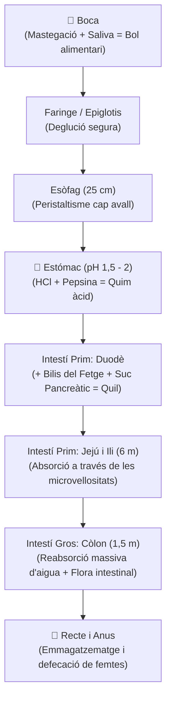

  

    ⚡ Progrés d'aprenentatge (2.4)
    0 / 3 reptes resolts
  

  

    

  

# 2.4 La Funció de Nutrició i l'Aparell Digestiu

Totes i cadascuna de les cèl·lules del nostre cos són petites fàbriques vives que consumeixen energia les 24 hores del dia per a mantindre's en funcionament, sintetitzar noves molècules i reparar teixits desgastats. Aquesta energia i matèria primera s'obtenen mitjançant la **funció de nutrició**.

---

## 1. Concepte de Nutrició: Alimentació vs Nutrició

Encara que en el llenguatge col·loquial s'utilitzen com a sinònims, en biologia i ciències de la salut representen dos processos completament diferents:
- **Alimentació:** És un procés conscient, voluntari, discontinu i molt influenciat per la cultura, l'economia i l'educació. Consisteix en l'acció de triar, preparar i introduir a la boca els aliments del nostre entorn. Nosaltres decidim **què**, **com** i **quan** mengem.
- **Nutrició:** És un procés biològic involuntari, continu i inconscient que comença just després d'engolir. Consisteix en el conjunt de transformacions químiques que descomponen els aliments en les seues molècules més simples (**nutrients**: glucosa, àcids grassos, aminoàcids, vitamines i aigua), el seu transport per la sang i la seua utilització metabòlica dins de les cèl·lules.

> [!IMPORTANT]
> ### L'Equip de la Nutrició: 4 Aparells Coordinats
> Cap òrgan pot nodrir el cos per si sol. La nutrició requereix la col·laboració sincrònica de 4 aparells:
> 1. **Aparell Digestiu:** Tritura mecànicament i descompon químicament els aliments per alliberar els nutrients i absorbir-los.
> 2. **Aparell Respiratori:** Aporta l'oxigen ($	ext{O}_2$) necessari per a cremar aquests nutrients a les cèl·lules i expulsa el diòxid de carboni ($	ext{CO}_2$).
> 3. **Aparell Circulatori:** La xarxa de transport que porta els nutrients i l'oxigen fins a l'última cèl·lula del cos i arreplega els residus.
> 4. **Aparell Excretor:** Filtra la sang per expulsar de l'organisme les substàncies tòxiques generades en el metabolisme celular.

---

## 2. Anatomia de l'Aparell Digestiu Humà

L'aparell digestiu humà està format per dues estructures bàsiques:
1. **El tub digestiu:** Un conducte continu d'uns **10 a 12 metres** de longitud que comença a la boca i finalitza a l'anus. La seua paret està formada per capes musculars llises que permeten l'avanç del menjar.
2. **Les glàndules annexes:** Òrgans situats fora del tub digestiu que fabriquen líquids rics en enzims digestius i els aboquen a la llum del tub per a accelerar la digestió química.

---

## 3. El Viatge del Menjar i les Seues Transformacions

Al llarg del tub digestiu, el menjar pateix dos tipus de digestió simultània:
- **Digestió mecànica:** Trossejament, trituració i batut físic del menjar per augmentar la superfície de contacte.
- **Digestió química:** Enzims específics tallen les grans macromolècules en nutrients simples que puguen travessar la membrana cel·lular.

### Pas 1: La Boca i la Mastegació
- **Dents:** Estructures dures recobertes d'esmalt. Un adult té **32 dents**: 8 incisius (per a tallar), 4 canins (per a estripar carn), 8 premolars i 12 molars (per a moldre i triturar).
- **Llengua:** Múscul potentíssim amb papil·les gustatives que barreja el menjar amb la saliva i empeny cap enrere.
- **Glàndules salivals:** Paròtides, submaxil·lars i sublinguals. Produeixen **saliva**, un líquid que conté aigua, moc (lubricant), **lisozima** (substància antibacteriana que desinfecta el menjar) i l'enzim **amilasa salival**, que comença a trencar el midó del pa o la pasta.
- **Resultat:** El menjar es converteix en una massa humida i pastosa anomenada **bol alimentari**.

### Pas 2: Faringe, Deglució i Esòfag
- La **faringe** és una cruïlla de camins compartida entre la via digestiva i la respiratòria. En engolir, la llengua empeny el bol alimentari, el paladar tou s'eleva per tapar les fosses nasals i una làmina de cartílag anomenada **epiglotis** baixa com una trapa sobre la laringe, impedint que el menjar entre a la tràquea (ennuegament).
- L'**esòfag** és un tub muscular d'uns 25 cm. Les seues parets fan contraccions en forma d'ona anomenades **moviments peristàltics**, capaços de fer baixar el menjar fins i tot si estiguérem bevent cap per avall.

### Pas 3: Digestió Gàstrica a l'Estómac
L'**estómac** és una dilatació muscular en forma de 'J' amb capacitat per a $1{,}5	ext{ litres}$. Està tancat per dues vàlvules: el **càrdies** a l'entrada (que impedeix que els àcids pugen cap a l'esòfag provocant ardor) i el **pílor** a l'eixida.
- Les seues parets musculars es contrauen enèrgicament per batre el contingut.
- Les glàndules gàstriques segreguen **suc gàstric**, format per:
  - **Àcid clorhídric ($	ext{HCl}$):** Crea un ambient extremadament àcid ($	ext{pH } 1{,}5 - 2$). Mata bacteris que vénen amb el menjar i desfà les fibres dures.
  - **Pepsina:** Enzim proteolític que comença a tallar les proteïnes complexes de la carn, ous o peix en cadenes curtes de pèptids.
  - **Moc protector:** Una capa espessa que recobreix la paret estomacal per evitar que l'àcid i la pepsina digerisquen el propi estómac (si aquesta capa es fa malbé, apareix una **úlcera gàstrica**).
- **Resultat:** Després de 2 a 4 hores de batut àcid, el bol alimentari es transforma en un líquid pastós i àcid anomenat **quim**.

### Pas 4: La Gran Digestió Química al Duodè (Intestí Prim)
El pílor s'obre en xicotets impulsos deixant passar el quim cap a la primera porció de l'intestí prim: el **duodè** (d'uns 25 cm). Ací desemboquen dues grans fàbriques químiques:
- **El Fetge i la Bilis:** El fetge és l'òrgan intern més gran ($1{,}5	ext{ kg}$). Sintetitza contínuament la **bilis**, que s'emmagatzema a la **vesícula biliar**. La bilis no conté enzims; conté sals biliars que actuen exactament igual que el detergent dels plats: **emulsionen els greixos**, trencant les grans gotes d'oli en milions de gotetes microscòpiques perquè els enzims puguen atacar-les.
- **El Pàncrees:** Segrega **suc pancreàtic**, molt ric en bicarbonat (que neutralitza de cop l'àcid de l'estómac) i enzims potentíssims: **lipasa** (destrueix greixos), **tripsina** (acaba amb les proteïnes) i **amilasa pancreàtica**.
- **Resultat:** El quim es neutralitza i es converteix en un líquid lletós ric en nutrients solubles anomenat **quil**.

### Pas 5: L'Absorció Intestinal (Jejú i Ili)
L'intestí prim mesura uns 6 metres. Perquè els nutrients puguen passar a la sang ràpidament, les seues parets estan altament plegades formant milions de replecs microscòpics anomenats **vellositats intestinals** i **microvellositats**:
- Aquesta arquitectura desplega una superfície d'absorció gegant, equivalent a **una pista de tennis sencera** (més de $250	ext{ m}^2$) enrotllada a l'abdomen!
- Els nutrients travessen les cèl·lules epitelials: la **glucosa**, els **aminoàcids**, les **vitamines** i l'**aigua** passen directament als capil·lars sanguinis (que van al fetge per la vena porta); els **àcids grassos** s'absorbeixen a través dels vasos limfàtics (quilífers).

### Pas 6: Intestí Gros i Formació de Femtes
Totes les restes d'aliments que no s'han pogut digerir (com la **fibra vegetal** cel·lulòsica) passen a través de la vàlvula ileocecal cap a l'**intestí gros** (d'uns $1{,}5	ext{ metres}$):
- S'encarrega de **reabsorbir massivament l'aigua** (més d'un litre al dia) i sals minerals, compactant els residus.
- Allotja la **microbiota intestinal** (flora bacteriana): bacteris simbiòtics que s'alimenten de les restes no digerides i fabriquen vitamina K (essencial per a la coagulació) i gasos.
- Els residus sòlids formen les **femtes**, que avancen pel còlon ascendent, transversal i descendent fins al **recte**, on s'activa el reflex de la **defecació** a través de l'anus.

---

> [!NOTE]
> ### 💡 Resum de Conceptes Clau
> - Alimentar-se és voluntari; nutrir-se és el procés cel·lular involuntari.
> - La digestió transforma el menjar successivament: **Bol alimentari** (boca) $
ightarrow$ **Quim** àcid (estómac) $
ightarrow$ **Quil** absorvible (intestí prim).
> - El fetge fabrica bilis per a emulsionar greixos; el pàncrees aporta bicarbonat i enzims digestius complets.
> - L'absorció de nutrients es fa a les microvellositats del jejú i ili; la reabsorció d'aigua, al còlon.

---

## 🎯 Activitats i Autoavaluació Interactiva

  

    🎮 <strong>Zona d'Entrenament FPB:</strong> 0 reptes resolts
    ⭐ 0 punts
  

  

### 1. Qüestionari d'Autoavaluació Tipus Test (MCQ)

  
<strong>1. A quin tram de l'aparell digestiu té lloc la major part de l'absorció de nutrients cap al torrent sanguini?</strong>

  

    <button type="button" class="btn-mcq-opt" data-opt="A">A) A l'estómac mitjançant l'àcid clorhídric</button>
    <button type="button" class="btn-mcq-opt" data-opt="B">B) A l'intestí prim gràcies als milions de vellositats intestinals</button>
    <button type="button" class="btn-mcq-opt" data-opt="C">C) A l'esòfag durant la deglució ràpida</button>
    <button type="button" class="btn-mcq-opt" data-opt="D">D) A la vesícula biliar junt amb la bilis</button>
  

  

  
<strong>2. Quina és la funció biològica essencial de la bilis secretada pel fetge i abocada al duodè?</strong>

  

    <button type="button" class="btn-mcq-opt" data-opt="A">A) Emulsionar els greixos perquè els enzims lipases puguen atacar-los fàcilment</button>
    <button type="button" class="btn-mcq-opt" data-opt="B">B) Destruir les proteïnes amb àcid molt concentrat</button>
    <button type="button" class="btn-mcq-opt" data-opt="C">C) Fabricar glòbuls vermells per a la sang</button>
    <button type="button" class="btn-mcq-opt" data-opt="D">D) Absorbir directament l'oxigen de l'aire</button>
  

  

---

### 2. Activitats de Vertader (V) o Fals (F)

  <strong>a) L'epiglotis és una vàlvula cartilaginosa que tanca la via respiratòria durant la deglució per evitar l'ennuegament.</strong>
  

    <button type="button" class="btn-vf" data-opt="V">V</button>
    <button type="button" class="btn-vf" data-opt="F">F</button>
  

  

  <strong>b) L'interior de l'estómac humà té un medi completament neutre i sense cap tipus d'acidesa.</strong>
  

    <button type="button" class="btn-vf" data-opt="V">V</button>
    <button type="button" class="btn-vf" data-opt="F">F</button>
  

  

---

### 3. Exercicis de Resposta Breu i Vocabulari Tècnic

  
✍️ Com s'anomena la massa semilíquida i àcida que resulta de la digestió dels aliments a l'interior de l'estómac?

  

    <input type="text" class="quiz-input" placeholder="Escriu el terme...">
    <button type="button" class="btn-quiz-check">Comprovar</button>
  

  

  
✍️ Quin òrgan glandular fabrica la bilis que posteriorment s'emmagatzema a la vesícula biliar?

  

    <input type="text" class="quiz-input" placeholder="Escriu l'òrgan...">
    <button type="button" class="btn-quiz-check">Comprovar</button>
  

  

---

### 4. Pregunta de Raonament i Desenvolupament Escrit

  
✍️ <strong>Digestió i absorció d'aigua:</strong> Si una persona pateix una infecció intestinal bacteriana (gastroenteritis), el seu intestí gros no és capaç de reabsorbir l'aigua adequadament. Quines conseqüències físiques immediates patirà el pacient i per què és tan perillós no reposar líquids amb sèrum oral?

  <textarea class="open-response-input" rows="4" placeholder="Explica la formació de femtes líquides (diarrea), la deshidratació i la pèrdua de sals minerals..."></textarea>

---

  <h3 style="margin-top:0; color:#0369a1;">📦 Lliurament d'Activitats d'Aules (Act 2.4)</h3>
  
Genera el teu document de tasca d'aquest apartat amb el teu nom i puntuació obtinguda.

  

    <input type="text" class="aules-student-name" placeholder="Cognoms, Nom de l'Alumne/a" style="padding:8px 12px; border:1px solid #94a3b8; border-radius:4px; flex-grow:1; min-width:240px;">
    <button class="btn-generate-aules-pdf" data-unit="UD02" data-activity="Act04" data-module="CA" style="padding:8px 16px; background:#0284c7; color:#fff; border:none; border-radius:4px; font-weight:600; cursor:pointer;">📄 Descarregar PDF per a Aules</button>
  

