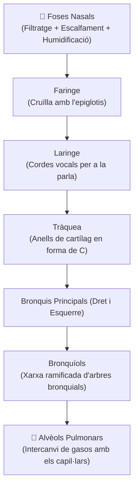

  

    ⚡ Progrés d'aprenentatge (2.5)
    0 / 3 reptes resolts
  

  

    

  

# 2.5 L'Aparell Respiratori i la Ventilació Pulmonar

Les nostres cèl·lules consumeixen constantment oxigen ($	ext{O}_2$) per a cremar glucosa als mitocondris i obtindre energia química. Com a resultat d'aquesta combustió, produeixen un gas de rebuig tòxic: el diòxid de carboni ($	ext{CO}_2$). 

L'**aparell respiratori** s'encarrega d'agafar l'oxigen de l'atmosfera i portar-lo a la sang, i alhora expulsar el diòxid de carboni a l'exterior.

---

## 1. Anatomia de les Vies Respiratòries

L'aparell respiratori humà està format per les **vies respiratòries** (el camí de pas de l'aire) i els **pulmons** (on es produeix l'intercanvi de gasos).

### Components de les Vies Respiratòries
1. **Foses nasals:** L'aire ha d'entrar pel nas. L'interior conté pèls, moc protector i una gran quantitat de capil·lars sanguinis (pituitària roja) que **filtren la pols**, **humitegen** i **escalfen l'aire** fins a $37^\circ	ext{C}$.
2. **Faringe:** Conducte comú digestiu i respiratori.
3. **Laringe:** Tub curt amb cartílags (el més prominent forma la "nou del coll"). Conté les **cordes vocals**, que vibren amb el pas de l'aire per emetre la veu.
4. **Tràquea:** Conducte d'uns 12 cm de longitud reforçat amb **anells de cartílag incomplets** (en forma de C) per evitar que el tub es col·lapse o s'aixafe en respirar. L'interior està entapissat de cilis mòbils que expulsen impureses cap amunt.
5. **Bronquis i Bronquíols:** La tràquea es bifurca en dos bronquis principals (un per a cada pulmó), que es ramifiquen en tubs cada vegada més fins anomenats bronquíols.

---

## 2. Els Pulmons i els Alvèols: L'Intercanvi de Gasos

Els **pulmons** són dos òrgans esponjosos i elàstics situats a la cavitat toràcica, protegits per les costelles i recoberts per una doble membrana anomenada **pleura**. El pulmó dret té 3 lòbuls i l'esquerre només 2 (perquè fa lloc al cor).

### Els Alvèols Pulmonars: L'Hematosi
A l'extrem de cada bronquíol hi ha xicotets sacs microscòpics anomenats **alvèols pulmonars**. En tenim més de **300 milions** en cada pulmó:
- Les seues parets són ultrafines (d'una sola capa de cèl·lules) i estan íntimament envoltades per una densa xarxa de **capil·lars sanguinis**.
- **L'Hematosi (Intercanvi de Gasos):**
  - L'**oxigen** ($	ext{O}_2$), que està en alta concentració a l'alvèol, travessa per difusió simple cap a la sang i s'uneix als glòbuls vermells.
  - El **diòxid de carboni** ($	ext{CO}_2$), que ve de rebuig de tot el cos per la sang, travessa cap a l'interior de l'alvèol per a ser expulsat.

---

## 3. La Mecànica Ventilatòria: Com Movem l'Aire?

Els pulmons no tenen músculs propis; es mouen gràcies a l'acció del **diafragma** (múscul en forma de cúpula que separa el tòrax de l'abdomen) i els **músculs intercostals**:

| Fase | Acció muscular | Volum toràcic | Pressió interna | Moviment de l'aire |
| :--- | :--- | :--- | :--- | :--- |
| **Inspiració** (Entrada) | El diafragma **es contrau i baixa**; les costelles pugen. | **Augmenta** | Baixa (pressió negativa) | L'aire exterior **entra** als pulmons |
| **Expiració** (Eixida) | El diafragma **es relaxa i puja**; les costelles baixen. | **Disminueix** | Puja | L'aire interior és **expulsat** enfora |

---

> [!NOTE]
> ### 💡 Resum de Conceptes Clau
> - Respirar pel nas condiciona l'aire (el neteja, l'escalfa i l'humiteja).
> - L'intercanvi de gasos ($	ext{O}_2 \leftrightarrow 	ext{CO}_2$) es fa exclusivament als alvèols pulmonars per difusió.
> - La inspiració és un moviment actiu (el diafragma es contrau i baixa); l'expiració és un moviment passiu de relaxació.

---

## 🎯 Activitats i Autoavaluació Interactiva

  

    🎮 <strong>Zona d'Entrenament FPB:</strong> 0 reptes resolts
    ⭐ 0 punts
  

  

### 1. Qüestionari d'Autoavaluació Tipus Test (MCQ)

  
<strong>1. A quina estructura microscòpica dels pulmons té lloc el pas de l'oxigen cap a la sang i la recollida del CO₂?</strong>

  

    <button type="button" class="btn-mcq-opt" data-opt="A">A) A les cordes vocals de la laringe</button>
    <button type="button" class="btn-mcq-opt" data-opt="B">B) Als anells de cartílag de la tràquea</button>
    <button type="button" class="btn-mcq-opt" data-opt="C">C) Als alvèols pulmonars en contacte directe amb els capil·lars sanguinis</button>
    <button type="button" class="btn-mcq-opt" data-opt="D">D) A la membrana pleural que recobreix les costelles</button>
  

  

  
<strong>2. Què ocorre amb el diafragma durant la fase d'inspiració quan agafem aire?</strong>

  

    <button type="button" class="btn-mcq-opt" data-opt="A">A) Es contrau i es desplaça cap avall, engrandint la caixa toràcica</button>
    <button type="button" class="btn-mcq-opt" data-opt="B">B) Es relaxa i puja pressionant els pulmons per buidar-los</button>
    <button type="button" class="btn-mcq-opt" data-opt="C">C) Es tanca completament per no deixar entrar pols</button>
    <button type="button" class="btn-mcq-opt" data-opt="D">D) El diafragma només funciona durant la digestió del menjar</button>
  

  

---

### 2. Activitats de Vertader (V) o Fals (F)

  <strong>a) Respirar pel nas és molt més saludable que per la boca perquè l'aire s'escalfa, s'humiteja i es filtra abans d'arribar als pulmons.</strong>
  

    <button type="button" class="btn-vf" data-opt="V">V</button>
    <button type="button" class="btn-vf" data-opt="F">F</button>
  

  

  <strong>b) L'aire que expirem conté únicament i exclusivament un 100% de diòxid de carboni pur sense gens d'oxigen.</strong>
  

    <button type="button" class="btn-vf" data-opt="V">V</button>
    <button type="button" class="btn-vf" data-opt="F">F</button>
  

  

---

### 3. Exercicis de Resposta Breu i Vocabulari Tècnic

  
✍️ Quin és el múscul principal de la respiració que separa la cavitat toràcica de la cavitat abdominal?

  

    <input type="text" class="quiz-input" placeholder="Escriu el nom del múscul...">
    <button type="button" class="btn-quiz-check">Comprovar</button>
  

  

  
✍️ Com s'anomenen els xicotets sacs terminals dels pulmons on té lloc l'intercanvi de gasos amb la sang?

  

    <input type="text" class="quiz-input" placeholder="Escriu el terme...">
    <button type="button" class="btn-quiz-check">Comprovar</button>
  

  

---

### 4. Pregunta de Raonament i Desenvolupament Escrit

  
✍️ <strong>Tabaquisme, vapeig i rendiment físic:</strong> El fum del tabac i les substàncies dels cigarrets electrònics paralitzen els cilis de la tràquea i destrueixen la paret dels alvèols pulmonars (emfisema). Com afecta aquest dany a la capacitat d'oxigenació de la sang i per què un jove fumador es cansa molt més ràpid pujant escales o fent esport?

  <textarea class="open-response-input" rows="4" placeholder="Explica la pèrdua de superfície d'intercanvi als alvèols i la manca d'oxigen als músculs..."></textarea>

---

  <h3 style="margin-top:0; color:#0369a1;">📦 Lliurament d'Activitats d'Aules (Act 2.5)</h3>
  
Genera el teu document de tasca d'aquest apartat amb el teu nom i puntuació obtinguda.

  

    <input type="text" class="aules-student-name" placeholder="Cognoms, Nom de l'Alumne/a" style="padding:8px 12px; border:1px solid #94a3b8; border-radius:4px; flex-grow:1; min-width:240px;">
    <button class="btn-generate-aules-pdf" data-unit="UD02" data-activity="Act05" data-module="CA" style="padding:8px 16px; background:#0284c7; color:#fff; border:none; border-radius:4px; font-weight:600; cursor:pointer;">📄 Descarregar PDF per a Aules</button>
  

