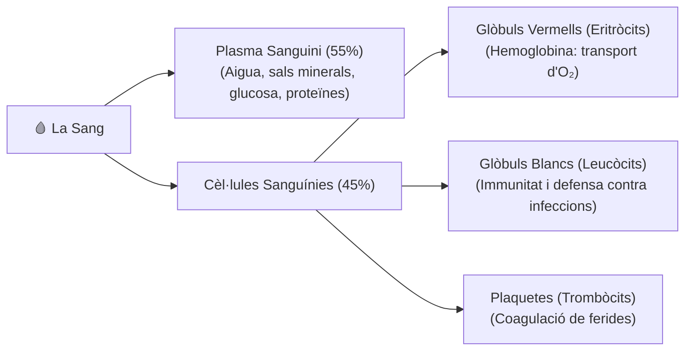

  

    ⚡ Progrés d'aprenentatge (2.6)
    0 / 3 reptes resolts
  

  

    

  

# 2.6 L'Aparell Circulatori Cardiovascular

El nostre cos conté bilions de cèl·lules que necessiten rebre oxigen i nutrients contínuament, així com desfer-se dels residus tòxics que produeixen. 

L'**aparell circulatori** és la gran xarxa de transport intern del cos. Està format per un líquid especialitzat (la **sang**), una xarxa de canonades (els **vasos sanguinis**) i una bomba impel·lent central (el **cor**).

---

## 1. La Sang: El Líquid de la Vida

Una persona adulta té entre 5 i 6 litres de sang circulant contínuament. Si centrifugem una mostra de sang, es divideix en dues fraccions:

1. **Glòbuls vermells (Eritròcits):** Cèl·lules en forma de disc bicòncau sense nucli. Estan plenes d'**hemoglobina**, una proteïna amb àtoms de ferro que s'uneix a l'oxigen donant a la sang el seu característic color roig. N'hi ha uns 5 milions per $	ext{mm}^3$.
2. **Glòbuls blancs (Leucòcits):** Cèl·lules del sistema immunitari encarregades de detectar i neutralitzar bacteris, virus i cèl·lules anòmales. N'hi ha entre 5.000 i 10.000 per $	ext{mm}^3$.
3. **Plaquetes (Trombòcits):** Fragments cel·lulars que formen un tap plaquetari i desencadenen la coagulació quan es trenca un vas sanguini, evitant l'hemorràgia.

---

## 2. Els Vasos Sanguinis: Artèries, Venes i Capil·lars

| Tipus de Vas | Direcció del flux | Característiques de la paret | Pressió sanguínia |
| :--- | :--- | :--- | :--- |
| **Artèries** | **Surten del cor** cap als òrgans | Parets molt gruixudes, elàstiques i musculars | **Molt alta** |
| **Venes** | **Tornen al cor** des dels òrgans | Parets més fines; tenen **vàlvules internes** per evitar el retrocés | Baixa |
| **Capil·lars** | Connecten artèries i venes als teixits | Microscòpics, d'**una sola capa de cèl·lules** | Molt baixa (facilita l'intercanvi) |

---

## 3. El Cor i el Cicle Cardíac

El **cor** és un òrgan buit fet de potent teixit muscular (miocardi), de la mida d'un puny tancat, situat al centre del tòrax lleugerament inclinat cap a l'esquerra.

- Està dividit en **4 cavitats**:
  - **2 Aurícules (a dalt):** reben la sang que torna al cor per les venes.
  - **2 Ventricles (a baix):** impulsen la sang amb força cap a les artèries.
- Entre les aurícules i els ventricles hi ha vàlvules que impedeixen el retorn de la sang (vàlvula **tricúspide** a la dreta i **mitral** a l'esquerra).
- **El batec cardíac:**
  - **Sístole:** Contracció de les parets del cor per bombejar la sang cap a fora.
  - **Diàstole:** Relaxació de les cambres perquè el cor es torne a omplir de sang.

---

## 4. Com és la Circulació Humana?

Es defineix amb tres característiques fonamentals:
1. **Tancada:** La sang mai surt de la xarxa de vasos sanguinis; l'intercanvi de líquids es fa a través dels capil·lars.
2. **Doble:** Té dos circuits complets independents:
   - **Circuit Menor o Pulmonar:** Ventricle dret $
ightarrow$ Pulmons (s'oxigena la sang) $
ightarrow$ Aurícula esquerra.
   - **Circuit Major o General:** Ventricle esquerre $
ightarrow$ Tot el cos (nutrients i $	ext{O}_2$) $
ightarrow$ Aurícula dreta.
3. **Completa:** La sang rica en oxigen (esquerra del cor) mai es barreja amb la sang rica en diòxid de carboni (dreta del cor).

---

## 5. Els Grups Sanguinis (Sistema AB0 i Rh)

A la membrana dels glòbuls vermells hi ha unes proteïnes identificadores (antígens):
- **Grup A:** Té antigen A.
- **Grup B:** Té antigen B.
- **Grup AB:** Té antígens A i B (**Receptor Universal**).
- **Grup 0:** No té cap antigen (**Donant Universal**, però només pot rebre de 0).
- **Factor Rh:** Si tens la proteïna Rh ets $	ext{Rh}^+$; si no la tens ets $	ext{Rh}^-$.

---

> [!NOTE]
> ### 💡 Resum de Conceptes Clau
> - La sang transporta oxigen (hemoglobina dels glòbuls vermells), defensa el cos (glòbuls blancs) i coagula (plaquetes).
> - Les artèries surten del cor a gran pressió; les venes tornen al cor amb vàlvules antiretorn.
> - La circulació humana és tancada, doble i completa.

---

## 🎯 Activitats i Autoavaluació Interactiva

  

    🎮 <strong>Zona d'Entrenament FPB:</strong> 0 reptes resolts
    ⭐ 0 punts
  

  

### 1. Qüestionari d'Autoavaluació Tipus Test (MCQ)

  
<strong>1. Per què es defineix la circulació sanguínia humana com a 'completa'?</strong>

  

    <button type="button" class="btn-mcq-opt" data-opt="A">A) Perquè la sang viatja per tot el cos en menys d'un segon</button>
    <button type="button" class="btn-mcq-opt" data-opt="B">B) Perquè la sang oxigenada i la sang rica en CO₂ mai es barregen a l'interior del cor</button>
    <button type="button" class="btn-mcq-opt" data-opt="C">C) Perquè tots els humans tenim el mateix grup sanguini</button>
    <button type="button" class="btn-mcq-opt" data-opt="D">D) Perquè conté un 100% de cèl·lules i gens de líquid</button>
  

  

  
<strong>2. Quins elements de la sang són fragments cel·lulars responsables de tapar una ferida formant un coàgul protector?</strong>

  

    <button type="button" class="btn-mcq-opt" data-opt="A">A) Els glòbuls vermells (eritròcits)</button>
    <button type="button" class="btn-mcq-opt" data-opt="B">B) Els leucòcits defensius</button>
    <button type="button" class="btn-mcq-opt" data-opt="C">C) El plasma líquid</button>
    <button type="button" class="btn-mcq-opt" data-opt="D">D) Les plaquetes o trombòcits</button>
  

  

---

### 2. Activitats de Vertader (V) o Fals (F)

  <strong>a) Les venes tenen petites vàlvules al seu interior que impedeixen el retrocés de la sang quan puja cap al cor en contra de la gravetat.</strong>
  

    <button type="button" class="btn-vf" data-opt="V">V</button>
    <button type="button" class="btn-vf" data-opt="F">F</button>
  

  

  <strong>b) Una persona amb grup sanguini 0⁻ pot rebre una transfusió de sang de qualsevol persona del món sense cap perill.</strong>
  

    <button type="button" class="btn-vf" data-opt="V">V</button>
    <button type="button" class="btn-vf" data-opt="F">F</button>
  

  

---

### 3. Exercicis de Resposta Breu i Vocabulari Tècnic

  
✍️ Com s'anomena la proteïna present als glòbuls vermells encarregada de fixar i transportar les molècules d'oxigen?

  

    <input type="text" class="quiz-input" placeholder="Escriu la proteïna...">
    <button type="button" class="btn-quiz-check">Comprovar</button>
  

  

  
✍️ Quin nom rep la fase mecànica en què el múscul cardíac es contrau amb força per expulsar la sang cap a les artèries?

  

    <input type="text" class="quiz-input" placeholder="Escriu la fase cardíaca...">
    <button type="button" class="btn-quiz-check">Comprovar</button>
  

  

---

### 4. Pregunta de Raonament i Desenvolupament Escrit

  
✍️ <strong>Freqüència cardíaca i esforç al taller:</strong> Un treballador té un pols de 70 pulsacions per minut en repòs. En carregar caixes pesades, el seu pols puja a 140 pulsacions per minut. Explica per quin motiu fisiològic el cor ha de bategar el doble de ràpid durant l'esforç i què li passaria a les cèl·lules musculars si no ho fera.

  <textarea class="open-response-input" rows="4" placeholder="Explica la demanda urgent d'oxigen i glucosa pels músculs i l'eliminació de residus..."></textarea>

---

  <h3 style="margin-top:0; color:#0369a1;">📦 Lliurament d'Activitats d'Aules (Act 2.6)</h3>
  
Genera el teu document de tasca d'aquest apartat amb el teu nom i puntuació obtinguda.

  

    <input type="text" class="aules-student-name" placeholder="Cognoms, Nom de l'Alumne/a" style="padding:8px 12px; border:1px solid #94a3b8; border-radius:4px; flex-grow:1; min-width:240px;">
    <button class="btn-generate-aules-pdf" data-unit="UD02" data-activity="Act06" data-module="CA" style="padding:8px 16px; background:#0284c7; color:#fff; border:none; border-radius:4px; font-weight:600; cursor:pointer;">📄 Descarregar PDF per a Aules</button>
  

