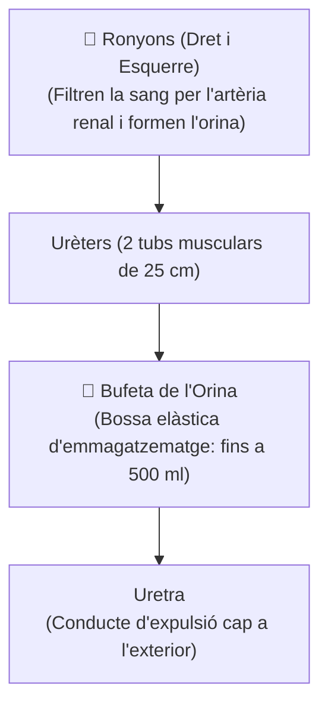

  

    ⚡ Progrés d'aprenentatge (2.7)
    0 / 3 reptes resolts
  

  

    

  

# 2.7 L'Aparell Excretor Humà: Ronyons i Formació d'Orina

Quan les nostres cèl·lules fan servir els nutrients per a obtindre energia o sintetitzar proteïnes, produeixen substàncies residuals altament tòxiques, principalment derivats del nitrogen com la **urea** i l'**àcid úric**. Si aquests compostos s'acumularen a la sang ens enverinarien en poques hores.

L'**aparell excretor** actua com la depuradora química del cos: s'encarrega de netejar i filtrar contínuament la sang per expulsar aquests tòxics a l'exterior dissolts en aigua.

---

## 1. Concepte d'Excreció: No Confondre Excretar amb Defecar

En biologia i ciències de la salut és fonamental no barrejar aquests dos conceptes:
- **Defecació (Aparell Digestiu):** És l'expulsió de substàncies que **mai han entrat dins de l'organisme**. Són restes d'aliments no digerits (com la fibra vegetal) que han passat pel tub digestiu sense travessar mai la paret intestinal ni arribar a les cèl·lules.
- **Excreció (Aparell Excretor):** És l'eliminació de residus metabòlics que **han produït les pròpies cèl·lules** en funcionar, que han passat a la sang i que han de ser filtrats.

---

## 2. L'Aparell Urinari Humà

L'aparell urinari està integrat per dos òrgans depuradors (els **ronyons**) i les **vies urinàries** (que condueixen l'orina a l'exterior).

### A) Els Ronyons
Són dos òrgans en forma de fava o mongeta, d'uns 12 cm de longitud, situats a la part posterior de l'abdomen, a banda i banda de la columna vertebral. Cada dia filtren aproximadament **180 litres de sang**.

### B) La Nefrona: La Depuradora Microscòpica
Cada ronyó conté més d'**un milió** de petites unitats microscòpiques anomenades **nefrones**. Cada nefrona té dues parts:
1. **Glomèrul de Malpighi (dins la càpsula de Bowman):** Un cabdell de capil·lars sanguinis a gran pressió on es produeix la **filtració**. L'aigua i molècules menudes (urea, glucosa, sals) surten de la sang cap a la nefrona.
2. **Túbul renal:** Un conducte llarg i sinuós on té lloc la **reabsorció**: el ronyó recupera cap a la sang el **99% de l'aigua** i totes les substàncies valuoses (com la glucosa o aminoàcids).
3. El líquid restant (només un 1%), carregat de residus tòxics i sals sobrants, és l'**orina** definitiva (aproximadament $1,5	ext{ litres}$ al dia).

### C) Les Vies Urinàries
- **Urèters:** Dos conductes fins d'uns 25 cm que transporten contínuament l'orina des de cada ronyó fins a la bufeta mitjançant moviments peristàltics.
- **Bufeta urinària:** Dipòsit muscular elàstic que emmagatzema l'orina entre miccions (capacitat de 300 a 500 ml).
- **Uretra:** Conducte que comunica la bufeta amb l'exterior. Té un esfínter muscular que controlem voluntàriament.

---

## 3. Altres Òrgans amb Funció Excretora

Els ronyons no són els únics òrgans que eliminen residus:
- **Glàndules sudorípares (pell):** Produeixen la **suor** (que és orina molt diluïda, amb aigua, sals minerals i urea). A més d'excretar, té la funció vital de **refredar el cos** per evaporació.
- **Pulmons:** Eliminen el gas tòxic $	ext{CO}_2$ i vapor d'aigua en cada expiració.
- **Fetge:** Neutralitza fàrmacs, alcohol i toxines de la sang, i expulsa pigments biliars amb les femtes.

---

> [!NOTE]
> ### 💡 Resum de Conceptes Clau
> - L'excreció elimina els residus cel·lulars de la sang; la defecació expulsa el menjar no digerit.
> - La nefrona és la unitat funcional del ronyó: fa filtració i reabsorbeix el 99% d'aigua útil.
> - L'orina viatja per: Ronyons $
ightarrow$ Urèters $
ightarrow$ Bufeta $
ightarrow$ Uretra.
> - La suor, els pulmons i el fetge també col·laboren en l'excreció.

---

## 🎯 Activitats i Autoavaluació Interactiva

  

    🎮 <strong>Zona d'Entrenament FPB:</strong> 0 reptes resolts
    ⭐ 0 punts
  

  

### 1. Qüestionari d'Autoavaluació Tipus Test (MCQ)

  
<strong>1. Quina és la unitat microscòpica funcional de filtració que es troba per milions a l'interior de cada ronyó?</strong>

  

    <button type="button" class="btn-mcq-opt" data-opt="A">A) L'alvèol renal</button>
    <button type="button" class="btn-mcq-opt" data-opt="B">B) La neurona urinària</button>
    <button type="button" class="btn-mcq-opt" data-opt="C">C) La nefrona</button>
    <button type="button" class="btn-mcq-opt" data-opt="D">D) L'adipòcit de protecció</button>
  

  

  
<strong>2. Quina importància té la fase de reabsorció que realitza la nefrona als seus túbuls?</strong>

  

    <button type="button" class="btn-mcq-opt" data-opt="A">A) Retorna a la sang el 99% de l'aigua filtrada i substàncies útils com la glucosa evitant la deshidratació</button>
    <button type="button" class="btn-mcq-opt" data-opt="B">B) Converteix l'orina en sang fresca</button>
    <button type="button" class="btn-mcq-opt" data-opt="C">C) Genera gas oxigen per als pulmons</button>
    <button type="button" class="btn-mcq-opt" data-opt="D">D) Destrueix els glòbuls blancs vells</button>
  

  

---

### 2. Activitats de Vertader (V) o Fals (F)

  <strong>a) Els urèters són dos conductes que transporten l'orina des de cada ronyó fins a la bufeta urinària on s'emmagatzema.</strong>
  

    <button type="button" class="btn-vf" data-opt="V">V</button>
    <button type="button" class="btn-vf" data-opt="F">F</button>
  

  

  <strong>b) La bufeta urinària és l'òrgan que filtra directament la sang i fabrica l'orina contínuament.</strong>
  

    <button type="button" class="btn-vf" data-opt="V">V</button>
    <button type="button" class="btn-vf" data-opt="F">F</button>
  

  

---

### 3. Exercicis de Resposta Breu i Vocabulari Tècnic

  
✍️ Quin conducte anatòmic permet l'evacuació de l'orina acumulada a la bufeta cap a l'exterior del cos?

  

    <input type="text" class="quiz-input" placeholder="Escriu el conducte...">
    <button type="button" class="btn-quiz-check">Comprovar</button>
  

  

  
✍️ Esmenta la principal substància residual tòxica rica en nitrogen que els ronyons eliminen de la sang dissolta en l'orina.

  

    <input type="text" class="quiz-input" placeholder="Escriu la substància...">
    <button type="button" class="btn-quiz-check">Comprovar</button>
  

  

---

### 4. Pregunta de Raonament i Desenvolupament Escrit

  
✍️ <strong>Hidratació, calor i color de l'orina:</strong> Durant un dia de molta calor a l'estiu treballant a un taller, un operari sua molt i beu poca aigua. En anar al lavabo observa que la seua orina és molt escassa i d'un color groc fosc intens. Explica què han fet les seues nefrones per protegir-lo i per què aquest és un senyal d'alerta de deshidratació.

  <textarea class="open-response-input" rows="4" placeholder="Explica com el ronyó reabsorbeix màxima aigua per mantindre la pressió sanguínia i concentra els residus..."></textarea>

---

  <h3 style="margin-top:0; color:#0369a1;">📦 Lliurament d'Activitats d'Aules (Act 2.7)</h3>
  
Genera el teu document de tasca d'aquest apartat amb el teu nom i puntuació obtinguda.

  

    <input type="text" class="aules-student-name" placeholder="Cognoms, Nom de l'Alumne/a" style="padding:8px 12px; border:1px solid #94a3b8; border-radius:4px; flex-grow:1; min-width:240px;">
    <button class="btn-generate-aules-pdf" data-unit="UD02" data-activity="Act07" data-module="CA" style="padding:8px 16px; background:#0284c7; color:#fff; border:none; border-radius:4px; font-weight:600; cursor:pointer;">📄 Descarregar PDF per a Aules</button>
  

