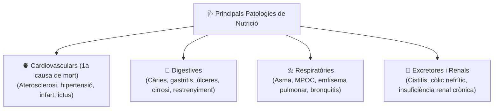
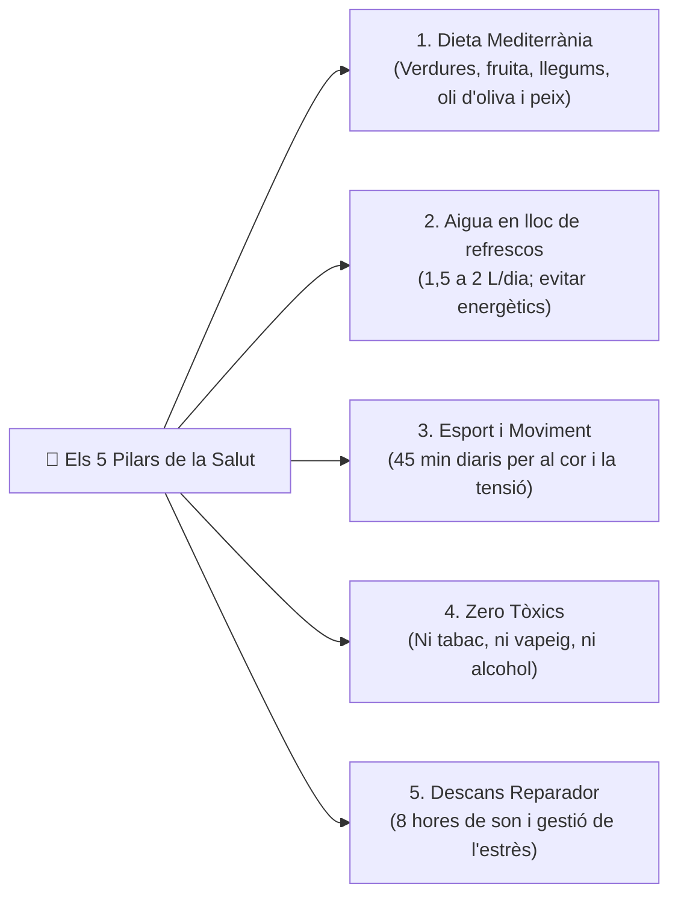

  

    ⚡ Progrés d'aprenentatge (2.8)
    0 / 3 reptes resolts
  

  

    

  

# 2.8 Hàbits Saludables, Dieta i Prevenció de Malalties

Els quatre aparells que participen en la nutrició humana (digestiu, respiratori, circulatori i excretor) treballen com un engranatge d'alta precisió. Si un d'ells falla o es deteriora, arrossega inevitablement la resta.

En la societat actual, les malalties que més vides s'emporten al món occidental no són les infeccions per bacteris, sinó les **malalties cròniques no transmissibles** (cardiovasculars, càncer, diabetis, obesitat i insuficiència renal), directament provocades per l'estil de vida: el sedentarisme, el consum d'aliments ultraprocessats plens de sucre i greixos saturats, el consum d'alcohol, el tabaquisme i el vapeig. La bona notícia és que **més del 80% d'aquestes patologies es poden previndre completament** amb hàbits senzills mantinguts en el dia a dia.

---

## 1. Patologies Freqüents dels Aparells de Nutrició

### A) Malalties de l'Aparell Circulatori (La Primera Causa de Mortalitat)
1. **Aterosclerosi:** És la formació progressiva de plaques dures d'**ateroma** (fetes de colesterol $	ext{LDL}$, greix, calci i restes cel·lulars) a l'interior de les artèries:
   - Comença quan el tabac o la pressió alta lesionen la paret interna del vas. El colesterol s'hi diposita i el cos envia glòbuls blancs, que s'inflamen i formen una crosta rígida.
   - L'artèria perd la seua elasticitat i la seua llum s'estreny, dificultant el pas de la sang.
2. **Hipertensió arterial:** Es produeix quan la pressió de la sang contra les artèries és de manera continuada igual o superior a **$140/90	ext{ mmHg}$**. És una "assassina silenciosa" perquè no fa mal, però a la llarga esquerda els vasos del cervell, de la retina i dels ronyons, i força el cor a fer un sobreesforç que l'engrosseix fins a esgotar-lo.
3. **Infart Agut de Miocardi (Atac de Cor):** Si una placa d'ateroma d'una artèria coronària es trenca, es forma un coàgul (trombe) que la tapona de cop. La sang deixa d'arribar a una part del múscul cardíac, i les seues cèl·lules moren asfixiades en pocs minuts. Es manifesta amb un dolor opressiu intens al mig del pit que s'irradia cap al braç esquerre, la mandíbula o l'esquena, acompanyat de suor freda i mareig.
4. **Ictus o Accident Cerebrovascular:** Quan una artèria que rega el cervell es tapona per un trombe (ictus isquèmic) o es trenca per alta pressió (ictus hemorràgic). Provoca paràlisi d'un costat del cos o pèrdua de la parla.

### B) Malalties de l'Aparell Digestiu
- **Càries dental:** Els bacteris de la boca s'alimenten dels sucres refinats i desprenen àcids que dissolen l'esmalt de calci, obrint forats que arriben a la polpa dental amb intens dolor.
- **Gastritis i úlceres pèptiques:** Inflamació i ferides obertes a la mucosa de l'estómac causades per l'estrès, fàrmacs antiinflamatoris o la infecció pel bacteri *Helicobacter pylori*.
- **Cirrosi hepàtica:** Malaltia degenerativa irreversible on les cèl·lules sanes del fetge són substituïdes per teixit cicatricial rígid (fibrosi). Les seues causes principals són l'abús crònic d'alcohol, dietes molt grasses (fetge gras) i les hepatitis víriques.
- **Restrenyiment crònic:** Dificultat per evacuar deguda a una dieta sense fruita ni verdura (manca de fibra) i a beure poca aigua. Les femtes s'assequen i causen hemorroides o diverticles.

### C) Malalties Respiratòries i Renals
- **MPOC (Malaltia Pulmonar Obstructiva Crònica) i Emfisema:** Els productes tòxics del fum del tabac i del vapeig cremen els cilis i destrueixen la paret elàstica dels alvèols. Els alvèols es fusionen formant grans bosses inútils, reduint dràsticament l'oxigenació: el malalt s'ofega amb el mínim esforç.
- **Cistitis:** Infecció bacteriana de la bufeta (habitualment pel bacteri *Escherichia coli*). Causa coïssor intens en orinar i ganes d'anar al lavabo cada cinc minuts. Molt freqüent en dones per la menor longitud de la uretra.
- **Càlculs renals (Pedres al ronyó / Còlic nefrític):** Cristalls sòlids de sals de calci o àcid úric que precipiten quan l'orina és massa concentrada per no beure aigua. Quan una pedra baixa per l'urèter i l'obstrueix, provoca un dolor espasmòdic insuportable a la zona lumbar.
- **Insuficiència renal crònica:** Quan les nefrones es destrueixen massivament per diabetis o hipertensió i els ronyons deixen de filtrar. El pacient necessita connectar-se 3 dies per setmana a una màquina d'**hemodiàlisi** que li filtra la sang artificialment a l'hospital durant 4 hores, o rebre un trasplantament de ronyó.

---

## 2. Decàleg d'Hàbits de Vida Saludable i Prevenció

### Com cuidar el cos cada dia:
1. **Aplicar el "Mètode del Plat de Harvard":**
   - **$50\%$ del plat:** Verdures fresques i fruita de temporada (aporten aigua, vitamines, minerals i fibra que neteja l'intestí).
   - **$25\%$ del plat:** Proteïnes saludables (llegums, peix blanc i blau, ous, carns blanques com pollastre o conill; reduint carns roges i embotits).
   - **$25\%$ del plat:** Hidrats de carboni integrals (pa integral, arròs integral, civada o creïlla bullida en lloc de farines blanques refinades).
   - Greix principal: **oli d'oliva verge extra** ric en àcid oleic cardioprotector.
2. **Control estricte de sucres i sal:**
   - La sal reté líquids i puja la pressió arterial: no superar els **5 grams al dia** (una cullerada de cafè).
   - Eliminar els refrescos ensucrats i les begudes energètiques: una sola llauna pot contenir més de 40 grams de sucre líquid i quantitats massives de cafeïna que taquicarditzen el cor i desgasten els ronyons.
3. **Hidratació constant:** Beure aigua abans de tindre set. L'orina clara com la llimonada és el millor indicador que els ronyons estan nets i sans.
4. **Activitat física quotidiana:** L'ésser humà està dissenyat per moure's. Caminar 8.000 passos al dia o fer 45 minuts d'activitat física modera la tensió, neteja el colesterol dolent i crema greix visceral.
5. **Seguretat al taller laboral:** Utilitzar sempre els Equips de Protecció Individual (EPIs): mascaretes filtrants quan es tallen fustes, es lixa fibra o es pinten metalls per a protegir els alvèols pulmonars de partícules tòxiques.

---

> [!NOTE]
> ### 💡 Resum de Conceptes Clau
> - L'aterosclerosi (plaques de colesterol i greix a les artèries) és la causa arrel d'infarts i ictus.
> - El tabac i el vapeig destrueixen els alvèols provocant MPOC i emfisema irreversible.
> - Beure 1,5 a 2 litres d'aigua prevé còlics nefrítics i protegeix les nefrones renals.
> - La combinació de Dieta Mediterrània, esport diari i zero tòxics redueix més del 80% de les malalties cròniques.

---

## 🎯 Activitats i Autoavaluació Interactiva

  

    🎮 <strong>Zona d'Entrenament FPB:</strong> 0 reptes resolts
    ⭐ 0 punts
  

  

### 1. Qüestionari d'Autoavaluació Tipus Test (MCQ)

  
<strong>1. Com s'anomena la patologia caracteritzada per la formació de plaques de colesterol i greix a l'interior de les artèries?</strong>

  

    <button type="button" class="btn-mcq-opt" data-opt="A">A) Gastritis aguda</button>
    <button type="button" class="btn-mcq-opt" data-opt="B">B) Aterosclerosi o arteriosclerosi</button>
    <button type="button" class="btn-mcq-opt" data-opt="C">C) Cistitis bacteriana</button>
    <button type="button" class="btn-mcq-opt" data-opt="D">D) Alvèolitis al·lèrgica</button>
  

  

  
<strong>2. Quin tractament mèdic substitueix la funció de filtració dels ronyons quan un pacient pateix insuficiència renal greu?</strong>

  

    <button type="button" class="btn-mcq-opt" data-opt="A">A) Una transfusió de plaquetes</button>
    <button type="button" class="btn-mcq-opt" data-opt="B">B) Una broncoscòpia diagnòstica</button>
    <button type="button" class="btn-mcq-opt" data-opt="C">C) Una dieta rica en greixos saturats</button>
    <button type="button" class="btn-mcq-opt" data-opt="D">D) L'hemodiàlisi mitjançant un ronyó artificial</button>
  

  

---

### 2. Activitats de Vertader (V) o Fals (F)

  <strong>a) Les begudes energètiques de llauna són ideals per a hidratar-se en lloc de l'aigua perquè contenen vitamines beneficioses per al cor.</strong>
  

    <button type="button" class="btn-vf" data-opt="V">V</button>
    <button type="button" class="btn-vf" data-opt="F">F</button>
  

  

  <strong>b) Menjar fruita, verdures i llegums rics en fibra vegetal ajuda a prevenir el restrenyiment i protegeix contra el càncer de còlon.</strong>
  

    <button type="button" class="btn-vf" data-opt="V">V</button>
    <button type="button" class="btn-vf" data-opt="F">F</button>
  

  

---

### 3. Exercicis de Resposta Breu i Vocabulari Tècnic

  
✍️ Com s'anomena la inflamació i infecció bacteriana de la bufeta urinària que provoca dolor i picor intensa en orinar?

  

    <input type="text" class="quiz-input" placeholder="Escriu la malaltia...">
    <button type="button" class="btn-quiz-check">Comprovar</button>
  

  

  
✍️ Quin accident cardiovascular greu es produeix quan una artèria coronària s'obstrueix i part del múscul cardíac mor per manca d'oxigen?

  

    <input type="text" class="quiz-input" placeholder="Escriu el terme mèdic...">
    <button type="button" class="btn-quiz-check">Comprovar</button>
  

  

---

### 4. Pregunta de Raonament i Desenvolupament Escrit

  
✍️ <strong>Diagnòstic d'hàbits en joves:</strong> Imagina un company de classe que esmorza cada dia un refresc energètic i una bossa de papes industrials, passa 7 hores assegut davant la pantalla sense fer gens d'esport i fuma vapejador. Analitza quins tres aparells de nutrició (circulatori, respiratori, digestiu o excretor) està posant en risc extrem i proposa 3 canvis pràctics concrets que hauria de fer des de demà mateix.

  <textarea class="open-response-input" rows="4" placeholder="Argumenta sobre artèries/pressió, alvèols/pulmons, ronyons/pes corporal..."></textarea>

---

  <h3 style="margin-top:0; color:#0369a1;">📦 Lliurament d'Activitats d'Aules (Act 2.8)</h3>
  
Genera el teu document de tasca d'aquest apartat amb el teu nom i puntuació obtinguda.

  

    <input type="text" class="aules-student-name" placeholder="Cognoms, Nom de l'Alumne/a" style="padding:8px 12px; border:1px solid #94a3b8; border-radius:4px; flex-grow:1; min-width:240px;">
    <button class="btn-generate-aules-pdf" data-unit="UD02" data-activity="Act08" data-module="CA" style="padding:8px 16px; background:#0284c7; color:#fff; border:none; border-radius:4px; font-weight:600; cursor:pointer;">📄 Descarregar PDF per a Aules</button>
  

