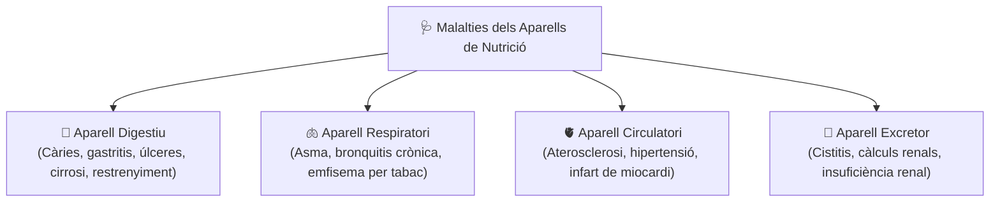

  

    ⚡ Progrés d'aprenentatge (2.8)
    0 / 3 reptes resolts
  

  

    

  

# 2.8 Hàbits Saludables, Dieta i Prevenció de Malalties

Els quatre aparells que participen en la nutrició (digestiu, respiratori, circulatori i excretor) treballen com un engranatge perfecte. Tanmateix, l'estil de vida modern, el sedentarisme, el consum d'aliments ultraprocessats, el tabac o l'estrès poden provocar malalties greus que redueixen dràsticament la nostra qualitat de vida.

---

## 1. Principals Malalties dels Aparells de Nutrició

### A) Malalties de l'Aparell Digestiu
- **Càries dental:** Destrucció de l'esmalt per àcids que produeixen els bacteris de la boca en alimentar-se de sucres refinats.
- **Gastritis i úlceres:** Inflamació i ferides obertes a la paret de l'estómac causades per l'excés d'àcid, fàrmacs o el bacteri *Helicobacter pylori*.
- **Restrenyiment:** Dificultat per defecar deguda a una dieta pobra en fibra vegetal i aigua.
- **Cirrosi hepàtica:** Destrucció irreversible de les cèl·lules del fetge, sovint per consum crònic d'alcohol o hepatitis víriques.

### B) Malalties de l'Aparell Circulatori (La 1a Causa de Mortalitat)
- **Aterosclerosi:** Acumulació de plaques de colesterol i greix a la paret interna de les artèries. Les artèries es tornen rígides i s'estrenyen, reduint el flux sanguini.
- **Hipertensió arterial:** Pressió sanguínia contínuament per damunt dels valors normals ($>140/90	ext{ mmHg}$), que desgasta el cor i fa malbé els vasos dels ronyons i del cervell.
- **Infart de miocardi (Atac de cor):** Obstrucció completa d'una artèria coronària que irriga el cor. Una part del múscul cardíac es queda sense oxigen i mor.
- **Ictus o accident cerebrovascular:** Obstrucció o trencament d'un vas sanguini al cervell.

### C) Malalties Respiratòries i Excretores
- **Bronquitis crònica i emfisema:** Destrucció del teixit pulmonar i dels alvèols, directament provocada pel fum del tabac i el vapeig continuat.
- **Cistitis:** Infecció bacteriana de la bufeta urinària que provoca picor, dolor i ganes freqüents d'orinar.
- **Càlculs renals (Pedres al ronyó):** Dipòsits sòlids de sals minerals (com oxalat de calci) que es cristal·litzen als ronyons quan no es beu prou aigua.
- **Insuficiència renal:** Els ronyons deixen de filtrar la sang. El pacient necessita connectar-se a una màquina d'**hemodiàlisi** 3 dies per setmana o un trasplantament de ronyó.

---

## 2. Decàleg d'Hàbits de Vida Saludable

Per mantindre sans els nostres aparells de nutrició, l'Organització Mundial de la Salut recomana aplicar cada dia aquests cinc pilars:

1. **Alimentació d'estil mediterrani:** Rica en verdures fresques, fruita, llegums, cereals integrals, peix i oli d'oliva verge. Reduir al màxim begudes ensucrades, brioixeria industrial i embotits grassos.
2. **Hidratació adequada:** Beure entre **1,5 i 2 litres d'aigua** al dia (evitant begudes energètiques o alcohòliques).
3. **Activitat física regular:** Caminar o fer esport almenys 45-60 minuts diaris per enfortir el cor i cremar greix corporal.
4. **Respirar aire net:** No fumar mai ni utilitzar vapejadors, i ventilar les aules i tallers de treball.
5. **Descans suficient i salut mental:** Dormir 8 hores diàries i gestionar l'estrès per mantindre la tensió arterial sota control.

---

> [!NOTE]
> ### 💡 Resum de Conceptes Clau
> - L'aterosclerosi (greix a les artèries) és el detonant principal d'infarts i ictus.
> - El tabaquisme i el vapeig són els destructors principals dels alvèols pulmonars.
> - La manca d'aigua provoca pedres al ronyó i sobrecàrrega les nefrones.
> - Una dieta rica en fibra i esport diari prevenen la immensa majoria de malalties cròniques.

---

## 🎯 Activitats i Autoavaluació Interactiva

  

    🎮 <strong>Zona d'Entrenament FPB:</strong> 0 reptes resolts
    ⭐ 0 punts
  

  

### 1. Qüestionari d'Autoavaluació Tipus Test (MCQ)

  
<strong>1. Com s'anomena la patologia caracteritzada per la formació de plaques de colesterol i greix a l'interior de les artèries?</strong>

  

    <button type="button" class="btn-mcq-opt" data-opt="A">A) Gastritis aguda</button>
    <button type="button" class="btn-mcq-opt" data-opt="B">B) Aterosclerosi o arteriosclerosi</button>
    <button type="button" class="btn-mcq-opt" data-opt="C">C) Cistitis bacteriana</button>
    <button type="button" class="btn-mcq-opt" data-opt="D">D) Alvèolitis al·lèrgica</button>
  

  

  
<strong>2. Quin tractament mèdic substitueix la funció de filtració dels ronyons quan un pacient pateix insuficiència renal greu?</strong>

  

    <button type="button" class="btn-mcq-opt" data-opt="A">A) Una transfusió de plaquetes</button>
    <button type="button" class="btn-mcq-opt" data-opt="B">B) Una broncoscòpia diagnòstica</button>
    <button type="button" class="btn-mcq-opt" data-opt="C">C) Una dieta rica en greixos saturats</button>
    <button type="button" class="btn-mcq-opt" data-opt="D">D) L'hemodiàlisi mitjançant un ronyó artificial</button>
  

  

---

### 2. Activitats de Vertader (V) o Fals (F)

  <strong>a) Les begudes energètiques de llauna són ideals per a hidratar-se en lloc de l'aigua perquè contenen vitamines beneficioses per al cor.</strong>
  

    <button type="button" class="btn-vf" data-opt="V">V</button>
    <button type="button" class="btn-vf" data-opt="F">F</button>
  

  

  <strong>b) Menjar fruita, verdures i llegums rics en fibra vegetal ajuda a prevenir el restrenyiment i protegeix contra el càncer de còlon.</strong>
  

    <button type="button" class="btn-vf" data-opt="V">V</button>
    <button type="button" class="btn-vf" data-opt="F">F</button>
  

  

---

### 3. Exercicis de Resposta Breu i Vocabulari Tècnic

  
✍️ Com s'anomena la inflamació i infecció bacteriana de la bufeta urinària que provoca dolor i picor intensa en orinar?

  

    <input type="text" class="quiz-input" placeholder="Escriu la malaltia...">
    <button type="button" class="btn-quiz-check">Comprovar</button>
  

  

  
✍️ Quin accident cardiovascular greu es produeix quan una artèria coronària s'obstrueix i part del múscul cardíac mor per manca d'oxigen?

  

    <input type="text" class="quiz-input" placeholder="Escriu el terme mèdic...">
    <button type="button" class="btn-quiz-check">Comprovar</button>
  

  

---

### 4. Pregunta de Raonament i Desenvolupament Escrit

  
✍️ <strong>Diagnòstic d'hàbits en joves:</strong> Imagina un company de classe que esmorza cada dia un refresc energètic i una bossa de papes industrials, passa 7 hores assegut davant la pantalla sense fer gens d'esport i fuma vapejador. Analitza quins tres aparells de nutrició (circulatori, respiratori, digestiu o excretor) està posant en risc extrem i proposa 3 canvis pràctics concrets que hauria de fer des de demà mateix.

  <textarea class="open-response-input" rows="4" placeholder="Argumenta sobre artèries/pressió, alvèols/pulmons, ronyons/pes corporal..."></textarea>

---

  <h3 style="margin-top:0; color:#0369a1;">📦 Lliurament d'Activitats d'Aules (Act 2.8)</h3>
  
Genera el teu document de tasca d'aquest apartat amb el teu nom i puntuació obtinguda.

  

    <input type="text" class="aules-student-name" placeholder="Cognoms, Nom de l'Alumne/a" style="padding:8px 12px; border:1px solid #94a3b8; border-radius:4px; flex-grow:1; min-width:240px;">
    <button class="btn-generate-aules-pdf" data-unit="UD02" data-activity="Act08" data-module="CA" style="padding:8px 16px; background:#0284c7; color:#fff; border:none; border-radius:4px; font-weight:600; cursor:pointer;">📄 Descarregar PDF per a Aules</button>
  

