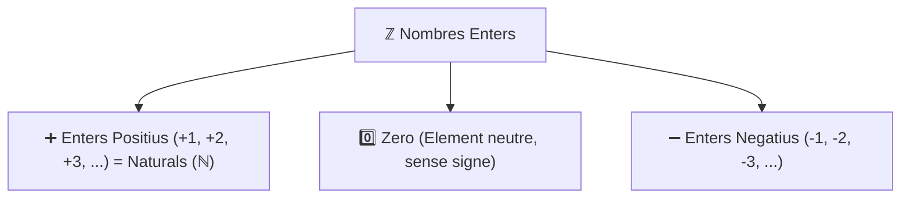
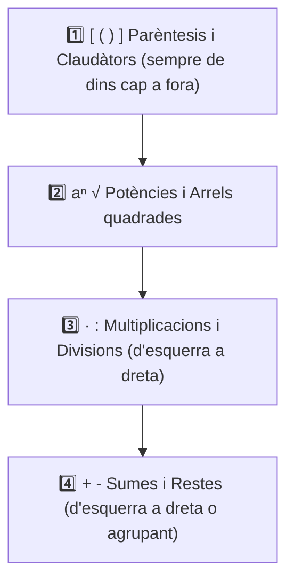

# UD3: Els Nombres Enters (Matemàtiques)

  

    

      PDI · Pissarra Digital
      🎯 5 Reptes Interactius d'Arrastrar i Soltar de UD3
    

    
Practica a la pissarra de classe amb pantalles tàctils o des de tauletes amb sons i autocorrecció immediata.

  

  <a href="../pissarra-interactiva.html" onclick="localStorage.setItem('pdi-target-unit', 'ud3')" style="background: linear-gradient(135deg, #059669, #0d9488); color: #fff !important; font-weight: 800; padding: 10px 18px; border-radius: 10px; text-decoration: none !important; box-shadow: 0 4px 12px rgba(5, 150, 105, 0.3); display: inline-flex; align-items: center; gap: 6px;">
    🖥️ Obrir Reptes PDI
    →
  </a>

Benvingut/da a la **Unitat Didàctica 3** del bloc de Matemàtiques de Ciències Aplicades I. En aquesta unitat aprofundirem en el conjunt dels **nombres enters ($\mathbb{Z}$)**, comprendrem la necessitat dels nombres negatius en contextos de la vida diària, dominarem la suma, resta, multiplicació i divisió amb la regla dels signes, aprendrem a treballar amb potències i arrels quadrades, i resoldrem problemes reals d'aplicació.

<svg viewBox="0 0 860 260" xmlns="http://www.w3.org/2000/svg" style="max-width: 100%; height: auto; font-family: 'Segoe UI', system-ui, sans-serif; background: linear-gradient(135deg, #0f172a 0%, #1e293b 100%); border-radius: 12px; border: 1px solid #334155; box-shadow: 0 10px 25px -5px rgba(0, 0, 0, 0.4);">
  <defs>
    <linearGradient id="g-ent" x1="0%" y1="0%" x2="100%" y2="100%">
      <stop offset="0%" stop-color="#38bdf8" stop-opacity="0.25"/>
      <stop offset="100%" stop-color="#0284c7" stop-opacity="0.05"/>
    </linearGradient>
    <linearGradient id="g-sum" x1="0%" y1="0%" x2="100%" y2="100%">
      <stop offset="0%" stop-color="#818cf8" stop-opacity="0.25"/>
      <stop offset="100%" stop-color="#4f46e5" stop-opacity="0.05"/>
    </linearGradient>
    <linearGradient id="g-rgl" x1="0%" y1="0%" x2="100%" y2="100%">
      <stop offset="0%" stop-color="#34d399" stop-opacity="0.25"/>
      <stop offset="100%" stop-color="#059669" stop-opacity="0.05"/>
    </linearGradient>
    <linearGradient id="g-pex" x1="0%" y1="0%" x2="100%" y2="100%">
      <stop offset="0%" stop-color="#f59e0b" stop-opacity="0.25"/>
      <stop offset="100%" stop-color="#d97706" stop-opacity="0.05"/>
    </linearGradient>
  </defs>

  <!-- Capçalera -->
  <text x="430" y="32" text-anchor="middle" fill="#f8fafc" font-size="16" font-weight="700" letter-spacing="1">ELS NOMBRES ENTERS ℤ: RECTA NUMÈRICA, REGLA DELS SIGNES I JERARQUIA</text>
  <text x="430" y="50" text-anchor="middle" fill="#94a3b8" font-size="12">Valors negatius, valor absolut, xoc de signes, potències de base negativa i arrels</text>

  <!-- Bloc 1: Conjunt Z i Recta -->
  <g transform="translate(25, 70)">
    <rect width="185" height="165" rx="10" fill="url(#g-ent)" stroke="#38bdf8" stroke-width="1.5"/>
    <rect x="15" y="14" width="28" height="28" rx="6" fill="#38bdf8" fill-opacity="0.2"/>
    <text x="29" y="33" text-anchor="middle" fill="#38bdf8" font-size="14" font-weight="bold">📉</text>
    <text x="52" y="33" fill="#f8fafc" font-size="13" font-weight="bold">El Conjunt ℤ</text>
    <text x="15" y="62" fill="#38bdf8" font-size="11" font-weight="600">Recta i Ordre</text>
    <text x="15" y="84" fill="#cbd5e1" font-size="11">• ℤ = {...,-2,-1,0,+1,+2...}</text>
    <text x="15" y="104" fill="#cbd5e1" font-size="11">• Valor absolut: |-7| = 7</text>
    <text x="15" y="124" fill="#cbd5e1" font-size="11">• Oposat: Op(-5) = +5</text>
    <text x="15" y="144" fill="#cbd5e1" font-size="11">• Comparació: -2 > -8</text>
  </g>

  <!-- Bloc 2: Suma i Resta -->
  <g transform="translate(230, 70)">
    <rect width="185" height="165" rx="10" fill="url(#g-sum)" stroke="#818cf8" stroke-width="1.5"/>
    <rect x="15" y="14" width="28" height="28" rx="6" fill="#818cf8" fill-opacity="0.2"/>
    <text x="29" y="33" text-anchor="middle" fill="#818cf8" font-size="14" font-weight="bold">⚖️</text>
    <text x="52" y="33" fill="#f8fafc" font-size="13" font-weight="bold">Suma i Resta</text>
    <text x="15" y="62" fill="#818cf8" font-size="11" font-weight="600">Xoc de Signes</text>
    <text x="15" y="84" fill="#cbd5e1" font-size="11">• Mateix signe: Es sumen</text>
    <text x="15" y="104" fill="#cbd5e1" font-size="11">• Signe diferent: Es resten</text>
    <text x="15" y="124" fill="#cbd5e1" font-size="11">• -(-a) = +a  |  +(-a) = -a</text>
    <text x="15" y="144" fill="#cbd5e1" font-size="11">• Restar = Sumar l'oposat</text>
  </g>

  <!-- Bloc 3: Regla dels Signes -->
  <g transform="translate(435, 70)">
    <rect width="185" height="165" rx="10" fill="url(#g-rgl)" stroke="#34d399" stroke-width="1.5"/>
    <rect x="15" y="14" width="28" height="28" rx="6" fill="#34d399" fill-opacity="0.2"/>
    <text x="29" y="33" text-anchor="middle" fill="#34d399" font-size="14" font-weight="bold">✖️</text>
    <text x="52" y="33" fill="#f8fafc" font-size="13" font-weight="bold">Regla dels Signes</text>
    <text x="15" y="62" fill="#34d399" font-size="11" font-weight="600">Producte i Quocient</text>
    <text x="15" y="84" fill="#cbd5e1" font-size="11">• (+) · (+) = +  |  (-) · (-) = +</text>
    <text x="15" y="104" fill="#cbd5e1" font-size="11">• (+) · (-) = -  |  (-) · (+) = -</text>
    <text x="15" y="124" fill="#cbd5e1" font-size="11">• Jerarquia: [ ( ) ]</text>
    <text x="15" y="144" fill="#cbd5e1" font-size="11">• Potències ➔ · : ➔ + -</text>
  </g>

  <!-- Bloc 4: Potències i Arrels -->
  <g transform="translate(640, 70)">
    <rect width="195" height="165" rx="10" fill="url(#g-pex)" stroke="#f59e0b" stroke-width="1.5"/>
    <rect x="15" y="14" width="28" height="28" rx="6" fill="#f59e0b" fill-opacity="0.2"/>
    <text x="29" y="33" text-anchor="middle" fill="#f59e0b" font-size="14" font-weight="bold">🔢</text>
    <text x="52" y="33" fill="#f8fafc" font-size="13" font-weight="bold">Potències & Arrels</text>
    <text x="15" y="62" fill="#f59e0b" font-size="11" font-weight="600">Exponents Negatius</text>
    <text x="15" y="84" fill="#cbd5e1" font-size="11">• (-a)parell = Positiu (+)</text>
    <text x="15" y="104" fill="#cbd5e1" font-size="11">• (-a)imparell = Negatiu (-)</text>
    <text x="15" y="124" fill="#cbd5e1" font-size="11">• (-2)⁴ = +16 vs -2⁴ = -16</text>
    <text x="15" y="144" fill="#cbd5e1" font-size="11">• √(-9) NO existeix en ℤ</text>
  </g>
</svg>

---

## 📑 Índex d'Apartats de la Unitat {#index-unitat}

  
Accés ràpid als apartats complets d'aquesta unitat:

  <ol style="margin: 0; padding-left: 20px; line-height: 2.1;">
    <li><a href="#sec3-1"><strong>3.1 El Conjunt dels Nombres Enters i Contextos Reals</strong></a></li>
    <li><a href="#sec3-2"><strong>3.2 Suma i Resta de Nombres Enters</strong></a></li>
    <li><a href="#sec3-3"><strong>3.3 Multiplicació, Divisió i Jerarquia d'Operacions</strong></a></li>
    <li><a href="#sec3-4"><strong>3.4 Potències de Nombres Enters i Arrels Quadrades</strong></a></li>
    <li><a href="#sec3-5"><strong>3.5 Quadern d'Activitats Pràctiques i Reptes de Laboratori</strong></a></li>
  </ol>

---

## 📌 3.1 El Conjunt dels Nombres Enters i Contextos Reals {#sec3-1}

En la vida quotidiana, els nombres naturals ($\mathbb{N} = \{0, 1, 2, 3, \dots\}$) resulten insuficients per expressar determinades situacions reals. Per exemple, com podem expressar que el termòmetre marca cinc graus sota zero, o que tenim un deute de $20\text{ €}$ al banc? Per a resoldre aquestes necessitats van nàixer els **nombres negatius**.

---

### 1. Els Nombres Negatius en Situacions Reals

Els nombres negatius s'escriuen precedits pel signe menys ($-$) i representen valors que estan per davall d'un punt de referència zero:

| Context Real | Situació Positiva ($+$) | Punt Zero ($0$) | Situació Negativa ($-$) |
| :--- | :--- | :--- | :--- |
| **Temperatura** | Fa calor: $+18\text{ }^\circ\text{C}$ (sobre zero) | Punt de congelació: $0\text{ }^\circ\text{C}$ | Fa gelor: $-5\text{ }^\circ\text{C}$ (5 graus sota zero) |
| **Economia i diners** | Tinc diners / Ingressos: $+50\text{ €}$ | Sense diners: $0\text{ €}$ | Tinc deutes / Pèrdues: $-20\text{ €}$ |
| **Altitud i relleu** | Cim d'una muntanya: $+1.500\text{ m}$ | Nivell del mar: $0\text{ m}$ | Submarí o fossa marina: $-120\text{ m}$ |
| **Plantes d'un edifici** | Pisos alts: Planta $+3$ | Planta baixa: Planta $0$ | Soterranis i pàrquing: Soterrani $-2$ |
| **Història i cronologia** | Segle XXI dC (després de Crist) | Naixement de Crist: Any $0$ | any $212\text{ aC}$ (abans de Crist: $-212$) |

> [!TIP]
> Quan un nombre és positiu, podem escriure'l amb el signe més davant o sense cap signe:  
> $+7$ és exactament el mateix que $7$. En canvi, el signe menys ($-$) **mai no es pot ometre**.

---

### 2. El Conjunt dels Nombres Enters ($\mathbb{Z}$)

El conjunt dels **nombres enters** es representa amb la lletra **$\mathbb{Z}$** (de l'alemany *Zahlen*, nombres) i està format per:
- Els **nombres enters positius** ($\mathbb{Z}^+$): $+1, +2, +3, +4, \dots$ (que coincideixen amb els naturals $\mathbb{N}$).
- El **zero** ($0$): ni positiu ni negatiu, és el punt neutre.
- Els **nombres enters negatius** ($\mathbb{Z}^-$): $-1, -2, -3, -4, \dots$

$$\mathbb{Z} = \{\dots, -4, -3, -2, -1, 0, +1, +2, +3, +4, \dots\}$$

Com si fóra una **nina russa (matrioixka)**, el conjunt dels naturals està totalment contingut dins dels enters: $\mathbb{N} \subset \mathbb{Z}$.

---

### 3. La Recta Numèrica i l'Ordre dels Enters

Els nombres enters es representen ordenadament sobre una recta horitzontal:
1. Tracem una recta i marquem el punt central **$0$**.
2. A la **dreta del zero** col·loquem els nombres positius en ordre creixent ($+1, +2, +3, \dots$).
3. A l'**esquerra del zero** col·loquem els nombres negatius en sentit decreixent ($-1, -2, -3, \dots$).

$$\longleftarrow \text{Menors } (\mathbb{Z}^-) \quad -4 \quad -3 \quad -2 \quad -1 \quad \mathbf{0} \quad +1 \quad +2 \quad +3 \quad +4 \quad +5 \quad (\mathbb{Z}^+) \text{ Majors} \longrightarrow$$

#### Criteri d'Ordenació
Un nombre enter és **més gran que un altre** si està situat més a la **dreta** en la recta numèrica:
- Qualsevol nombre positiu és més gran que el zero: $+4 > 0$.
- Qualsevol nombre negatiu és més petit que el zero: $-3 < 0$.
- Qualsevol nombre positiu és més gran que qualsevol negatiu: $+2 > -50$.
- Entre dos nombres negatius, és **més gran el que està més a prop del zero**:  
  $$-2 > -7 \quad (\text{perquè } -2 \text{ està més a la dreta que } -7)$$

---

### 4. Valor Absolut i Nombre Oposat

#### A) El Valor Absolut ($|a|$)
El **valor absolut** d'un nombre enter és la **distància** (en unitats) que el separa del zero a la recta numèrica. S'escriu col·locant el nombre entre dues barres verticals: $|a|$.

Com que és una distància, el valor absolut **sempre és un nombre positiu o zero**:
- $|+5| = 5$ (està a 5 passos del zero cap a la dreta).
- $|-5| = 5$ (està a 5 passos del zero cap a l'esquerra).
- $|0| = 0$
- $|-14| = 14$

#### B) El Nombre Oposat ($\text{Op}(a)$)
L'**oposat** d'un nombre enter és un altre nombre enter que té el **mateix valor absolut però signe contrari**. Estan a la mateixa distància del zero però en costats oposats de la recta numèrica:
- L'oposat de $+6$ és **$-6$**: $\text{Op}(+6) = -6$
- L'oposat de $-9$ és **$+9$**: $\text{Op}(-9) = +9$
- L'oposat de $0$ és el propi $0$.

---

### ✏️ Exercicis Pràctics d'Aplicació

  

    🎮 <strong>Zona d'Entrenament FPB:</strong> 0 reptes resolts
    ⭐ 0 punts
  

  

#### 1. Modelització amb Nombres Enters (ℤ)

Escriu el nombre enter amb el seu signe (+ o -):

  
✍️ L'ascensor es troba al tercer soterrani:

  

    <input type="text" class="quiz-input" placeholder="El teu resultat...">
    <button type="button" class="btn-quiz-check">Comprovar</button>
  

  

  
✍️ El submarí navega a 85 m de profunditat marina:

  

    <input type="text" class="quiz-input" placeholder="El teu resultat...">
    <button type="button" class="btn-quiz-check">Comprovar</button>
  

  

  
✍️ Hem ingressat una nòmina de 1.250 € a la caixa del taller:

  

    <input type="text" class="quiz-input" placeholder="El teu resultat...">
    <button type="button" class="btn-quiz-check">Comprovar</button>
  

  

  
✍️ La temperatura a l'hivern a Terol és de 4 graus sota zero:

  

    <input type="text" class="quiz-input" placeholder="El teu resultat...">
    <button type="button" class="btn-quiz-check">Comprovar</button>
  

  

---

#### 2. Ordenació de Nombres Enters

  
✍️ D'entre els següents enters: {-8, +4, -15, 0, -2, +9}, quin és el nombre menor de tots?

  

    <input type="text" class="quiz-input" placeholder="El teu resultat...">
    <button type="button" class="btn-quiz-check">Comprovar</button>
  

  

  <a href="#index-unitat" class="page-nav-btn" style="display: inline-block; padding: 4px 14px; font-size: 0.85rem;">⬆️ Pujar a l'Índex</a>

---

## 📌 3.2 Suma i Resta de Nombres Enters {#sec3-2}

Sumar i restar nombres enters és com gestionar una guardiola de diners: els **positius són diners que tenim o guanyem** i els **negatius són diners que devem o gastem**.

---

### 1. La Suma de Nombres Enters

Quan sumem dos nombres enters, ens podem trobar amb dos casos:

#### Cas 1: Nombres amb el Mateix Signe
Si els dos nombres tenen el mateix signe, **sumem els seus valors absoluts** i posem al resultat el **signe comú**:
- **Dos positius:** Tinc $5\text{ €}$ i en guanye $3\text{ €}$, en tinc $8\text{ €}$.
  $$(+5) + (+3) = +8$$
- **Dos negatius:** Dec $4\text{ €}$ i en gaste altres $6\text{ €}$, dec en total $10\text{ €}$.
  $$(-4) + (-6) = -10$$

#### Cas 2: Nombres amb Signes Diferents
Si els dos nombres tenen signes diferents, **restem els seus valors absoluts** (el més gran menys el més petit) i posem el **signe del nombre que té major valor absolut**:
- Tinc $10\text{ €}$ i en dec $4\text{ €}$, em queden $6\text{ €}$:
  $$(+10) + (-4) = +6$$
- Tinc $3\text{ €}$ i en dec $8\text{ €}$, continue devent $5\text{ €}$:
  $$(+3) + (-8) = -5$$
- Dec $12\text{ €}$ i en pague $12\text{ €}$, em quede a zero:
  $$(-12) + (+12) = 0 \quad \text{(La suma de dos nombres oposats sempre és 0)}$$

---

### 2. La Resta de Nombres Enters

> [!IMPORTANT]
> ### Regla de la Resta
> **Restar un nombre enter equival a sumar el seu oposat:**
> $$a - b = a + \text{Op}(b)$$

Vegem alguns exemples:
- $(+7) - (+2) = (+7) + (-2) = +5$
- $(+4) - (+9) = (+4) + (-9) = -5$
- $(-6) - (+3) = (-6) + (-3) = -9$
- $(+5) - (-8) = (+5) + (+8) = +13$

---

### 3. Supressió de Parèntesis (El "Xoc de Signes")

Quan un signe està just davant d'un parèntesi, podem eliminar el parèntesi seguint aquestes normes:

| Expressió amb parèntesi | Simplificació | Significat intuitiu |
| :---: | :---: | :--- |
| **$+(+a)$** | **$+a$** | Afegir un guany és positiu. |
| **$+(-a)$** | **$-a$** | Afegir un deute és negatiu. |
| **$-(+a)$** | **$-a$** | Llevar un guany és negatiu. |
| **$-(-a)$** | **$+a$** | **Llevar un deute equival a guanyar diners!** |

#### Exemples de simplificació directa:
$$+(-7) = -7$$
$$-(-15) = +15$$
$$-(+9) = -9$$
$$+(+4) = +4$$

---

### 4. Operacions Combinades de Sumes i Restes

Quan tenim una cadena llarga de sumes i restes d'enters, el mètode més net i segur és:
1. **Llevar tots els parèntesis** aplicant el xoc de signes.
2. **Agrupar tots els positius** per una banda i **tots els negatius** per l'altra.
3. Fer la resta final.

#### Exemple resolt pas a pas:
Calcula el valor de la següent expressió:
$$(-8) - (-12) + (+5) - (+9) + (-3) - (-7)$$

**Pas 1: Llevem parèntesis:**
$$-8 + 12 + 5 - 9 - 3 + 7$$

**Pas 2: Agrupem positius i negatius:**
- Positius: $+12 + 5 + 7 = +24$
- Negatius: $-8 - 9 - 3 = -20$

**Pas 3: Calculem el resultat final:**
$$+24 - 20 = \mathbf{+4}$$

---

### ✏️ Exercicis Pràctics

  

    🎮 <strong>Zona d'Entrenament FPB:</strong> 0 reptes resolts
    ⭐ 0 punts
  

  

#### 1. Sumes i Restes de Nombres Enters

  
✍️ Calcula: (+9) + (-15)

  

    <input type="text" class="quiz-input" placeholder="El teu resultat...">
    <button type="button" class="btn-quiz-check">Comprovar</button>
  

  

  
✍️ Calcula: (-14) + (-6)

  

    <input type="text" class="quiz-input" placeholder="El teu resultat...">
    <button type="button" class="btn-quiz-check">Comprovar</button>
  

  

  
✍️ Calcula: (+18) - (-7)

  

    <input type="text" class="quiz-input" placeholder="El teu resultat...">
    <button type="button" class="btn-quiz-check">Comprovar</button>
  

  

  
✍️ Calcula: (-11) - (+14)

  

    <input type="text" class="quiz-input" placeholder="El teu resultat...">
    <button type="button" class="btn-quiz-check">Comprovar</button>
  

  

---

#### 2. Eliminació de Parèntesis i Agrupació

  
✍️ Resol: 15 - (-4) + (-8) - 6

  

    <input type="text" class="quiz-input" placeholder="El teu resultat...">
    <button type="button" class="btn-quiz-check">Comprovar</button>
  

  

  
✍️ Resol: -12 + (-3) - (-20) - (+7)

  

    <input type="text" class="quiz-input" placeholder="El teu resultat...">
    <button type="button" class="btn-quiz-check">Comprovar</button>
  

  

  <a href="#index-unitat" class="page-nav-btn" style="display: inline-block; padding: 4px 14px; font-size: 0.85rem;">⬆️ Pujar a l'Índex</a>

---

## 📌 3.3 Multiplicació, Divisió i Jerarquia d'Operacions {#sec3-3}

Per multiplicar o dividir nombres enters operem amb els seus valors absoluts tal com fèiem amb els nombres naturals, i després apliquem la **regla dels signes** per determinar el signe del resultat.

---

### 1. La Regla dels Signes

La regla dels signes és idèntica tant per a la **multiplicació** com per a la **divisió**:

| Multiplicació ($\cdot$) | Divisió ($:$) | Regla Mnemotècnica |
| :---: | :---: | :--- |
| **$(+) \cdot (+) = (+)$** | **$(+) : (+) = (+)$** | Signes iguals $\rightarrow$ **Positiu ($+$)** |
| **$(-) \cdot (-) = (+)$** | **$(-) : (-) = (+)$** | Signes iguals $\rightarrow$ **Positiu ($+$)** |
| **$(+) \cdot (-) = (-)$** | **$(+) : (-) = (-)$** | Signes diferents $\rightarrow$ **Negatiu ($-$)** |
| **$(-) \cdot (+) = (-)$** | **$(-) : (+) = (-)$** | Signes diferents $\rightarrow$ **Negatiu ($-$)** |

#### Exemples:
- $(+6) \cdot (+4) = +24$
- $(-8) \cdot (-3) = +24$
- $(+5) \cdot (-7) = -35$
- $(-9) \cdot (+2) = -18$
- $(+20) : (+5) = +4$
- $(-36) : (-6) = +6$
- $(+42) : (-7) = -6$
- $(-40) : (+8) = -5$

> [!TIP]
> ### Producte de Múltiples Factors
> Quan multipliquem tres o més nombres enters, només cal comptar quants signes negatius hi ha:
> - Si el nombre de factors negatius és **PARELL**, el resultat és **POSITIU ($+$)**:  
>   $$(-2) \cdot (-3) \cdot (-4) \cdot (-5) = +120 \quad \text{(4 negatius, parell)}$$
> - Si el nombre de factors negatius és **IMPARELL**, el resultat és **NEGATIU ($-$)**:  
>   $$(-2) \cdot (-3) \cdot (-4) = -24 \quad \text{(3 negatius, imparell)}$$

---

### 2. La Propietat Distributiva i Factor Comú

La multiplicació compleix la **propietat distributiva** respecte a la suma i la resta:

$$a \cdot (b + c) = a \cdot b + a \cdot c$$

#### Exemple de propietat distributiva:
$$(-3) \cdot (4 - 7) = (-3) \cdot 4 - (-3) \cdot 7 = -12 - (-21) = -12 + 21 = +9$$

#### Extreure Factor Comú:
És el procés invers a la propietat distributiva:
$$(-5) \cdot 6 + (-5) \cdot 4 = (-5) \cdot (6 + 4) = (-5) \cdot 10 = -50$$

---

### 3. Jerarquia Oficial d'Operacions Combinades

Quan una expressió matemàtica combina sumes, restes, multiplicacions, divisions i parèntesis, hem de seguir estrictament aquest ordre:

---

### 🔍 Exemples Resolts Pas a Pas

#### Exemple 1: Operacions bàsiques combinades
Calcula:
$$4 - 2 \cdot 5 + 8 : (-2)$$

**Pas 1: Fem multiplicacions i divisions primer:**
- $2 \cdot 5 = 10$
- $8 : (-2) = -4$

L'expressió queda:
$$4 - 10 + (-4) = 4 - 10 - 4$$

**Pas 2: Fem sumes i restes:**
$$4 - 14 = \mathbf{-10}$$

---

#### Exemple 2: Amb parèntesis i claudàtors
Calcula:
$$-36 : [-8 : (-5 + 3) + 12 : (-2 + 2 \cdot 4)]$$

**Pas 1: Resolem els parèntesis més interns:**
- $(-5 + 3) = -2$
- $(-2 + 2 \cdot 4) = (-2 + 8) = +6$

Substituïm:
$$-36 : [-8 : (-2) + 12 : 6]$$

**Pas 2: Resolem les divisions dins del claudàtor:**
- $-8 : (-2) = +4$
- $12 : 6 = +2$

Substituïm:
$$-36 : [4 + 2] = -36 : [6]$$

**Pas 3: Divisió final:**
$$-36 : 6 = \mathbf{-6}$$

---

### ✏️ Exercicis Pràctics

  

    🎮 <strong>Zona d'Entrenament FPB:</strong> 0 reptes resolts
    ⭐ 0 punts
  

  

#### 1. Jerarquia d'Operacions i Regla dels Signes

  
✍️ Calcula: 6 - 3 · (-4) + 10 : (-2)

  

    <input type="text" class="quiz-input" placeholder="El teu resultat...">
    <button type="button" class="btn-quiz-check">Comprovar</button>
  

  

  
✍️ Calcula: 5 · (-2) + (-18) : (-3)

  

    <input type="text" class="quiz-input" placeholder="El teu resultat...">
    <button type="button" class="btn-quiz-check">Comprovar</button>
  

  

  
✍️ Calcula amb claudàtor: (-4) · [8 - (-2)]

  

    <input type="text" class="quiz-input" placeholder="El teu resultat...">
    <button type="button" class="btn-quiz-check">Comprovar</button>
  

  

  
✍️ Calcula: 15 - (-3) · [2 - 5]

  

    <input type="text" class="quiz-input" placeholder="El teu resultat...">
    <button type="button" class="btn-quiz-check">Comprovar</button>
  

  

  <a href="#index-unitat" class="page-nav-btn" style="display: inline-block; padding: 4px 14px; font-size: 0.85rem;">⬆️ Pujar a l'Índex</a>

---

## 📌 3.4 Potències de Nombres Enters i Arrels Quadrades {#sec3-4}

Una **potència** és una forma abreujada d'escriure una multiplicació de factors iguals:

$$a^n = \underbrace{a \cdot a \cdot a \cdot \dots \cdot a}_{n \text{ vegades}}$$

On **$a$** és la **base** (el nombre que es repeteix) i **$n$** és l'**exponent** (el nombre de vegades que es multiplica).

---

### 1. El Signe d'una Potència de Base Entera

Quan la base d'una potència és un nombre enter (positiu o negatiu), el signe del resultat depèn del signe de la base i de si l'exponent és parell o imparell:

| Base | Exponent | Signe del Resultat | Exemple |
| :---: | :---: | :---: | :--- |
| **Positiva ($+$)** | Parell | **Positiu ($+$)** | $(+3)^2 = (+3) \cdot (+3) = \mathbf{+9}$ |
| **Positiva ($+$)** | Imparell | **Positiu ($+$)** | $(+2)^3 = (+2) \cdot (+2) \cdot (+2) = \mathbf{+8}$ |
| **Negativa ($-$)** | **Parell** | **Positiu ($+$)** | $(-3)^2 = (-3) \cdot (-3) = \mathbf{+9}$ |
| **Negativa ($-$)** | **Imparell** | **Negatiu ($-$)** | $(-2)^3 = (-2) \cdot (-2) \cdot (-2) = \mathbf{-8}$ |

> [!WARNING]
> ### Atenció a l'Ús dels Parèntesis!
> No és el mateix $(-3)^2$ que $-3^2$:
> - **$(-3)^2$:** El quadrat afecta a tot el nombre amb el signe: $(-3) \cdot (-3) = \mathbf{+9}$.
> - **$-3^2$:** El quadrat només afecta al nombre 3, el menys està davant: $-(3 \cdot 3) = \mathbf{-9}$.

---

### 2. Propietats de les Potències

Les propietats de les potències permeten simplificar càlculs complexos de forma directa:

#### 1. Exponent Zero i Exponent U
- Qualsevol nombre enter (diferent de zero) elevat a zero és igual a $1$:
  $$a^0 = 1 \quad \longrightarrow \quad (-5)^0 = 1, \quad 8^0 = 1$$
- Qualsevol nombre elevat a $1$ és igual a ell mateix:
  $$a^1 = a \quad \longrightarrow \quad (-7)^1 = -7$$

#### 2. Producte de Potències de la Mateixa Base
Es manté la mateixa base i **se sumen els exponents**:
$$a^m \cdot a^n = a^{m+n}$$
$$(-4)^3 \cdot (-4)^5 = (-4)^{3+5} = (-4)^8$$

#### 3. Quocient de Potències de la Mateixa Base
Es manté la base i **es resten els exponents**:
$$a^m : a^n = \frac{a^m}{a^n} = a^{m-n}$$
$$(-2)^7 : (-2)^4 = (-2)^{7-4} = (-2)^3 = -8$$

#### 4. Potència d'una Potència
Es manté la base i **es multipliquen els exponents**:
$$(a^m)^n = a^{m \cdot n}$$
$$[(-3)^2]^4 = (-3)^{2 \cdot 4} = (-3)^8$$

#### 5. Potència d'un Producte i d'un Quocient
L'exponent es distribueix a cadascun dels factors:
$$(a \cdot b)^n = a^n \cdot b^n \quad \longrightarrow \quad [(-2) \cdot 5]^3 = (-2)^3 \cdot 5^3$$
$$(a : b)^n = a^n : b^n \quad \longrightarrow \quad [(-12) : 4]^2 = (-12)^2 : 4^2$$

#### 6. Potències d'Exponent Negatiu
Una potència amb exponent negatiu equival a la inversa de la potència amb exponent positiu:
$$a^{-n} = \frac{1}{a^n} \quad \longrightarrow \quad 2^{-3} = \frac{1}{2^3} = \frac{1}{8}$$

---

### 3. Les Arrels Quadrades de Nombres Enters

L'**arrel quadrada** és l'operació inversa d'elevar al quadrat:

$$\sqrt{a} = b \iff b^2 = a$$

#### A) Arrels Quadrades Exactes
Un nombre enter té arrel quadrada exacta si és el quadrat d'un altre nombre enter (quadrat perfecte):
- $\sqrt{25} = \pm 5$, perquè tant $(+5)^2 = 25$ com $(-5)^2 = 25$.
- En l'àmbit aritmètic habitual s'utilitza l'arrel positiva: $\sqrt{36} = 6$, $\sqrt{81} = 9$, $\sqrt{100} = 10$.

#### B) Arrel Quadrada de Nombres Negatius
Què val $\sqrt{-16}$?
- Cap nombre enter elevat al quadrat pot donar un resultat negatiu: $(+4)^2 = +16$ i $(-4)^2 = +16$.
- Per tant: **No existeix l'arrel quadrada d'un nombre negatiu dins dels nombres enters $\mathbb{Z}$**.

#### C) Arrel Quadrada Entera i Residu
Quan un nombre no és un quadrat perfecte, podem calcular la seua **arrel quadrada entera** (el major enter el quadrat del qual és menor que el nombre donat) i el seu **residu**:

$$a = (\text{arrel})^2 + \text{residu}$$

Per exemple, per a calcular $\sqrt{45}$:
- $6^2 = 36 < 45$
- $7^2 = 49 > 45$
- L'arrel quadrada entera és **$6$** i el residu és $45 - 36 = \mathbf{9}$.

---

### ✏️ Exercicis Pràctics

  

    🎮 <strong>Zona d'Entrenament FPB:</strong> 0 reptes resolts
    ⭐ 0 punts
  

  

#### 1. Potències de Base Negativa i Arrels en ℤ

  
✍️ Calcula amb exponent parell: (-3)²

  

    <input type="text" class="quiz-input" placeholder="El teu resultat...">
    <button type="button" class="btn-quiz-check">Comprovar</button>
  

  

  
✍️ Calcula amb exponent imparell: (-2)³

  

    <input type="text" class="quiz-input" placeholder="El teu resultat...">
    <button type="button" class="btn-quiz-check">Comprovar</button>
  

  

  
✍️ Calcula sense parèntesi a la base: -4²

  

    <input type="text" class="quiz-input" placeholder="El teu resultat...">
    <button type="button" class="btn-quiz-check">Comprovar</button>
  

  

  
✍️ Calcula: (-1)¹⁵

  

    <input type="text" class="quiz-input" placeholder="El teu resultat...">
    <button type="button" class="btn-quiz-check">Comprovar</button>
  

  

  
✍️ Calcula l'arrel exacta: √(+81)

  

    <input type="text" class="quiz-input" placeholder="El teu resultat...">
    <button type="button" class="btn-quiz-check">Comprovar</button>
  

  

  <a href="#index-unitat" class="page-nav-btn" style="display: inline-block; padding: 4px 14px; font-size: 0.85rem;">⬆️ Pujar a l'Índex</a>

---

## 📌 3.5 Quadern d'Activitats Pràctiques i Reptes de Laboratori {#sec3-5}

Aquest apartat recull el conjunt complet d'exercicis d'aplicació pràctica, reptes de taller tecnològic i la rúbrica d'avaluació competencial per a la **Unitat 3: Els Nombres Enters**.

---

### 1. Fonaments d'Aplicació en Contextos Tècnics

Els nombres enters són l'eina matemàtica fonamental per modelar fenòmens físics i situacions professionals que evolucionen en dos sentits oposats al voltant d'un valor de referència o punt zero:

1. **Termometria i amplitud tèrmica:**
   La variació de temperatura ($\Delta T$) es calcula com la temperatura final menys la inicial, o la màxima menys la mínima:
   $$\Delta T = T_{\text{final}} - T_{\text{inicial}} \qquad \text{Amplitud} = T_{\text{màx}} - T_{\text{mín}}$$
   Si la temperatura nocturna d'una sala de servidors és de $-3\text{ °C}$ i la diürna de $+22\text{ °C}$:
   $$\text{Amplitud} = 22 - (-3) = 22 + 3 = 25\text{ °C}$$

2. **Topografia i altimetria:**
   El nivell mitjà del mar representa la cota $0\text{ m}$. Cimes i turons prenen valors positius ($+h$) i fosses oceàniques o galeries mineres valors negatius ($-h$). La distància vertical o desnivell entre dos punts és:
   $$\text{Desnivell} = |\text{Cota}_A - \text{Cota}_B|$$

3. **Economia de taller i balanços de caixa:**
   Un saldo positiu indica liquiditat o benefici ($+B$), mentre que un saldo negatiu representa un dèficit, deute o pèrdua ($-D$). Les transaccions es modelen sumant ingressos i restant despeses:
   $$\text{Saldo Final} = \text{Saldo Inicial} + \sum \text{Ingressos} - \sum \text{Despeses}$$

---

### 2. Quadern d'Activitats Pràctiques i Reptes de Laboratori

  

    🎮 <strong>Zona d'Entrenament FPB:</strong> 0 reptes resolts
    ⭐ 0 punts
  

  

#### Bloc A: Fonaments, Dimensionament i Diagnòstic Tècnic

##### Exercici 1: Altimetria, variació tèrmica i distàncies amb valors absoluts
1. En una estació meteorològica d'alta muntanya es registren les següents temperatures durant una setmana d'hivern:
   - Dilluns: $-6\text{ °C}$
   - Dimarts: $-9\text{ °C}$
   - Dimecres: $+2\text{ °C}$
   - Dijous: $-4\text{ °C}$
   - Divendres: $+5\text{ °C}$
   Calcula:
   - La variació de temperatura entre el dimarts i el dimecres: $\Delta T = T_{\text{dim}} - T_{\text{mar}}$.
   - L'amplitud tèrmica setmanal absoluta: $T_{\text{màx}} - T_{\text{mín}}$.
   - La mitjana aritmètica exacta de la setmana en graus Celsius.

2. Un dron de reconeixement s'eleva a $+185\text{ m}$ per damunt del nivell del mar i un submarí d'investigació oceanogràfica s'enfonsa fins a $-340\text{ m}$ a la mateixa vertical:
   - Escriu la distància vertical total que separa ambdós vehicles utilitzant valors absoluts: $|(+185) - (-340)|$.
   - Si el submarí ascendeix $120\text{ m}$, quina serà la seua nova cota numèrica en $\mathbb{Z}$?

  
✍️ Exercici 1.1: Calcula la variació tèrmica entre dimarts (-9 °C) i dimecres (+2 °C): ΔT = (+2) - (-9)

  

    <input type="text" class="quiz-input" placeholder="El teu resultat...">
    <button type="button" class="btn-quiz-check">Comprovar</button>
  

  

  
✍️ Exercici 1.2: Desnivell vertical entre dron (+185 m) i submarí (-340 m): |(+185) - (-340)|

  

    <input type="text" class="quiz-input" placeholder="El teu resultat...">
    <button type="button" class="btn-quiz-check">Comprovar</button>
  

  

##### Exercici 2: Jerarquia d'operacions combinades amb signes d'agrupació i regla de signes
Resol cadascuna de les següents expressions mostrant detalladament cada pas intermedi segons la jerarquia d'operacions i la regla dels signes:
1. **Expressió A:**
   $$A = -15 + 4 \cdot [(-3) \cdot (-2) - (8 - 12)] - (-18) : (-3)$$
2. **Expressió B:**
   $$B = [(-2)^3 \cdot 3 - (-10)] : (-7) + (-4) \cdot [5 - (-2 \cdot 3)]$$
3. **Expressió C:**
   $$C = -36 : [(-2)^2 + (-5) \cdot (-2) - 8] - [(-3)^3 : 9 - (-4)]$$

##### Exercici 3: Potències de base negativa, exponents parells/imparells i arrels
1. Avalua i compara els següents parells d'expressions prestant atenció a l'ús dels parèntesis:
   - $P_1 = (-3)^4 \quad \text{enfront de} \quad P_2 = -3^4$
   - $P_3 = (-5)^3 \quad \text{enfront de} \quad P_4 = -5^3$
   - $P_5 = (-1)^{2026} \quad \text{enfront de} \quad P_6 = (-1)^{2027}$
2. Aplica les propietats de les potències per expressar com una sola potència de base enter irreductible:
   $$E_1 = \frac{(-2)^5 \cdot (-2)^7 \cdot 2^3}{(-2)^6 \cdot (-2)^4}$$
3. Justifica si tenen solució en el conjunt dels nombres enters $\mathbb{Z}$ les següents arrels:
   - $\sqrt{+81}$
   - $\sqrt{-64}$
   - $-\sqrt{49}$
   - $\sqrt[3]{-27}$

  
✍️ <strong>Exercici 2 (Operacions Combinades amb Enters):</strong> Desenvolupa pas a pas la resolució d'almenys dues de les expressions (A, B o C) aplicant la regla de signes i la jerarquia de claudàtors i parèntesis:

  <textarea class="open-response-input" rows="3" placeholder="Mostra els passos intermedis i la regla de signes aplicada a cada multiplicació/divisió..."></textarea>

  
✍️ <strong>Exercici 3 (Bases Negatives i Arrels Quadrades d'Enters):</strong> Compara la diferència entre (-3)² i -3², i justifica matemàticament per què l'arrel quadrada d'un nombre negatiu com √(-25) no té solució en el conjunt dels enters Z:

  <textarea class="open-response-input" rows="3" placeholder="Escriu la regla de l'exponent parell/imparell i la definició de l'arrel quadrada..."></textarea>

---

#### Bloc B: Reptes Pràctics de Laboratori i Taller / Comandes

  
🔬 Simulador de Taller: Balanç Econòmic i Tresoreria amb Enters (±)

  

    Calcula en directe el saldo net d'una empresa de reparació informàtica gestionant ingressos (+) i despeses de recanvis (-):
  

  

    

      <label for="bal-inicial">Saldo inicial de caixa (€):</label>
      <input type="number" id="bal-inicial" value="120" step="10">
    

    

      <label for="bal-ingressos">Total ingressos de reparacions (€):</label>
      <input type="number" id="bal-ingressos" value="450" min="0" step="10">
    

    

      <label for="bal-despeses">Total despeses en components (€):</label>
      <input type="number" id="bal-despeses" value="380" min="0" step="10">
    

  

  <button type="button" class="btn-lab-action" onclick="runCalcBalanc()">⚡ Calcular Balanç de Caixa</button>
  

    <em>Prem el botó per analitzar l'estat econòmic del taller.</em>
  

---

##### Repte 1: Balanç financer de tresoreria i control de caixes en taller de reparacions
- **Objectiu:** Utilitzar la suma i resta de nombres enters per gestionar la comptabilitat diària d'un negoci tècnic.
- **Situació de taller:** El departament tècnic d'un servei de reparació d'ordinadors comença el mes amb un fons inicial de caixa de $+450\text{ €}$. Durant la primera setmana es produeixen els següents moviments:
  - Dia 1: Pagament de llicències de programari per valor de $-180\text{ €}$.
  - Dia 2: Cobrament de reparació de placa base de client: $+125\text{ €}$.
  - Dia 3: Compra a crèdit de components (fonts i pasta tèrmica): $-240\text{ €}$.
  - Dia 4: Cobrament de manteniment de xarxa d'oficina: $+310\text{ €}$.
  - Dia 5: Pagament de quota de servei d'emergència elèctrica: $-490\text{ €}$.
- **Procediment de càlcul:**
  1. Escriu el polinomi aritmètic complet que representa la seqüència de moviments:
     $$\text{Saldo Final} = (+450) + (-180) + (+125) + (-240) + (+310) + (-490)$$
  2. Resol agrupant en primer lloc tots els nombres positius (ingressos) i en segon lloc tots els negatius (despeses).
  3. Quin és el saldo final de la caixa en tancar la setmana? Hi ha superàvit o dèficit?
  4. Quina quantitat mínima ha d'ingressar el taller el dilluns següent per restablir el fons de maniobra a $+300\text{ €}$?

  
✍️ Repte 1.3: Saldo final de caixa del taller: (+450) + (-180) + (+125) + (-240) + (+310) + (-490)

  

    <input type="text" class="quiz-input" placeholder="El teu resultat...">
    <button type="button" class="btn-quiz-check">Comprovar</button>
  

  

  
✍️ Repte 1.4: Quants euros cal ingressar per restablir el fons de caixa a +300 € partint del saldo de -25 €?

  

    <input type="text" class="quiz-input" placeholder="El teu resultat...">
    <button type="button" class="btn-quiz-check">Comprovar</button>
  

  

##### Repte 2: Gestió automatitzada d'un ascensor muntacàrregues en edifici de servidors
- **Objectiu:** Modelar desplaçaments lineals i calcular el consum energètic associat a partir del valor absolut en $\mathbb{Z}$.
- **Situació:** En un edifici tecnològic d'alta seguretat es disposa de $6\text{ plantes sobre rasant}$ ($+1$ a $+6$), una planta baixa ($0$) i $4\text{ soterranis}$ ($-1$ a $-4$) on s'ubiquen els sistemes de còpia de seguretat i climatització.
- **Moviments d'un muntacàrregues al llarg d'una ronda de manteniment:**
  - Parteix de la planta baixa ($0$).
  - Baixa a la cambra cuirasada del soterrani $-4$ per carregar discs de suport.
  - Puixa a la planta de desenvolupament $+5$ per lliurar els discs.
  - Baixa al soterrani $-2$ per recollir cablejat vell.
  - Puja finalment a la planta $+3$ per instal·lar un commutador.
- **Comanda tècnica:**
  1. Calcula el nombre de plantes recorregudes en cadascun dels quatre trajectes individuals aplicant la distància absoluta: $|\text{Destí} - \text{Origen}|$.
  2. Calcula el nombre total de plantes recorregudes durant tota la ronda:
     $$\text{Plantes Totals} = |(-4) - 0| + |(+5) - (-4)| + |(-2) - (+5)| + |(+3) - (-2)|$$
  3. Si cada planta té una alçada de $3\text{ metres}$, quants metres verticals totals ha recorregut l'ascensor?
  4. Si el motor consumeix $15\text{ Wh}$ per cada metre vertical desplaçat, quin consum elèctric total en $\text{kWh}$ ha generat la ronda?

  
✍️ Repte 2.2: Plantes totals recorregudes per l'ascensor: |(-4)-0| + |(+5)-(-4)| + |(-2)-(+5)| + |(+3)-(-2)|

  

    <input type="text" class="quiz-input" placeholder="El teu resultat...">
    <button type="button" class="btn-quiz-check">Comprovar</button>
  

  

  
✍️ Repte 2.3: Si cada planta fa 3 metres d'alçada, quants metres verticals totals ha recorregut l'ascensor (25 × 3)?

  

    <input type="text" class="quiz-input" placeholder="El teu resultat...">
    <button type="button" class="btn-quiz-check">Comprovar</button>
  

  

##### Repte 3: Monitoratge de temperatures extremes en càmeres climàtiques de testatge
- **Objectiu:** Utilitzar nombres enters per interpretar gràfiques de proves de resistència tèrmica de circuits electrònics.
- **Situació:** En un laboratori d'assaig de servidors industrials, una placa base se sotmet a un cicle tèrmic extrem en una cambra climàtica seguint aquest protocol:
  - Fase 1 (Repòs): Inicialment a $+20\text{ °C}$.
  - Fase 2 (Congelació ràpida): La cambra refreda a un ritme constant de $-4\text{ °C per minut}$ durant $12\text{ minuts}$.
  - Fase 3 (Xoc tèrmic fred extrem): S'introdueix nitrogen gasós que baixa la temperatura altres $-15\text{ °C}$.
  - Fase 4 (Escalfament sobtat): La cambra activa resistències ceràmiques i augmenta la temperatura $+85\text{ °C}$.
- **Càlculs requerits:**
  1. Determina la temperatura assolida al final de la Fase 2: $T_2 = 20 + [12 \cdot (-4)]$.
  2. Determina la temperatura mínima absoluta assolida al final de la Fase 3: $T_3 = T_2 + (-15)$.
  3. Calcula la temperatura final en completar la Fase 4: $T_4 = T_3 + (+85)$.
  4. Quina és la variació tèrmica global $\Delta T = T_4 - T_3$ que ha hagut de suportar el silici de la CPU sense clivellar-se?

---

  
✍️ Repte 3.4: Si la CPU va baixar fins a -43 °C a la Fase 3 i va pujar fins a +42 °C a la Fase 4, quina variació tèrmica global ΔT = 42 - (-43) va suportar?

  

    <input type="text" class="quiz-input" placeholder="El teu resultat...">
    <button type="button" class="btn-quiz-check">Comprovar</button>
  

  

#### 🎯 Reptes d'Autocomprovació Interactiva (Self-Check)

Introdueix els teus resultats numèrics i comprova immediatament si la teua resposta és correcta:

  
✍️ Repte interactiu: Quina és la variació tèrmica (en °C) si la temperatura d'una sala passa de -4 °C a la matinada a +18 °C al migdia?

  

    <input type="text" class="quiz-input" placeholder="El teu resultat...">
    <button type="button" class="btn-quiz-check">Comprovar</button>
  

  

  
✍️ Repte interactiu: Calcula el resultat exacte de l'operació amb enters: (-3) · (-5) + (-8)

  

    <input type="text" class="quiz-input" placeholder="El teu resultat...">
    <button type="button" class="btn-quiz-check">Comprovar</button>
  

  

  
✍️ Repte interactiu: Quin és el resultat numèric exacte de la potència de base negativa (-2)⁴?

  

    <input type="text" class="quiz-input" placeholder="El teu resultat...">
    <button type="button" class="btn-quiz-check">Comprovar</button>
  

  

  
✍️ Repte interactiu: Quin és el desnivell vertical total en metres entre una antena a +850 m i un túnel de fibra a -120 m?

  

    <input type="text" class="quiz-input" placeholder="El teu resultat...">
    <button type="button" class="btn-quiz-check">Comprovar</button>
  

  

---

#### Bloc C: Llista de Verificació i Rúbrica d'Avaluació Competencial

##### Llista de comprovació per a l'alumnat
- [ ] He representat correctament nombres positius i negatius a la recta numèrica identificant l'ordre ($a < b$).
- [ ] He calculat el valor absolut ($|a|$) i l'oposat ($\text{Op}(a)$) d'un enter sense confondre ambdós conceptes.
- [ ] He aplicat correctament la regla dels signes en productes i quocients: signes iguals donen positiu, diferents donen negatiu.
- [ ] He resolt expressions combinades amb claudàtors niats respectant l'ordre jeràrquic estricte.
- [ ] He calculat potències de base negativa distingint correctament $(-a)^n$ de $-a^n$ segons la paritat de l'exponent.
- [ ] He modelat situacions reals d'altimetria, saldos econòmics i desplaçaments utilitzant nombres enters.

##### Rúbrica d'avaluació d'aprenentatge

| Criteri d'Avaluació | Excel·lent (9-10) | Notable (7-8) | Aprovat (5-6) | No Assolit (0-4) |
| :--- | :--- | :--- | :--- | :--- |
| **Concepte d'enter i ordenació a la recta** | Domina la representació a la recta, ordena nombres enters positius i negatius amb soltesa i empra el valor absolut amb precisió. | Ordena nombres enters correctament i calcula valors absoluts amb alguna xicoteta vacil·lació en valors molt negatius. | Reconeix la diferència entre positius i negatius però dubta en comparar dos nombres negatius (ex. $-8 > -2$). | Confon els nombres negatius amb positius i no sap situar-los a la recta respecte al zero. |
| **Operacions bàsiques i xoc de signes** | Resol sumes, restes i eliminació de parèntesis amb signes confrontats sense cap errada algebraica. | Resol sumes i restes de nombres enters correctament amb errades menors en parèntesis encadenats. | Aplica la regla bàsica de signes però s'equivoca en sumar dos nombres negatius. | Aplica la regla del producte a la suma (diu que $(-3) + (-4) = +7$) de manera reiterada. |
| **Producte, quocient i jerarquia combinada** | Aplica la jerarquia oficial i la regla de signes en expressions complexes amb claudàtors niats de manera impecable. | Resol expressions combinades amb bona aplicació de la jerarquia i xicotets errors en càlculs finals. | Recorda la prioritat de multiplicacions sobre sumes però s'encalla en desfer claudàtors interiors. | Incompleix la jerarquia d'operacions calculant d'esquerra a dreta sense respectar els operadors. |
| **Potències i arrels en $\mathbb{Z}$** | Distingeix amb claredat $(-a)^n$ de $-a^n$, aplica propietats d'exponents i justifica la inexistència d'arrels negatives en $\mathbb{Z}$. | Calcula potències de base negativa amb exponent parell/imparell i simplifica expressions de la mateixa base. | Calcula potències bàsiques però comet errors en el signe de bases negatives sense parèntesis. | Multiplica la base per l'exponent o afirma erròniament que $\sqrt{-16} = -4$. |
| **Resolució de problemes aplicats (taller/clima)** | Tradueix enunciats tècnics de tresoreria, ascensors i cicles tèrmics a polinomis aritmètics enters i n'interpreta el resultat. | Planteja i resol problemes de la vida quotidiana i de taller interpretant el sentit físic del resultat. | Resol problemes senzills amb ajuda en la formulació de les operacions o en el conveni de signes. | Incapaç de traduir un enunciat verbal a nombres positius i negatius o d'interpretar el resultat final. |

---

  <h3>📤 Comprovant de Lliurament per a Aules</h3>
  
En acabar els reptes interactius i la llista de comprovació, genera el teu informe oficial per adjuntar-lo o enganxar-lo al lliurament de la tasca d'Aules:

  

    <label for="aules-student-name">Nom i Cognoms de l'alumne/a:</label>
    <input type="text" id="aules-student-name" placeholder="Ex: Pere Martí Soler">
  

  

    Calculant resultats dels reptes...
  

  

    <button type="button" class="btn-aules-copy">📋 Copiar Resum per a Aules</button>
    <button type="button" class="btn-aules-dl" data-module="CA" data-unit="UD03" data-activity="Global">📄 Descarregar Comprovant (.pdf)</button>
  

  

  <a href="#index-unitat" class="page-nav-btn" style="display: inline-block; padding: 4px 14px; font-size: 0.85rem;">⬆️ Pujar a l'Índex</a>

---
