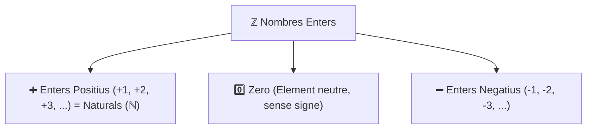

# 3.1 El Conjunt dels Nombres Enters i Contextos Reals

En la vida quotidiana, els nombres naturals ($\mathbb{N} = \{0, 1, 2, 3, \dots\}$) resulten insuficients per expressar determinades situacions reals. Per exemple, com podem expressar que el termòmetre marca cinc graus sota zero, o que tenim un deute de $20\text{ €}$ al banc? Per a resoldre aquestes necessitats van nàixer els **nombres negatius**.

---

## 1. Els Nombres Negatius en Situacions Reals

Els nombres negatius s'escriuen precedits pel signe menys ($-$) i representen valors que estan per davall d'un punt de referència zero:

| Context Real | Situació Positiva ($+$) | Punt Zero ($0$) | Situació Negativa ($-$) |
| :--- | :--- | :--- | :--- |
| **Temperatura** | Fa calor: $+18\text{ }^\circ\text{C}$ (sobre zero) | Punt de congelació: $0\text{ }^\circ\text{C}$ | Fa gelor: $-5\text{ }^\circ\text{C}$ (5 graus sota zero) |
| **Economia i diners** | Tinc diners / Ingressos: $+50\text{ €}$ | Sense diners: $0\text{ €}$ | Tinc deutes / Pèrdues: $-20\text{ €}$ |
| **Altitud i relleu** | Cim d'una muntanya: $+1.500\text{ m}$ | Nivell del mar: $0\text{ m}$ | Submarí o fossa marina: $-120\text{ m}$ |
| **Plantes d'un edifici** | Pisos alts: Planta $+3$ | Planta baixa: Planta $0$ | Soterranis i pàrquing: Soterrani $-2$ |
| **Història i cronologia** | Segle XXI dC (després de Crist) | Naixement de Crist: Any $0$ | any $212\text{ aC}$ (abans de Crist: $-212$) |

> [!TIP]
> Quan un nombre és positiu, podem escriure'l amb el signe més davant o sense cap signe:  
> $+7$ és exactament el mateix que $7$. En canvi, el signe menys ($-$) **mai no es pot ometre**.

---

## 2. El Conjunt dels Nombres Enters ($\mathbb{Z}$)

El conjunt dels **nombres enters** es representa amb la lletra **$\mathbb{Z}$** (de l'alemany *Zahlen*, nombres) i està format per:
- Els **nombres enters positius** ($\mathbb{Z}^+$): $+1, +2, +3, +4, \dots$ (que coincideixen amb els naturals $\mathbb{N}$).
- El **zero** ($0$): ni positiu ni negatiu, és el punt neutre.
- Els **nombres enters negatius** ($\mathbb{Z}^-$): $-1, -2, -3, -4, \dots$

$$\mathbb{Z} = \{\dots, -4, -3, -2, -1, 0, +1, +2, +3, +4, \dots\}$$

Com si fóra una **nina russa (matrioixka)**, el conjunt dels naturals està totalment contingut dins dels enters: $\mathbb{N} \subset \mathbb{Z}$.

---

## 3. La Recta Numèrica i l'Ordre dels Enters

Els nombres enters es representen ordenadament sobre una recta horitzontal:
1. Tracem una recta i marquem el punt central **$0$**.
2. A la **dreta del zero** col·loquem els nombres positius en ordre creixent ($+1, +2, +3, \dots$).
3. A l'**esquerra del zero** col·loquem els nombres negatius en sentit decreixent ($-1, -2, -3, \dots$).

$$\longleftarrow \text{Menors } (\mathbb{Z}^-) \quad -4 \quad -3 \quad -2 \quad -1 \quad \mathbf{0} \quad +1 \quad +2 \quad +3 \quad +4 \quad +5 \quad (\mathbb{Z}^+) \text{ Majors} \longrightarrow$$

### Criteri d'Ordenació
Un nombre enter és **més gran que un altre** si està situat més a la **dreta** en la recta numèrica:
- Qualsevol nombre positiu és més gran que el zero: $+4 > 0$.
- Qualsevol nombre negatiu és més petit que el zero: $-3 < 0$.
- Qualsevol nombre positiu és més gran que qualsevol negatiu: $+2 > -50$.
- Entre dos nombres negatius, és **més gran el que està més a prop del zero**:  
  $$-2 > -7 \quad (\text{perquè } -2 \text{ està més a la dreta que } -7)$$

---

## 4. Valor Absolut i Nombre Oposat

### A) El Valor Absolut ($|a|$)
El **valor absolut** d'un nombre enter és la **distància** (en unitats) que el separa del zero a la recta numèrica. S'escriu col·locant el nombre entre dues barres verticals: $|a|$.

Com que és una distància, el valor absolut **sempre és un nombre positiu o zero**:
- $|+5| = 5$ (està a 5 passos del zero cap a la dreta).
- $|-5| = 5$ (està a 5 passos del zero cap a l'esquerra).
- $|0| = 0$
- $|-14| = 14$

### B) El Nombre Oposat ($\text{Op}(a)$)
L'**oposat** d'un nombre enter és un altre nombre enter que té el **mateix valor absolut però signe contrari**. Estan a la mateixa distància del zero però en costats oposats de la recta numèrica:
- L'oposat de $+6$ és **$-6$**: $\text{Op}(+6) = -6$
- L'oposat de $-9$ és **$+9$**: $\text{Op}(-9) = +9$
- L'oposat de $0$ és el propi $0$.

---

## ✏️ Exercicis Pràctics d'Aplicació

  

    🎮 <strong>Zona d'Entrenament FPB:</strong> 0 reptes resolts
    ⭐ 0 punts
  

  

### 1. Modelització amb Nombres Enters (ℤ)

Escriu el nombre enter amb el seu signe (+ o -):

  
✍️ L'ascensor es troba al tercer soterrani:

  

    <input type="text" class="quiz-input" placeholder="El teu resultat...">
    <button type="button" class="btn-quiz-check">Comprovar</button>
  

  

  
✍️ El submarí navega a 85 m de profunditat marina:

  

    <input type="text" class="quiz-input" placeholder="El teu resultat...">
    <button type="button" class="btn-quiz-check">Comprovar</button>
  

  

  
✍️ Hem ingressat una nòmina de 1.250 € a la caixa del taller:

  

    <input type="text" class="quiz-input" placeholder="El teu resultat...">
    <button type="button" class="btn-quiz-check">Comprovar</button>
  

  

  
✍️ La temperatura a l'hivern a Terol és de 4 graus sota zero:

  

    <input type="text" class="quiz-input" placeholder="El teu resultat...">
    <button type="button" class="btn-quiz-check">Comprovar</button>
  

  

---

### 2. Ordenació de Nombres Enters

  
✍️ D'entre els següents enters: {-8, +4, -15, 0, -2, +9}, quin és el nombre menor de tots?

  

    <input type="text" class="quiz-input" placeholder="El teu resultat...">
    <button type="button" class="btn-quiz-check">Comprovar</button>
  

  

---

  <h3 style="margin-top:0; color:#0369a1;">📦 Lliurament d'Activitats d'Aules (Act 3.1)</h3>
  
Genera el teu document de tasca d'aquest apartat amb el teu nom i puntuació obtinguda.

  

    <input type="text" class="aules-student-name" placeholder="Cognoms, Nom de l'Alumne/a" style="padding:8px 12px; border:1px solid #94a3b8; border-radius:4px; flex-grow:1; min-width:240px;">
    <button class="btn-generate-aules-pdf" data-unit="UD03" data-activity="Act01" data-module="CA" style="padding:8px 16px; background:#0284c7; color:#fff; border:none; border-radius:4px; font-weight:600; cursor:pointer;">📄 Descarregar PDF per a Aules</button>
  

