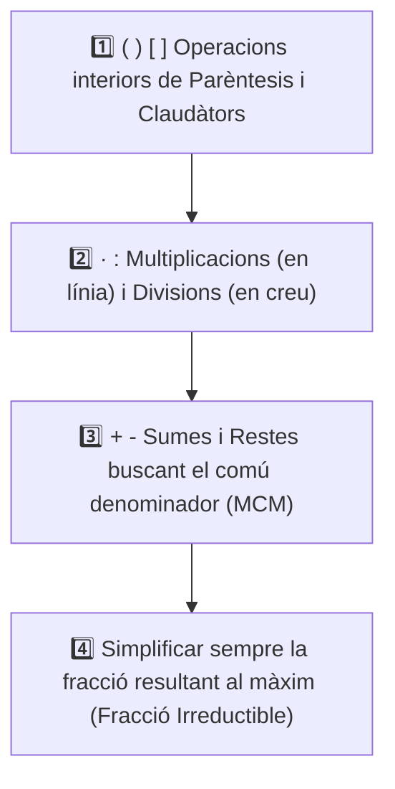

# UD5: Les Fraccions (Matemàtiques)

  

    

      PDI · Pissarra Digital
      🎯 5 Reptes Interactius d'Arrastrar i Soltar de UD5
    

    
Practica a la pissarra de classe amb pantalles tàctils o des de tauletes amb sons i autocorrecció immediata.

  

  <a href="../pissarra-interactiva.html" onclick="localStorage.setItem('pdi-target-unit', 'ud5')" style="background: linear-gradient(135deg, #059669, #0d9488); color: #fff !important; font-weight: 800; padding: 10px 18px; border-radius: 10px; text-decoration: none !important; box-shadow: 0 4px 12px rgba(5, 150, 105, 0.3); display: inline-flex; align-items: center; gap: 6px;">
    🖥️ Obrir Reptes PDI
    →
  </a>

<svg viewBox="0 0 860 260" xmlns="http://www.w3.org/2000/svg" style="max-width: 100%; height: auto; font-family: 'Segoe UI', system-ui, sans-serif; border-radius: 12px; box-shadow: 0 8px 24px rgba(0,0,0,0.35);">
  <defs>
    <linearGradient id="bg-grad-5" x1="0%" y1="0%" x2="100%" y2="100%">
      <stop offset="0%" stop-color="#0f172a"/>
      <stop offset="100%" stop-color="#1e293b"/>
    </linearGradient>
    <linearGradient id="g-eqv" x1="0%" y1="0%" x2="100%" y2="100%">
      <stop offset="0%" stop-color="#38bdf8" stop-opacity="0.25"/>
      <stop offset="100%" stop-color="#38bdf8" stop-opacity="0.05"/>
    </linearGradient>
    <linearGradient id="g-sum" x1="0%" y1="0%" x2="100%" y2="100%">
      <stop offset="0%" stop-color="#818cf8" stop-opacity="0.25"/>
      <stop offset="100%" stop-color="#818cf8" stop-opacity="0.05"/>
    </linearGradient>
    <linearGradient id="g-prd" x1="0%" y1="0%" x2="100%" y2="100%">
      <stop offset="0%" stop-color="#34d399" stop-opacity="0.25"/>
      <stop offset="100%" stop-color="#34d399" stop-opacity="0.05"/>
    </linearGradient>
    <linearGradient id="g-app" x1="0%" y1="0%" x2="100%" y2="100%">
      <stop offset="0%" stop-color="#f59e0b" stop-opacity="0.25"/>
      <stop offset="100%" stop-color="#f59e0b" stop-opacity="0.05"/>
    </linearGradient>
  </defs>

  <!-- Background -->
  <rect width="860" height="260" rx="12" fill="url(#bg-grad-5)"/>

  <!-- Capçalera -->
  <text x="430" y="36" text-anchor="middle" fill="#f8fafc" font-size="19" font-weight="bold">ARITMÈTICA FRACCIONÀRIA: OPERACIONS I PROPORCIONS</text>
  <text x="430" y="56" text-anchor="middle" fill="#94a3b8" font-size="12">Equivalència, comú denominador mitjançant MCM, àlgebra de racionals i dissolucions de laboratori</text>

  <!-- Bloc 1: Concepte i Equivalència -->
  <g transform="translate(25, 70)">
    <rect width="185" height="165" rx="10" fill="url(#g-eqv)" stroke="#38bdf8" stroke-width="1.5"/>
    <rect x="15" y="14" width="28" height="28" rx="6" fill="#38bdf8" fill-opacity="0.2"/>
    <text x="29" y="33" text-anchor="middle" fill="#38bdf8" font-size="14" font-weight="bold">⚖️</text>
    <text x="52" y="33" fill="#f8fafc" font-size="13" font-weight="bold">Equivalència</text>
    <text x="15" y="62" fill="#38bdf8" font-size="11" font-weight="600">Productes Creuats</text>
    <text x="15" y="84" fill="#cbd5e1" font-size="11">• a/b = c/d ⇔ a·d = b·c</text>
    <text x="15" y="104" fill="#cbd5e1" font-size="11">• Amplificació: · k / · k</text>
    <text x="15" y="124" fill="#cbd5e1" font-size="11">• Simplificació: : MCD</text>
    <text x="15" y="144" fill="#cbd5e1" font-size="11">• Fracció irreductible</text>
  </g>

  <!-- Bloc 2: Suma i Resta (MCM) -->
  <g transform="translate(230, 70)">
    <rect width="185" height="165" rx="10" fill="url(#g-sum)" stroke="#818cf8" stroke-width="1.5"/>
    <rect x="15" y="14" width="28" height="28" rx="6" fill="#818cf8" fill-opacity="0.2"/>
    <text x="29" y="33" text-anchor="middle" fill="#818cf8" font-size="14" font-weight="bold">➕</text>
    <text x="52" y="33" fill="#f8fafc" font-size="13" font-weight="bold">Suma i Resta</text>
    <text x="15" y="62" fill="#818cf8" font-size="11" font-weight="600">Comú Denominador</text>
    <text x="15" y="84" fill="#cbd5e1" font-size="11">• 1r: MCM(denominadors)</text>
    <text x="15" y="104" fill="#cbd5e1" font-size="11">• 2n: Nou num = (MCM:d)·n</text>
    <text x="15" y="124" fill="#cbd5e1" font-size="11">• 3r: Sumar/restar numeradors</text>
    <text x="15" y="144" fill="#cbd5e1" font-size="11">• Mantenir denominador comú</text>
  </g>

  <!-- Bloc 3: Producte i Quocient -->
  <g transform="translate(435, 70)">
    <rect width="185" height="165" rx="10" fill="url(#g-prd)" stroke="#34d399" stroke-width="1.5"/>
    <rect x="15" y="14" width="28" height="28" rx="6" fill="#34d399" fill-opacity="0.2"/>
    <text x="29" y="33" text-anchor="middle" fill="#34d399" font-size="14" font-weight="bold">✖️</text>
    <text x="52" y="33" fill="#f8fafc" font-size="13" font-weight="bold">Producte & Divisió</text>
    <text x="15" y="62" fill="#34d399" font-size="11" font-weight="600">Operacions Directes</text>
    <text x="15" y="84" fill="#cbd5e1" font-size="11">• Multiplicació: En línia</text>
    <text x="15" y="104" fill="#cbd5e1" font-size="11">  (a/b) · (c/d) = (a·c)/(b·d)</text>
    <text x="15" y="124" fill="#cbd5e1" font-size="11">• Divisió: En creu (inversa)</text>
    <text x="15" y="144" fill="#cbd5e1" font-size="11">  (a/b) : (c/d) = (a·d)/(b·c)</text>
  </g>

  <!-- Bloc 4: Aplicacions Pràctiques -->
  <g transform="translate(640, 70)">
    <rect width="195" height="165" rx="10" fill="url(#g-app)" stroke="#f59e0b" stroke-width="1.5"/>
    <rect x="15" y="14" width="28" height="28" rx="6" fill="#f59e0b" fill-opacity="0.2"/>
    <text x="29" y="33" text-anchor="middle" fill="#f59e0b" font-size="14" font-weight="bold">🧪</text>
    <text x="52" y="33" fill="#f8fafc" font-size="13" font-weight="bold">Contextos Reals</text>
    <text x="15" y="62" fill="#f59e0b" font-size="11" font-weight="600">Mescles i Particions</text>
    <text x="15" y="84" fill="#cbd5e1" font-size="11">• Dissolució alcohol IPA (7/10)</text>
    <text x="15" y="104" fill="#cbd5e1" font-size="11">• Particions de discs SSD</text>
    <text x="15" y="124" fill="#cbd5e1" font-size="11">• Fracció restant: 1 - ∑(parts)</text>
    <text x="15" y="144" fill="#cbd5e1" font-size="11">• Fracció d'una fracció</text>
  </g>
</svg>

---

## 📑 Índex d'Apartats de la Unitat {#index-unitat}

  
Accés ràpid als apartats complets d'aquesta unitat:

  <ol style="margin: 0; padding-left: 20px; line-height: 2.1;">
    <li><a href="#sec5-1"><strong>5.1 Concepte de Fracció i Fraccions Equivalents</strong></a></li>
    <li><a href="#sec5-2"><strong>5.2 Suma i Resta de Fraccions</strong></a></li>
    <li><a href="#sec5-3"><strong>5.3 Multiplicació i Divisió de Fraccions</strong></a></li>
    <li><a href="#sec5-4"><strong>5.4 Operacions Combinades i Jerarquia amb Fraccions</strong></a></li>
    <li><a href="#sec5-5"><strong>5.5 Quadern d'Activitats Pràctiques i Reptes de Laboratori</strong></a></li>
  </ol>

---

## 📌 5.1 Concepte de Fracció i Fraccions Equivalents {#sec5-1}

Una **fracció** és l'expressió matemàtica d'una quantitat dividida entre una altra quantitat. S'escriu en la forma:

$$\frac{a}{b}$$

On:
- **$a$ és el Numerador:** El nombre situat per damunt de la barra. Indica el nombre de parts iguals que prenem o considerem.
- **$b$ és el Denominador:** El nombre situat per davall de la barra ($b \neq 0$). Indica en quantes parts iguals hem dividit la unitat sencera.

---

### 1. Els Tres Significats d'una Fracció

Una fracció pot interpretar-se de tres formes segons el context:

#### A) La Fracció com a Part d'una Unitat
Si dividim una pizza en $8$ porcions iguals i ens mengem $3$ porcions, hem consumit:
$$\frac{3}{8} \text{ de la pizza}$$
- Ens queden: $\frac{5}{8}$ de la pizza.

#### B) La Fracció com a Quocient o Divisió
Tota fracció representa el quocient exacte o decimal entre el numerador i el denominador:
$$\frac{3}{4} = 3 : 4 = 0{,}75$$
$$\frac{12}{3} = 12 : 3 = 4$$

#### C) La Fracció com a Operador d'una Quantitat
Calcular la fracció d'un nombre consisteix a **dividir el nombre entre el denominador i multiplicar el resultat pel numerador** (o multiplicar el numerador pel nombre i dividir entre el denominador):

$$\frac{a}{b} \text{ de } N = \frac{a \cdot N}{b} = (N : b) \cdot a$$

> **Exemple:** Calcula els $\frac{3}{5}$ de $250\text{ €}$:
> $$\frac{3}{5} \text{ de } 250 = (250 : 5) \cdot 3 = 50 \cdot 3 = \mathbf{150\text{ €}}$$

---

### 2. Tipus de Fraccions

- **Fracció Pròpia:** El numerador és més petit que el denominador ($a < b$). Representa una quantitat menor que la unitat ($< 1$):  
  $$\frac{2}{5} = 0{,}4 < 1$$
- **Fracció Impròpia:** El numerador és més gran que el denominador ($a > b$). Representa una quantitat major que la unitat ($> 1$):  
  $$\frac{7}{4} = 1{,}75 > 1$$
- **Fracció Igual a la Unitat:** Numerador i denominador són iguals ($a = b$):  
  $$\frac{6}{6} = 1$$

---

### 3. Fraccions Equivalents

Dues fraccions $\frac{a}{b}$ i $\frac{c}{d}$ són **equivalents** ($\frac{a}{b} = \frac{c}{d}$) si representen exactament la mateixa quantitat o el mateix valor decimal.

> [!IMPORTANT]
> ### Comprovació de la Regla dels Productes Creuats
> Dues fraccions són equivalents si i només si **el producte dels extrems és igual al producte dels mitjans**:
> $$\frac{a}{b} = \frac{c}{d} \iff a \cdot d = b \cdot c$$

**Exemple:** Són equivalents $\frac{2}{3}$ i $\frac{8}{12}$?
$$2 \cdot 12 = 24 \qquad \text{i} \qquad 3 \cdot 8 = 24$$
Com que $24 = 24$, les dues fraccions són **equivalents**: $\frac{2}{3} = \frac{8}{12}$.

---

### 4. Obtenció de Fraccions Equivalents i Simplificació

Podem obtindre fraccions equivalents de dues maneres:

1. **Per Amplificació:** Multipliquem el numerador i el denominador pel mateix nombre natural diferent de zero:
   $$\frac{3}{5} = \frac{3 \cdot 4}{5 \cdot 4} = \frac{12}{20}$$
2. **Per Simplificació:** Dividim el numerador i el denominador entre un divisor comú a tots dos:
   $$\frac{24}{36} = \frac{24 : 2}{36 : 2} = \frac{12}{18} = \frac{12 : 6}{18 : 6} = \frac{2}{3}$$

#### La Fracció Irreductible
Una fracció és **irreductible** quan el numerador i el denominador no tenen cap divisor comú excepte l'1 ($\text{MCD}(a, b) = 1$). No es pot simplificar més.
Per obtindre directament la fracció irreductible, **dividim numerador i denominador pel seu Màxim Comú Divisor ($\text{MCD}$)**:
- Per a $\frac{60}{84}$, calculem $\text{MCD}(60, 84) = 12$:
  $$\frac{60 : 12}{84 : 12} = \mathbf{\frac{5}{7}} \quad \text{(fracció irreductible)}$$

---

### ✏️ Exercicis Pràctics

  

    🎮 <strong>Zona d'Entrenament FPB:</strong> 0 reptes resolts
    ⭐ 0 punts
  

  

#### 1. Concepte de Fracció i Fracció d'una Quantitat

  
✍️ Si dividim una pizza en 8 porcions iguals i en mengem 3, quin nombre ocupa el lloc del numerador (3/8)?

  

    <input type="text" class="quiz-input" placeholder="El teu resultat...">
    <button type="button" class="btn-quiz-check">Comprovar</button>
  

  

  
✍️ Calcula la fracció d'una quantitat: quant són els 2/3 de 60 € d'una comanda?

  

    <input type="text" class="quiz-input" placeholder="El teu resultat...">
    <button type="button" class="btn-quiz-check">Comprovar</button>
  

  

  <a href="#index-unitat" class="page-nav-btn" style="display: inline-block; padding: 4px 14px; font-size: 0.85rem;">⬆️ Pujar a l'Índex</a>

---

## 📌 5.2 Suma i Resta de Fraccions {#sec5-2}

Per poder sumar o restar fraccions és **imprescindible que totes tinguen el mateix denominador** (és a dir, que les porcions siguen de la mateixa mida).

---

### 1. Suma i Resta amb el Mateix Denominador

Si les fraccions ja comparteixen el mateix denominador, el càlcul és directe: **se sumen o resten els numeradors i es manté el mateix denominador**.

$$\frac{a}{c} + \frac{b}{c} = \frac{a + b}{c} \qquad \text{i} \qquad \frac{a}{c} - \frac{b}{c} = \frac{a - b}{c}$$

#### Exemples:
- $\frac{3}{8} + \frac{2}{8} = \mathbf{\frac{5}{8}}$
- $\frac{7}{10} - \frac{3}{10} = \frac{4}{10} = \mathbf{\frac{2}{5}}$ *(sempre simplifiquem al final)*
- $\frac{9}{12} + \frac{5}{12} - \frac{6}{12} = \frac{9 + 5 - 6}{12} = \frac{8}{12} = \mathbf{\frac{2}{3}}$

---

### 2. Suma i Resta amb Diferent Denominador

Si les fraccions tenen denominadors diferents, primer hem de transformar-les en fraccions equivalents amb un **comú denominador** utilitzant el **Mínim Comú Múltiple ($\text{MCM}$)**.

> [!IMPORTANT]
> ### Procediment Pas a Pas
> 1. **Calcular l'MCM** de tots els denominadors. Aquest valor serà el nou denominador comú.
> 2. **Calcular els nous numeradors:** Dividim el nou denominador entre el denominador original antic i multipliquem el resultat pel numerador antic:
>    $$\text{Nou numerador} = (\text{MCM} : \text{denominador antic}) \cdot \text{numerador antic}$$
> 3. **Sumar o restar els nous numeradors**, mantenint el comú denominador.
> 4. **Simplificar** la fracció resultant fins a obtindre la fracció irreductible.

---

#### Exemple Resolts Pas a Pas

##### Exemple 1: Suma de dues fraccions
Calcula:
$$\frac{3}{4} + \frac{1}{6}$$

1. Calculem l'MCM dels denominadors $4$ i $6$:
   - $4 = 2^2$
   - $6 = 2 \cdot 3$
   - $\text{MCM}(4, 6) = 2^2 \cdot 3 = \mathbf{12}$
2. Transformem les fraccions a denominador $12$:
   - Per a $\frac{3}{4}$: $(12 : 4) \cdot 3 = 3 \cdot 3 = 9 \longrightarrow \frac{9}{12}$
   - Per a $\frac{1}{6}$: $(12 : 6) \cdot 1 = 2 \cdot 1 = 2 \longrightarrow \frac{2}{12}$
3. Sumem els numeradors:
   $$\frac{9}{12} + \frac{2}{12} = \mathbf{\frac{11}{12}}$$

---

##### Exemple 2: Operació amb tres fraccions i enters
Calcula:
$$2 - \frac{3}{5} + \frac{7}{10}$$

1. Recordem que tot nombre enter té denominador $1$: $2 = \frac{2}{1}$.
2. Calculem l'MCM de $1, 5$ i $10$:
   $$\text{MCM}(1, 5, 10) = \mathbf{10}$$
3. Calculem els nous numeradors:
   - $(10 : 1) \cdot 2 = 20 \longrightarrow \frac{20}{10}$
   - $(10 : 5) \cdot 3 = 6 \longrightarrow \frac{6}{10}$
   - $(10 : 10) \cdot 7 = 7 \longrightarrow \frac{7}{10}$
4. Operem i simplifiquem:
   $$\frac{20 - 6 + 7}{10} = \mathbf{\frac{21}{10}}$$

---

### ✏️ Exercicis Pràctics

  

    🎮 <strong>Zona d'Entrenament FPB:</strong> 0 reptes resolts
    ⭐ 0 punts
  

  

#### 1. Fraccions Equivalents i Simplificació

 la fracció irreductible és 3/4.">
  
✍️ Simplifica la fracció 18/24 dividint numerador i denominador entre 6: quin és el nou numerador irreductible (3/4)?

  

    <input type="text" class="quiz-input" placeholder="El teu resultat...">
    <button type="button" class="btn-quiz-check">Comprovar</button>
  

  

  <strong>Les fraccions 2/3 i 8/12 són equivalents (comprova multiplicant en creu: 2 × 12 = 3 × 8 = 24).</strong>
  

    <button type="button" class="btn-vf" data-opt="V">V</button>
    <button type="button" class="btn-vf" data-opt="F">F</button>
  

  

  <a href="#index-unitat" class="page-nav-btn" style="display: inline-block; padding: 4px 14px; font-size: 0.85rem;">⬆️ Pujar a l'Índex</a>

---

## 📌 5.3 Multiplicació i Divisió de Fraccions {#sec5-3}

A diferència de la suma i la resta, per a multiplicar o dividir fraccions **NO cal buscar un comú denominador**: les operacions es calculen de manera directa i immediata.

---

### 1. La Multiplicació de Fraccions

El producte de dues o més fraccions és una altra fracció que té:
- Com a numerador: el **producte dels numeradors** (en línia horitzontal).
- Com a denominador: el **producte dels denominadors** (en línia horitzontal).

$$\frac{a}{b} \cdot \frac{c}{d} = \frac{a \cdot c}{b \cdot d}$$

#### Exemples:
- $\frac{2}{3} \cdot \frac{5}{7} = \frac{2 \cdot 5}{3 \cdot 7} = \mathbf{\frac{10}{21}}$
- $\frac{3}{4} \cdot \frac{8}{9} = \frac{3 \cdot 8}{4 \cdot 9} = \frac{24}{36} = \mathbf{\frac{2}{3}}$ *(simplificat)*

#### Producte d'un Nombre Sencer per una Fracció:
Considerem que el nombre sencer té denominador $1$:
$$5 \cdot \frac{3}{7} = \frac{5}{1} \cdot \frac{3}{7} = \frac{5 \cdot 3}{1 \cdot 7} = \mathbf{\frac{15}{7}}$$

> [!TIP]
> ### Fracció d'una Fracció
> Quan calculem una fracció d'una altra fracció, es tracta simplement d'una multiplicació:
> "La meitat dels tres quarts":
> $$\frac{1}{2} \text{ de } \frac{3}{4} = \frac{1}{2} \cdot \frac{3}{4} = \mathbf{\frac{3}{8}}$$

---

### 2. La Fracció Inversa

La **fracció inversa** d'una fracció $\frac{a}{b}$ s'obté intercanviant el numerador i el denominador:

$$\text{Inversa de } \frac{a}{b} = \frac{b}{a}$$

- La inversa de $\frac{3}{5}$ és $\mathbf{\frac{5}{3}}$.
- La inversa de $\frac{1}{4}$ és $\frac{4}{1} = \mathbf{4}$.
- La inversa de $7$ és $\mathbf{\frac{1}{7}}$.

> [!NOTE]
> El producte d'una fracció per la seua inversa és sempre igual a la **unitat ($1$)**:
> $$\frac{a}{b} \cdot \frac{b}{a} = \frac{a \cdot b}{b \cdot a} = 1 \qquad \longrightarrow \qquad \frac{3}{5} \cdot \frac{5}{3} = \frac{15}{15} = 1$$

---

### 3. La Divisió de Fraccions

Per dividir dues fraccions tenim dos mètodes totalment equivalents:

#### Mètode A: Multiplicació en Creu
Multipliquem el numerador de la primera pel denominador de la segona (nou numerador) i el denominador de la primera pel numerador de la segona (nou denominador):

$$\frac{a}{b} : \frac{c}{d} = \frac{a \cdot d}{b \cdot c}$$

#### Mètode B: Multiplicar per la Fracció Inversa *(Recomanat)*
Dividir entre una fracció equival a **multiplicar per la seua inversa**:

$$\frac{a}{b} : \frac{c}{d} = \frac{a}{b} \cdot \frac{d}{c} = \frac{a \cdot d}{b \cdot c}$$

#### Exemples:
- $\frac{2}{5} : \frac{3}{4} = \frac{2 \cdot 4}{5 \cdot 3} = \mathbf{\frac{8}{15}}$
- $\frac{7}{6} : \frac{14}{9} = \frac{7 \cdot 9}{6 \cdot 14} = \frac{63}{84} = \mathbf{\frac{3}{4}}$
- $\frac{4}{5} : 2 = \frac{4}{5} : \frac{2}{1} = \frac{4 \cdot 1}{5 \cdot 2} = \frac{4}{10} = \mathbf{\frac{2}{5}}$

---

### ✏️ Exercicis Pràctics

  

    🎮 <strong>Zona d'Entrenament FPB:</strong> 0 reptes resolts
    ⭐ 0 punts
  

  

#### 1. Operacions amb Fraccions

 3/4.">
  
✍️ Suma amb el mateix denominador: 1/4 + 2/4 (escriu '3/4' o '0.75')

  

    <input type="text" class="quiz-input" placeholder="El teu resultat...">
    <button type="button" class="btn-quiz-check">Comprovar</button>
  

  

  
✍️ Suma amb diferent denominador: 1/2 + 1/3 (escriu la fracció resultant amb denominador 6: '5/6')

  

    <input type="text" class="quiz-input" placeholder="El teu resultat...">
    <button type="button" class="btn-quiz-check">Comprovar</button>
  

  

  
✍️ Resta de fraccions: 3/4 - 1/6 (escriu la fracció resultant amb denominador 12: '7/12')

  

    <input type="text" class="quiz-input" placeholder="El teu resultat...">
    <button type="button" class="btn-quiz-check">Comprovar</button>
  

  

  <a href="#index-unitat" class="page-nav-btn" style="display: inline-block; padding: 4px 14px; font-size: 0.85rem;">⬆️ Pujar a l'Índex</a>

---

## 📌 5.4 Operacions Combinades i Jerarquia amb Fraccions {#sec5-4}

Quan ens trobem amb expressions que combinen sumes, restes, productes, divisions i parèntesis de fraccions, és imprescindible aplicar amb rigor la **jerarquia oficial d'operacions**.

---

### 1. La Jerarquia d'Operacions

---

### 🔍 Exemples Models Resolts Pas a Pas

#### Exemple 1: Sense Parèntesis
Calcula:
$$\frac{2}{3} + \frac{1}{4} \cdot \frac{8}{3} - \frac{1}{2}$$

**Pas 1: Resolem primer la multiplicació:**
$$\frac{1}{4} \cdot \frac{8}{3} = \frac{8}{12} = \frac{2}{3}$$
L'expressió queda:
$$\frac{2}{3} + \frac{2}{3} - \frac{1}{2}$$

**Pas 2: Comú denominador per a la suma i la resta:**
- Denominadors: $3$ i $2 \longrightarrow \text{MCM}(3, 2) = 6$.
- Transformem a denominador $6$:
  $$\frac{4}{6} + \frac{4}{6} - \frac{3}{6} = \frac{4 + 4 - 3}{6} = \mathbf{\frac{5}{6}}$$

---

#### Exemple 2: Amb Parèntesis
Calcula:
$$\left( \frac{3}{4} - \frac{1}{2} \right) \cdot \left( \frac{2}{3} + \frac{1}{5} \right)$$

**Pas 1: Resolem el contingut del primer parèntesi:**
$$\frac{3}{4} - \frac{1}{2} = \frac{3}{4} - \frac{2}{4} = \frac{1}{4}$$

**Pas 2: Resolem el contingut del segon parèntesi:**
- $\text{MCM}(3, 5) = 15$:
$$\frac{2}{3} + \frac{1}{5} = \frac{10}{15} + \frac{3}{15} = \frac{13}{15}$$

**Pas 3: Multipliquem els dos resultats:**
$$\frac{1}{4} \cdot \frac{13}{15} = \frac{1 \cdot 13}{4 \cdot 15} = \mathbf{\frac{13}{60}}$$

---

#### Exemple 3: Amb Claudàtors i Nombres Enters
Calcula:
$$2 - \frac{3}{5} \cdot \left[ 1 + \left( \frac{4}{3} - \frac{1}{2} \right) \right]$$

**Pas 1: Parèntesi intern:**
$$\frac{4}{3} - \frac{1}{2} = \frac{8}{6} - \frac{3}{6} = \frac{5}{6}$$

**Pas 2: Resolem l'interior del claudàtor:**
$$1 + \frac{5}{6} = \frac{6}{6} + \frac{5}{6} = \frac{11}{6}$$
L'expressió queda:
$$2 - \frac{3}{5} \cdot \frac{11}{6}$$

**Pas 3: Fem la multiplicació abans de la resta:**
$$\frac{3}{5} \cdot \frac{11}{6} = \frac{33}{30} = \frac{11}{10}$$

**Pas 4: Fem la resta final:**
$$2 - \frac{11}{10} = \frac{20}{10} - \frac{11}{10} = \mathbf{\frac{9}{10}}$$

---

### ⚠️ Errors Habituals a Evitar

1. **Sumar abans de multiplicar:** En $\frac{1}{2} + \frac{3}{4} \cdot \frac{2}{5}$, **MAI** sumes $\frac{1}{2} + \frac{3}{4}$ primer; la multiplicació té prioritat absoluta!
2. **Oblidar buscar comú denominador en sumes:** En $\frac{2}{3} + \frac{1}{4}$, no es pot sumar $2+1$ i $3+4$. Només es pot sumar quan tenen el mateix denominador.
3. **No simplificar les fraccions intermèdies o el resultat final.**

---

### ✏️ Exercicis Pràctics

  

    🎮 <strong>Zona d'Entrenament FPB:</strong> 0 reptes resolts
    ⭐ 0 punts
  

  

#### 1. Operacions Combinades amb Fraccions

  
✍️ Calcula i simplifica: (3/5 : 2/3) - 1/10 (escriu la fracció simplificada '4/5' o '0.8')

  

    <input type="text" class="quiz-input" placeholder="El teu resultat...">
    <button type="button" class="btn-quiz-check">Comprovar</button>
  

  

  
✍️ Calcula: 5/6 - 1/3 · (3/4 + 1/2) (escriu la fracció amb denominador 12: '5/12')

  

    <input type="text" class="quiz-input" placeholder="El teu resultat...">
    <button type="button" class="btn-quiz-check">Comprovar</button>
  

  

  
✍️ Calcula: (2 - 1/3) : (1/2 + 1/4) (escriu la fracció irreductible '20/9')

  

    <input type="text" class="quiz-input" placeholder="El teu resultat...">
    <button type="button" class="btn-quiz-check">Comprovar</button>
  

  

  <a href="#index-unitat" class="page-nav-btn" style="display: inline-block; padding: 4px 14px; font-size: 0.85rem;">⬆️ Pujar a l'Índex</a>

---

## 📌 5.5 Quadern d'Activitats Pràctiques i Reptes de Laboratori {#sec5-5}

En entorns científics i tècnics, les fraccions s'utilitzen habitualment en:
1. **Fracció de la part restant:**
   Si es consumeix una fracció $\dfrac{a}{b}$ d'un total, la part restant no consumida és la unitat menys eixa fracció:
   $$\text{Fracció Restant} = 1 - \frac{a}{b} = \frac{b - a}{b}$$
2. **Fracció d'una fracció (Producte):**
   Quan es pren "una fracció del que queda", s'aplica una **multiplicació**:
   $$\text{Segona despesa} = \frac{c}{d} \text{ de la part restant} = \frac{c}{d} \cdot \left(1 - \frac{a}{b}\right)$$
3. **Formulació de dissolucions químiques:**
   En mescles líquides com l'alcohol isopropílic (IPA) per a manteniment de plaques base, les concentracions es defineixen com a proporcions de volum ($V_{\text{solut}} / V_{\text{total}}$).

---

### 📝 Quadern d'Activitats Pràctiques i Reptes de Laboratori

  

    🎮 <strong>Zona d'Entrenament FPB:</strong> 0 reptes resolts
    ⭐ 0 punts
  

  

#### Bloc A: Fonaments, Dimensionament i Diagnòstic Tècnic

##### Exercici 1: Fraccions equivalents, productes creuats i fracció irreductible
1. Comprova si cadascuna de les següents parelles de fraccions són equivalents utilitzant la regla dels productes creuats:
   - Parella A: $\dfrac{18}{24} \quad \text{i} \quad \dfrac{15}{20}$
   - Parella B: $\dfrac{14}{35} \quad \text{i} \quad \dfrac{16}{42}$
   - Parella C: $\dfrac{45}{60} \quad \text{i} \quad \dfrac{39}{52}$
2. Troba el valor de la incògnita $x$ en cadascuna de les següents proporcions perquè es mantinga l'equivalència:
   $$\frac{x}{12} = \frac{15}{20} \qquad \frac{9}{x} = \frac{27}{45} \qquad \frac{8}{14} = \frac{20}{x}$$
3. Simplifica cadascuna de les següents fraccions fins a obtenir la seua fracció irreductible calculant l'$\text{MCD}$ de numerador i denominador:
   $$F_1 = \frac{72}{108} \qquad F_2 = \frac{140}{210} \qquad F_3 = \frac{198}{264}$$

 4/5 (o 0,8).">
  
✍️ Exercici 1: Simplifica la fracció 48/60 fins a fracció irreductible (escriu '4/5' o '0.8'):

  

    <input type="text" class="quiz-input" placeholder="El teu resultat...">
    <button type="button" class="btn-quiz-check">Comprovar</button>
  

  

  
✍️ <strong>Exercici 1 (Fraccions Equivalents i Fracció Irreductible):</strong> Comprova mitjançant productes creuats si les fraccions 18/24 i 15/20 són equivalents, i obtén la seua fracció irreductible dividint numerador i denominador per l'MCD:

  <textarea class="open-response-input" rows="3" placeholder="Producte creuat: 18 · 20 = ... i 24 · 15 = ... Fracció irreductible: ..."></textarea>

##### Exercici 2: Suma i resta de fraccions amb mínim comú denominador
Resol les següents operacions reduint primerament a comú denominador mitjançant l'$\text{MCM}$ i simplifica el resultat final:
1. **Suma simple:**
   $$S_1 = \frac{3}{8} + \frac{5}{12}$$
2. **Resta combinada:**
   $$S_2 = \frac{7}{10} - \frac{4}{15} + \frac{1}{6}$$
3. **Suma amb nombres enters:**
   $$S_3 = 2 - \frac{3}{5} + \frac{7}{10}$$

##### Exercici 3: Operacions combinades i jerarquia amb fraccions
Resol mostrant detalladament tots els passos intermedis segons la jerarquia d'operacions:
1. **Expressió A:**
   $$A = \frac{3}{4} \cdot \left(\frac{5}{6} - \frac{1}{3}\right) + \frac{7}{8} : \frac{14}{4}$$
2. **Expressió B:**
   $$B = \left(2 - \frac{1}{4}\right) : \left(\frac{3}{5} + \frac{1}{2}\right) - \frac{4}{11}$$
3. **Expressió C:**
   $$C = \frac{5}{6} - \left[\frac{2}{3} \cdot \left(\frac{9}{4} - \frac{3}{2}\right) + \frac{1}{8}\right]$$

  
✍️ <strong>Exercici 2 (Procediment de Suma i Resta de Fraccions):</strong> Desenvolupa pas a pas la suma 3/4 + 5/6 - 7/12 calculant l'mcm dels denominadors i reduint a comú denominador abans d'operar:

  <textarea class="open-response-input" rows="3" placeholder="mcm(4, 6, 12) = ... Fraccions equivalents reduïdes: ... Resultat final irreductible: ..."></textarea>

---

#### Bloc B: Reptes Pràctics de Laboratori i Taller / Comandes

  
🔬 Calculadora i Simplificador de Fraccions Irreductibles

  

    Introdueix el numerador i el denominador per obtenir la fracció irreductible més simplificada, el seu valor decimal i el percentatge equivalent:
  

  

    

      <label for="frac-num">Numerador:</label>
      <input type="number" id="frac-num" value="12">
    

    

      <label for="frac-den">Denominador (≠ 0):</label>
      <input type="number" id="frac-den" value="18">
    

  

  <button type="button" class="btn-lab-action" onclick="runCalcFraccions()">⚡ Simplificar Fracció</button>
  

    <em>Introdueix numerador i denominador per calcular la fracció irreductible.</em>
  

---

##### Repte 1: Formulació de dissolució desengreixant d'alcohol isopropílic (IPA)
- **Objectiu:** Utilitzar la fracció com a operador per calcular quantitats exactes de líquids en un laboratori tècnic.
- **Situació de taller:** Per netejar restes de pasta tèrmica ressecada i flux de soldadura en plaques base, un tècnic ha de preparar un flascó aplicador d'exactament $500\text{ ml}$ d'una mescla de neteja d'alta puresa:
  - $\dfrac{7}{10}$ del volum total han de ser d'alcohol isopropílic pur al 99%.
  - La resta del volum ha de ser d'aigua destil·lada desionitzada.
- **Comanda tècnica:**
  1. Quina fracció del volum total correspon a l'aigua destil·lada?
  2. Calcula els mil·lilitres exactes d'alcohol isopropílic que cal mesurar amb la proveta:
     $$V_{\text{IPA}} = \frac{7}{10} \text{ de } 500\text{ ml}$$
  3. Quants mil·lilitres d'aigua destil·lada cal afegir per completar el flascó?
  4. Si per a una neteja intensiva s'utilitzen $\dfrac{2}{5}$ del contingut del flascó preparat, quants mil·lilitres de dissolució s'han gastat i quants en queden disponibles?

  
✍️ Repte 1: En un disc SSD de 500 GB, quants GB ocupa la partició de dades si representa 1/2 de la capacitat?

  

    <input type="text" class="quiz-input" placeholder="El teu resultat...">
    <button type="button" class="btn-quiz-check">Comprovar</button>
  

  

  
✍️ Repte 1: Quants GB queden d'espai lliure sense assignar si representen 1/10 de la capacitat?

  

    <input type="text" class="quiz-input" placeholder="El teu resultat...">
    <button type="button" class="btn-quiz-check">Comprovar</button>
  

  

##### Repte 2: Particionament lògic d'un disc sòlid NVMe i espai lliure
- **Objectiu:** Modelar el repartiment proporcional d'un recurs físic i calcular la fracció i capacitat sobrant.
- **Situació:** En un equip de taller d'FP Bàsica s'instal·la un disc SSD NVMe amb una capacitat neta útil de $960\text{ GB}$. Es planifica la següent distribució de particions:
  - Partició de Sistema Operatiu (Windows/Linux): $\dfrac{1}{4}$ del disc.
  - Partició de Màquines Virtuals i Imatges ISO: $\dfrac{3}{8}$ del disc.
  - Partició de Còpies de Seguretat de Taller: $\dfrac{1}{5}$ del disc.
  - La capacitat restant es deixa com a espai no assignat per a futures ampliacions.
- **Procediment de càlcul:**
  1. Calcula la fracció total de disc que ocupen les tres primeres particions sumant:
     $$\text{Fracció Ocupada} = \frac{1}{4} + \frac{3}{8} + \frac{1}{5}$$
  2. Quina fracció exacta del disc roman com a espai lliure sense assignar?
  3. Converteix cadascuna de les fraccions a gigabytes reals ($\text{GB}$) aplicant la fracció sobre el total de $960\text{ GB}$:
     - Espai del Sistema Operatiu ($\text{GB}$).
     - Espai de Màquines Virtuals ($\text{GB}$).
     - Espai de Còpies de Seguretat ($\text{GB}$).
     - Espai Lliure no assignat ($\text{GB}$).
  4. Suma els quatre valors obtinguts en GB per comprovar que el total suma exactament $960\text{ GB}$.

  
✍️ Repte 2: Quin percentatge (%) de dissolució representa mesclar 150 ml d'alcohol isopropílic en 600 ml de volum total?

  

    <input type="text" class="quiz-input" placeholder="El teu resultat...">
    <button type="button" class="btn-quiz-check">Comprovar</button>
  

  

##### Repte 3: Control d'inventari i consum progressiu de connectors RJ45
- **Objectiu:** Resoldre problemes de consum encadenat ("fracció del que queda") en la gestió de material de xarxa.
- **Situació:** A principis de curs, el taller disposa d'un pot ple amb $600\text{ connectors RJ45}$ mascle categoria 6:
  - Durant el primer trimestre, les pràctiques de muntatge de cables consumeixen $\dfrac{1}{3}$ del total de connectors del pot.
  - Durant el segon trimestre, s'utilitzen $\dfrac{2}{5}$ dels connectors **que quedaven** després del primer trimestre.
  - La resta es reserva per al projecte integrador de final de curs.
- **Càlculs requerits:**
  1. Quants connectors es gasten en el primer trimestre? Quants en queden al pot?
  2. Quants connectors es consumeixen durant el segon trimestre?
  3. Quina fracció **respecte del total inicial** representa el consum del segon trimestre? ($\frac{2}{5} \cdot \text{part restant}$).
  4. Quants connectors queden disponibles exactament per al projecte de final de curs? Quina fracció del total inicial representen?

  
✍️ <strong>Repte 3 (Gestió d'Inventari amb Fraccions):</strong> D'una caixa de 500 connectors RJ45, el dilluns se'n gasta 1/5 del total, i el dimarts 2/3 dels que quedaven. Quants connectors s'han consumit en total i quants en queden a la caixa?

  <textarea class="open-response-input" rows="3" placeholder="Mostra el càlcul de cada fracció i el nombre d'unitats físiques que queden..."></textarea>

---

#### 🎯 Reptes d'Autocomprovació Interactiva (Self-Check)

Introdueix els teus resultats numèrics i comprova immediatament si la teua resposta és correcta:

  
✍️ Repte interactiu: Si simplifiques la fracció 12/18 fins a obtenir la fracció irreductible (2/3), quin és el numerador?

  

    <input type="text" class="quiz-input" placeholder="El teu resultat...">
    <button type="button" class="btn-quiz-check">Comprovar</button>
  

  

 3/4 (o 0,75).">
  
✍️ Repte interactiu: Quant val la suma de fraccions amb mateix denominador: 1/4 + 2/4 (escriu '3/4' o '0.75')?

  

    <input type="text" class="quiz-input" placeholder="El teu resultat...">
    <button type="button" class="btn-quiz-check">Comprovar</button>
  

  

  
✍️ Repte interactiu: Si un disc sòlid de 100 GB té ocupats 2/5 de la seua capacitat total, quants GB estan utilitzats?

  

    <input type="text" class="quiz-input" placeholder="El teu resultat...">
    <button type="button" class="btn-quiz-check">Comprovar</button>
  

  

  
✍️ Repte interactiu: Si s'ha descarregat 3/7 d'un fitxer d'instal·lació, quin és el numerador de la fracció que queda per descarregar (x/7)?

  

    <input type="text" class="quiz-input" placeholder="El teu resultat...">
    <button type="button" class="btn-quiz-check">Comprovar</button>
  

  

---

#### Bloc C: Llista de Verificació i Rúbrica d'Avaluació Competencial

##### Llista de comprovació per a l'alumnat
- [ ] He verificat l'equivalència entre dues fraccions utilitzant la regla dels productes creuats ($a \cdot d = b \cdot c$).
- [ ] He simplificat fraccions dividint pel seu màxim comú divisor fins a trobar la fracció irreductible.
- [ ] He calculat la suma i resta de fraccions reduint correctament a mínim comú denominador mitjançant l'MCM.
- [ ] He multiplicat fraccions en línia i dividit mitjançant el producte creuat o fracció inversa.
- [ ] He resolt operacions combinades respectant l'ordre jeràrquic (parèntesis, multiplicacions/divisions, sumes/restes).
- [ ] He calculat quantitats reals de volum i emmagatzematge aplicant la fracció com a operador sobre una xifra.
- [ ] He resolt problemes encadenats de càlcul de la fracció restant ($1 - \frac{a}{b}$).

##### Rúbrica d'avaluació d'aprenentatge

| Criteri d'Avaluació | Excel·lent (9-10) | Notable (7-8) | Aprovat (5-6) | No Assolit (0-4) |
| :--- | :--- | :--- | :--- | :--- |
| **Concepte d'equivalència i simplificació** | Identifica fraccions equivalents a l'acte, aïlla incògnites en proporcions i redueix a fracció irreductible via MCD sense errades. | Comprova l'equivalència amb productes creuats i simplifica dividint entre factors comuns. | Comprova l'equivalència bàsica però li costa simplificar fraccions de xifres altes. | No comprèn el concepte de fracció equivalent o suma numeradors i denominadors per "simplificar". |
| **Suma i resta amb comú denominador** | Calcula l'MCM amb agilitat, ajusta els nous numeradors amb precisió i simplifica el resultat final de manera sistemàtica. | Realitza la reducció a comú denominador correctament amb xicotets errors en calcular els nous numeradors. | Recorda que cal comú denominador però utilitza el producte directe dels denominadors sense calcular l'MCM. | Suma directament numeradors i denominadors ($\frac{1}{2} + \frac{1}{3} = \frac{2}{5}$). |
| **Multiplicació i divisió de racionals** | Multiplica en línia i divideix en creu amb soltesa, simplificant factors comuns abans d'operar per evitar xifres gegants. | Aplica correctament les regles de multiplicació en línia i divisió creuada simplificant al final. | Confon la multiplicació en línia amb la divisió creuada en situacions d'examen. | Multiplica en creu per a la multiplicació i en línia per a la divisió. |
| **Operacions combinades i jerarquia** | Resol expressions amb claudàtors, multiplicacions i sumes respectant estrictament la jerarquia sense saltar-se passos. | Resol operacions combinades amb bona jerarquia i errades menors de càlcul en l'ajust de denominadors. | Resol primer el parèntesi però s'equivoca en prioritzar la multiplicació sobre la suma posterior. | No respecta la jerarquia d'operacions calculant d'esquerra a dreta. |
| **Resolució de problemes aplicats (taller/química)** | Modela problemes de dissolucions, particions de disc i despeses del que queda amb plantejament matemàtic exemplar. | Planteja i resol problemes de fracció d'una quantitat i de volum de forma clara. | Resol problemes directes de fracció d'un total però s'encalla en "fracció del que queda". | No sap traduir els enunciats a operacions amb fraccions ni interpretar el resultat en context real. |

---

  <h3>📤 Comprovant de Lliurament per a Aules</h3>
  
En acabar els reptes interactius i la llista de comprovació, genera el teu informe oficial per adjuntar-lo o enganxar-lo al lliurament de la tasca d'Aules:

  

    <label for="aules-student-name">Nom i Cognoms de l'alumne/a:</label>
    <input type="text" id="aules-student-name" placeholder="Ex: Pere Martí Soler">
  

  

    Calculant resultats dels reptes...
  

  

    <button type="button" class="btn-aules-copy">📋 Copiar Resum per a Aules</button>
    <button type="button" class="btn-aules-dl" data-module="CA" data-unit="UD05" data-activity="Global">📄 Descarregar Comprovant (.pdf)</button>
  

  

  <a href="#index-unitat" class="page-nav-btn" style="display: inline-block; padding: 4px 14px; font-size: 0.85rem;">⬆️ Pujar a l'Índex</a>

---
