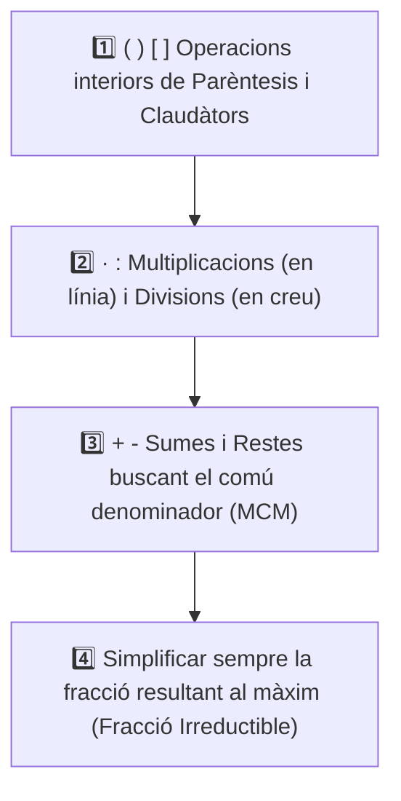

# 5.4 Operacions Combinades i Jerarquia amb Fraccions

Quan ens trobem amb expressions que combinen sumes, restes, productes, divisions i parèntesis de fraccions, és imprescindible aplicar amb rigor la **jerarquia oficial d'operacions**.

---

## 1. La Jerarquia d'Operacions

---

## 🔍 Exemples Models Resolts Pas a Pas

### Exemple 1: Sense Parèntesis
Calcula:
$$\frac{2}{3} + \frac{1}{4} \cdot \frac{8}{3} - \frac{1}{2}$$

**Pas 1: Resolem primer la multiplicació:**
$$\frac{1}{4} \cdot \frac{8}{3} = \frac{8}{12} = \frac{2}{3}$$
L'expressió queda:
$$\frac{2}{3} + \frac{2}{3} - \frac{1}{2}$$

**Pas 2: Comú denominador per a la suma i la resta:**
- Denominadors: $3$ i $2 \longrightarrow \text{MCM}(3, 2) = 6$.
- Transformem a denominador $6$:
  $$\frac{4}{6} + \frac{4}{6} - \frac{3}{6} = \frac{4 + 4 - 3}{6} = \mathbf{\frac{5}{6}}$$

---

### Exemple 2: Amb Parèntesis
Calcula:
$$\left( \frac{3}{4} - \frac{1}{2} \right) \cdot \left( \frac{2}{3} + \frac{1}{5} \right)$$

**Pas 1: Resolem el contingut del primer parèntesi:**
$$\frac{3}{4} - \frac{1}{2} = \frac{3}{4} - \frac{2}{4} = \frac{1}{4}$$

**Pas 2: Resolem el contingut del segon parèntesi:**
- $\text{MCM}(3, 5) = 15$:
$$\frac{2}{3} + \frac{1}{5} = \frac{10}{15} + \frac{3}{15} = \frac{13}{15}$$

**Pas 3: Multipliquem els dos resultats:**
$$\frac{1}{4} \cdot \frac{13}{15} = \frac{1 \cdot 13}{4 \cdot 15} = \mathbf{\frac{13}{60}}$$

---

### Exemple 3: Amb Claudàtors i Nombres Enters
Calcula:
$$2 - \frac{3}{5} \cdot \left[ 1 + \left( \frac{4}{3} - \frac{1}{2} \right) \right]$$

**Pas 1: Parèntesi intern:**
$$\frac{4}{3} - \frac{1}{2} = \frac{8}{6} - \frac{3}{6} = \frac{5}{6}$$

**Pas 2: Resolem l'interior del claudàtor:**
$$1 + \frac{5}{6} = \frac{6}{6} + \frac{5}{6} = \frac{11}{6}$$
L'expressió queda:
$$2 - \frac{3}{5} \cdot \frac{11}{6}$$

**Pas 3: Fem la multiplicació abans de la resta:**
$$\frac{3}{5} \cdot \frac{11}{6} = \frac{33}{30} = \frac{11}{10}$$

**Pas 4: Fem la resta final:**
$$2 - \frac{11}{10} = \frac{20}{10} - \frac{11}{10} = \mathbf{\frac{9}{10}}$$

---

## ⚠️ Errors Habituals a Evitar

1. **Sumar abans de multiplicar:** En $\frac{1}{2} + \frac{3}{4} \cdot \frac{2}{5}$, **MAI** sumes $\frac{1}{2} + \frac{3}{4}$ primer; la multiplicació té prioritat absoluta!
2. **Oblidar buscar comú denominador en sumes:** En $\frac{2}{3} + \frac{1}{4}$, no es pot sumar $2+1$ i $3+4$. Només es pot sumar quan tenen el mateix denominador.
3. **No simplificar les fraccions intermèdies o el resultat final.**

---

## ✏️ Exercicis Pràctics

  

    🎮 <strong>Zona d'Entrenament FPB:</strong> 0 reptes resolts
    ⭐ 0 punts
  

  

### 1. Qüestionari d'Autoavaluació Tipus Test (MCQ)

  
<strong>1. En l'operació combinada amb fraccions $rac{1}{2} + rac{3}{4} 	imes rac{2}{5}$, quina operació s'ha de realitzar en primer lloc?</strong>

  

    <button type="button" class="btn-mcq-opt" data-opt="A">A) La suma $rac{1}{2} + rac{3}{4}$</button>
    <button type="button" class="btn-mcq-opt" data-opt="B">B) La multiplicació $rac{3}{4} 	imes rac{2}{5}$ segons la jerarquia d'operacions</button>
    <button type="button" class="btn-mcq-opt" data-opt="C">C) És indiferent, dóna sempre el mateix resultat</button>
    <button type="button" class="btn-mcq-opt" data-opt="D">D) Primer cal convertir-ho tot a nombres decimals</button>
  

  

  
<strong>2. Com s'escriu el nombre enter 3 en forma de fracció per operar fàcilment amb altres fraccions?</strong>

  

    <button type="button" class="btn-mcq-opt" data-opt="A">A) $rac{3}{3}$</button>
    <button type="button" class="btn-mcq-opt" data-opt="B">B) $rac{1}{3}$</button>
    <button type="button" class="btn-mcq-opt" data-opt="C">C) $rac{3}{1}$ (posant un 1 al denominador)</button>
    <button type="button" class="btn-mcq-opt" data-opt="D">D) $rac{3}{0}$</button>
  

  

---

### 2. Activitats de Vertader (V) o Fals (F)

  <strong>a) Si una operació combinada conté parèntesis com $\left(rac{1}{2} + rac{3}{4}
ight) 	imes rac{2}{5}$, s'ha de calcular obligatòriament primer la suma de l'interior del parèntesi.</strong>
  

    <button type="button" class="btn-vf" data-opt="V">V</button>
    <button type="button" class="btn-vf" data-opt="F">F</button>
  

  

  <strong>b) Quan acabem una operació combinada amb fraccions, és correcte deixar el resultat com a $rac{120}{200}$ sense simplificar en cap cas.</strong>
  

    <button type="button" class="btn-vf" data-opt="V">V</button>
    <button type="button" class="btn-vf" data-opt="F">F</button>
  

  

---

### 1. Operacions Combinades amb Fraccions

  
✍️ Calcula i simplifica: (3/5 : 2/3) - 1/10 (escriu la fracció simplificada '4/5' o '0.8')

  

    <input type="text" class="quiz-input" placeholder="El teu resultat...">
    <button type="button" class="btn-quiz-check">Comprovar</button>
  

  

  
✍️ Calcula: 5/6 - 1/3 · (3/4 + 1/2) (escriu la fracció amb denominador 12: '5/12')

  

    <input type="text" class="quiz-input" placeholder="El teu resultat...">
    <button type="button" class="btn-quiz-check">Comprovar</button>
  

  

  
✍️ Calcula: (2 - 1/3) : (1/2 + 1/4) (escriu la fracció irreductible '20/9')

  

    <input type="text" class="quiz-input" placeholder="El teu resultat...">
    <button type="button" class="btn-quiz-check">Comprovar</button>
  

  

---

---

### 4. Pregunta de Raonament i Resolució d'Operacions Combinades amb Fraccions

  
✍️ <strong>Resolució Pas a Pas d'Operació Combinada:</strong> Resol en el teu quadern la següent operació combinada respectant rigorosament la jerarquia d'operacions:  
  $$rac{3}{4} - rac{1}{2} \cdot \left( rac{5}{6} - rac{1}{3} 
ight)$$  
  Explica detalladament cada pas:  
  1) Resta interior del parèntesi (reduint a comú denominador).  
  2) Multiplicació del resultat pel factor $rac{1}{2}$.  
  3) Resta final reduint a comú denominador i simplificació a la fracció irreductible.

  <textarea class="open-response-input" rows="4" placeholder="Escriu ací el desenvolupament pas a pas i la fracció irreductible final..."></textarea>

---

  <h3 style="margin-top:0; color:#0369a1;">📦 Lliurament d'Activitats d'Aules (Act 5.4)</h3>
  
Genera el teu document de tasca d'aquest apartat amb el teu nom i puntuació obtinguda.

  

    <input type="text" class="aules-student-name" placeholder="Cognoms, Nom de l'Alumne/a" style="padding:8px 12px; border:1px solid #94a3b8; border-radius:4px; flex-grow:1; min-width:240px;">
    <button class="btn-generate-aules-pdf" data-unit="UD05" data-activity="Act04" data-module="CA" style="padding:8px 16px; background:#0284c7; color:#fff; border:none; border-radius:4px; font-weight:600; cursor:pointer;">📄 Descarregar PDF per a Aules</button>
  

