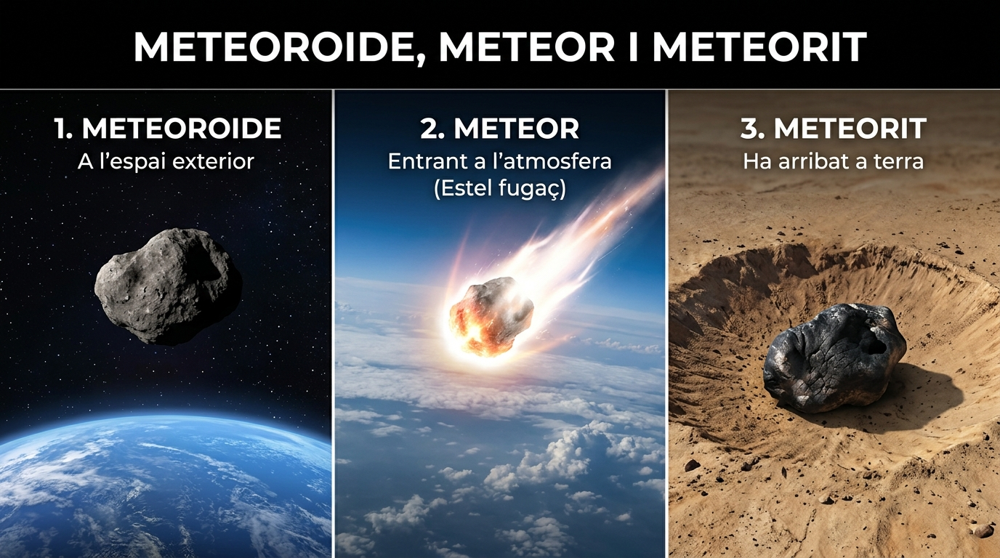

# UD6: La Terra i l'Univers (Biologia i Geologia)

  

    

      PDI · Pissarra Digital
      🎯 5 Reptes Interactius d'Arrastrar i Soltar de UD6
    

    
Practica a la pissarra de classe amb pantalles tàctils o des de tauletes amb sons i autocorrecció immediata.

  

  <a href="../pissarra-interactiva.html" onclick="localStorage.setItem('pdi-target-unit', 'ud6')" style="background: linear-gradient(135deg, #059669, #0d9488); color: #fff !important; font-weight: 800; padding: 10px 18px; border-radius: 10px; text-decoration: none !important; box-shadow: 0 4px 12px rgba(5, 150, 105, 0.3); display: inline-flex; align-items: center; gap: 6px;">
    🖥️ Obrir Reptes PDI
    →
  </a>

<svg viewBox="0 0 860 260" xmlns="http://www.w3.org/2000/svg" style="max-width: 100%; height: auto; font-family: 'Segoe UI', system-ui, sans-serif; border-radius: 12px; box-shadow: 0 8px 24px rgba(0,0,0,0.35);">
  <defs>
    <linearGradient id="bg-grad-6" x1="0%" y1="0%" x2="100%" y2="100%">
      <stop offset="0%" stop-color="#0f172a"/>
      <stop offset="100%" stop-color="#1e293b"/>
    </linearGradient>
    <linearGradient id="g-bb" x1="0%" y1="0%" x2="100%" y2="100%">
      <stop offset="0%" stop-color="#38bdf8" stop-opacity="0.25"/>
      <stop offset="100%" stop-color="#38bdf8" stop-opacity="0.05"/>
    </linearGradient>
    <linearGradient id="g-dst" x1="0%" y1="0%" x2="100%" y2="100%">
      <stop offset="0%" stop-color="#818cf8" stop-opacity="0.25"/>
      <stop offset="100%" stop-color="#818cf8" stop-opacity="0.05"/>
    </linearGradient>
    <linearGradient id="g-sol" x1="0%" y1="0%" x2="100%" y2="100%">
      <stop offset="0%" stop-color="#34d399" stop-opacity="0.25"/>
      <stop offset="100%" stop-color="#34d399" stop-opacity="0.05"/>
    </linearGradient>
    <linearGradient id="g-sat" x1="0%" y1="0%" x2="100%" y2="100%">
      <stop offset="0%" stop-color="#f59e0b" stop-opacity="0.25"/>
      <stop offset="100%" stop-color="#f59e0b" stop-opacity="0.05"/>
    </linearGradient>
  </defs>

  <!-- Background -->
  <rect width="860" height="260" rx="12" fill="url(#bg-grad-6)"/>

  <!-- Capçalera -->
  <text x="430" y="36" text-anchor="middle" fill="#f8fafc" font-size="19" font-weight="bold">COSMOLOGIA I EL SISTEMA SOLAR: DE L'ORIGEN A L'EXPLORACIÓ</text>
  <text x="430" y="56" text-anchor="middle" fill="#94a3b8" font-size="12">Evolució còsmica, distàncies astronòmiques, planetologia comparada i satèl·lits de comunicacions</text>

  <!-- Bloc 1: Origen i Galàxies -->
  <g transform="translate(25, 70)">
    <rect width="185" height="165" rx="10" fill="url(#g-bb)" stroke="#38bdf8" stroke-width="1.5"/>
    <rect x="15" y="14" width="28" height="28" rx="6" fill="#38bdf8" fill-opacity="0.2"/>
    <text x="29" y="33" text-anchor="middle" fill="#38bdf8" font-size="14" font-weight="bold">🌌</text>
    <text x="52" y="33" fill="#f8fafc" font-size="13" font-weight="bold">Origen Còsmic</text>
    <text x="15" y="62" fill="#38bdf8" font-size="11" font-weight="600">Big Bang & Estels</text>
    <text x="15" y="84" fill="#cbd5e1" font-size="11">• Big Bang: Fa 13.800 Ma</text>
    <text x="15" y="104" fill="#cbd5e1" font-size="11">• Expansió contínua de l'espai</text>
    <text x="15" y="124" fill="#cbd5e1" font-size="11">• Via Làctia: Espiral barrada</text>
    <text x="15" y="144" fill="#cbd5e1" font-size="11">• Fusió nuclear: H ➔ He</text>
  </g>

  <!-- Bloc 2: Distàncies Astronòmiques -->
  <g transform="translate(230, 70)">
    <rect width="185" height="165" rx="10" fill="url(#g-dst)" stroke="#818cf8" stroke-width="1.5"/>
    <rect x="15" y="14" width="28" height="28" rx="6" fill="#818cf8" fill-opacity="0.2"/>
    <text x="29" y="33" text-anchor="middle" fill="#818cf8" font-size="14" font-weight="bold">📐</text>
    <text x="52" y="33" fill="#f8fafc" font-size="13" font-weight="bold">Escales Còsmiques</text>
    <text x="15" y="62" fill="#818cf8" font-size="11" font-weight="600">Unitats & Velocitat</text>
    <text x="15" y="84" fill="#cbd5e1" font-size="11">• c = 300.000 km/s</text>
    <text x="15" y="104" fill="#cbd5e1" font-size="11">• 1 UA ≈ 150.000.000 km</text>
    <text x="15" y="124" fill="#cbd5e1" font-size="11">• 1 Any Llum ≈ 9,46·10¹² km</text>
    <text x="15" y="144" fill="#cbd5e1" font-size="11">• Retard de senyal: t = d/c</text>
  </g>

  <!-- Bloc 3: El Sistema Solar -->
  <g transform="translate(435, 70)">
    <rect width="185" height="165" rx="10" fill="url(#g-sol)" stroke="#34d399" stroke-width="1.5"/>
    <rect x="15" y="14" width="28" height="28" rx="6" fill="#34d399" fill-opacity="0.2"/>
    <text x="29" y="33" text-anchor="middle" fill="#34d399" font-size="14" font-weight="bold">🪐</text>
    <text x="52" y="33" fill="#f8fafc" font-size="13" font-weight="bold">Sistema Solar</text>
    <text x="15" y="62" fill="#34d399" font-size="11" font-weight="600">Rocosos vs Jovians</text>
    <text x="15" y="84" fill="#cbd5e1" font-size="11">• Interiors: Me, Ve, Te, Ma</text>
    <text x="15" y="104" fill="#cbd5e1" font-size="11">• Cinturó d'asteroides</text>
    <text x="15" y="124" fill="#cbd5e1" font-size="11">• Exteriors: Jú, Sa, Ur, Ne</text>
    <text x="15" y="144" fill="#cbd5e1" font-size="11">• Kuiper & Núvol d'Oort</text>
  </g>

  <!-- Bloc 4: Satèl·lits i Telecomunicacions -->
  <g transform="translate(640, 70)">
    <rect width="195" height="165" rx="10" fill="url(#g-sat)" stroke="#f59e0b" stroke-width="1.5"/>
    <rect x="15" y="14" width="28" height="28" rx="6" fill="#f59e0b" fill-opacity="0.2"/>
    <text x="29" y="33" text-anchor="middle" fill="#f59e0b" font-size="14" font-weight="bold">📡</text>
    <text x="52" y="33" fill="#f8fafc" font-size="13" font-weight="bold">Tecnologia Espacial</text>
    <text x="15" y="62" fill="#f59e0b" font-size="11" font-weight="600">Òrbites LEO & GEO</text>
    <text x="15" y="84" fill="#cbd5e1" font-size="11">• LEO (500 km): Starlink / ISS</text>
    <text x="15" y="104" fill="#cbd5e1" font-size="11">• GEO (35.786 km): TV & Clima</text>
    <text x="15" y="124" fill="#cbd5e1" font-size="11">• Latència RTT en enllaços</text>
    <text x="15" y="144" fill="#cbd5e1" font-size="11">• Telescopi James Webb (L2)</text>
  </g>
</svg>

---

## 📑 Índex d'Apartats de la Unitat {#index-unitat}

  
Accés ràpid als apartats complets d'aquesta unitat:

  <ol style="margin: 0; padding-left: 20px; line-height: 2.1;">
    <li><a href="#sec6-1"><strong>6.1 L'Origen de l'Univers i els Components Còsmics</strong></a></li>
    <li><a href="#sec6-2"><strong>6.2 Els Astres i les Distàncies a l'Univers</strong></a></li>
    <li><a href="#sec6-3"><strong>6.3 El Sistema Solar: El Sol i els Planetes</strong></a></li>
    <li><a href="#sec6-4"><strong>6.4 Exploració Espacial i Activitats d'Aprenentatge</strong></a></li>
    <li><a href="#sec6-5"><strong>6.5 Quadern d'Activitats Pràctiques i Reptes de Laboratori</strong></a></li>
  </ol>

---

## 📌 6.1 L'Origen de l'Univers i els Components Còsmics {#sec6-1}

L'**Univers** és el conjunt de tot l'espai, el temps, la matèria i l'energia que existeixen, des de les partícules subatòmiques més menudes fins als cúmuls gegantins de galàxies, incloent-hi el nostre propi planeta i a nosaltres mateixos.

---

### 1. L'Origen de l'Univers: La Teoria del Big Bang

La teoria científica més acceptada sobre l'origen de l'Univers és la **teoria del Big Bang** (el Gran Esclat):

- **El moment inicial:** Fa aproximadament **13.800 milions d'anys**, tota la matèria i l'energia de l'univers estaven concentrades en un punt infinitament dens i calent anomenat *singularitat*.
- **La gran expansió:** Aquest punt va patir una sobtada i violenta expansió inflacionària. L'espai es va començar a estendre ràpidament i, en refredar-se, l'energia es va transformar en les primeres partícules de matèria (hidrogen i heli).
- **Formació d'estels i galàxies:** Amb el pas de centenars de milions d'anys, la força de la gravetat va agrupar aquests gasos primigenis donant lloc a les primeres estrelles i galàxies.
- **Un univers en expansió contínua:** L'astrònom Edwin Hubble va descobrir en el segle XX que les galàxies s'estan allunyant les unes de les altres a gran velocitat: l'Univers no és estàtic, continua creixent contínuament.

---

### 2. Les Galàxies: Illes d'Estrelles

Una **galàxia** és una gegantina agrupació de milers de milions d'estrelles, pols còsmica, gas i matèria fosca, units entre si per la força gravitatòria. S'estima que en l'univers observable hi ha més de dos bilions de galàxies.

Segons la seua forma geomètrica, les galàxies es classifiquen en:
- **Espirals:** Tenen un nucli dens central i diversos braços enrotllats que giren al seu voltant (com la nostra Via Làctia o la galàxia d'Andròmeda).
- **El·líptiques:** Tenen forma ovalada o esfèrica, sense braços, i solen estar formades per estels vells.
- **Irregulars:** No tenen una forma definida; solen ser galàxies xicotetes o deformades per col·lisions gravitatòries amb altres galàxies.

| Tipus de Galàxia | Morfologia i Forma | Dinàmica i Components | Exemples Reals |
| :--- | :--- | :--- | :--- |
| 🌀 **Espirals** | Disc pla giratori amb braços corbats | Gas dens, pols i estrelles joves en formació contínua | **Via Làctia**, Andròmeda (M31) |
| 🥚 **El·líptiques** | Esferoide o oval homogeni lluminós | Estrelles velles, molt poc gas i pols interestel·lar | **M87** (constel·lació de la Verge) |
| 💫 **Irregulars** | Sense eix de simetria ni forma definida | Nuvols densos de gas i brots estel·lars violents | **Núvols de Magalhães** |

---

### 3. La Nostra Galàxia: La Via Làctia

La **Via Làctia** és la galàxia a la qual pertany el nostre Sistema Solar:
- És una **galàxia espiral barrada** d'uns $100.000\text{ anys llum}$ de diàmetre.
- Conté més de $200.000\text{ milions}$ d'estrelles.
- El nostre Sistema Solar està situat a la perifèria, en un braç espiral anomenat el **Braç d'Orió**, a uns $26.000\text{ anys llum}$ del centre galàctic (on hi ha un forat negre supermassiu anomenat Sagitari A*).
- Des de la Terra, en una nit fosca i serena sense contaminació lumínica, es pot observar creuant el cel com una franja blanquinosa i nebulosa semblant a un camí de llet (d'on prové el seu nom clàssic).

---

### 4. Les Nebuloses i les Constel·lacions

#### A) Les Nebuloses
Són immensos núvols de gas (principalment hidrogen i heli) i pols interestel·lar. Són els veritables **bressols de les estrelles**: quan la gravetat fa condensar i col·lapsar la matèria d'una nebulosa, s'encenen nous estels. També poden formar-se nebuloses en morir estels gegants en explosions de supernova.

#### B) Les Constel·lacions
Una **constel·lació** és una agrupació aparent d'estrelles que la mirada humana uneix mitjançant línies imaginàries en el firmament per formar figures d'animals, déus o herois mitològics:
- Les estrelles d'una constel·lació només semblen juntes des de la nostra perspectiva a la Terra; en realitat estan a distàncies immenses les unes de les altres.
- Exemples cèlebres: L'**Óssa Major** (molt útil a l'hemisferi nord per trobar l'Estel del Nord o Polar), l'Óssa Menor, Orió el caçador o les constel·lacions del Zodíac.

---

### 💡 Resum de Conceptes Clau

- L'Univers es va originar fa uns **13.800 milions d'anys** en el **Big Bang** i està en expansió contínua.
- Les **galàxies** són col·leccions immenses d'estrelles; poden ser espirals, el·líptiques o irregulars.
- Vivim a la **Via Làctia**, una galàxia espiral; el nostre Sol es troba al **Braç d'Orió**.
- Les **nebuloses** són núvols de gas on neixen noves estrelles.
- Les **constel·lacions** són dibuixos imaginaris d'estrelles al cel nocturn usats històricament per a orientar-se.

  <a href="#index-unitat" class="page-nav-btn" style="display: inline-block; padding: 4px 14px; font-size: 0.85rem;">⬆️ Pujar a l'Índex</a>

---

## 📌 6.2 Els Astres i les Distàncies a l'Univers {#sec6-2}

Dins de les galàxies hi trobem una gran diversitat de cossos celestes o **astres**, cadascun amb propietats i dimensions sorprenents.

---

### 1. Els Diferents Astres de l'Univers

| Tipus d'Astre | Llum pròpia? | Característiques Principals | Exemple |
| :--- | :---: | :--- | :--- |
| **Estrelles** | **SÍ** | Esferes gegants de gas molt calent (hidrogen i heli). Generen energia i llum mitjançant **reaccions nuclears de fusió**. El seu color indica la temperatura: les **blaves** són les més calentes, les **grogues** són intermèdies i les **roges** són més fredes. | El Sol, Sirius, Polaris, Betelgeuse |
| **Planetes** | NO | Cossos rocosos o gasosos que orbiten al voltant d'una estrella. Tenen prou massa perquè la gravetat els done forma esfèrica i han escombrat la seua òrbita. | La Terra, Mart, Júpiter |
| **Satèl·lits** | NO | Cossos celestes menors que orbiten al voltant d'un planeta. Reflecteixen la llum de l'estrella. | La Lluna (Terra), Fobos (Mart), Tità (Saturn) |
| **Cometes** | NO | Cossos menuts formats per gel, pols i roques ("boles de neu bruta"). Tenen òrbites molt allargades. Quan s'acosten al Sol, el gel es sublima i el vent solar forma una cua o cabellera brillant de milions de quilòmetres dirigida en sentit contrari al Sol. | Cometa Halley |
| **Asteroides** | NO | Fragments rocosos o metàl·lics irregulars de diferents mides que orbiten al voltant del Sol, principalment en cinturons. | Ceres, Vesta, Eros |

---

### 2. Diferència Clau: Meteoroide, Meteor i Meteorit

Molt sovint es confonen aquests tres conceptes:

*Figura: Les tres etapes d'un cos celeste rocós: (1) Meteoroide a l'espai profund, (2) Meteor o estel fugaç desintegrant-se brillantment a l'alta atmosfera per fricció, i (3) Meteorit arribant com a roca sòlida a la superfície terrestre.*

1. **Meteoroide:** Xicotet fragment de roca o pols que vaga per l'espai interplanetari.
2. **Meteor (o Estel Fugaç):** Quan un meteoroide xoca contra l'atmosfera terrestre a gran velocitat ($10-70\text{ km/s}$), la fricció amb l'aire l'escalfa fins a vaporitzar-lo a la mesosfera, deixant un traç de llum fugaç en el cel nocturn. Les pluges d'estels més famoses són els Perseids (Les llàgrimes de Sant Llorenç a l'agost).
3. **Meteorit:** Si el fragment és prou gran per no desintegrar-se del tot en l'atmosfera i arriba a colpejar la superfície de la Terra, rep el nom de **meteorit** (formant de vegades cràters d'impacte).

---

### 3. Com Mesurem les Distàncies a l'Univers?

A l'Univers les distàncies són tan immensament grans que utilitzar el quilòmetre ($\text{km}$) no és pràctic, ja que ens obligaria a escriure números amb desenes de zeros. Els astrònoms utilitzen unitats especials:

#### A) La Unitat Astronòmica ($\text{UA}$)
S'utilitza per mesurar distàncies **dins del nostre Sistema Solar**. És la distància mitjana que separa la Terra del Sol:

$$1 \text{ UA} \approx 150.000.000\text{ km} \quad (1{,}5 \times 10^8\text{ km})$$

- Mart està a aproximadament $1{,}5\text{ UA}$ del Sol.
- Júpiter està a unes $5{,}2\text{ UA}$ del Sol.
- Neptú està a unes $30\text{ UA}$ del Sol.

---

#### B) L'Any Llum
S'utilitza per mesurar distàncies **entre diferents estrelles i galàxies**. És la **distància física** que recorre un raig de llum en el buit durant **un any complet**:

Com que la llum viatja a la velocitat màxima del cosmos ($c \approx 300.000\text{ km/s}$):
$$\text{Segons en un any} = 365 \cdot 24 \cdot 60 \cdot 60 = 31.536.000\text{ segons}$$
$$1 \text{ Any Llum} = 300.000\text{ km/s} \times 31.536.000\text{ s} \approx \mathbf{9{,}46 \times 10^{12}\text{ km}}$$
És a dir, quasi **$9{,}5\text{ bilions de quilòmetres}$**!

> [!NOTE]
> ### Viatjar en el Temps Mirant el Cel
> Quan mirem l'univers, estem mirant el passat:
> - La llum del Sol tarda **$8\text{ minuts i 20 segons}$** a arribar als nostres ulls. Si el Sol s'apagara de sobte, no ens n'adonaríem fins passats 8 minuts!
> - L'estrella més pròxima al Sistema Solar, **Pròxima Centauri**, està a **$4{,}2\text{ anys llum}$**: la veiem tal com era fa més de quatre anys.
> - La galàxia d'Andròmeda està a **$2{,}5\text{ milions d'anys llum}$**.

---

### ✏️ Exercicis de Comprensió

1. **Quina diferència fonamental hi ha entre un planeta i una estrella?**

2. **Per què els estels fugaços no són realment estrelles que cauen?**

3. **Si una sonda espacial viatja a un planeta situat a $4\text{ UA}$, quants quilòmetres aproximadament haurà de recórrer?**
#### 🎯 Reptes Interactius d'Escala Astronòmica

  

    🎮 <strong>Zona d'Entrenament FPB:</strong> 0 reptes resolts
    ⭐ 0 punts
  

  

  
✍️ A quants milions de quilòmetres equival la distància mitjana Terra-Sol (1 UA)?

  

    <input type="text" class="quiz-input" placeholder="El teu resultat...">
    <button type="button" class="btn-quiz-check">Comprovar</button>
  

  

  
✍️ A quina velocitat viatja la llum en el buit en milers de km/s (escriu '300')?

  

    <input type="text" class="quiz-input" placeholder="El teu resultat...">
    <button type="button" class="btn-quiz-check">Comprovar</button>
  

  

  <a href="#index-unitat" class="page-nav-btn" style="display: inline-block; padding: 4px 14px; font-size: 0.85rem;">⬆️ Pujar a l'Índex</a>

---

## 📌 6.3 El Sistema Solar: El Sol i els Planetes {#sec6-3}

El nostre **Sistema Solar** es va formar fa uns **4.600 milions d'anys** a partir d'un núvol gegant de pols i gas interestel·lar. Està format pel **Sol**, que conté el $99{,}8\%$ de tota la massa, i tots els astres que orbiten atrapats pel seu camp gravitatori.

  
  
<em>Figura 6.2: Cossos menors del Sistema Solar: diferència física entre meteoroide (espai), meteor (fregament atmosfèric) i meteorit (impacte en superfície)</em>

---

### 1. El Sol: El Cor del Sistema Solar

El **Sol** és una estrella de tipus espectral nana groga. És la font d'energia primària que fa possible la vida a la Terra i manté en moviment l'atmosfera i el cicle de l'aigua:
- **Nucli:** Zona central on tenen lloc les reaccions de fusió nuclear que transformen l'hidrogen en heli a una temperatura de més de **$15.000.000\text{ }^\circ\text{C}$**.
- **Fotosfera:** La superfície visible del Sol, amb una temperatura d'uns **$5.500\text{ }^\circ\text{C}$**. En ella s'observen les **taques solars** (zones més fredes i amb intens camp magnètic).
- **Cromosfera i Corona:** L'atmosfera exterior del Sol, només visible a simple vista durant els eclipsis totals de Sol.

---

### 2. Els Planetes Interiors o Terrestres (Rocosos)

Són els quatre planetes més propers al Sol. Es caracteritzen per ser **relativament petits**, de **superfície sòlida i rocosa**, densos, i amb pocs o cap satèl·lit natural:

1. **Mercuri:**
   - És el planeta més menut i el més proper al Sol.
   - Manca d'atmosfera, per la qual cosa està ple de cràters d'impacte i pateix oscil·lacions tèrmiques extremes: des de $-180\text{ }^\circ\text{C}$ de nit fins a $+430\text{ }^\circ\text{C}$ de dia.
2. **Venus:**
   - De grandària molt semblant a la Terra.
   - Posseeix una atmosfera asfixiant molt densa de diòxid de carboni ($\text{CO}_2$) amb núvols d'àcid sulfúric, creant un **efecte d'hivernacle extrem**. És el planeta més calent del Sistema Solar (temperatura constant d'uns **$465\text{ }^\circ\text{C}$**).
   - Gira sobre si mateix en sentit retrògrad (a l'inrevés que la majoria).
3. **La Terra:**
   - El nostre llar: l'únic planeta conegut que alberga vida.
   - Distància ideal al Sol, atmosfera amb un $21\%$ d'oxigen, camp magnètic protector i abundant **aigua líquida** a la superfície. Té un satèl·lit: la Lluna.
4. **Mart:**
   - Conegut com el "planeta roig" pel color dels minerals d'òxid de ferro que cobreixen el seu sòl.
   - Té una atmosfera molt tènue de $\text{CO}_2$, aigua congelada als casquets polars i sota terra, i acull el volcà més gegantí del Sistema Solar: el **Mont Olimp** ($22\text{ km}$ d'alçada). Té dos xicotets satèl·lits rocosos: Fobos i Deimos.

---

### 3. El Cinturó Principal d'Asteroides

Situat entre les òrbites de Mart i Júpiter, és una franja d'espai poblada per milions de fragments rocosos que no van arribar a unir-se per formar un planeta degut a la forta influència gravitatòria de Júpiter. En ell es troba el planeta nan **Ceres**.

---

### 4. Els Planetes Exteriors o Gegants Gasosos

Situats més enllà del cinturó d'asteroides, són planetes **enormes**, sense una superfície sòlida definida, compostos principalment per hidrogen, heli, metà i aigua congelada, amb anells i nombrosos satèl·lits:

5. **Júpiter:**
   - El rei dels planetes: és més massiu que tots els altres planetes junts (hi cabrien més de $1.300$ planetes Terra).
   - Famosa per la seua **Gran Taca Roja**, una tempesta anticiclònica gegantina de gas que porta activa més de 300 anys. Té més de 90 satèl·lits (destaquen Io, Europa, Ganimedes i Cal·listo).
6. **Saturn:**
   - Cèlebre pel seu espectacular i brillant **sistema d'anells**, formats per milions de fragments de gel d'aigua i pols.
   - És el segon més gran i és tan poc dens que suraria en una banyera prou gran d'aigua. El seu satèl·lit més famós és Tità.
7. **Urà:**
   - Un gegant de gel amb un característic to blau verdós degut al metà de la seua atmosfera.
   - El seu eix de rotació està quasi tombat ($98^\circ$ d'inclinació), per la qual cosa orbita "rodant de costat".
8. **Neptú:**
   - El planeta més allunyat del Sistema Solar (a unes $30\text{ UA}$).
   - Té un intens color blau marí i posseeix els **vents més violents i ràpids** de tot el Sistema Solar, superant els $2.000\text{ km/h}$.

---

### 5. Els Cossos Transneptunians: Plutó i el Núvol d'Oort

- **Plutó i els Planetes Nans:** Des de 1930 fins a 2006, Plutó va ser considerat el nové planeta. En 2006, la Unió Astronòmica Internacional el va reclassificar com a **planeta nan** perquè comparteix la seua òrbita amb milers de cossos semblants al Cinturó de Kuiper (com Eris o Makemake).
- **El Cinturó de Kuiper:** Disc de cossos gelats més enllà de l'òrbita de Neptú.
- **El Núvol d'Oort:** Immensa closca esfèrica de cometes situada als confins del Sistema Solar (vora 1 any llum del Sol), d'on provenen els cometes de període llarg.

  <a href="#index-unitat" class="page-nav-btn" style="display: inline-block; padding: 4px 14px; font-size: 0.85rem;">⬆️ Pujar a l'Índex</a>

---

## 📌 6.4 Exploració Espacial i Activitats d'Aprenentatge {#sec6-4}

Des de l'antiguitat, la humanitat ha mirat al cel amb curiositat. En les darreres dècades, la ciència i la tecnologia han permés que l'ésser humà viatge més enllà de la Terra i explore els confins del Sistema Solar.

---

### 🚀 Grans Fites de l'Exploració Espacial

- **1957:** Llançament de l'**Spútnik 1** per la Unió Soviètica, el primer satèl·lit artificial que va orbitar la Terra.
- **1961:** El cosmonauta soviètic **Iuri Gagarin** es converteix en el primer ésser humà a viatjar a l'espai a bord de la nau *Vostok 1*.
- **20 de juliol de 1969:** La missió nord-americana **Apollo 11** aterra a la Lluna. Els astronautes **Neil Armstrong** i **Buzz Aldrin** es converteixen en els primers humans a caminar sobre la superfície d'un altre món.
  > *«Aquest és un xicotet pas per a un home, però un gran salt per a la humanitat.»* — Neil Armstrong.
- **Les Sondes Voyager (1977 - Actualitat):** Les sondes *Voyager 1* i *Voyager 2* van visitar els gegants gasosos i actualment són els objectes fabricats per l'ésser humà que viatgen més lluny, havent creuat la frontera del Sistema Solar cap a l'espai interestel·lar.
- **Telescopis Espacials Hubble i James Webb:** Situats fora de l'atmosfera per captar imatges nítides de les galàxies més llunyanes i estudiar l'atmosfera d'exoplanetes.
- **Ròvers a Mart:** Vehicles robotitzats com *Curiosity* i *Perseverance* exploren la superfície marciana analitzant roques a la recerca de senyals de vida microscòpica passada.
- **L'Estació Espacial Internacional (ISS):** Laboratori de recerca orbital permanent habitat de manera ininterrompuda des de l'any 2000 per astronautes de diferents països.

---

### 📝 Butlletí d'Activitats d'Avaluació

  

    🎮 <strong>Zona d'Entrenament FPB:</strong> 0 reptes resolts
    ⭐ 0 punts
  

  

#### 1. Activitats de Vertader (V) o Fals (F)

  <strong>a) El Sol concentra més del 99% de tota la matèria i massa del Sistema Solar.</strong>
  

    <button type="button" class="btn-vf" data-opt="V">V</button>
    <button type="button" class="btn-vf" data-opt="F">F</button>
  

  

  <strong>b) Mercuri és el planeta amb les temperatures nocturnes més càlides del Sistema Solar.</strong>
  

    <button type="button" class="btn-vf" data-opt="V">V</button>
    <button type="button" class="btn-vf" data-opt="F">F</button>
  

  

---

#### 2. Qüestionari d'Autoavaluació Astronòmica Tipus Test

  
<strong>1. Quin planeta té el dia més llarg que el seu any a causa de la seua rotació retrògrada extremadament lenta?</strong>

  

    <button type="button" class="btn-mcq-opt" data-opt="A">A) Mart</button>
    <button type="button" class="btn-mcq-opt" data-opt="B">B) Venus</button>
    <button type="button" class="btn-mcq-opt" data-opt="C">C) Júpiter</button>
    <button type="button" class="btn-mcq-opt" data-opt="D">D) Mercuri</button>
  

  

  
<strong>2. Quina estructura astronòmica separa els planetes interiors rocosos dels planetes exteriors gegants?</strong>

  

    <button type="button" class="btn-mcq-opt" data-opt="A">A) El núvol d'Oort</button>
    <button type="button" class="btn-mcq-opt" data-opt="B">B) El cinturó d'asteroides (entre Mart i Júpiter)</button>
    <button type="button" class="btn-mcq-opt" data-opt="C">C) El cinturó de Kuiper</button>
    <button type="button" class="btn-mcq-opt" data-opt="D">D) Els anells de Saturn</button>
  

  

  
<strong>3. Quin és el planeta més gran i massiu de tot el Sistema Solar?</strong>

  

    <button type="button" class="btn-mcq-opt" data-opt="A">A) Saturn</button>
    <button type="button" class="btn-mcq-opt" data-opt="B">B) Júpiter</button>
    <button type="button" class="btn-mcq-opt" data-opt="C">C) Neptú</button>
    <button type="button" class="btn-mcq-opt" data-opt="D">D) La Terra</button>
  

  

  <a href="#index-unitat" class="page-nav-btn" style="display: inline-block; padding: 4px 14px; font-size: 0.85rem;">⬆️ Pujar a l'Índex</a>

---

## 📌 6.5 Quadern d'Activitats Pràctiques i Reptes de Laboratori {#sec6-5}

Aquest apartat recull el conjunt complet d'exercicis d'aplicació pràctica, reptes de telecomunicacions espacials i la rúbrica d'avaluació competencial per a la **Unitat 6: La Terra i l'Univers**.

---

### 📝 Quadern d'Activitats Pràctiques i Reptes de Laboratori

  

    🎮 <strong>Zona d'Entrenament FPB:</strong> 0 reptes resolts
    ⭐ 0 punts
  

  

#### Bloc A: Fonaments, Dimensionament i Diagnòstic Tècnic

##### Exercici 1: Velocitat de propagació de la llum i retard de senyal còsmic
Les ones de ràdio emprades en comunicacions espacials viatgen a la velocitat de la llum en el buit:
$$c = 300.000\text{ km/s} = 3 \times 10^5\text{ km/s}$$
Aplica la fórmula fonamental del moviment rectilini uniforme $t = \dfrac{d}{c}$ per calcular el temps exacte de retard (en segons o minuts) que tarda a arribar un senyal enviat des de la Terra als següents objectius:
1. A la **Lluna** (distància mitjana $d_{\text{Lluna}} = 384.400\text{ km}$).
2. Al **Sol** (distància mitjana $d_{\text{Sol}} = 150.000.000\text{ km}$). Converteix el temps a minuts i segons.
3. Al ròver Perseverance situat a **Mart**:
   - En el moment d'oposició més propera: $d_{\text{mín}} = 56.000.000\text{ km}$.
   - En el moment d'oposició més llunyana (amb el Sol entremig): $d_{\text{màx}} = 400.000.000\text{ km}$.
4. Explica per què un operador humà no pot conduir el ròver de Mart amb un comandament a distància en temps real i cal dotar el robot de navegació autònoma per IA.

  
✍️ Exercici 1: Quants segons triga un senyal de ràdio a viatjar a Mart situat a 225 milions de km (225.000.000 : 300.000)?

  

    <input type="text" class="quiz-input" placeholder="El teu resultat...">
    <button type="button" class="btn-quiz-check">Comprovar</button>
  

  

  
✍️ Exercici 1: A quants minuts equivalen aquests 750 segons de retard (750 : 60)?

  

    <input type="text" class="quiz-input" placeholder="El teu resultat...">
    <button type="button" class="btn-quiz-check">Comprovar</button>
  

  

  
✍️ <strong>Exercici 1.3 i 1.4 (Retard de Senyals en Telecomunicacions Espacials):</strong> Si una sonda espacial a Mart es troba a 225.000.000 km de la Terra, quant triga un senyal de ràdio (velocitat c = 300.000 km/s) a arribar? Quin és el temps mínim d'espera per rebre la confirmació d'una comanda bidireccional?

  <textarea class="open-response-input" rows="3" placeholder="Càlcul de t = d/v en segons i minuts d'anada, i temps total d'anada i tornada (RTT)..."></textarea>

##### Exercici 2: Conversió d'unitats astronòmiques i notació científica
1. L'estel més proper al Sistema Solar és **Pròxima Centauri**, situat a una distància de $4{,}24\text{ anys llum}$. Converteix aquesta distància física a quilòmetres reals expressant el resultat en notació científica:
   $$d = 4{,}24 \times (9{,}46 \times 10^{12}\text{ km})$$
2. Júpiter orbita a una distància mitjana del Sol de $5{,}2\text{ UA}$. Converteix aquesta mesura a quilòmetres ($1\text{ UA} = 1{,}5 \times 10^8\text{ km}$).
3. La sonda espacial Voyager 1 es troba aproximadament a $162\text{ UA}$ de la Terra navegant per l'espai interestel·lar. Quantes hores tarda un paquet de dades de telemetria emès per la Voyager 1 a arribar a les antenes de la Xarxa d'Espai Profund (DSN) de la NASA?

  
✍️ Exercici 2: Si Júpiter està a 5,2 UA del Sol, quina és la seua distància en milions de km (5,2 × 150)?

  

    <input type="text" class="quiz-input" placeholder="El teu resultat...">
    <button type="button" class="btn-quiz-check">Comprovar</button>
  

  

##### Exercici 3: Densitat i classificació de planetes del Sistema Solar
La densitat mitjana d'un cos celeste es calcula dividint la seua massa pel seu volum: $\rho = \dfrac{M}{V}$.
Analitza les dades de la següent taula i respon a les preguntes:

| Astre | Massa respecte Terra ($M_{\oplus}$) | Radi Equatorial ($\text{km}$) | Densitat ($\text{g/cm}^3$) | Tipus de Planeta |
| :--- | :---: | :---: | :---: | :--- |
| **Mercuri** | $0{,}055$ | $2.440$ | $5{,}43$ | Rocós interior |
| **Terra** | $1{,}000$ | $6.371$ | $5{,}51$ | Rocós interior |
| **Júpiter** | $317{,}8$ | $69.911$ | $1{,}33$ | Gasós exterior |
| **Saturn** | $95{,}2$ | $58.232$ | $0{,}69$ | Gasós exterior |

1. Per què els planetes rocosos tenen una densitat unes $4$ a $8$ vegades superior a la dels planetes gegants gasosos, malgrat ser molt més menuts?
2. Quina particularitat física única té Saturn respecte a la densitat de l'aigua dolça ($\rho_{\text{aigua}} = 1{,}00\text{ g/cm}^3$)?
3. Quins dos elements químics constitueixen més del 90% de la matèria dels planetes jovians?

  
✍️ <strong>Exercici 3 (Planetes Rocosos vs. Gasosos i Densitat):</strong> Compara la composició i densitat mitjana dels planetes terrestres o rocosos (Mercuri, Venus, Terra, Mart) respecte als gegants gasosos (Júpiter, Saturn). Per què Saturn suraria en una banyera prou gran d'aigua?

  <textarea class="open-response-input" rows="3" placeholder="Explica la diferència de densitat (d = m/V), la composició de silicats/ferro vs. H/He i la densitat de Saturn (0,69 g/cm³ < 1 g/cm³)..."></textarea>

---

#### Bloc B: Reptes Pràctics de Laboratori i Taller / Comandes

  
🔬 Convertidor Còsmic: Distàncies en l'Univers, UA i Temps-Llum

  

    Calcula l'equivalència en Unitats Astronòmiques (UA) i el temps que triga la llum (c = 300.000 km/s) a recórrer grans distàncies interplanetàries:
  

  

    

      <label for="astro-km">Distància en milions de quilòmetres:</label>
      <input type="number" id="astro-km" value="150" min="0.1" step="1" placeholder="Ex: 150">
    

  

  <button type="button" class="btn-lab-action" onclick="runCalcAstronomia()">⚡ Convertir Distància Còsmica</button>
  

    <em>Introdueix els milions de km per calcular les UA i el retard llum.</em>
  

---

##### Repte 1: Dimensionament de latència i enllaços per a satèl·lits LEO vs. GEO
- **Objectiu:** Comparar el temps d'anada i tornada (*Round Trip Time* - RTT) en xarxes informàtiques satel·litàries.
- **Situació de telecomunicacions:** Una empresa vol dotar d'internet un refugi aïllat de muntanya i avalua dues tecnologies:
  - **Opció A (Satèl·lit GEO):** Satèl·lit geoestacionari a $h_{\text{GEO}} = 36.000\text{ km}$ d'altitud.
  - **Opció B (Constel·lació LEO):** Satèl·lits de baixa cota a $h_{\text{LEO}} = 600\text{ km}$ d'altitud.
- **Comanda tècnica:**
  1. Per a l'enllaç GEO, calcula el temps teòric que tarda un paquet IP a pujar de l'estació terrestre al satèl·lit i baixar a la passarel·la (*gateway*):
     $$t_{\text{propagació}} = \frac{2 \cdot 36.000\text{ km}}{300.000\text{ km/s}}$$
  2. Per a completar la connexió bidireccional (*ping* / RTT d'anada i tornada completa Terra-Espai-Terra dues vegades), calcula el retard mínim afegit en mil·lisegons ($\text{ms}$).
  3. Repeteix el càlcul d'anada i tornada per a la connexió LEO a $600\text{ km}$.
  4. Redacta una recomanació tècnica argumentant quina connexió és apta per a videotrucades i jocs en xarxa interactius i per què.

  
✍️ Repte 1: Quin és el retard d'anada i tornada (72.000 km : 300.000 km/s) d'un satèl·lit GEO expressat en mil·lisegons (ms)?

  

    <input type="text" class="quiz-input" placeholder="El teu resultat...">
    <button type="button" class="btn-quiz-check">Comprovar</button>
  

  

##### Repte 2: Orientació d'antena parabòlica domèstica a satèl·lit geoestacionari
- **Objectiu:** Identificar els paràmetres d'instal·lació d'una antena receptora de televisió per satèl·lit.
- **Situació:** En el taller d'instal·lacions de telecomunicacions es munta una antena parabòlica orientada al satèl·lit **Astra 19.2°E** per rebre canals internacionals:
  1. Per què l'antena parabòlica ha d'apuntar necessàriament en direcció Sud i amb un angle d'elevació precís sobre l'horitzó?
  2. Quin component electrònic situat al focus de la paràbola s'encarrega de captar les microones i baixar-ne la freqüència (LNB - *Low Noise Block*)?
  3. Què és el fenomen d'esvaïment per tempesta (*Rain Fade*) i com afecta les freqüències de la banda Ku ($12\text{ GHz}$) en dies de pluja torrencial?
  4. Explica què és l'apagada solar (*Solar Outage*) que ocorre dues vegades a l'any (durant els equinoccis de primavera i tardor) quan el Sol se situa exactament darrere del satèl·lit respecte a la paràbola.

##### Repte 3: Construcció d'un model a escala del Sistema Solar
- **Objectiu:** Representar proporcionalment les dimensions astronòmiques en un espai tangible de centre educatiu.
- **Situació:** L'alumnat de grau bàsic dissenya una maqueta lineal a escala del Sistema Solar al passadís de l'institut ($60\text{ metres}$ de longitud total disponible):
  - Establim que la distància Sol-Neptú ($30\text{ UA} = 4.500.000.000\text{ km}$) equivaldrà exactament a $60\text{ metres}$ a la maqueta.
- **Càlculs d'escala requerits:**
  1. Determina l'escala de conversió: Quants metres a la maqueta representen $1\text{ UA}$?
     $$\text{Factor Escala} = \frac{60\text{ m}}{30\text{ UA}} = \dots \text{ m/UA}$$
  2. Calcula a quina distància en metres del punt d'origen (el Sol) s'haurà de situar cadascun dels següents planetes:
     - Mercuri ($0{,}39\text{ UA}$)
     - Venus ($0{,}72\text{ UA}$)
     - Terra ($1{,}00\text{ UA}$)
     - Mart ($1{,}52\text{ UA}$)
     - Júpiter ($5{,}20\text{ UA}$)
     - Saturn ($9{,}58\text{ UA}$)
  3. Reflexiona sobre la distribució espacial: Per què els quatre primers planetes queden amuntegats en els primers $3\text{ metres}$ i la resta queden molt dispersos?

  
✍️ <strong>Repte 2 (Alineació d'Antena Parabòlica: Azimut i Elevació):</strong> Explica els dos angles fonamentals (azimut i elevació) per orientar una antena parabòlica cap a un satèl·lit geoestacionari com Astra 19.2°E des de València, i per què un satèl·lit GEO sembla immòbil al cel:

  <textarea class="open-response-input" rows="3" placeholder="Defineix azimut, elevació i el període orbital de 24 hores sincrònic amb la rotació terrestre..."></textarea>

---

#### 🎯 Reptes d'Autocomprovació Interactiva (Self-Check)

Introdueix els teus resultats numèrics i comprova immediatament si la teua resposta és correcta:

  
✍️ Repte interactiu: Quants planetes principals formen oficialment el nostre Sistema Solar?

  

    <input type="text" class="quiz-input" placeholder="El teu resultat...">
    <button type="button" class="btn-quiz-check">Comprovar</button>
  

  

  
✍️ Repte interactiu: A quina distància mitjana aproximada (en milions de quilòmetres) està la Terra del Sol?

  

    <input type="text" class="quiz-input" placeholder="El teu resultat...">
    <button type="button" class="btn-quiz-check">Comprovar</button>
  

  

  
✍️ Repte interactiu: A quina velocitat es propaga la llum en el buit (expressat en milers de km/s, és a dir, escriu '300')?

  

    <input type="text" class="quiz-input" placeholder="El teu resultat...">
    <button type="button" class="btn-quiz-check">Comprovar</button>
  

  

  
✍️ Repte interactiu: Aproximadament quants minuts triga la llum emesa pel Sol a arribar fins a la superfície de la Terra?

  

    <input type="text" class="quiz-input" placeholder="El teu resultat...">
    <button type="button" class="btn-quiz-check">Comprovar</button>
  

  

---

#### Bloc C: Llista de Verificació i Rúbrica d'Avaluació Competencial

##### Llista de comprovació per a l'alumnat
- [ ] He explicat la teoria del Big Bang i la formació d'àtoms d'hidrogen i heli en els primers minuts del cosmos.
- [ ] He diferenciat estels, planetes, satèl·lits naturals, asteroides i cometes per la seua composició i òrbita.
- [ ] He convertit distàncies espacials entre quilòmetres, Unitats Astronòmiques (UA) i Anys Llum (a.ll.).
- [ ] He calculat el temps de retard en telecomunicacions espacials aplicant la velocitat de la llum ($c = 300.000\text{ km/s}$).
- [ ] He comparat les característiques físiques (densitat, mida i atmosfera) dels planetes rocosos i gasosos.
- [ ] He distingit les aplicacions de les òrbites baixes LEO (baixa latència) i de les òrbites geoestacionàries GEO (antenes fixes).

##### Rúbrica d'avaluació d'aprenentatge

| Criteri d'Avaluació | Excel·lent (9-10) | Notable (7-8) | Aprovat (5-6) | No Assolit (0-4) |
| :--- | :--- | :--- | :--- | :--- |
| **Cosmologia i evolució estel·lar** | Explica amb precisió el model del Big Bang, la fusió d'hidrogen en estels i l'estructura de la Via Làctia. | Comprèn el Big Bang i la diferència entre estels i galàxies amb bona expressió tècnica. | Descriu la idea general del Big Bang però confon nebuloses amb constel·lacions. | Afirma erròniament que el Sistema Solar és el centre de l'univers o confon estels amb planetes. |
| **Escales de distància astronòmica** | Converteix amb facilitat entre km, UA i anys llum utilitzant notació científica i explicant el sentit de cada unitat. | Realitza conversions d'unitats correctament amb suport en les operacions matemàtiques de potències. | Reconeix la definició d'any llum i UA però comet errades de càlcul en passar a km. | Creu que l'any llum és una mesura de temps en lloc d'una mesura física de distància. |
| **Planetologia comparada (Rocosos/Jovians)** | Contrasta densitats, atmosferes, diàmetres i anells dels 8 planetes del Sistema Solar de forma exhaustiva. | Agrupa correctament els planetes en rocosos i gasosos explicant les diferències clau. | Recorda l'ordre dels planetes respecte al Sol però confon la seua composició interna. | No sap distingir els planetes interiors dels exteriors o inclou la Lluna com a planeta. |
| **Velocitat de la llum i telecomunicacions** | Calcula retards de propagació i latències RTT en òrbites LEO/GEO i missions a Mart amb càlcul impecable. | Aplica la fórmula $t = d/c$ de forma correcta i raona el retard en transmissions de ràdio. | Calcula el temps bàsic Terra-Lluna però té dificultats per convertir segons a minuts. | No comprèn que les ones electromagnètiques tenen una velocitat finita i creu que la comunicació és instantània. |
| **Òrbites satel·litàries i tecnologia aplicada** | Justifica la tria d'òrbites LEO o GEO segons requeriments de latència i orientació d'antenes parabòliques. | Explica la utilitat de l'òrbita geoestacionària per a satèl·lits de televisió i clima. | Descriu què és un satèl·lit artificial però confon altituds orbitals. | Incapaç de relacionar l'òrbita d'un satèl·lit amb el funcionament del GPS o la televisió domèstica. |

---

  <h3>📤 Comprovant de Lliurament per a Aules</h3>
  
En acabar els reptes interactius i la llista de comprovació, genera el teu informe oficial per adjuntar-lo o enganxar-lo al lliurament de la tasca d'Aules:

  

    <label for="aules-student-name">Nom i Cognoms de l'alumne/a:</label>
    <input type="text" id="aules-student-name" placeholder="Ex: Pere Martí Soler">
  

  

    Calculant resultats dels reptes...
  

  

    <button type="button" class="btn-aules-copy">📋 Copiar Resum per a Aules</button>
    <button type="button" class="btn-aules-dl" data-module="CA" data-unit="UD06" data-activity="Global">📄 Descarregar Comprovant (.pdf)</button>
  

  

  <a href="#index-unitat" class="page-nav-btn" style="display: inline-block; padding: 4px 14px; font-size: 0.85rem;">⬆️ Pujar a l'Índex</a>

---
