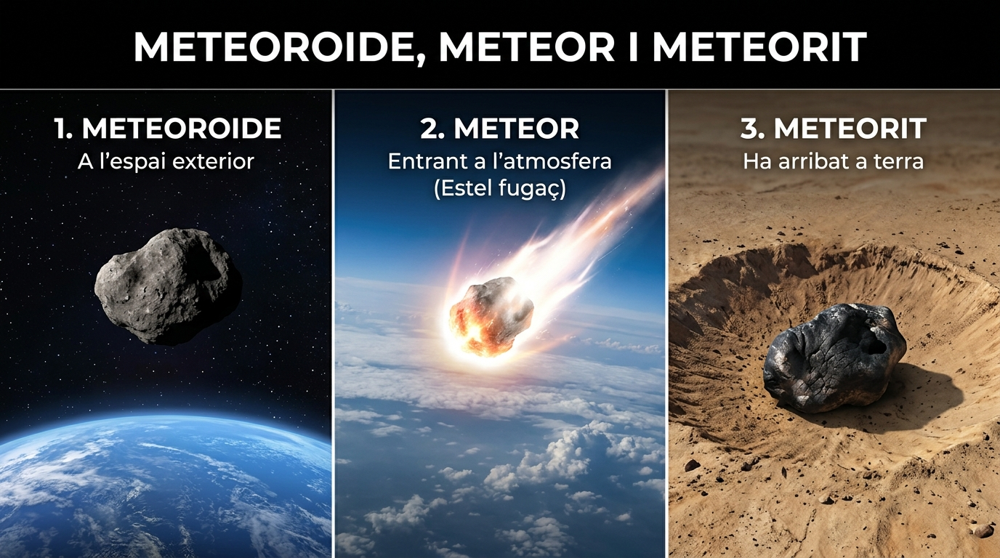

# 6.2 Els Astres i les Distàncies a l'Univers

Dins de les galàxies hi trobem una gran diversitat de cossos celestes o **astres**, cadascun amb propietats i dimensions sorprenents.

---

## 1. Els Diferents Astres de l'Univers

| Tipus d'Astre | Llum pròpia? | Característiques Principals | Exemple |
| :--- | :---: | :--- | :--- |
| **Estrelles** | **SÍ** | Esferes gegants de gas molt calent (hidrogen i heli). Generen energia i llum mitjançant **reaccions nuclears de fusió**. El seu color indica la temperatura: les **blaves** són les més calentes, les **grogues** són intermèdies i les **roges** són més fredes. | El Sol, Sirius, Polaris, Betelgeuse |
| **Planetes** | NO | Cossos rocosos o gasosos que orbiten al voltant d'una estrella. Tenen prou massa perquè la gravetat els done forma esfèrica i han escombrat la seua òrbita. | La Terra, Mart, Júpiter |
| **Satèl·lits** | NO | Cossos celestes menors que orbiten al voltant d'un planeta. Reflecteixen la llum de l'estrella. | La Lluna (Terra), Fobos (Mart), Tità (Saturn) |
| **Cometes** | NO | Cossos menuts formats per gel, pols i roques ("boles de neu bruta"). Tenen òrbites molt allargades. Quan s'acosten al Sol, el gel es sublima i el vent solar forma una cua o cabellera brillant de milions de quilòmetres dirigida en sentit contrari al Sol. | Cometa Halley |
| **Asteroides** | NO | Fragments rocosos o metàl·lics irregulars de diferents mides que orbiten al voltant del Sol, principalment en cinturons. | Ceres, Vesta, Eros |

---

## 2. Diferència Clau: Meteoroide, Meteor i Meteorit

Molt sovint es confonen aquests tres conceptes:

*Figura: Les tres etapes d'un cos celeste rocós: (1) Meteoroide a l'espai profund, (2) Meteor o estel fugaç desintegrant-se brillantment a l'alta atmosfera per fricció, i (3) Meteorit arribant com a roca sòlida a la superfície terrestre.*

1. **Meteoroide:** Xicotet fragment de roca o pols que vaga per l'espai interplanetari.
2. **Meteor (o Estel Fugaç):** Quan un meteoroide xoca contra l'atmosfera terrestre a gran velocitat ($10-70\text{ km/s}$), la fricció amb l'aire l'escalfa fins a vaporitzar-lo a la mesosfera, deixant un traç de llum fugaç en el cel nocturn. Les pluges d'estels més famoses són els Perseids (Les llàgrimes de Sant Llorenç a l'agost).
3. **Meteorit:** Si el fragment és prou gran per no desintegrar-se del tot en l'atmosfera i arriba a colpejar la superfície de la Terra, rep el nom de **meteorit** (formant de vegades cràters d'impacte).

---

## 3. Com Mesurem les Distàncies a l'Univers?

A l'Univers les distàncies són tan immensament grans que utilitzar el quilòmetre ($\text{km}$) no és pràctic, ja que ens obligaria a escriure números amb desenes de zeros. Els astrònoms utilitzen unitats especials:

### A) La Unitat Astronòmica ($\text{UA}$)
S'utilitza per mesurar distàncies **dins del nostre Sistema Solar**. És la distància mitjana que separa la Terra del Sol:

$$1 \text{ UA} \approx 150.000.000\text{ km} \quad (1{,}5 \times 10^8\text{ km})$$

- Mart està a aproximadament $1{,}5\text{ UA}$ del Sol.
- Júpiter està a unes $5{,}2\text{ UA}$ del Sol.
- Neptú està a unes $30\text{ UA}$ del Sol.

---

### B) L'Any Llum
S'utilitza per mesurar distàncies **entre diferents estrelles i galàxies**. És la **distància física** que recorre un raig de llum en el buit durant **un any complet**:

Com que la llum viatja a la velocitat màxima del cosmos ($c \approx 300.000\text{ km/s}$):
$$\text{Segons en un any} = 365 \cdot 24 \cdot 60 \cdot 60 = 31.536.000\text{ segons}$$
$$1 \text{ Any Llum} = 300.000\text{ km/s} \times 31.536.000\text{ s} \approx \mathbf{9{,}46 \times 10^{12}\text{ km}}$$
És a dir, quasi **$9{,}5\text{ bilions de quilòmetres}$**!

> [!NOTE]
> ### Viatjar en el Temps Mirant el Cel
> Quan mirem l'univers, estem mirant el passat:
> - La llum del Sol tarda **$8\text{ minuts i 20 segons}$** a arribar als nostres ulls. Si el Sol s'apagara de sobte, no ens n'adonaríem fins passats 8 minuts!
> - L'estrella més pròxima al Sistema Solar, **Pròxima Centauri**, està a **$4{,}2\text{ anys llum}$**: la veiem tal com era fa més de quatre anys.
> - La galàxia d'Andròmeda està a **$2{,}5\text{ milions d'anys llum}$**.

---

## ✏️ Exercicis de Comprensió

1. **Quina diferència fonamental hi ha entre un planeta i una estrella?**

2. **Per què els estels fugaços no són realment estrelles que cauen?**

3. **Si una sonda espacial viatja a un planeta situat a $4\text{ UA}$, quants quilòmetres aproximadament haurà de recórrer?**

## 🎯 Activitats i Autoavaluació Interactiva

  

    🎮 <strong>Zona d'Entrenament FPB:</strong> 0 reptes resolts
    ⭐ 0 punts
  

  

### 1. Qüestionari d'Autoavaluació Tipus Test (MCQ)

  
<strong>1. Què és exactament un 'meteorit'?</strong>

  

    <button type="button" class="btn-mcq-opt" data-opt="A">A) Qualsevol roca que òrbita pacíficament entre Mart i Júpiter</button>
    <button type="button" class="btn-mcq-opt" data-opt="B">B) El flaix lluminós que s'observa al cel quan es desintegra pols còsmica</button>
    <button type="button" class="btn-mcq-opt" data-opt="C">C) El fragment rocós o metàl·lic procedent de l'espai que sobreviu a l'atmosfera i impacta contra la superfície terrestre</button>
    <button type="button" class="btn-mcq-opt" data-opt="D">D) Una estrela nana blanca en procés de refredament</button>
  

  

  
<strong>2. Quina unitat de mesura s'utilitza habitualment per a expressar les distàncies entre planetes dins del Sistema Solar?</strong>

  

    <button type="button" class="btn-mcq-opt" data-opt="A">A) La Unitat Astronòmica (UA)</button>
    <button type="button" class="btn-mcq-opt" data-opt="B">B) L'any llum</button>
    <button type="button" class="btn-mcq-opt" data-opt="C">C) El metre cúbic</button>
    <button type="button" class="btn-mcq-opt" data-opt="D">D) El nanòmetre</button>
  

  

---

### 2. Activitats de Vertader (V) o Fals (F)

  <strong>a) L'any llum és una unitat de distància (espai recorregut per la llum en un any), no pas una unitat de temps.</strong>
  

    <button type="button" class="btn-vf" data-opt="V">V</button>
    <button type="button" class="btn-vf" data-opt="F">F</button>
  

  

  <strong>b) Els planetes i la Lluna brillen a la nit perquè produeixen la seua pròpia llum mitjançant fusió nuclear d'hidrogen.</strong>
  

    <button type="button" class="btn-vf" data-opt="V">V</button>
    <button type="button" class="btn-vf" data-opt="F">F</button>
  

  

---

### 3. Exercicis de Resposta Breu i Càlcul d'Escala

  
✍️ Quants minuts aproximats triga la llum del Sol a recórrer 1 UA d'espai i arribar al nostre planeta Terra?

  

    <input type="text" class="quiz-input" placeholder="Ex: 8 minuts...">
    <button type="button" class="btn-quiz-check">Comprovar</button>
  

  

  
✍️ Com s'anomena tècnicament el fenomen lluminós que popularment anomenem 'estrela fugaç'?

  

    <input type="text" class="quiz-input" placeholder="El teu resultat...">
    <button type="button" class="btn-quiz-check">Comprovar</button>
  

  

---

### 4. Pregunta de Raonament i Desenvolupament Escrit

  
✍️ <strong>Diferenciació Conceptual a l'Espai:</strong> Explica clarament amb les teues paraules la diferència entre: meteoroide, meteor i meteorit. Per què la major part dels meteoroides no arriben a tocar el terra de la Terra?

  <textarea class="open-response-input" rows="3" placeholder="Escriu ací la diferència entre els 3 termes i el paper de l'atmosfera terrestre..."></textarea>

---

  <h3 style="margin-top:0; color:#0369a1;">📦 Lliurament d'Activitats d'Aules (Act 6.2)</h3>
  
Genera el teu document de tasca d'aquest apartat amb el teu nom i puntuació obtinguda.

  

    <input type="text" class="aules-student-name" placeholder="Cognoms, Nom de l'Alumne/a" style="padding:8px 12px; border:1px solid #94a3b8; border-radius:4px; flex-grow:1; min-width:240px;">
    <button class="btn-generate-aules-pdf" data-unit="UD06" data-activity="Act02" data-module="CA" style="padding:8px 16px; background:#0284c7; color:#fff; border:none; border-radius:4px; font-weight:600; cursor:pointer;">📄 Descarregar PDF per a Aules</button>
  

