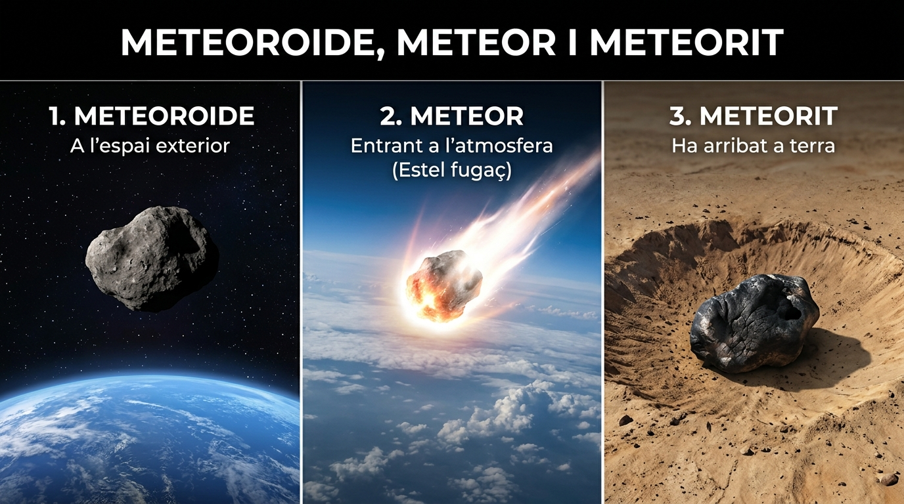
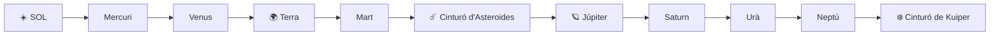

  

    ⚡ Progrés d'aprenentatge (6.3)
    0 / 3 reptes resolts
  

  

    

  

# 6.3 El Sistema Solar: El Sol i els Planetes

El nostre **Sistema Solar** es va formar fa uns **4.600 milions d'anys** a partir d'un núvol gegant de pols i gas interestel·lar. Està format pel **Sol**, que conté el $99{,}8\%$ de tota la massa, i tots els astres que orbiten atrapats pel seu camp gravitatori.

  
  
<em>Figura 6.2: Cossos menors del Sistema Solar: diferència física entre meteoroide (espai), meteor (fregament atmosfèric) i meteorit (impacte en superfície)</em>

---

## 1. El Sol: El Cor del Sistema Solar

El **Sol** és una estrella de tipus espectral nana groga. És la font d'energia primària que fa possible la vida a la Terra i manté en moviment l'atmosfera i el cicle de l'aigua:
- **Nucli:** Zona central on tenen lloc les reaccions de fusió nuclear que transformen l'hidrogen en heli a una temperatura de més de **$15.000.000\text{ }^\circ\text{C}$**.
- **Fotosfera:** La superfície visible del Sol, amb una temperatura d'uns **$5.500\text{ }^\circ\text{C}$**. En ella s'observen les **taques solars** (zones més fredes i amb intens camp magnètic).
- **Cromosfera i Corona:** L'atmosfera exterior del Sol, només visible a simple vista durant els eclipsis totals de Sol.

---

## 2. Els Planetes Interiors o Terrestres (Rocosos)

Són els quatre planetes més propers al Sol. Es caracteritzen per ser **relativament petits**, de **superfície sòlida i rocosa**, densos, i amb pocs o cap satèl·lit natural:

1. **Mercuri:**
   - És el planeta més menut i el més proper al Sol.
   - Manca d'atmosfera, per la qual cosa està ple de cràters d'impacte i pateix oscil·lacions tèrmiques extremes: des de $-180\text{ }^\circ\text{C}$ de nit fins a $+430\text{ }^\circ\text{C}$ de dia.
2. **Venus:**
   - De grandària molt semblant a la Terra.
   - Posseeix una atmosfera asfixiant molt densa de diòxid de carboni ($\text{CO}_2$) amb núvols d'àcid sulfúric, creant un **efecte d'hivernacle extrem**. És el planeta més calent del Sistema Solar (temperatura constant d'uns **$465\text{ }^\circ\text{C}$**).
   - Gira sobre si mateix en sentit retrògrad (a l'inrevés que la majoria).
3. **La Terra:**
   - El nostre llar: l'únic planeta conegut que alberga vida.
   - Distància ideal al Sol, atmosfera amb un $21\%$ d'oxigen, camp magnètic protector i abundant **aigua líquida** a la superfície. Té un satèl·lit: la Lluna.
4. **Mart:**
   - Conegut com el "planeta roig" pel color dels minerals d'òxid de ferro que cobreixen el seu sòl.
   - Té una atmosfera molt tènue de $\text{CO}_2$, aigua congelada als casquets polars i sota terra, i acull el volcà més gegantí del Sistema Solar: el **Mont Olimp** ($22\text{ km}$ d'alçada). Té dos xicotets satèl·lits rocosos: Fobos i Deimos.

---

## 3. El Cinturó Principal d'Asteroides

Situat entre les òrbites de Mart i Júpiter, és una franja d'espai poblada per milions de fragments rocosos que no van arribar a unir-se per formar un planeta degut a la forta influència gravitatòria de Júpiter. En ell es troba el planeta nan **Ceres**.

---

## 4. Els Planetes Exteriors o Gegants Gasosos

Situats més enllà del cinturó d'asteroides, són planetes **enormes**, sense una superfície sòlida definida, compostos principalment per hidrogen, heli, metà i aigua congelada, amb anells i nombrosos satèl·lits:

5. **Júpiter:**
   - El rei dels planetes: és més massiu que tots els altres planetes junts (hi cabrien més de $1.300$ planetes Terra).
   - Famosa per la seua **Gran Taca Roja**, una tempesta anticiclònica gegantina de gas que porta activa més de 300 anys. Té més de 90 satèl·lits (destaquen Io, Europa, Ganimedes i Cal·listo).
6. **Saturn:**
   - Cèlebre pel seu espectacular i brillant **sistema d'anells**, formats per milions de fragments de gel d'aigua i pols.
   - És el segon més gran i és tan poc dens que suraria en una banyera prou gran d'aigua. El seu satèl·lit més famós és Tità.
7. **Urà:**
   - Un gegant de gel amb un característic to blau verdós degut al metà de la seua atmosfera.
   - El seu eix de rotació està quasi tombat ($98^\circ$ d'inclinació), per la qual cosa orbita "rodant de costat".
8. **Neptú:**
   - El planeta més allunyat del Sistema Solar (a unes $30\text{ UA}$).
   - Té un intens color blau marí i posseeix els **vents més violents i ràpids** de tot el Sistema Solar, superant els $2.000\text{ km/h}$.

---

## 5. Els Cossos Transneptunians: Plutó i el Núvol d'Oort

- **Plutó i els Planetes Nans:** Des de 1930 fins a 2006, Plutó va ser considerat el nové planeta. En 2006, la Unió Astronòmica Internacional el va reclassificar com a **planeta nan** perquè comparteix la seua òrbita amb milers de cossos semblants al Cinturó de Kuiper (com Eris o Makemake).
- **El Cinturó de Kuiper:** Disc de cossos gelats més enllà de l'òrbita de Neptú.
- **El Núvol d'Oort:** Immensa closca esfèrica de cometes situada als confins del Sistema Solar (vora 1 any llum del Sol), d'on provenen els cometes de període llarg.

## 🎯 Activitats i Autoavaluació Interactiva

  

    🎮 <strong>Zona d'Entrenament FPB:</strong> 0 reptes resolts
    ⭐ 0 punts
  

  

### 1. Qüestionari d'Autoavaluació Tipus Test (MCQ)

  
<strong>1. Quin dels següents grups de planetes està format exclusivament per planetes terrestres o rocosos?</strong>

  

    <button type="button" class="btn-mcq-opt" data-opt="A">A) Júpiter, Saturn, Urà i Neptú</button>
    <button type="button" class="btn-mcq-opt" data-opt="B">B) Terra, Mart, Júpiter i Saturn</button>
    <button type="button" class="btn-mcq-opt" data-opt="C">C) Mercuri, Venus, Júpiter i Plutó</button>
    <button type="button" class="btn-mcq-opt" data-opt="D">D) Mercuri, Venus, Terra i Mart</button>
  

  

  
<strong>2. On se situa exactament el Cinturó Principal d'Asteroides del nostre Sistema Solar?</strong>

  

    <button type="button" class="btn-mcq-opt" data-opt="A">A) Entre la Terra i Venus</button>
    <button type="button" class="btn-mcq-opt" data-opt="B">B) Entre les òrbites de Mart i Júpiter</button>
    <button type="button" class="btn-mcq-opt" data-opt="C">C) Més enllà de Neptú</button>
    <button type="button" class="btn-mcq-opt" data-opt="D">D) Al voltant del Sol abans de Mercuri</button>
  

  

---

### 2. Activitats de Vertader (V) o Fals (F)

  <strong>a) Júpiter és el planeta més massiu i gran de tot el Sistema Solar, i compta amb la famosa Gran Taca Roja (una tempesta gegant).</strong>
  

    <button type="button" class="btn-vf" data-opt="V">V</button>
    <button type="button" class="btn-vf" data-opt="F">F</button>
  

  

  <strong>b) Plutó continua sent oficialment el novè planeta principal del Sistema Solar segons la Unió Astronòmica Internacional.</strong>
  

    <button type="button" class="btn-vf" data-opt="V">V</button>
    <button type="button" class="btn-vf" data-opt="F">F</button>
  

  

---

### 3. Exercicis de Resposta Breu i Identificació

  
✍️ Quins dos gasos lleugers constitueixen més del 98% de la massa del Sol?

  

    <input type="text" class="quiz-input" placeholder="Ex: Hidrogen i heli...">
    <button type="button" class="btn-quiz-check">Comprovar</button>
  

  

  
✍️ Quin planeta gegant gasós destaca per tindre el sistema d'anells més brillant i visible des de la Terra?

  

    <input type="text" class="quiz-input" placeholder="El teu resultat...">
    <button type="button" class="btn-quiz-check">Comprovar</button>
  

  

---

### 4. Pregunta de Raonament i Desenvolupament Escrit

  
✍️ <strong>Comparativa Planetària:</strong> Per quines raons físiques els planetes interiors (Mercuri, Venus, Terra i Mart) són petits, densos i rocosos, mentre que els planetes exteriors (Júpiter, Saturn, Urà i Neptú) van poder acumular quantitats gegantines de gasos lleugers?

  <textarea class="open-response-input" rows="3" placeholder="Escriu ací la teua explicació (temperatura pròxima al Sol, vent solar, condensació de gasos en fred...)..."></textarea>

---

  <h3 style="margin-top:0; color:#0369a1;">📦 Lliurament d'Activitats d'Aules (Act 6.3)</h3>
  
Genera el teu document de tasca d'aquest apartat amb el teu nom i puntuació obtinguda.

  

    <input type="text" class="aules-student-name" placeholder="Cognoms, Nom de l'Alumne/a" style="padding:8px 12px; border:1px solid #94a3b8; border-radius:4px; flex-grow:1; min-width:240px;">
    <button class="btn-generate-aules-pdf" data-unit="UD06" data-activity="Act03" data-module="CA" style="padding:8px 16px; background:#0284c7; color:#fff; border:none; border-radius:4px; font-weight:600; cursor:pointer;">📄 Descarregar PDF per a Aules</button>
  

