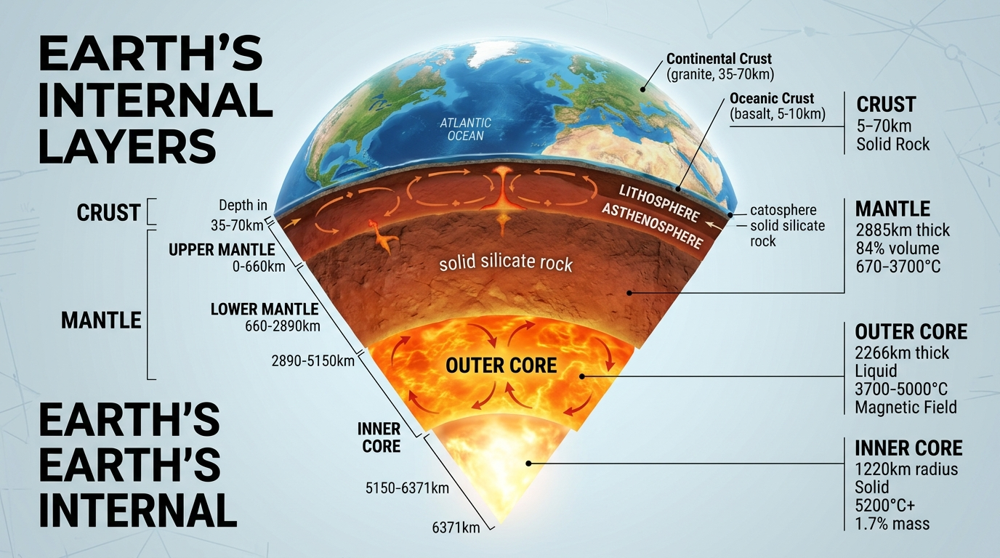
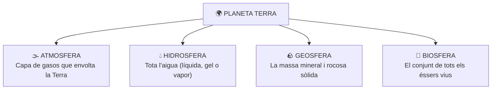
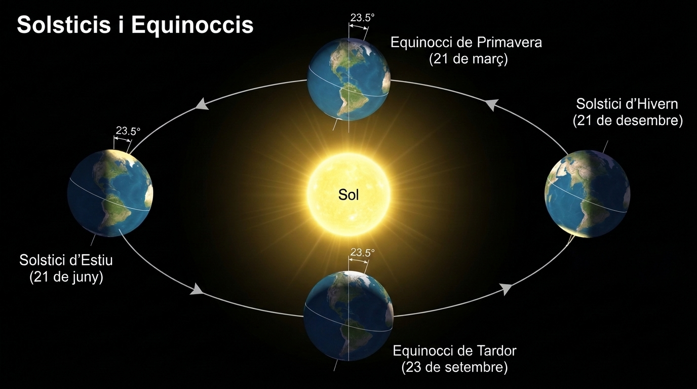
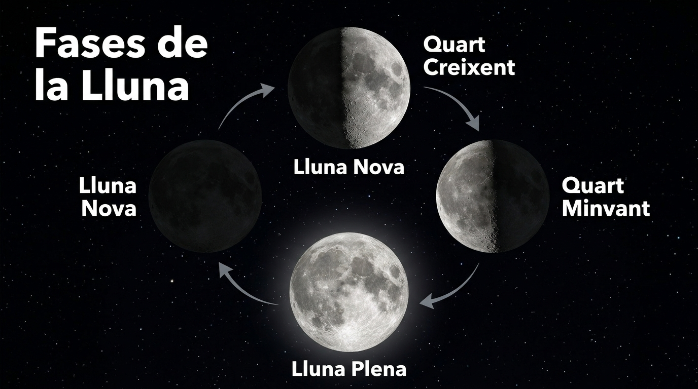

# UD7: El Planeta Terra: Estructura, Geosfera i Moviments (Biologia i Geologia)

<svg viewBox="0 0 860 260" xmlns="http://www.w3.org/2000/svg" style="max-width: 100%; height: auto; font-family: 'Segoe UI', system-ui, sans-serif; border-radius: 12px; box-shadow: 0 8px 24px rgba(0,0,0,0.35);">
  <defs>
    <linearGradient id="bg-grad-7" x1="0%" y1="0%" x2="100%" y2="100%">
      <stop offset="0%" stop-color="#0f172a"/>
      <stop offset="100%" stop-color="#1e293b"/>
    </linearGradient>
    <linearGradient id="g-ter" x1="0%" y1="0%" x2="100%" y2="100%">
      <stop offset="0%" stop-color="#38bdf8" stop-opacity="0.25"/>
      <stop offset="100%" stop-color="#38bdf8" stop-opacity="0.05"/>
    </linearGradient>
    <linearGradient id="g-mov" x1="0%" y1="0%" x2="100%" y2="100%">
      <stop offset="0%" stop-color="#818cf8" stop-opacity="0.25"/>
      <stop offset="100%" stop-color="#818cf8" stop-opacity="0.05"/>
    </linearGradient>
    <linearGradient id="g-llu" x1="0%" y1="0%" x2="100%" y2="100%">
      <stop offset="0%" stop-color="#34d399" stop-opacity="0.25"/>
      <stop offset="100%" stop-color="#34d399" stop-opacity="0.05"/>
    </linearGradient>
    <linearGradient id="g-geo" x1="0%" y1="0%" x2="100%" y2="100%">
      <stop offset="0%" stop-color="#f59e0b" stop-opacity="0.25"/>
      <stop offset="100%" stop-color="#f59e0b" stop-opacity="0.05"/>
    </linearGradient>
  </defs>

  <!-- Background -->
  <rect width="860" height="260" rx="12" fill="url(#bg-grad-7)"/>

  <!-- Capçalera -->
  <text x="430" y="36" text-anchor="middle" fill="#f8fafc" font-size="19" font-weight="bold">EL SISTEMA TERRA: DINÀMICA PLANETÀRIA I ESTRUCTURA INTERNA</text>
  <text x="430" y="56" text-anchor="middle" fill="#94a3b8" font-size="12">Condicions d'habitabilitat, mecànica orbital, fases de la Lluna i capes de la geosfera</text>

  <!-- Bloc 1: Planeta Únic -->
  <g transform="translate(25, 70)">
    <rect width="185" height="165" rx="10" fill="url(#g-ter)" stroke="#38bdf8" stroke-width="1.5"/>
    <rect x="15" y="14" width="28" height="28" rx="6" fill="#38bdf8" fill-opacity="0.2"/>
    <text x="29" y="33" text-anchor="middle" fill="#38bdf8" font-size="14" font-weight="bold">🌍</text>
    <text x="52" y="33" fill="#f8fafc" font-size="13" font-weight="bold">Habitabilitat</text>
    <text x="15" y="62" fill="#38bdf8" font-size="11" font-weight="600">Refugi Vital Únic</text>
    <text x="15" y="84" fill="#cbd5e1" font-size="11">• Distància solar: Tmitj = 15°C</text>
    <text x="15" y="104" fill="#cbd5e1" font-size="11">• Hidrosfera: 71% aigua líquida</text>
    <text x="15" y="124" fill="#cbd5e1" font-size="11">• Atmosfera amb 21% O₂</text>
    <text x="15" y="144" fill="#cbd5e1" font-size="11">• Magnetosfera: Desvia vent solar</text>
  </g>

  <!-- Bloc 2: Moviments Orbitals -->
  <g transform="translate(230, 70)">
    <rect width="185" height="165" rx="10" fill="url(#g-mov)" stroke="#818cf8" stroke-width="1.5"/>
    <rect x="15" y="14" width="28" height="28" rx="6" fill="#818cf8" fill-opacity="0.2"/>
    <text x="29" y="33" text-anchor="middle" fill="#818cf8" font-size="14" font-weight="bold">🔄</text>
    <text x="52" y="33" fill="#f8fafc" font-size="13" font-weight="bold">Cinemàtica</text>
    <text x="15" y="62" fill="#818cf8" font-size="11" font-weight="600">Rotació & Translació</text>
    <text x="15" y="84" fill="#cbd5e1" font-size="11">• Rotació (24 h): Dia i nit</text>
    <text x="15" y="104" fill="#cbd5e1" font-size="11">• Translació (365d 6h): Any solar</text>
    <text x="15" y="124" fill="#cbd5e1" font-size="11">• Inclinació eix: 23,5° ➔ Estacions</text>
    <text x="15" y="144" fill="#cbd5e1" font-size="11">• Solsticis & Equinoccis</text>
  </g>

  <!-- Bloc 3: La Lluna -->
  <g transform="translate(435, 70)">
    <rect width="185" height="165" rx="10" fill="url(#g-llu)" stroke="#34d399" stroke-width="1.5"/>
    <rect x="15" y="14" width="28" height="28" rx="6" fill="#34d399" fill-opacity="0.2"/>
    <text x="29" y="33" text-anchor="middle" fill="#34d399" font-size="14" font-weight="bold">🌙</text>
    <text x="52" y="33" fill="#f8fafc" font-size="13" font-weight="bold">El Satèl·lit</text>
    <text x="15" y="62" fill="#34d399" font-size="11" font-weight="600">Fases & Gravetat</text>
    <text x="15" y="84" fill="#cbd5e1" font-size="11">• Rotació sincrònica: 28 dies</text>
    <text x="15" y="104" fill="#cbd5e1" font-size="11">• Fases: Nova, Creix, Plena, Minv</text>
    <text x="15" y="124" fill="#cbd5e1" font-size="11">• Eclipsis de Sol i de Lluna</text>
    <text x="15" y="144" fill="#cbd5e1" font-size="11">• Dinàmica de marees marines</text>
  </g>

  <!-- Bloc 4: La Geosfera -->
  <g transform="translate(640, 70)">
    <rect width="195" height="165" rx="10" fill="url(#g-geo)" stroke="#f59e0b" stroke-width="1.5"/>
    <rect x="15" y="14" width="28" height="28" rx="6" fill="#f59e0b" fill-opacity="0.2"/>
    <text x="29" y="33" text-anchor="middle" fill="#f59e0b" font-size="14" font-weight="bold">🌋</text>
    <text x="52" y="33" fill="#f8fafc" font-size="13" font-weight="bold">La Geosfera</text>
    <text x="15" y="62" fill="#f59e0b" font-size="11" font-weight="600">Capes & Tectònica</text>
    <text x="15" y="84" fill="#cbd5e1" font-size="11">• Escorça (5-70 km): Silicats</text>
    <text x="15" y="104" fill="#cbd5e1" font-size="11">• Mantell (fins 2.900 km): Convecció</text>
    <text x="15" y="124" fill="#cbd5e1" font-size="11">• Nucli (Fe-Ni): Fluid i sòlid</text>
    <text x="15" y="144" fill="#cbd5e1" font-size="11">• Plaques, sismes i volcans</text>
  </g>
</svg>

---

## 📑 Índex d'Apartats de la Unitat {#index-unitat}

  
Accés ràpid als apartats complets d'aquesta unitat:

  <ol style="margin: 0; padding-left: 20px; line-height: 2.1;">
    <li><a href="#sec7-1"><strong>7.1 La Terra: Característiques d'un Planeta Únic per a la Vida</strong></a></li>
    <li><a href="#sec7-2"><strong>7.2 Els Moviments de la Terra: Rotació, Translació i les Estacions</strong></a></li>
    <li><a href="#sec7-3"><strong>7.3 La Lluna, les Fases Lunars, els Eclipsis i les Marees</strong></a></li>
    <li><a href="#sec7-4"><strong>7.4 L'Estructura Interna de la Terra (La Geosfera) i Activitats</strong></a></li>
    <li><a href="#sec7-5"><strong>7.5 Quadern d'Activitats Pràctiques i Reptes de Laboratori</strong></a></li>
  </ol>

---

## 📌 7.1 La Terra: Característiques d'un Planeta Únic per a la Vida {#sec7-1}

La **Terra** és el tercer planeta des del Sol i, fins on sabem avui dia, l'únic racó de l'Univers que acull vida. És un planeta geològicament actiu i dinàmic, les condicions físico-químiques del qual han permés el desenvolupament i la continuïtat de la biosfera al llarg de més de 3.500 milions d'anys.

---

### 1. Per Què la Terra és un Planeta Habitable?

L'existència de vida a la Terra és el resultat de la combinació de cinc factors astronòmics i geològics excepcionals:

#### 1. La Distància al Sol (Zona d'Habitabilitat)
La Terra orbita a una distància mitjana d'uns $150.000.000\text{ km}$ ($1\text{ UA}$) del Sol. Si estiguérem tan a prop com Venus, l'aigua s'evaporaria completament; si estiguérem tan lluny com Mart, l'aigua romandria permanentment congelada.

#### 2. Una Temperatura Mitjana Suau ($15\text{ }^\circ\text{C}$)
Gràcies a la distància al Sol i a l'efecte d'hivernacle natural provocat pels gasos de l'atmosfera (com el vapor d'aigua i el diòxid de carboni), la Terra manté una temperatura mitjana global d'uns **$15\text{ }^\circ\text{C}$**, ideal perquè l'aigua puga coexistir en els seus tres estats físics: líquid, sòlid i gasós.

#### 3. Presència d'Abundant Aigua Líquida
L'aigua és el dissolvent universal en el qual tenen lloc totes les reaccions químiques de la vida cel·lular. Més del **$70\%$ de la superfície terrestre** està coberta per aigua líquida en oceans, mars, rius i llacs, formant el motor del cicle hidrològic.

#### 4. Una Atmosfera Rica en Oxigen
La nostra atmosfera conté un **$21\%$ d'oxigen molecular ($\text{O}_2$)**, gas indispensable per a la respiració cel·lular dels éssers vius aeròbics. A més, a l'estratosfera compta amb una **capa d'ozó ($\text{O}_3$)** que filtra les letals radiacions solars ultraviolades (UV).

#### 5. Un Camp Magnètic Protector (La Magnetosfera)
El moviment de convecció del ferro líquid que gira al nucli extern de la Terra genera un potent **camp magnètic**. Aquest camp actua com un escut invisible (la *magnetosfera*) que desvia el perillós vent solar de partícules carregades procedents del Sol, evitant que s'escombre l'atmosfera cap a l'espai.

---

### 2. Les Grans Capes de la Terra

Per a comprendre com funciona la Terra com un sistema interconnectat, distingim quatre grans subsistemes terrestres:

  
  
<em>Figura 7.1: Els quatre grans subsistemes del planeta Terra (Atmosfera, Hidrosfera, Geosfera i Biosfera)</em>

Tots quatre components interactuen íntimament: per exemple, la geosfera allibera gasos pels volcans a l'atmosfera, l'atmosfera condensa l'aigua de la hidrosfera en forma de pluja, i l'aigua i els nutrients del sòl permeten créixer a les plantes de la biosfera.

---

### 💡 Resum de Conceptes Clau

- La Terra és l'únic planeta conegut amb vida gràcies a la seua **distància al Sol**, temperatura mitjana de **$15\text{ }^\circ\text{C}$**, **aigua líquida**, **atmosfera amb oxigen** i **camp magnètic protector**.
- El camp magnètic es genera al nucli terrestre i ens protegeix del vent solar.
- Els quatre subsistemes de la Terra són l'**Atmosfera**, la **Hidrosfera**, la **Geosfera** i la **Biosfera**.

  <a href="#index-unitat" class="page-nav-btn" style="display: inline-block; padding: 4px 14px; font-size: 0.85rem;">⬆️ Pujar a l'Índex</a>

---

## 📌 7.2 Els Moviments de la Terra: Rotació, Translació i les Estacions {#sec7-2}

La Terra no roman immòbil a l'espai, sinó que es troba en continu moviment sota la influència de la gravetat del Sol. Els seus dos moviments principals són la **rotació** i la **translació**.

---

### 1. El Moviment de Rotació: El Dia i la Nit

La **rotació** és el gir que fa la Terra sobre el seu propi eix imaginari:
- **Sentit del gir:** Gira d'**oest cap a est** (en sentit antihorari vist des del Pol Nord). Per això veiem eixir el Sol per l'est i pondre's per l'oest.
- **Durada:** Tarda exactament **24 hores** (un dia solar sencer).
- **Inclinació de l'eix:** L'eix de rotació no és vertical respecte al pla orbital, sinó que està inclinat un angle de **$23{,}5^\circ$**.
- **Conseqüència fonamental:** La successió alternada del **dia i la nit**. La meitat que queda encarada al Sol rep llum i calor (dia), mentre que la meitat oposada roman a les fosques (nit). Això evita temperatures extremes com les de Mercuri.

---

### 2. El Moviment de Translació: L'Any i els Anys de Traspàs

La **translació** és el desplaçament que fa la Terra al voltant del Sol descrivint una òrbita el·líptica a una velocitat mitjana d'uns $107.000\text{ km/h}$:
- **Durada:** Tarda **365 dies, 5 hores i 48 minuts** (aproximadament 365 dies i 6 hores).
- **L'Any de Traspàs:** Com que el calendari oficial compta 365 dies exactes, cada any sobren vora 6 hores. En quatre anys, aquestes hores sumen un dia sencer ($6\text{ h} \times 4 = 24\text{ h} = 1\text{ dia}$). Per compensar aquest desfasament, cada quatre anys s'afegeix un dia al mes de febrer (el 29 de febrer), donant lloc a un **any de traspàs de 366 dies**.

---

### 3. L'Origen de les Estacions de l'Any

> [!WARNING]
> ### Error Freqüent a Desterrar
> Les estacions de l'any **NO es deuen a la distància de la Terra al Sol**. De fet, la Terra està en el seu punt més proper al Sol (periheli) a principis de gener, en ple hivern a l'hemisferi nord!

La veritable causa de les quatre estacions és la **inclinació de $23{,}5^\circ$ de l'eix de rotació terrestre**:

1. Durant una part de l'any, l'**hemisferi nord està inclinat cap al Sol**: els raigs solars arriben de manera molt perpendicular i concentrada, i els dies són més llargs que les nits $\rightarrow$ és **estiu a l'hemisferi nord** i **hivern a l'hemisferi sud**.
2. Sis mesos després, la Terra es troba a l'altre costat de l'òrbita i és l'**hemisferi sud el que queda inclinat cap al Sol**: els raigs arriben molt inclinats al nord, dispersant la calor, i les nits són més llargues que els dies $\rightarrow$ és **hivern a l'hemisferi nord** i **estiu a l'hemisferi sud**.

  
  
<em>Figura 7.2: Translació terrestre, inclinació de l'eix (23,5°) i origen dels solsticis i equinoccis</em>

#### Solsticis i Equinoccis (Hemisferi Nord)
- **Solstici d'Estiu (20-21 de juny):** El dia més llarg i la nit més curta de l'any. Comença l'estiu.
- **Equinocci de Tardor (22-23 de setembre):** Els raigs solars incideixen perpendicularment a l'Equador. El dia i la nit tenen exactament la mateixa durada ($12\text{ hores}$). Comença la tardor.
- **Solstici d'Hivern (21-22 de desembre):** La nit més llarga i el dia més curt de l'any. Comença l'hivern.
- **Equinocci de Primavera (20-21 de març):** El dia i la nit tornen a durar 12 hores iguals. Comença la primavera.

---

### 💡 Resum de Conceptes Clau

- La **rotació** dura 24 hores i causa el dia i la nit.
- La **translació** dura 365 dies i 6 hores; cada 4 anys hi ha un **any de traspàs** (366 dies).
- Les **estacions de l'any** són degudes a la **inclinació de $23{,}5^\circ$ de l'eix de gir** de la Terra, no a la distància al Sol.
- En els **equinoccis** el dia i la nit duren igual (12 h); en els **solsticis** es produeix la màxima diferència entre hores de llum i foscor.

  <a href="#index-unitat" class="page-nav-btn" style="display: inline-block; padding: 4px 14px; font-size: 0.85rem;">⬆️ Pujar a l'Índex</a>

---

## 📌 7.3 La Lluna, les Fases Lunars, els Eclipsis i les Marees {#sec7-3}

La **Lluna** és l'únic satèl·lit natural de la Terra. Situada a una distància mitjana de $384.400\text{ km}$, no té llum pròpia, no té atmosfera ni aigua líquida, i té un paper determinant en la regulació dels cicles biològics i les marees dels nostres oceans.

---

### 1. La Lluna i la Cara Oculta

- **Dimensions:** Té un diàmetre de $3.474\text{ km}$ (aproximadament una quarta part del diàmetre de la Terra).
- **Rotació Sincrònica:** La Lluna tarda exactament el mateix temps en girar sobre el seu propi eix (rotació) que en donar una volta completa al voltant de la Terra (translació): **28 dies** (un mes lunar).
- **Conseqüència:** Des de la superfície de la Terra **sempre veiem exactament la mateixa cara de la Lluna**. L'altra meitat (la cara oculta) no va poder ser observada ni fotografiada per la humanitat fins a l'any 1959 per la sonda espacial soviètica *Luna 3*.

---

### 2. Les Fases Lunars

A mesura que la Lluna es desplaça al voltant de la Terra, la porció de la seua cara visible il·luminada pel Sol va variant contínuament, donant lloc a les **quatre fases lunars**:

*Figura: Les quatre fases lunars principals en el seu cicle complet d'il·luminació vista des de la Terra.*

1. **Lluna Nova:** La Lluna se situa entre la Terra i el Sol. La seua cara il·luminada mira cap a l'espai, de manera que des de la Terra queda a les fosques i no es veu.
2. **Quart Creixent:** La cara visible es va il·luminant progressivament d'est a oest, adoptant la forma d'una lletra **"D"**.
3. **Lluna Plena:** La Terra se situa entre el Sol i la Lluna. La cara visible rep directament la llum solar i es veu com un cercle complet brillant.
4. **Quart Minvant:** La zona il·luminada comença a decréixer progressivament, adoptant la forma d'una lletra **"C"**.

> [!TIP]
> **Regla Mnemotècnica**
> La Lluna és "mentidera": quan té forma de **"C"** no creix sinó que **minva** (decreix), i quan té forma de **"D"** no decreix sinó que **creix**!

---

### 3. Els Eclipsis: Ombra i Penombra

Un **eclipsi** es produeix quan un cos celeste s'interposa en la línia de visió entre altres dos astres, projectant la seua ombra:

#### A) Eclipsi de Sol
- **Posició dels astres:** El Sol, la **Lluna** i la Terra s'alineen en aquest ordre ($\text{Sol} \rightarrow \text{Lluna} \rightarrow \text{Terra}$).
- **Com ocorre:** La Lluna s'interposa davant del Sol tapant-ne la llum i projectant un con d'ombra sobre una franja estreta de la superfície terrestre.
- Només pot ocórrer durant la fase de **Lluna Nova**. Pot ser **total** (el dia es fa de nit durant uns minuts), **anular** (es veu un anell de foc) o **parcial**.

#### B) Eclipsi de Lluna
- **Posició dels astres:** El Sol, la **Terra** i la Lluna s'alineen en aquest ordre ($\text{Sol} \rightarrow \text{Terra} \rightarrow \text{Lluna}$).
- **Com ocorre:** La Terra s'interposa entre el Sol i la Lluna, projectant la seua gegantina ombra sobre el nostre satèl·lit.
- Només pot ocórrer durant la fase de **Lluna Plena**. La Lluna no desapareix del tot, sinó que adquireix un to vermellós ataronjat molt característic (l'anomenada "Lluna de sang"), ja que l'atmosfera de la Terra desvia els tons rogencs de la llum solar cap a l'ombra.

---

### 4. Les Marees: La Força de la Gravetat als Oceans

Les **marees** són moviments periòdics d'ascens i descens del nivell de les aigües del mar causats per l'**atracció gravitatòria que la Lluna (i en menor mesura el Sol) exerceix sobre la Terra**:

- **Pleamar (Marea Alta):** El nivell de l'aigua assoleix la seua alçada màxima a les zones de la Terra que queden alineades amb la Lluna.
- **Baixamar (Marea Baixa):** El nivell de l'aigua baixa fins al seu punt mínim a les zones perpendiculars.
- En cada punt costaner es produeixen aproximadament **dues marees altes i dues marees baixes cada 24 hores i 50 minuts**.

#### Marees Vives vs Marees Mortes
- **Marees Vives:** Es produeixen quan el Sol, la Lluna i la Terra estan en línia recta (durant la **Lluna Plena** i la **Lluna Nova**). Les atraccions gravitatòries del Sol i de la Lluna se sumen, provocant marees molt altes i baixes extremades.
- **Marees Mortes:** Es produeixen quan la Lluna està en **Quart Creixent** o **Quart Minvant** (formant un angle recte de $90^\circ$ amb la línia Terra-Sol). Les forces gravitatòries es contraresten parcialment i les marees tenen poca oscil·lació.

  <a href="#index-unitat" class="page-nav-btn" style="display: inline-block; padding: 4px 14px; font-size: 0.85rem;">⬆️ Pujar a l'Índex</a>

---

## 📌 7.4 L'Estructura Interna de la Terra (La Geosfera) i Activitats {#sec7-4}

La **geosfera** és la part sòlida i rocosa del nostre planeta. S'estén des de la superfície dels continents i els fons dels oceans fins al centre mateix de la Terra, a uns **$6.371\text{ km}$ de profunditat**.

---

### 1. Com Coneixem l'Interior de la Terra?

Com que el pou més profund mai excavat per la humanitat (el pou de Kola a Rússia) només va arribar a $12{,}2\text{ km}$, els científics han hagut d'utilitzar **mètodes indirectes** per conèixer l'interior terrestre:
- **L'estudi de les ones sísmiques:** Els terratrèmols generen ones de xoc que travessen l'interior del planeta. Com que la velocitat i la direcció de les ones canvien sobtadament quan xoquen amb materials de diferent densitat o estat (sòlid o líquid), han permés dibuixar les diferents capes internes de la Terra amb gran precisió.

---

### 2. Les Capes de la Geosfera (Model Geoquímic)

Segons la composició dels materials, la geosfera es divideix en tres capes concèntriques:

| Capa | Gruix / Profunditat | Composició i Característiques |
| :--- | :--- | :--- |
| **Escorça** | Superfície fins a $5-70\text{ km}$ | Capa més prima, externa i freda. Es divideix en: • **Escorça Continental:** Fa entre $30$ i $70\text{ km}$ de gruix sota les grans muntanyes. Formada per roques com el granit. • **Escorça Oceànica:** Molt més prima ($5-10\text{ km}$). Forma el fons marí amb roques volcàniques com el basalt. |
| **Mantell** | De $70$ a $2.900\text{ km}$ | És la capa més voluminosa (ocupa el $84\%$ de la Terra). Formada per peridotita (roca molt densa rica en ferro i magnesi). A causa de les altes temperatures, les roques presenten un comportament viscós plàstic amb **corrents de convecció** de magma que mouen les plaques superficials. |
| **Nucli** | De $2.900$ a $6.371\text{ km}$ | Esfera central d'aliatge metàl·lic de **ferro ($90\%$) i níquel**: • **Nucli Extern:** En estat líquid fluorescent a gran temperatura ($4.000\text{ }^\circ\text{C}$). El seu moviment continu genera el **camp magnètic terrestre**. • **Nucli Intern:** En estat sòlid a causa de les brutals pressions, amb temperatures superiors a **$5.500\text{ }^\circ\text{C}$** (similar a la superfície del Sol). |

*Figura 7.1: Estructura interna de la Terra en capes: **(1)** Escorça terrestre (sòlida i rocosa), **(2)** Mantell (silicats i magma amb corrents de convecció), **(3)** Nucli extern (ferro i níquel fos en estat líquid), **(4)** Nucli intern (esfera metàl·lica sòlida incandescent).*

---

### 3. La Litosfera i la Tectònica de Plaques

La part més superficial i rígida del planeta s'anomena **litosfera** (formada per l'escorça i la part superior del mantell). La litosfera no és una closca contínua, sinó que està trencada com un trencaclosques gegant en grans fragments anomenats **plaques tectòniques** (com la placa Euroasiàtica, la placa Africana o la placa del Pacífic).

Aquestes plaques es desplacen lentament (uns quants centímetres cada any) impulsades per la calor del mantell, donant lloc a fenòmens geològics violents a les seues vores:
- **Terratrèmols (Sismes):** Alliberament brusc d'energia acumulat pel fregament entre dues plaques al llarg d'una falla geològica. El punt subterrani d'origen és l'**hipocentre**, i el punt de la superfície verticalment superior és l'**epicentre**.
- **Volcans:** Obertures a l'escorça per on el magma fos de l'interior puja i és expulsat a l'exterior en forma de lava, cendres i gasos ardents.
- **Formació de Serralades:** Quan dues plaques continentals xoquen frontalment, els sediments s'arruguen i s'eleven formant serralades de muntanyes (com els Pirineus o l'Himàlaia).

---

### 📝 Butlletí d'Activitats d'Avaluació

  

    🎮 <strong>Zona d'Entrenament FPB:</strong> 0 reptes resolts
    ⭐ 0 punts
  

  

#### 1. Activitats de Vertader (V) o Fals (F) sobre la Geosfera

  <strong>a) L'escorça continental és més gruixuda (30-70 km) i de composició granítica respecte a l'oceànica (5-10 km basàltica).</strong>
  

    <button type="button" class="btn-vf" data-opt="V">V</button>
    <button type="button" class="btn-vf" data-opt="F">F</button>
  

  

  <strong>b) El nucli intern de la Terra és líquid a causa de temperatures superiors als 5.000 °C.</strong>
  

    <button type="button" class="btn-vf" data-opt="V">V</button>
    <button type="button" class="btn-vf" data-opt="F">F</button>
  

  

  <strong>c) Les ones sísmiques transversals (S) tenen la capacitat de travessar líquids com el magma o el nucli extern.</strong>
  

    <button type="button" class="btn-vf" data-opt="V">V</button>
    <button type="button" class="btn-vf" data-opt="F">F</button>
  

  

---

#### 2. Qüestionari d'Autoavaluació Tipus Test

  
<strong>1. Quina és la capa concèntrica més voluminosa de la geosfera, concentrant més del 80% del volum terrestre?</strong>

  

    <button type="button" class="btn-mcq-opt" data-opt="A">A) L'escorça</button>
    <button type="button" class="btn-mcq-opt" data-opt="B">B) El mantell terrestre</button>
    <button type="button" class="btn-mcq-opt" data-opt="C">C) El nucli intern</button>
    <button type="button" class="btn-mcq-opt" data-opt="D">D) La litosfera</button>
  

  

  
<strong>2. Com s'anomena la fractura o discontinuïtat tectònica de l'escorça al llarg de la qual es produeix moviment sobtat generant terratrèmols?</strong>

  

    <button type="button" class="btn-mcq-opt" data-opt="A">A) Fossa oceànica</button>
    <button type="button" class="btn-mcq-opt" data-opt="B">B) Falla tectònica</button>
    <button type="button" class="btn-mcq-opt" data-opt="C">C) Dorsal volcànica</button>
    <button type="button" class="btn-mcq-opt" data-opt="D">D) Plec anticlinal</button>
  

  

  <a href="#index-unitat" class="page-nav-btn" style="display: inline-block; padding: 4px 14px; font-size: 0.85rem;">⬆️ Pujar a l'Índex</a>

---

## 📌 7.5 Quadern d'Activitats Pràctiques i Reptes de Laboratori {#sec7-5}

Aquest apartat recull el conjunt complet d'exercicis d'aplicació pràctica, reptes de sismologia i protecció de centres de dades, així com la rúbrica d'avaluació competencial per a la **Unitat 7: El Planeta Terra: Geosfera i Moviments**.

---

### 📝 Quadern d'Activitats Pràctiques i Reptes de Laboratori

  

    🎮 <strong>Zona d'Entrenament FPB:</strong> 0 reptes resolts
    ⭐ 0 punts
  

  

#### Bloc A: Fonaments, Dimensionament i Diagnòstic Tècnic

##### Exercici 1: Fusos horaris, longitud geogràfica i sincronització de servidors
La circumferència terrestre té $360^\circ$ geomètrics i la Terra completa un gir de rotació en $24\text{ hores}$:
$$\omega = \frac{360^\circ}{24\text{ h}} = 15^\circ \text{ per cada hora de temps solar}$$
1. Quants graus de longitud geogràfica corresponen a una diferència horària de $1\text{ minut}$ de temps?
2. La seu d'un centre de dades a València es troba a longitud $\lambda = 0^\circ$ (meridià de Greenwich / UTC). Si una sucursal corporativa a Califòrnia està ubicada a longitud $\lambda = 120^\circ\text{ Oest}$:
   - Quantes hores de desfasament horari solar hi ha entre València i Califòrnia?
   - Si a València són les $15:00\text{ h}$, quina hora solar és a la seu de Califòrnia?
3. Un servidor registra un incident de ciberseguretat a les `2026-10-13T14:30:00Z` en temps universal coordinat (UTC). Quina hora local marcava el rellotge a Tòquio (Japó, fus horari $\text{UTC}+9$)?

  
✍️ Exercici 1: Quants graus de longitud geogràfica abasta cadascun dels 24 fusos horaris (360° : 24 h)?

  

    <input type="text" class="quiz-input" placeholder="El teu resultat...">
    <button type="button" class="btn-quiz-check">Comprovar</button>
  

  

  
✍️ <strong>Exercici 1.2 (Raonament i Procediment):</strong> La seu de València està a longitud 0° (UTC) i Califòrnia a 120° Oest. Si a València són les 15:00 h, quina hora és a Califòrnia i quin és el desfasament horari solar? Justifica el teu càlcul:

  <textarea class="open-response-input" rows="3" placeholder="Escriu ací el teu raonament o procediment per a que el professor puga revisar-lo al PDF..."></textarea>

##### Exercici 2: Propagació d'ones sísmiques i distància a l'epicentre
Quan es produeix un sisme, es generen dos tipus principals d'ones internes:
- **Ones primàries ($P$):** Són longitudinals (de compressió), les més ràpides, amb velocitat $v_P = 8\text{ km/s}$.
- **Ones secundàries ($S$):** Són transversals (de cisallament), més lentes, amb velocitat $v_S = 4{,}5\text{ km/s}$.
1. Una estació sismològica registra l'arribada del front d'ones $P$ i, exactament $\Delta t = 28\text{ segons}$ més tard, detecta l'arribada de les ones $S$.
2. Aplica la fórmula cinemàtica de distància al focus sísmic:
   $$d = \Delta t \cdot \frac{v_P \cdot v_S}{v_P - v_S}$$
   Calcula la distància física exacta $d$ en quilòmetres des de l'estació sismològica fins a l'epicentre.
3. Quantes estacions sismològiques independents calen com a mínim per determinar mitjançant triangulació la ubicació exacta d'un epicentre sobre un mapa? Justifica-ho geomètricament.

  
✍️ Exercici 2: Si les ones S arriben 20 segons després de les ones P a velocitat relativa de 8 km/s, a quants km està l'epicentre (20 × 8)?

  

    <input type="text" class="quiz-input" placeholder="El teu resultat...">
    <button type="button" class="btn-quiz-check">Comprovar</button>
  

  

  
✍️ <strong>Exercici 2.3 (Justificació geomètrica):</strong> Quantes estacions sismològiques independents calen com a mínim per determinar mitjançant triangulació la ubicació exacta d'un epicentre sobre un mapa? Justifica-ho geomètricament:

  <textarea class="open-response-input" rows="3" placeholder="Explica la intersecció de circumferències des de diferents sismògrafs..."></textarea>

##### Exercici 3: Pressió litostàtica en l'escorça i el mantell
La pressió hidroestàtica o litostàtica que suporten les roques a una profunditat $h$ ve donada per l'equació fonamental:
$$P = \rho \cdot g \cdot h$$
On prenem l'acceleració de la gravetat $g = 9{,}8\text{ m/s}^2$:
1. Calcula la pressió litostàtica en Pascals ($\text{Pa}$) a la base de l'escorça continental a $h = 35.000\text{ metres}$ de profunditat, considerant una densitat mitjana de la roca de $\rho = 2.700\text{ kg/m}^3$.
2. Converteix el resultat a atmosferes ($1\text{ atm} \approx 101.325\text{ Pa}$) o a barres ($1\text{ bar} = 10^5\text{ Pa}$).
3. Explica per què a temperatures superiors a $5.000\text{ °C}$ el nucli intern de la Terra roman sòlid malgrat superar àmpliament el punt de fusió teòric del ferro.

  
✍️ <strong>Exercici 3.3 (Estat Físic del Nucli Intern Terrestre):</strong> Explica per què a temperatures superiors a 5.000 °C el nucli intern terrestre és sòlid mentre que el nucli extern és líquid, detallant el paper que juga la immensa pressió litostàtica:

  <textarea class="open-response-input" rows="3" placeholder="Escriu la justificació sobre el punt de fusió del ferro i níquel sota pressions extremes..."></textarea>

---

#### Bloc B: Reptes Pràctics de Laboratori i Taller / Comandes

  
🔬 Simulador de Laboratori: Escala Sísmica de Richter i Energia Alliberada

  

    Analitza com creix exponencialment l'energia alliberada per un terratrèmol segons la magnitud en l'escala de Richter:
  

  

    

      <label for="sis-mag">Magnitud Richter (1.0 - 10.0):</label>
      <input type="number" id="sis-mag" value="4.5" min="1.0" max="10.0" step="0.5">
    

  

  <button type="button" class="btn-lab-action" onclick="runCalcSismes()">⚡ Avaluar Energia Sísmica</button>
  

    <em>Tria una magnitud per analitzar l'energia i els efectes tectònics associats.</em>
  

---

##### Repte 1: Sincronització de servidors NTP, anys de traspàs i l'època POSIX
- **Objectiu:** Comprendre l'impacte dels moviments astronòmics de la Terra en els sistemes operatius informàtics.
- **Situació:** En un clúster de servidors de taller, els registres de seguretat s'han de coordinar amb precisió absoluta de mil·lisegons:
  1. La Terra tarda $365\text{ dies}$, $5\text{ hores}$, $48\text{ minuts}$ i $46\text{ segons}$ en la seua translació solar. Calcula quants segons exactes es desvia un any calendari convencional de $365\text{ dies}$ respecte a l'any tròpic real:
     $$\Delta t = (5 \times 3.600) + (48 \times 60) + 46 = \dots \text{ segons}$$
  2. Si no s'afegira el 29 de febrer cada 4 anys, quants dies de desfasament s'acumularien al cap d'un segle ($100\text{ anys}$)?
  3. Què és el protocol NTP (*Network Time Protocol*) i per què utilitza servidors d'estrat 1 connectats a rellotges atòmics i receptors GPS en lloc de confiar en el cristall de quars intern de la placa base?
  4. Què és el temps Unix / temps POSIX (segons transcorreguts des de l'1 de gener de 1970 a les 00:00:00 UTC) i per què existirà el problema de l'any 2038 en sistemes de 32 bits?

  
✍️ Repte 1: Quants segons exactes té un dia complet de 24 hores (24 × 60 × 60) en el comptador de temps POSIX?

  

    <input type="text" class="quiz-input" placeholder="El teu resultat...">
    <button type="button" class="btn-quiz-check">Comprovar</button>
  

  

##### Repte 2: Minerals crítics de la geosfera per a la indústria de xips i electrònica
- **Objectiu:** Identificar la procedència geològica dels materials essencials per al maquinari tecnològic.
- **Situació:** Els components d'un equip informàtic depenen directament de jaciments minerals de l'escorça terrestre.
- **Comanda d'investigació tècnica:**
  1. Completa la taula associant cada component electrònic amb el mineral del qual s'extreu i la seua propietat física:

| Component de Maquinari | Element Químic Requerit | Mineral d'Origen a la Geosfera | Propietat Clau |
| :--- | :--- | :--- | :--- |
| **Microprocessador (CPU)** | Silici ($\text{Si}$) | | Semiconductor elemental |
| **Pistes de circuit imprès (PCB)** | Coure ($\text{Cu}$) | | Excel·lent conductor elèctric |
| **Bateries de portàtils** | Liti ($\text{Li}$) | | Alta densitat electroquímica |
| **Condensadors d'alta capacitat** | Tàntal ($\text{Ta}$) | | Gran estabilitat en poc volum |
| **Contactes de sòcols (Sockets)** | Or ($\text{Au}$) | | Resistència a l'oxidació i corrosió |

  2. Què és el mineral conegut comercialment com a **coltan** (columbita-tantalita) i quins greus conflictes geopolítics i mediambientals genera la seua extracció a l'Àfrica Central?
  3. Per què el reciclatge de RAEE (residus d'aparells elèctrics i electrònics) al taller redueix la necessitat de mineria destructiva a gran escala?

##### Repte 3: Avaluació de risc sísmic i protecció física d'armaris rack
- **Objectiu:** Aplicar coneixements de dinàmica tectònica al condicionament físic d'instal·lacions informàtiques.
- **Situació:** El País Valencià presenta una sismicitat moderada associada a la convergència entre la placa Africana i la placa Euroasiàtica (falles de la comarca de la Vega Baixa, recordant el devastador terratrèmol de Torrevella de 1829):
  1. Explica com es transmet l'energia des de la falla tectònica fins als fonaments d'un edifici on s'ubica una sala de servidors.
  2. Quines mesures mecàniques de subjecció s'han d'aplicar a un armari rack de $42\text{U}$ per evitar que bolque durant un terratrèmol de magnitud $5{,}5$ en l'escala Richter?
  3. Què són els sistemes de protecció per terra tècnic amb aïllament sísmic de base (suports amortidors amb molles o polímers viscoelàstics)?
  4. Si un sensor acceleròmetre detecta la primera ona $P$ a l'armari rack, quina ordre immediata pot executar automàticament l'script de protecció per evitar danys als discs durs mecànics (HDD) abans que arribe l'ona $S$?

  
✍️ <strong>Repte 2 (Minerals Crítics en Maquinari Informàtic):</strong> Completa la investigació associant almenys tres components informàtics essencials (CPU, bateries de portàtil, cablejat) amb els minerals i elements geològics dels quals s'extreuen (quars/silici, liti/cobalt, calcopirita/coure):

  <textarea class="open-response-input" rows="3" placeholder="Component -> Mineral -> Propietat física que el fa indispensable..."></textarea>

---

#### 🎯 Reptes d'Autocomprovació Interactiva (Self-Check)

Introdueix els teus resultats numèrics i comprova immediatament si la teua resposta és correcta:

  
✍️ Repte interactiu: Quantes hores triga la Terra a fer un gir complet sobre el seu propi eix de rotació?

  

    <input type="text" class="quiz-input" placeholder="El teu resultat...">
    <button type="button" class="btn-quiz-check">Comprovar</button>
  

  

  
✍️ Repte interactiu: Quants dies dura aproximadament el moviment de translació de la Terra al voltant del Sol?

  

    <input type="text" class="quiz-input" placeholder="El teu resultat...">
    <button type="button" class="btn-quiz-check">Comprovar</button>
  

  

  
✍️ Repte interactiu: Quantes capes concèntriques principals formen l'estructura interna de la Terra segons la seua composició (escorça, mantell, nucli)?

  

    <input type="text" class="quiz-input" placeholder="El teu resultat...">
    <button type="button" class="btn-quiz-check">Comprovar</button>
  

  

  
✍️ Repte interactiu: Quantes vegades més energia allibera aproximadament un terratrèmol per cada grau d'increment a l'escala de Richter (escriu aprox. 32)?

  

    <input type="text" class="quiz-input" placeholder="El teu resultat...">
    <button type="button" class="btn-quiz-check">Comprovar</button>
  

  

---

#### Bloc C: Llista de Verificació i Rúbrica d'Avaluació Competencial

##### Llista de comprovació per a l'alumnat
- [ ] He explicat els 4 factors que permeten la vida a la Terra (zona habitable, aigua, atmosfera amb oxigen/ozó i magnetosfera).
- [ ] He diferenciat el moviment de rotació (24 h, dia/nit, fusos horaris) del de translació (365,25 dies, any de traspàs).
- [ ] He justificat que les estacions es deuen a la inclinació de l'eix de rotació de $23{,}5^\circ$ i no a la distància al Sol.
- [ ] He identificat les quatre fases lunars principals i distingit els eclipsis de Sol dels de Lluna.
- [ ] He calculat distàncies a l'epicentre d'un sisme a partir de la diferència temporal d'arribada d'ones sísmiques $P$ i $S$.
- [ ] He descrit les capes de la geosfera (escorça, mantell i nucli extern fluid/intern sòlid) i la dinàmica de plaques.
- [ ] He associat components electrònics reals (CPU, circuits, bateries) amb els seus minerals d'origen geològic.

##### Rúbrica d'avaluació d'aprenentatge

| Criteri d'Avaluació | Excel·lent (9-10) | Notable (7-8) | Aprovat (5-6) | No Assolit (0-4) |
| :--- | :--- | :--- | :--- | :--- |
| **Habitabilitat i condicions planetàries** | Explica amb rigor la interacció de la magnetosfera, la capa d'ozó i la hidrosfera en la protecció de la vida. | Reconeix els factors d'habitabilitat i el paper del camp magnètic amb bon llenguatge científic. | Identifica l'aigua líquida i l'oxigen però no comprèn la funció protectora del camp magnètic. | No sap justificar per què la Terra té vida i altres planetes rocosos com Venus o Mart no en tenen. |
| **Cinemàtica orbital i estacions** | Demostra que la inclinació de $23{,}5^\circ$ genera les estacions i calcula fusos horaris i desfasaments d'anys de traspàs. | Explica correctament la causa de les estacions i calcula diferències horàries senzilles. | Recorda que la Terra té l'eix inclinat però creu que l'estiu es deu a estar més a prop del Sol. | Incapaç d'explicar la diferència entre el moviment de rotació i el de translació. |
| **La Lluna: Fases, eclipsis i marees** | Distingeix fases creixents/minvants, la geometria dels eclipsis i la influència gravitatòria en les marees vives/mortes. | Identifica les fases lunars i la diferència entre eclipsi solar i lunar sense dificultat. | Reconeix la lluna plena i nova però confon la forma de quart creixent ("D") i minvant ("C"). | Afirma que les fases de la Lluna són eclipsis provocats per l'ombra de la Terra. |
| **Estructura de la geosfera i sismes** | Descriu l'estat físic i composició de cada capa interna i calcula la distància a l'epicentre mitjançant ones $P$ i $S$. | Coneix les capes de la geosfera i el paper del nucli fluid en la generació del camp magnètic. | Enumera escorça, mantell i nucli però confon els seus estats sòlids i líquids. | No sap quines són les capes internes de la Terra ni com es produeix un terratrèmol. |
| **Aplicació pràctica de taller i minerals** | Relaciona minerals crítics de la geosfera amb el maquinari informàtic i analitza mesures antisísmiques en CPD. | Identifica el silici, coure i liti com a minerals de taller i comprèn la necessitat de fixació de racks. | Reconeix alguns materials dels ordinadors però no els vincula amb l'extracció minera de la geosfera. | Desconeix per complet d'on s'obtenen els materials per fabricar components electrònics. |

---

  <h3>📤 Comprovant de Lliurament per a Aules</h3>
  
En acabar els reptes interactius i la llista de comprovació, genera el teu informe oficial per adjuntar-lo o enganxar-lo al lliurament de la tasca d'Aules:

  

    <label for="aules-student-name">Nom i Cognoms de l'alumne/a:</label>
    <input type="text" id="aules-student-name" placeholder="Ex: Pere Martí Soler">
  

  

    Calculant resultats dels reptes...
  

  

    <button type="button" class="btn-aules-copy">📋 Copiar Resum per a Aules</button>
    <button type="button" class="btn-aules-dl" data-module="CA" data-unit="UD07" data-activity="Global">📄 Descarregar Comprovant (.pdf)</button>
  

  

  <a href="#index-unitat" class="page-nav-btn" style="display: inline-block; padding: 4px 14px; font-size: 0.85rem;">⬆️ Pujar a l'Índex</a>

---
