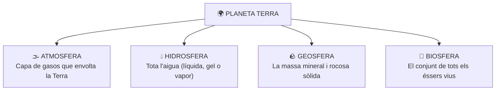

  

    ⚡ Progrés d'aprenentatge (7.1)
    0 / 3 reptes resolts
  

  

    

  

# 7.1 La Terra: Característiques d'un Planeta Únic per a la Vida

La **Terra** és el tercer planeta des del Sol i, fins on sabem avui dia, l'únic racó de l'Univers que acull vida. És un planeta geològicament actiu i dinàmic, les condicions físico-químiques del qual han permés el desenvolupament i la continuïtat de la biosfera al llarg de més de 3.500 milions d'anys.

---

## 1. Per Què la Terra és un Planeta Habitable?

L'existència de vida a la Terra és el resultat de la combinació de cinc factors astronòmics i geològics excepcionals:

### 1. La Distància al Sol (Zona d'Habitabilitat)
La Terra orbita a una distància mitjana d'uns $150.000.000\text{ km}$ ($1\text{ UA}$) del Sol. Si estiguérem tan a prop com Venus, l'aigua s'evaporaria completament; si estiguérem tan lluny com Mart, l'aigua romandria permanentment congelada.

### 2. Una Temperatura Mitjana Suau ($15\text{ }^\circ\text{C}$)
Gràcies a la distància al Sol i a l'efecte d'hivernacle natural provocat pels gasos de l'atmosfera (com el vapor d'aigua i el diòxid de carboni), la Terra manté una temperatura mitjana global d'uns **$15\text{ }^\circ\text{C}$**, ideal perquè l'aigua puga coexistir en els seus tres estats físics: líquid, sòlid i gasós.

### 3. Presència d'Abundant Aigua Líquida
L'aigua és el dissolvent universal en el qual tenen lloc totes les reaccions químiques de la vida cel·lular. Més del **$70\%$ de la superfície terrestre** està coberta per aigua líquida en oceans, mars, rius i llacs, formant el motor del cicle hidrològic.

### 4. Una Atmosfera Rica en Oxigen
La nostra atmosfera conté un **$21\%$ d'oxigen molecular ($\text{O}_2$)**, gas indispensable per a la respiració cel·lular dels éssers vius aeròbics. A més, a l'estratosfera compta amb una **capa d'ozó ($\text{O}_3$)** que filtra les letals radiacions solars ultraviolades (UV).

### 5. Un Camp Magnètic Protector (La Magnetosfera)
El moviment de convecció del ferro líquid que gira al nucli extern de la Terra genera un potent **camp magnètic**. Aquest camp actua com un escut invisible (la *magnetosfera*) que desvia el perillós vent solar de partícules carregades procedents del Sol, evitant que s'escombre l'atmosfera cap a l'espai.

---

## 2. Les Grans Capes de la Terra

Per a comprendre com funciona la Terra com un sistema interconnectat, distingim quatre grans subsistemes terrestres:

  
  
<em>Figura 7.1: Els quatre grans subsistemes del planeta Terra (Atmosfera, Hidrosfera, Geosfera i Biosfera)</em>

Tots quatre components interactuen íntimament: per exemple, la geosfera allibera gasos pels volcans a l'atmosfera, l'atmosfera condensa l'aigua de la hidrosfera en forma de pluja, i l'aigua i els nutrients del sòl permeten créixer a les plantes de la biosfera.

---

## 💡 Resum de Conceptes Clau

- La Terra és l'únic planeta conegut amb vida gràcies a la seua **distància al Sol**, temperatura mitjana de **$15\text{ }^\circ\text{C}$**, **aigua líquida**, **atmosfera amb oxigen** i **camp magnètic protector**.
- El camp magnètic es genera al nucli terrestre i ens protegeix del vent solar.
- Els quatre subsistemes de la Terra són l'**Atmosfera**, la **Hidrosfera**, la **Geosfera** i la **Biosfera**.

## 🎯 Activitats i Autoavaluació Interactiva

  

    🎮 <strong>Zona d'Entrenament FPB:</strong> 0 reptes resolts
    ⭐ 0 punts
  

  

### 1. Qüestionari d'Autoavaluació Tipus Test (MCQ)

  
<strong>1. Quina condició fonamental fa possible que la Terra albergue aigua en estat líquid a la superfície de manera estable?</strong>

  

    <button type="button" class="btn-mcq-opt" data-opt="A">A) Estar situada a tocar de la superfície solar</button>
    <button type="button" class="btn-mcq-opt" data-opt="B">B) La manca d'atmosfera i de gravetat</button>
    <button type="button" class="btn-mcq-opt" data-opt="C">C) La distància precisa al Sol (zona d'habitabilitat) que manté una temperatura mitjana global de 15 °C</button>
    <button type="button" class="btn-mcq-opt" data-opt="D">D) El moviment constant de les marees lunars exclusivament</button>
  

  

  
<strong>2. Quina estructura invisible protegeix la Terra contra les partícules ionitzades i letals del vent solar?</strong>

  

    <button type="button" class="btn-mcq-opt" data-opt="A">A) La magnetosfera (el camp magnètic terrestre)</button>
    <button type="button" class="btn-mcq-opt" data-opt="B">B) L'escorça continental</button>
    <button type="button" class="btn-mcq-opt" data-opt="C">C) La hidrosfera submarina</button>
    <button type="button" class="btn-mcq-opt" data-opt="D">D) La biosfera forestal</button>
  

  

---

### 2. Activitats de Vertader (V) o Fals (F)

  <strong>a) La Terra funciona com un sistema integrat on qualsevol alteració a la biosfera o atmosfera afecta directament la hidrosfera i la geosfera.</strong>
  

    <button type="button" class="btn-vf" data-opt="V">V</button>
    <button type="button" class="btn-vf" data-opt="F">F</button>
  

  

  <strong>b) L'atmosfera terrestre està formada per un 95% d'oxigen pur i no conté nitrogen ni vapor d'aigua.</strong>
  

    <button type="button" class="btn-vf" data-opt="V">V</button>
    <button type="button" class="btn-vf" data-opt="F">F</button>
  

  

---

### 3. Exercicis de Resposta Breu i Identificació

  
✍️ Quin dels 4 grans subsistemes de la Terra engloba el conjunt de tots els éssers vius (animals, plantes, fongs, bacteris)?

  

    <input type="text" class="quiz-input" placeholder="El teu resultat...">
    <button type="button" class="btn-quiz-check">Comprovar</button>
  

  

  
✍️ Quin gas atmosfèric ($O_3$) absorbeix la major part de la radiació ultraviolada (UV) perjudicial procedent del Sol?

  

    <input type="text" class="quiz-input" placeholder="El teu resultat...">
    <button type="button" class="btn-quiz-check">Comprovar</button>
  

  

---

### 4. Pregunta de Raonament i Desenvolupament Escrit

  
✍️ <strong>Habitabilitat i Canvi Global:</strong> Si la Terra no disposara de camp magnètic propi ni d'efecte hivernacle natural a l'atmosfera, com canviarien les condicions de vida a la superfície? Descriu quines conseqüències patiríem els éssers vius.

  <textarea class="open-response-input" rows="3" placeholder="Escriu ací el teu raonament (radiació, temperatures extremes gèlides de -18 °C, pèrdua d'aigua...)..."></textarea>

---

  <h3 style="margin-top:0; color:#0369a1;">📦 Lliurament d'Activitats d'Aules (Act 7.1)</h3>
  
Genera el teu document de tasca d'aquest apartat amb el teu nom i puntuació obtinguda.

  

    <input type="text" class="aules-student-name" placeholder="Cognoms, Nom de l'Alumne/a" style="padding:8px 12px; border:1px solid #94a3b8; border-radius:4px; flex-grow:1; min-width:240px;">
    <button class="btn-generate-aules-pdf" data-unit="UD07" data-activity="Act01" data-module="CA" style="padding:8px 16px; background:#0284c7; color:#fff; border:none; border-radius:4px; font-weight:600; cursor:pointer;">📄 Descarregar PDF per a Aules</button>
  

