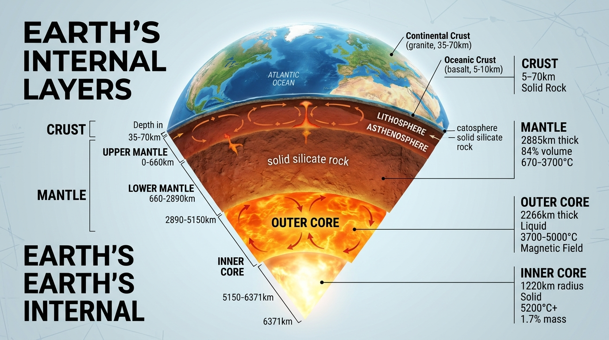
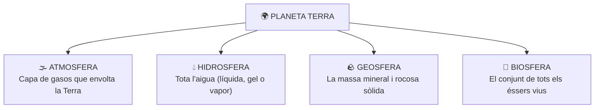

  

    ⚡ Progrés d'aprenentatge (7.1)
    0 / 3 reptes resolts
  

  

    

  

# 7.1 La Terra: Característiques d'un Planeta Únic per a la Vida

La **Terra** és el tercer planeta des del Sol i, fins on sabem avui dia, l'únic racó de l'Univers que acull vida. És un planeta geològicament actiu i dinàmic, les condicions físico-químiques del qual han permés el desenvolupament i la continuïtat de la biosfera al llarg de més de 3.500 milions d'anys.

---

## 1. Per Què la Terra és un Planeta Habitable?

L'existència de vida a la Terra és el resultat de la combinació de cinc factors astronòmics i geològics excepcionals:

### 1. La Distància al Sol (Zona d'Habitabilitat)
La Terra orbita a una distància mitjana d'uns $150.000.000\text{ km}$ ($1\text{ UA}$) del Sol. Si estiguérem tan a prop com Venus, l'aigua s'evaporaria completament; si estiguérem tan lluny com Mart, l'aigua romandria permanentment congelada.

### 2. Una Temperatura Mitjana Suau ($15\text{ }^\circ\text{C}$)
Gràcies a la distància al Sol i a l'efecte d'hivernacle natural provocat pels gasos de l'atmosfera (com el vapor d'aigua i el diòxid de carboni), la Terra manté una temperatura mitjana global d'uns **$15\text{ }^\circ\text{C}$**, ideal perquè l'aigua puga coexistir en els seus tres estats físics: líquid, sòlid i gasós.

### 3. Presència d'Abundant Aigua Líquida
L'aigua és el dissolvent universal en el qual tenen lloc totes les reaccions químiques de la vida cel·lular. Més del **$70\%$ de la superfície terrestre** està coberta per aigua líquida en oceans, mars, rius i llacs, formant el motor del cicle hidrològic.

### 4. Una Atmosfera Rica en Oxigen
La nostra atmosfera conté un **$21\%$ d'oxigen molecular ($\text{O}_2$)**, gas indispensable per a la respiració cel·lular dels éssers vius aeròbics. A més, a l'estratosfera compta amb una **capa d'ozó ($\text{O}_3$)** que filtra les letals radiacions solars ultraviolades (UV).

### 5. Un Camp Magnètic Protector (La Magnetosfera)
El moviment de convecció del ferro líquid que gira al nucli extern de la Terra genera un potent **camp magnètic**. Aquest camp actua com un escut invisible (la *magnetosfera*) que desvia el perillós vent solar de partícules carregades procedents del Sol, evitant que s'escombre l'atmosfera cap a l'espai.

---

## 2. Les Grans Capes de la Terra

Per a comprendre com funciona la Terra com un sistema interconnectat, distingim quatre grans subsistemes terrestres:

  
  
<em>Figura 7.1: Els quatre grans subsistemes del planeta Terra (Atmosfera, Hidrosfera, Geosfera i Biosfera)</em>

Tots quatre components interactuen íntimament: per exemple, la geosfera allibera gasos pels volcans a l'atmosfera, l'atmosfera condensa l'aigua de la hidrosfera en forma de pluja, i l'aigua i els nutrients del sòl permeten créixer a les plantes de la biosfera.

---

## 💡 Resum de Conceptes Clau

- La Terra és l'únic planeta conegut amb vida gràcies a la seua **distància al Sol**, temperatura mitjana de **$15\text{ }^\circ\text{C}$**, **aigua líquida**, **atmosfera amb oxigen** i **camp magnètic protector**.
- El camp magnètic es genera al nucli terrestre i ens protegeix del vent solar.
- Els quatre subsistemes de la Terra són l'**Atmosfera**, la **Hidrosfera**, la **Geosfera** i la **Biosfera**.

## 🎯 Reptes d'Autoavaluació Interactiva

  

    Repte 1: Quines són les tres capes principals que formen la geosfera terrestre segons la seua composició?
    +25 pts
  

  

    <label style="display:flex; align-items:center; gap:8px; cursor:pointer;"><input type="radio" name="ca_q_116" value="a"> Escorça, mantell i nucli</label>
    <label style="display:flex; align-items:center; gap:8px; cursor:pointer;"><input type="radio" name="ca_q_116" value="b"> Troposfera, estratosfera i mesosfera</label>
    <label style="display:flex; align-items:center; gap:8px; cursor:pointer;"><input type="radio" name="ca_q_116" value="c"> Litosfera, hidrosfera i biosfera</label>
    <label style="display:flex; align-items:center; gap:8px; cursor:pointer;"><input type="radio" name="ca_q_116" value="d"> Sòl, roca mare i magma</label>
  

  <button class="btn-check" data-correct="a" data-feedback="Correcte! L'escorça és exterior i sòlida, el mantell intermedi i el nucli intern metàl·lic." style="margin-top:12px; padding:6px 14px; background:#2563eb; color:#fff; border:none; border-radius:4px; cursor:pointer;">Comprova</button>
  

  

    Repte 2: Quin metall pesant és el constituent principal del nucli terrestre (juntament amb el níquel)?
    +25 pts
  

  

    <label style="display:flex; align-items:center; gap:8px; cursor:pointer;"><input type="radio" name="ca_q_117" value="a"> Ferro (Fe)</label>
    <label style="display:flex; align-items:center; gap:8px; cursor:pointer;"><input type="radio" name="ca_q_117" value="b"> Alumini</label>
    <label style="display:flex; align-items:center; gap:8px; cursor:pointer;"><input type="radio" name="ca_q_117" value="c"> Coure</label>
    <label style="display:flex; align-items:center; gap:8px; cursor:pointer;"><input type="radio" name="ca_q_117" value="d"> Plom</label>
  

  <button class="btn-check" data-correct="a" data-feedback="Molt bé! L'aliatge de ferro i níquel del nucli genera el camp magnètic de la Terra." style="margin-top:12px; padding:6px 14px; background:#2563eb; color:#fff; border:none; border-radius:4px; cursor:pointer;">Comprova</button>
  

  

    Repte 3: Quina capa sòlida i rígida comprèn tota l'escorça i la part superior del mantell?
    +25 pts
  

  

    <label style="display:flex; align-items:center; gap:8px; cursor:pointer;"><input type="radio" name="ca_q_118" value="a"> La litosfera</label>
    <label style="display:flex; align-items:center; gap:8px; cursor:pointer;"><input type="radio" name="ca_q_118" value="b"> L'astenosfera</label>
    <label style="display:flex; align-items:center; gap:8px; cursor:pointer;"><input type="radio" name="ca_q_118" value="c"> La hidrosfera</label>
    <label style="display:flex; align-items:center; gap:8px; cursor:pointer;"><input type="radio" name="ca_q_118" value="d"> L'atmosfera</label>
  

  <button class="btn-check" data-correct="a" data-feedback="Exacte! La litosfera és la capa rígida externa que es troba dividida en plaques tectòniques." style="margin-top:12px; padding:6px 14px; background:#2563eb; color:#fff; border:none; border-radius:4px; cursor:pointer;">Comprova</button>
  

---

  <h3 style="margin-top:0; color:#0369a1;">📦 Lliurament d'Activitats d'Aules (Act 7.1)</h3>
  
Genera el teu document de tasca d'aquest apartat amb el teu nom i puntuació obtinguda.

  

    <input type="text" class="aules-student-name" placeholder="Cognoms, Nom de l'Alumne/a" style="padding:8px 12px; border:1px solid #94a3b8; border-radius:4px; flex-grow:1; min-width:240px;">
    <button class="btn-generate-aules-pdf" data-unit="UD07" data-activity="Act01" data-module="CA" style="padding:8px 16px; background:#0284c7; color:#fff; border:none; border-radius:4px; font-weight:600; cursor:pointer;">📄 Descarregar PDF per a Aules</button>
  

