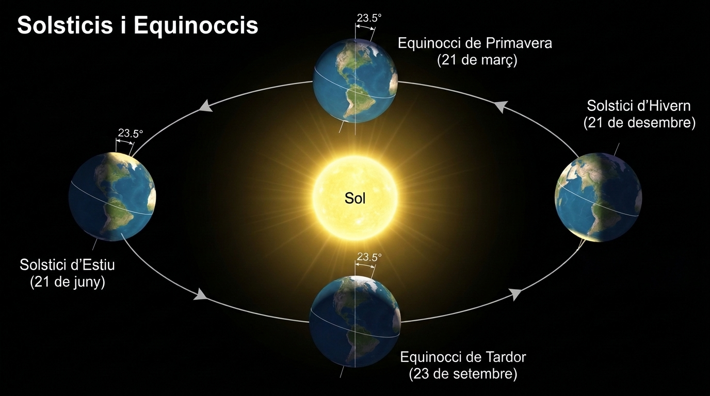

  

    ⚡ Progrés d'aprenentatge (7.2)
    0 / 3 reptes resolts
  

  

    

  

# 7.2 Els Moviments de la Terra: Rotació, Translació i les Estacions

La Terra no roman immòbil a l'espai, sinó que es troba en continu moviment sota la influència de la gravetat del Sol. Els seus dos moviments principals són la **rotació** i la **translació**.

---

## 1. El Moviment de Rotació: El Dia i la Nit

La **rotació** és el gir que fa la Terra sobre el seu propi eix imaginari:
- **Sentit del gir:** Gira d'**oest cap a est** (en sentit antihorari vist des del Pol Nord). Per això veiem eixir el Sol per l'est i pondre's per l'oest.
- **Durada:** Tarda exactament **24 hores** (un dia solar sencer).
- **Inclinació de l'eix:** L'eix de rotació no és vertical respecte al pla orbital, sinó que està inclinat un angle de **$23{,}5^\circ$**.
- **Conseqüència fonamental:** La successió alternada del **dia i la nit**. La meitat que queda encarada al Sol rep llum i calor (dia), mentre que la meitat oposada roman a les fosques (nit). Això evita temperatures extremes com les de Mercuri.

---

## 2. El Moviment de Translació: L'Any i els Anys de Traspàs

La **translació** és el desplaçament que fa la Terra al voltant del Sol descrivint una òrbita el·líptica a una velocitat mitjana d'uns $107.000\text{ km/h}$:
- **Durada:** Tarda **365 dies, 5 hores i 48 minuts** (aproximadament 365 dies i 6 hores).
- **L'Any de Traspàs:** Com que el calendari oficial compta 365 dies exactes, cada any sobren vora 6 hores. En quatre anys, aquestes hores sumen un dia sencer ($6\text{ h} \times 4 = 24\text{ h} = 1\text{ dia}$). Per compensar aquest desfasament, cada quatre anys s'afegeix un dia al mes de febrer (el 29 de febrer), donant lloc a un **any de traspàs de 366 dies**.

---

## 3. L'Origen de les Estacions de l'Any

> [!WARNING]
> ### Error Freqüent a Desterrar
> Les estacions de l'any **NO es deuen a la distància de la Terra al Sol**. De fet, la Terra està en el seu punt més proper al Sol (periheli) a principis de gener, en ple hivern a l'hemisferi nord!

La veritable causa de les quatre estacions és la **inclinació de $23{,}5^\circ$ de l'eix de rotació terrestre**:

1. Durant una part de l'any, l'**hemisferi nord està inclinat cap al Sol**: els raigs solars arriben de manera molt perpendicular i concentrada, i els dies són més llargs que les nits $\rightarrow$ és **estiu a l'hemisferi nord** i **hivern a l'hemisferi sud**.
2. Sis mesos després, la Terra es troba a l'altre costat de l'òrbita i és l'**hemisferi sud el que queda inclinat cap al Sol**: els raigs arriben molt inclinats al nord, dispersant la calor, i les nits són més llargues que els dies $\rightarrow$ és **hivern a l'hemisferi nord** i **estiu a l'hemisferi sud**.

  
  
<em>Figura 7.2: Translació terrestre, inclinació de l'eix (23,5°) i origen dels solsticis i equinoccis</em>

### Solsticis i Equinoccis (Hemisferi Nord)
- **Solstici d'Estiu (20-21 de juny):** El dia més llarg i la nit més curta de l'any. Comença l'estiu.
- **Equinocci de Tardor (22-23 de setembre):** Els raigs solars incideixen perpendicularment a l'Equador. El dia i la nit tenen exactament la mateixa durada ($12\text{ hores}$). Comença la tardor.
- **Solstici d'Hivern (21-22 de desembre):** La nit més llarga i el dia més curt de l'any. Comença l'hivern.
- **Equinocci de Primavera (20-21 de març):** El dia i la nit tornen a durar 12 hores iguals. Comença la primavera.

---

## 💡 Resum de Conceptes Clau

- La **rotació** dura 24 hores i causa el dia i la nit.
- La **translació** dura 365 dies i 6 hores; cada 4 anys hi ha un **any de traspàs** (366 dies).
- Les **estacions de l'any** són degudes a la **inclinació de $23{,}5^\circ$ de l'eix de gir** de la Terra, no a la distància al Sol.
- En els **equinoccis** el dia i la nit duren igual (12 h); en els **solsticis** es produeix la màxima diferència entre hores de llum i foscor.

## 🎯 Activitats i Autoavaluació Interactiva

  

    🎮 <strong>Zona d'Entrenament FPB:</strong> 0 reptes resolts
    ⭐ 0 punts
  

  

### 1. Qüestionari d'Autoavaluació Tipus Test (MCQ)

  
<strong>1. Quina és la causa real de l'existència de les quatre estacions de l'any a la Terra?</strong>

  

    <button type="button" class="btn-mcq-opt" data-opt="A">A) Que a l'estiu la Terra està milions de quilòmetres més a prop del Sol que a l'hivern</button>
    <button type="button" class="btn-mcq-opt" data-opt="B">B) La inclinació de 23,5° de l'eix de rotació terrestre combinada amb el moviment de translació al voltant del Sol</button>
    <button type="button" class="btn-mcq-opt" data-opt="C">C) La variació de la velocitat del vent solar al llarg de l'any</button>
    <button type="button" class="btn-mcq-opt" data-opt="D">D) L'ombra que la Lluna projecta regularment sobre els continents</button>
  

  

  
<strong>2. Per què s'afegeix un dia addicional al mes de febrer (anys de traspàs) cada 4 anys?</strong>

  

    <button type="button" class="btn-mcq-opt" data-opt="A">A) Perquè la Terra frena la seua rotació durant els eclipsis</button>
    <button type="button" class="btn-mcq-opt" data-opt="B">B) Perquè la Lluna tarda 29 dies a girar sobre si mateixa</button>
    <button type="button" class="btn-mcq-opt" data-opt="C">C) És una convenció sense motiu astronòmic</button>
    <button type="button" class="btn-mcq-opt" data-opt="D">D) Per a compensar les quasi 6 hores sobrants que triga la Terra a fer una translació completa (365 dies i 5 h 48 min)</button>
  

  

---

### 2. Activitats de Vertader (V) o Fals (F)

  <strong>a) El moviment de rotació de la Terra es produeix d'oest a est, per la qual cosa veiem sortir el Sol per l'est i pondre's per l'oest.</strong>
  

    <button type="button" class="btn-vf" data-opt="V">V</button>
    <button type="button" class="btn-vf" data-opt="F">F</button>
  

  

  <strong>b) Durant l'equinocci de primavera la nit dura 18 hores i el dia només 6 hores a la Comunitat Valenciana.</strong>
  

    <button type="button" class="btn-vf" data-opt="V">V</button>
    <button type="button" class="btn-vf" data-opt="F">F</button>
  

  

---

### 3. Exercicis de Resposta Breu i Identificació

  
✍️ Quantes hores triga la Terra a completar un gir complet de 360° sobre el seu propi eix?

  

    <input type="text" class="quiz-input" placeholder="Ex: 24 hores...">
    <button type="button" class="btn-quiz-check">Comprovar</button>
  

  

  
✍️ Com s'anomena el dia de l'any en què el Sol assoleix la màxima alçada sobre l'horitzó i tenim el dia més llarg i la nit més curta a l'hemisferi nord?

  

    <input type="text" class="quiz-input" placeholder="El teu resultat...">
    <button type="button" class="btn-quiz-check">Comprovar</button>
  

  

---

### 4. Pregunta de Raonament i Desenvolupament Escrit

  
✍️ <strong>Inclinació i Clima Global:</strong> Per què quan a València (hemisferi nord) estem al mes de juliol gaudint de l'estiu, a l'Argentina o Austràlia (hemisferi sud) estan en ple hivern? Explica com incideixen els raigs solars en cadascun dels hemisferis.

  <textarea class="open-response-input" rows="3" placeholder="Escriu ací la teua resposta (inclinació de l'eix, raigs perpendiculars vs oblics, hores de llum...)..."></textarea>

---

  <h3 style="margin-top:0; color:#0369a1;">📦 Lliurament d'Activitats d'Aules (Act 7.2)</h3>
  
Genera el teu document de tasca d'aquest apartat amb el teu nom i puntuació obtinguda.

  

    <input type="text" class="aules-student-name" placeholder="Cognoms, Nom de l'Alumne/a" style="padding:8px 12px; border:1px solid #94a3b8; border-radius:4px; flex-grow:1; min-width:240px;">
    <button class="btn-generate-aules-pdf" data-unit="UD07" data-activity="Act02" data-module="CA" style="padding:8px 16px; background:#0284c7; color:#fff; border:none; border-radius:4px; font-weight:600; cursor:pointer;">📄 Descarregar PDF per a Aules</button>
  

