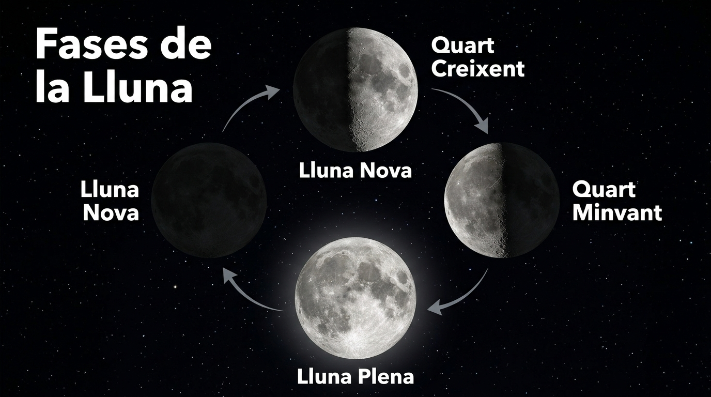

  

    ⚡ Progrés d'aprenentatge (7.3)
    0 / 3 reptes resolts
  

  

    

  

# 7.3 La Lluna, les Fases Lunars, els Eclipsis i les Marees

La **Lluna** és l'únic satèl·lit natural de la Terra. Situada a una distància mitjana de $384.400\text{ km}$, no té llum pròpia, no té atmosfera ni aigua líquida, i té un paper determinant en la regulació dels cicles biològics i les marees dels nostres oceans.

---

## 1. La Lluna i la Cara Oculta

- **Dimensions:** Té un diàmetre de $3.474\text{ km}$ (aproximadament una quarta part del diàmetre de la Terra).
- **Rotació Sincrònica:** La Lluna tarda exactament el mateix temps en girar sobre el seu propi eix (rotació) que en donar una volta completa al voltant de la Terra (translació): **28 dies** (un mes lunar).
- **Conseqüència:** Des de la superfície de la Terra **sempre veiem exactament la mateixa cara de la Lluna**. L'altra meitat (la cara oculta) no va poder ser observada ni fotografiada per la humanitat fins a l'any 1959 per la sonda espacial soviètica *Luna 3*.

---

## 2. Les Fases Lunars

A mesura que la Lluna es desplaça al voltant de la Terra, la porció de la seua cara visible il·luminada pel Sol va variant contínuament, donant lloc a les **quatre fases lunars**:

*Figura: Les quatre fases lunars principals en el seu cicle complet d'il·luminació vista des de la Terra.*

1. **Lluna Nova:** La Lluna se situa entre la Terra i el Sol. La seua cara il·luminada mira cap a l'espai, de manera que des de la Terra queda a les fosques i no es veu.
2. **Quart Creixent:** La cara visible es va il·luminant progressivament d'est a oest, adoptant la forma d'una lletra **"D"**.
3. **Lluna Plena:** La Terra se situa entre el Sol i la Lluna. La cara visible rep directament la llum solar i es veu com un cercle complet brillant.
4. **Quart Minvant:** La zona il·luminada comença a decréixer progressivament, adoptant la forma d'una lletra **"C"**.

> [!TIP]
> **Regla Mnemotècnica**
> La Lluna és "mentidera": quan té forma de **"C"** no creix sinó que **minva** (decreix), i quan té forma de **"D"** no decreix sinó que **creix**!

---

## 3. Els Eclipsis: Ombra i Penombra

Un **eclipsi** es produeix quan un cos celeste s'interposa en la línia de visió entre altres dos astres, projectant la seua ombra:

### A) Eclipsi de Sol
- **Posició dels astres:** El Sol, la **Lluna** i la Terra s'alineen en aquest ordre ($\text{Sol} \rightarrow \text{Lluna} \rightarrow \text{Terra}$).
- **Com ocorre:** La Lluna s'interposa davant del Sol tapant-ne la llum i projectant un con d'ombra sobre una franja estreta de la superfície terrestre.
- Només pot ocórrer durant la fase de **Lluna Nova**. Pot ser **total** (el dia es fa de nit durant uns minuts), **anular** (es veu un anell de foc) o **parcial**.

### B) Eclipsi de Lluna
- **Posició dels astres:** El Sol, la **Terra** i la Lluna s'alineen en aquest ordre ($\text{Sol} \rightarrow \text{Terra} \rightarrow \text{Lluna}$).
- **Com ocorre:** La Terra s'interposa entre el Sol i la Lluna, projectant la seua gegantina ombra sobre el nostre satèl·lit.
- Només pot ocórrer durant la fase de **Lluna Plena**. La Lluna no desapareix del tot, sinó que adquireix un to vermellós ataronjat molt característic (l'anomenada "Lluna de sang"), ja que l'atmosfera de la Terra desvia els tons rogencs de la llum solar cap a l'ombra.

---

## 4. Les Marees: La Força de la Gravetat als Oceans

Les **marees** són moviments periòdics d'ascens i descens del nivell de les aigües del mar causats per l'**atracció gravitatòria que la Lluna (i en menor mesura el Sol) exerceix sobre la Terra**:

- **Pleamar (Marea Alta):** El nivell de l'aigua assoleix la seua alçada màxima a les zones de la Terra que queden alineades amb la Lluna.
- **Baixamar (Marea Baixa):** El nivell de l'aigua baixa fins al seu punt mínim a les zones perpendiculars.
- En cada punt costaner es produeixen aproximadament **dues marees altes i dues marees baixes cada 24 hores i 50 minuts**.

### Marees Vives vs Marees Mortes
- **Marees Vives:** Es produeixen quan el Sol, la Lluna i la Terra estan en línia recta (durant la **Lluna Plena** i la **Lluna Nova**). Les atraccions gravitatòries del Sol i de la Lluna se sumen, provocant marees molt altes i baixes extremades.
- **Marees Mortes:** Es produeixen quan la Lluna està en **Quart Creixent** o **Quart Minvant** (formant un angle recte de $90^\circ$ amb la línia Terra-Sol). Les forces gravitatòries es contraresten parcialment i les marees tenen poca oscil·lació.

## 🎯 Activitats i Autoavaluació Interactiva

  

    🎮 <strong>Zona d'Entrenament FPB:</strong> 0 reptes resolts
    ⭐ 0 punts
  

  

### 1. Qüestionari d'Autoavaluació Tipus Test (MCQ)

  
<strong>1. Per quina raó des de la superfície de la Terra sempre veiem la mateixa cara de la Lluna (i mai la 'cara oculta' a simple vista)?</strong>

  

    <button type="button" class="btn-mcq-opt" data-opt="A">A) Perquè el temps que triga la Lluna a rotar sobre si mateixa és exactament igual al temps que triga a girar al voltant de la Terra (rotació sincrònica)</button>
    <button type="button" class="btn-mcq-opt" data-opt="B">B) Perquè la Lluna no gira sobre el seu propi eix</button>
    <button type="button" class="btn-mcq-opt" data-opt="C">C) Perquè l'altra cara de la Lluna és completament fosca i no reflecteix cap llum</button>
    <button type="button" class="btn-mcq-opt" data-opt="D">D) Perquè els núvols terrestres bloquegen la meitat de la visió lunar</button>
  

  

  
<strong>2. Quina alineació d'astres produeix un eclipsi solar total?</strong>

  

    <button type="button" class="btn-mcq-opt" data-opt="A">A) Sol — Terra — Lluna</button>
    <button type="button" class="btn-mcq-opt" data-opt="B">B) Terra — Sol — Lluna</button>
    <button type="button" class="btn-mcq-opt" data-opt="C">C) Sol — Lluna — Terra (la Lluna es col·loca enmig i tapa el Sol)</button>
    <button type="button" class="btn-mcq-opt" data-opt="D">D) Mart — Lluna — Terra</button>
  

  

---

### 2. Activitats de Vertader (V) o Fals (F)

  <strong>a) Les marees oceàniques són provocades principalment per la força d'atracció gravitatòria que la Lluna exerceix sobre l'aigua dels oceans.</strong>
  

    <button type="button" class="btn-vf" data-opt="V">V</button>
    <button type="button" class="btn-vf" data-opt="F">F</button>
  

  

  <strong>b) Quan la Lluna està en fase de quart creixent a l'hemisferi nord, presenta exactament la forma de la lletra 'C'.</strong>
  

    <button type="button" class="btn-vf" data-opt="V">V</button>
    <button type="button" class="btn-vf" data-opt="F">F</button>
  

  

---

### 3. Exercicis de Resposta Breu i Identificació

  
✍️ Com s'anomena el moment de la marea en què l'aigua del mar assoleix la seua màxima alçada a la platja o port?

  

    <input type="text" class="quiz-input" placeholder="El teu resultat...">
    <button type="button" class="btn-quiz-check">Comprovar</button>
  

  

  
✍️ Quants dies aproximats triga el cicle complet de les 4 fases lunars (mes lunar sinòdic)?

  

    <input type="text" class="quiz-input" placeholder="Ex: 28 dies...">
    <button type="button" class="btn-quiz-check">Comprovar</button>
  

  

---

### 4. Pregunta de Raonament i Desenvolupament Escrit

  
✍️ <strong>Comparació d'Eclipsis:</strong> Explica quina diferència hi ha entre un eclipsi de Sol i un eclipsi de Lluna pel que fa a la posició relativa dels astres. Per què l'eclipsi de Lluna es pot veure amb seguretat a ull nu sense ulleres de filtre especial mentre que l'eclipsi solar requereix filtres homologats?

  <textarea class="open-response-input" rows="3" placeholder="Escriu ací la comparativa (posicions relatives, intensitat de la radiació directa solar...)..."></textarea>

---

  <h3 style="margin-top:0; color:#0369a1;">📦 Lliurament d'Activitats d'Aules (Act 7.3)</h3>
  
Genera el teu document de tasca d'aquest apartat amb el teu nom i puntuació obtinguda.

  

    <input type="text" class="aules-student-name" placeholder="Cognoms, Nom de l'Alumne/a" style="padding:8px 12px; border:1px solid #94a3b8; border-radius:4px; flex-grow:1; min-width:240px;">
    <button class="btn-generate-aules-pdf" data-unit="UD07" data-activity="Act03" data-module="CA" style="padding:8px 16px; background:#0284c7; color:#fff; border:none; border-radius:4px; font-weight:600; cursor:pointer;">📄 Descarregar PDF per a Aules</button>
  

