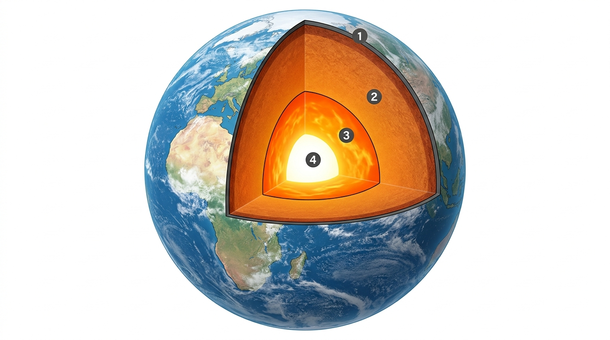

# 7.4 L'Estructura Interna de la Terra (La Geosfera) i Activitats

La **geosfera** és la part sòlida i rocosa del nostre planeta. S'estén des de la superfície dels continents i els fons dels oceans fins al centre mateix de la Terra, a uns **$6.371\text{ km}$ de profunditat**.

---

## 1. Com Coneixem l'Interior de la Terra?

Com que el pou més profund mai excavat per la humanitat (el pou de Kola a Rússia) només va arribar a $12{,}2\text{ km}$, els científics han hagut d'utilitzar **mètodes indirectes** per conèixer l'interior terrestre:
- **L'estudi de les ones sísmiques:** Els terratrèmols generen ones de xoc que travessen l'interior del planeta. Com que la velocitat i la direcció de les ones canvien sobtadament quan xoquen amb materials de diferent densitat o estat (sòlid o líquid), han permés dibuixar les diferents capes internes de la Terra amb gran precisió.

---

## 2. Les Capes de la Geosfera (Model Geoquímic)

Segons la composició dels materials, la geosfera es divideix en tres capes concèntriques:

```
  [ ESCORÇA ]  ➔ 5 a 70 km (Continental: granit / Oceànica: basalt)
       │
  [ MANTELL ]  ➔ 2.900 km  (Superior i Inferior: peridotites i magma fluid)
       │
   [ NUCLI ]   ➔ 6.371 km  (Extern: líquid / Intern: sòlid; Ferro i Níquel)
```

| Capa | Gruix / Profunditat | Composició i Característiques |
| :--- | :--- | :--- |
| **Escorça** | Superfície fins a $5-70\text{ km}$ | Capa més prima, externa i freda. Es divideix en:<br>• **Escorça Continental:** Fa entre $30$ i $70\text{ km}$ de gruix sota les grans muntanyes. Formada per roques com el granit.<br>• **Escorça Oceànica:** Molt més prima ($5-10\text{ km}$). Forma el fons marí amb roques volcàniques com el basalt. |
| **Mantell** | De $70$ a $2.900\text{ km}$ | És la capa més voluminosa (ocupa el $84\%$ de la Terra). Formada per peridotita (roca molt densa rica en ferro i magnesi). A causa de les altes temperatures, les roques presenten un comportament viscós plàstic amb **corrents de convecció** de magma que mouen les plaques superficials. |
| **Nucli** | De $2.900$ a $6.371\text{ km}$ | Esfera central d'aliatge metàl·lic de **ferro ($90\%$) i níquel**:<br>• **Nucli Extern:** En estat líquid fluorescent a gran temperatura ($4.000\text{ }^\circ\text{C}$). El seu moviment continu genera el **camp magnètic terrestre**.<br>• **Nucli Intern:** En estat sòlid a causa de les brutals pressions, amb temperatures superiors a **$5.500\text{ }^\circ\text{C}$** (similar a la superfície del Sol). |


*Figura 7.1: Estructura interna de la Terra en capes: **(1)** Escorça terrestre (sòlida i rocosa), **(2)** Mantell (silicats i magma amb corrents de convecció), **(3)** Nucli extern (ferro i níquel fos en estat líquid), **(4)** Nucli intern (esfera metàl·lica sòlida incandescent).*

---

## 3. La Litosfera i la Tectònica de Plaques

La part més superficial i rígida del planeta s'anomena **litosfera** (formada per l'escorça i la part superior del mantell). La litosfera no és una closca contínua, sinó que està trencada com un trencaclosques gegant en grans fragments anomenats **plaques tectòniques** (com la placa Euroasiàtica, la placa Africana o la placa del Pacífic).

Aquestes plaques es desplacen lentament (uns quants centímetres cada any) impulsades per la calor del mantell, donant lloc a fenòmens geològics violents a les seues vores:
- **Terratrèmols (Sismes):** Alliberament brusc d'energia acumulat pel fregament entre dues plaques al llarg d'una falla geològica. El punt subterrani d'origen és l'**hipocentre**, i el punt de la superfície verticalment superior és l'**epicentre**.
- **Volcans:** Obertures a l'escorça per on el magma fos de l'interior puja i és expulsat a l'exterior en forma de lava, cendres i gasos ardents.
- **Formació de Serralades:** Quan dues plaques continentals xoquen frontalment, els sediments s'arruguen i s'eleven formant serralades de muntanyes (com els Pirineus o l'Himàlaia).

---

## 📝 Butlletí d'Activitats d'Avaluació

### Preguntes de Comprensió i Relació

1. **Quina diferència hi ha entre l'escorça continental i l'escorça oceànica?**  
   *Solució:* L'escorça continental és més gruixuda ($30-70\text{ km}$) i rica en granit formant els continents; l'oceànica és més prima ($5-10\text{ km}$), rica en basalt i forma els fons oceànics.

2. **Per què el nucli intern de la Terra és sòlid si està a més de $5.000\text{ }^\circ\text{C}$?**  
   *Solució:* Perquè la colossal pressió exercida per tot el pes de la Terra impedeix que els àtoms de ferro i níquel se separen i passen a estat líquid.

3. **Indica si les següents afirmacions són Vertaderes (V) o Falses (F):**
   - a) L'eclipsi de Sol es produeix quan la Terra es posa entre el Sol i la Lluna. $\rightarrow$ **Fals** (és la Lluna qui es posa enmig).
   - b) El moviment del nucli extern líquid de ferro genera el camp magnètic de la Terra. $\rightarrow$ **Vertader**.
   - c) Les marees vives ocorren en Quart Creixent. $\rightarrow$ **Fals** (ocorren en Lluna Plena i Lluna Nova).

---

### Qüestionari Tipus Test

**1. Quina és la capa més voluminosa de la Terra?**
- A) L'escorça
- B) El mantell
- C) El nucli intern
- D) La hidrosfera  
*(Solució: B)*

**2. Què anomenem epicentre d'un terratrèmol?**
- A) El punt profund subterrani on es trenca la roca
- B) L'aparell que mesura les ones sísmiques
- C) El punt de la superfície terrestre situat directament sobre l'origen del sisme
- D) L'escala numèrica de danys  
*(Solució: C)*

**3. Què és la litosfera?**
- A) La capa d'aigua dolça
- B) La capa rígida formada per l'escorça i el mantell superior dividida en plaques tectòniques
- C) El gas de l'atmosfera
- D) El centre de ferro fos de la Terra  
*(Solució: B)*
