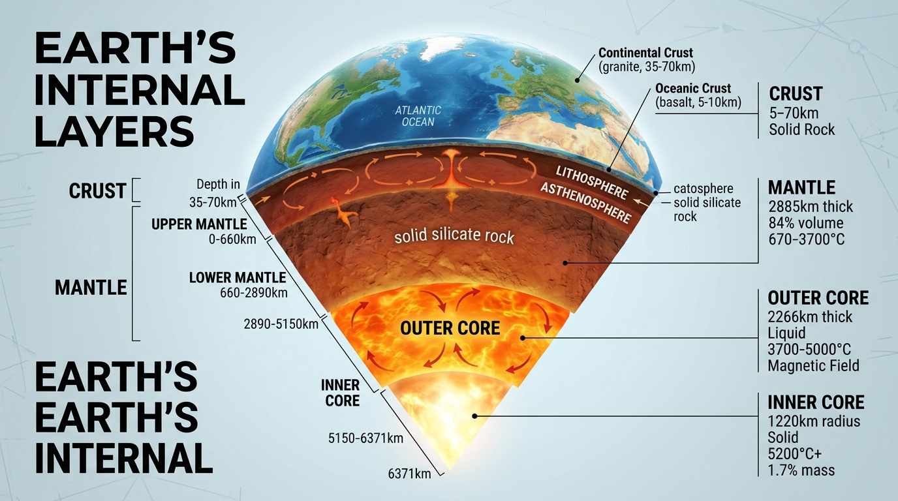

# 7.4 L'Estructura Interna de la Terra (La Geosfera) i Activitats

La **geosfera** és la part sòlida i rocosa del nostre planeta. S'estén des de la superfície dels continents i els fons dels oceans fins al centre mateix de la Terra, a uns **$6.371\text{ km}$ de profunditat**.

---

## 1. Com Coneixem l'Interior de la Terra?

Com que el pou més profund mai excavat per la humanitat (el pou de Kola a Rússia) només va arribar a $12{,}2\text{ km}$, els científics han hagut d'utilitzar **mètodes indirectes** per conèixer l'interior terrestre:
- **L'estudi de les ones sísmiques:** Els terratrèmols generen ones de xoc que travessen l'interior del planeta. Com que la velocitat i la direcció de les ones canvien sobtadament quan xoquen amb materials de diferent densitat o estat (sòlid o líquid), han permés dibuixar les diferents capes internes de la Terra amb gran precisió.

---

## 2. Les Capes de la Geosfera (Model Geoquímic)

Segons la composició dels materials, la geosfera es divideix en tres capes concèntriques:

```
  [ ESCORÇA ]  ➔ 5 a 70 km (Continental: granit / Oceànica: basalt)
       │
  [ MANTELL ]  ➔ 2.900 km  (Superior i Inferior: peridotites i magma fluid)
       │
   [ NUCLI ]   ➔ 6.371 km  (Extern: líquid / Intern: sòlid; Ferro i Níquel)
```

| Capa | Gruix / Profunditat | Composició i Característiques |
| :--- | :--- | :--- |
| **Escorça** | Superfície fins a $5-70\text{ km}$ | Capa més prima, externa i freda. Es divideix en:<br>• **Escorça Continental:** Fa entre $30$ i $70\text{ km}$ de gruix sota les grans muntanyes. Formada per roques com el granit.<br>• **Escorça Oceànica:** Molt més prima ($5-10\text{ km}$). Forma el fons marí amb roques volcàniques com el basalt. |
| **Mantell** | De $70$ a $2.900\text{ km}$ | És la capa més voluminosa (ocupa el $84\%$ de la Terra). Formada per peridotita (roca molt densa rica en ferro i magnesi). A causa de les altes temperatures, les roques presenten un comportament viscós plàstic amb **corrents de convecció** de magma que mouen les plaques superficials. |
| **Nucli** | De $2.900$ a $6.371\text{ km}$ | Esfera central d'aliatge metàl·lic de **ferro ($90\%$) i níquel**:<br>• **Nucli Extern:** En estat líquid fluorescent a gran temperatura ($4.000\text{ }^\circ\text{C}$). El seu moviment continu genera el **camp magnètic terrestre**.<br>• **Nucli Intern:** En estat sòlid a causa de les brutals pressions, amb temperatures superiors a **$5.500\text{ }^\circ\text{C}$** (similar a la superfície del Sol). |


*Figura 7.1: Estructura interna de la Terra en capes: **(1)** Escorça terrestre (sòlida i rocosa), **(2)** Mantell (silicats i magma amb corrents de convecció), **(3)** Nucli extern (ferro i níquel fos en estat líquid), **(4)** Nucli intern (esfera metàl·lica sòlida incandescent).*

---

## 3. La Litosfera i la Tectònica de Plaques

La part més superficial i rígida del planeta s'anomena **litosfera** (formada per l'escorça i la part superior del mantell). La litosfera no és una closca contínua, sinó que està trencada com un trencaclosques gegant en grans fragments anomenats **plaques tectòniques** (com la placa Euroasiàtica, la placa Africana o la placa del Pacífic).

Aquestes plaques es desplacen lentament (uns quants centímetres cada any) impulsades per la calor del mantell, donant lloc a fenòmens geològics violents a les seues vores:
- **Terratrèmols (Sismes):** Alliberament brusc d'energia acumulat pel fregament entre dues plaques al llarg d'una falla geològica. El punt subterrani d'origen és l'**hipocentre**, i el punt de la superfície verticalment superior és l'**epicentre**.
- **Volcans:** Obertures a l'escorça per on el magma fos de l'interior puja i és expulsat a l'exterior en forma de lava, cendres i gasos ardents.
- **Formació de Serralades:** Quan dues plaques continentals xoquen frontalment, els sediments s'arruguen i s'eleven formant serralades de muntanyes (com els Pirineus o l'Himàlaia).

---

## 📝 Butlletí d'Activitats d'Avaluació


<div class="interactive-progress-tracker">
  <div class="tracker-header">
    <span>🎮 <strong>Zona d'Entrenament FPB:</strong> <span class="tracker-count">0 reptes resolts</span></span>
    <span class="tracker-pts">⭐ 0 punts</span>
  </div>
  <div class="tracker-bar"><div class="tracker-fill" style="width: 0%;"></div></div>
</div>


### 1. Activitats de Vertader (V) o Fals (F) sobre la Geosfera


<div class="interactive-vf" data-quiz-id="ca1_u7_4_vf1" data-answer="V" data-hint="VERTADER: L'escorça continental és menys densa i molt més gruixuda que l'oceànica.">
  <span class="vf-statement"><strong>a) L'escorça continental és més gruixuda (30-70 km) i de composició granítica respecte a l'oceànica (5-10 km basàltica).</strong></span>
  <div class="vf-buttons">
    <button type="button" class="btn-vf" data-opt="V">V</button>
    <button type="button" class="btn-vf" data-opt="F">F</button>
  </div>
  <div class="quiz-feedback"></div>
</div>


<div class="interactive-vf" data-quiz-id="ca1_u7_4_vf2" data-answer="F" data-hint="FALS: Tot i l'extrema temperatura, l'immensa pressió litostàtica manté el ferro i níquel en estat sòlid cristal·lí.">
  <span class="vf-statement"><strong>b) El nucli intern de la Terra és líquid a causa de temperatures superiors als 5.000 °C.</strong></span>
  <div class="vf-buttons">
    <button type="button" class="btn-vf" data-opt="V">V</button>
    <button type="button" class="btn-vf" data-opt="F">F</button>
  </div>
  <div class="quiz-feedback"></div>
</div>


<div class="interactive-vf" data-quiz-id="ca1_u7_4_vf3" data-answer="F" data-hint="FALS: Les ones S no es propaguen en fluids líquids, motiu pel qual es produeix la zona d'ombra sísmica que va permetre descobrir el nucli extern líquid.">
  <span class="vf-statement"><strong>c) Les ones sísmiques transversals (S) tenen la capacitat de travessar líquids com el magma o el nucli extern.</strong></span>
  <div class="vf-buttons">
    <button type="button" class="btn-vf" data-opt="V">V</button>
    <button type="button" class="btn-vf" data-opt="F">F</button>
  </div>
  <div class="quiz-feedback"></div>
</div>


---

### 2. Qüestionari d'Autoavaluació Tipus Test


<div class="interactive-mcq" data-quiz-id="ca1_u7_4_mcq1" data-answer="B" data-hint="El mantell s'estén fins a 2.900 km de profunditat i representa el 84% del volum del nostre planeta.">
  <p class="mcq-question"><strong>1. Quina és la capa concèntrica més voluminosa de la geosfera, concentrant més del 80% del volum terrestre?</strong></p>
  <div class="mcq-options">
    <button type="button" class="btn-mcq-opt" data-opt="A">A) L'escorça</button>
    <button type="button" class="btn-mcq-opt" data-opt="B">B) El mantell terrestre</button>
    <button type="button" class="btn-mcq-opt" data-opt="C">C) El nucli intern</button>
    <button type="button" class="btn-mcq-opt" data-opt="D">D) La litosfera</button>
  </div>
  <div class="quiz-feedback"></div>
</div>


<div class="interactive-mcq" data-quiz-id="ca1_u7_4_mcq2" data-answer="B" data-hint="Les falles són fractures de la litosfera on s'acumula tensió elàstica que s'allibera bruscament en forma de sismes.">
  <p class="mcq-question"><strong>2. Com s'anomena la fractura o discontinuïtat tectònica de l'escorça al llarg de la qual es produeix moviment sobtat generant terratrèmols?</strong></p>
  <div class="mcq-options">
    <button type="button" class="btn-mcq-opt" data-opt="A">A) Fossa oceànica</button>
    <button type="button" class="btn-mcq-opt" data-opt="B">B) Falla tectònica</button>
    <button type="button" class="btn-mcq-opt" data-opt="C">C) Dorsal volcànica</button>
    <button type="button" class="btn-mcq-opt" data-opt="D">D) Plec anticlinal</button>
  </div>
  <div class="quiz-feedback"></div>
</div>
