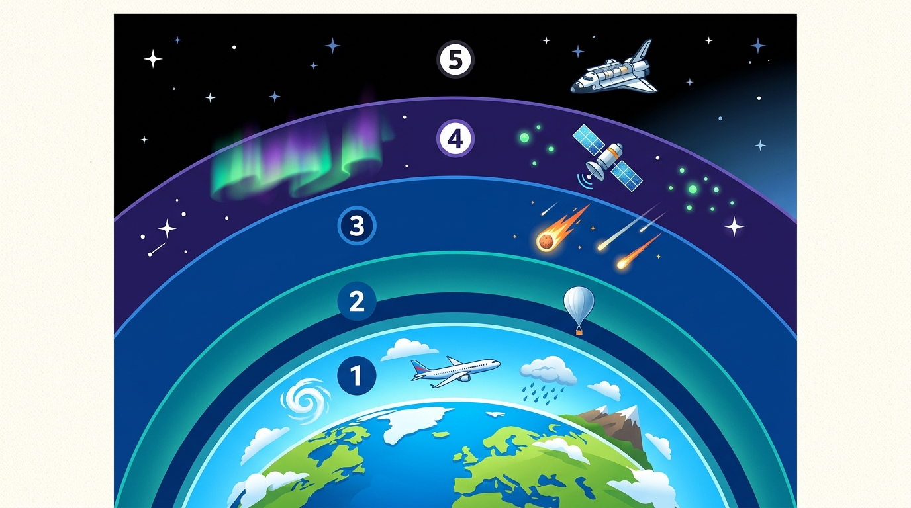

# UD8: L'Atmosfera Terrestre (Biologia i Geologia)

<svg viewBox="0 0 860 260" xmlns="http://www.w3.org/2000/svg" style="max-width: 100%; height: auto; font-family: 'Segoe UI', system-ui, sans-serif; border-radius: 12px; box-shadow: 0 8px 24px rgba(0,0,0,0.35);">
  <defs>
    <linearGradient id="bg-grad-8" x1="0%" y1="0%" x2="100%" y2="100%">
      <stop offset="0%" stop-color="#0f172a"/>
      <stop offset="100%" stop-color="#1e293b"/>
    </linearGradient>
    <linearGradient id="g-air" x1="0%" y1="0%" x2="100%" y2="100%">
      <stop offset="0%" stop-color="#38bdf8" stop-opacity="0.25"/>
      <stop offset="100%" stop-color="#38bdf8" stop-opacity="0.05"/>
    </linearGradient>
    <linearGradient id="g-cap" x1="0%" y1="0%" x2="100%" y2="100%">
      <stop offset="0%" stop-color="#818cf8" stop-opacity="0.25"/>
      <stop offset="100%" stop-color="#818cf8" stop-opacity="0.05"/>
    </linearGradient>
    <linearGradient id="g-met" x1="0%" y1="0%" x2="100%" y2="100%">
      <stop offset="0%" stop-color="#34d399" stop-opacity="0.25"/>
      <stop offset="100%" stop-color="#34d399" stop-opacity="0.05"/>
    </linearGradient>
    <linearGradient id="g-cli" x1="0%" y1="0%" x2="100%" y2="100%">
      <stop offset="0%" stop-color="#f59e0b" stop-opacity="0.25"/>
      <stop offset="100%" stop-color="#f59e0b" stop-opacity="0.05"/>
    </linearGradient>
  </defs>

  <!-- Background -->
  <rect width="860" height="260" rx="12" fill="url(#bg-grad-8)"/>

  <!-- Capçalera -->
  <text x="430" y="36" text-anchor="middle" fill="#f8fafc" font-size="19" font-weight="bold">L'ATMOSFERA TERRESTRE: ESTRUCTURA, METEOROLOGIA I SENSÒRICA</text>
  <text x="430" y="56" text-anchor="middle" fill="#94a3b8" font-size="12">Composició dels gasos, perfil tèrmic vertical, dinàmica de pressions i control ambiental de servidors</text>

  <!-- Bloc 1: Composició de l'Aire -->
  <g transform="translate(25, 70)">
    <rect width="185" height="165" rx="10" fill="url(#g-air)" stroke="#38bdf8" stroke-width="1.5"/>
    <rect x="15" y="14" width="28" height="28" rx="6" fill="#38bdf8" fill-opacity="0.2"/>
    <text x="29" y="33" text-anchor="middle" fill="#38bdf8" font-size="14" font-weight="bold">💨</text>
    <text x="52" y="33" fill="#f8fafc" font-size="13" font-weight="bold">Gasos de l'Aire</text>
    <text x="15" y="62" fill="#38bdf8" font-size="11" font-weight="600">Composició Química</text>
    <text x="15" y="84" fill="#cbd5e1" font-size="11">• Nitrogen (N₂): 78%</text>
    <text x="15" y="104" fill="#cbd5e1" font-size="11">• Oxigen (O₂): 21%</text>
    <text x="15" y="124" fill="#cbd5e1" font-size="11">• Argó: 0,9% | CO₂: 0,04%</text>
    <text x="15" y="144" fill="#cbd5e1" font-size="11">• Filtre UV i gas d'hivernacle</text>
  </g>

  <!-- Bloc 2: Capes Verticals -->
  <g transform="translate(230, 70)">
    <rect width="185" height="165" rx="10" fill="url(#g-cap)" stroke="#818cf8" stroke-width="1.5"/>
    <rect x="15" y="14" width="28" height="28" rx="6" fill="#818cf8" fill-opacity="0.2"/>
    <text x="29" y="33" text-anchor="middle" fill="#818cf8" font-size="14" font-weight="bold">🌡️</text>
    <text x="52" y="33" fill="#f8fafc" font-size="13" font-weight="bold">Capes Verticals</text>
    <text x="15" y="62" fill="#818cf8" font-size="11" font-weight="600">Estructura Tèrmica</text>
    <text x="15" y="84" fill="#cbd5e1" font-size="11">• Troposfera (0-12 km): Temps</text>
    <text x="15" y="104" fill="#cbd5e1" font-size="11">• Estratosfera (12-50 km): Ozó O₃</text>
    <text x="15" y="124" fill="#cbd5e1" font-size="11">• Mesosfera (50-80 km): Meteors</text>
    <text x="15" y="144" fill="#cbd5e1" font-size="11">• Termosfera: Ionització ràdio</text>
  </g>

  <!-- Bloc 3: Dinàmica Meteorològica -->
  <g transform="translate(435, 70)">
    <rect width="185" height="165" rx="10" fill="url(#g-met)" stroke="#34d399" stroke-width="1.5"/>
    <rect x="15" y="14" width="28" height="28" rx="6" fill="#34d399" fill-opacity="0.2"/>
    <text x="29" y="33" text-anchor="middle" fill="#34d399" font-size="14" font-weight="bold">🧭</text>
    <text x="52" y="33" fill="#f8fafc" font-size="13" font-weight="bold">Meteorologia</text>
    <text x="15" y="62" fill="#34d399" font-size="11" font-weight="600">Pressió i Vents</text>
    <text x="15" y="84" fill="#cbd5e1" font-size="11">• Pnormal = 1.013 hPa (1 atm)</text>
    <text x="15" y="104" fill="#cbd5e1" font-size="11">• Anticicló (A): Estable & assolellat</text>
    <text x="15" y="124" fill="#cbd5e1" font-size="11">• Borrasca (B): Núvols & pluja</text>
    <text x="15" y="144" fill="#cbd5e1" font-size="11">• El vent bufa de A cap a B</text>
  </g>

  <!-- Bloc 4: Clima i Sensòrica IoT -->
  <g transform="translate(640, 70)">
    <rect width="195" height="165" rx="10" fill="url(#g-cli)" stroke="#f59e0b" stroke-width="1.5"/>
    <rect x="15" y="14" width="28" height="28" rx="6" fill="#f59e0b" fill-opacity="0.2"/>
    <text x="29" y="33" text-anchor="middle" fill="#f59e0b" font-size="14" font-weight="bold">📡</text>
    <text x="52" y="33" fill="#f8fafc" font-size="13" font-weight="bold">Sensors Ambientals</text>
    <text x="15" y="62" fill="#f59e0b" font-size="11" font-weight="600">Control CPD & IoT</text>
    <text x="15" y="84" fill="#cbd5e1" font-size="11">• BMP280: Pressió baromètrica</text>
    <text x="15" y="104" fill="#cbd5e1" font-size="11">• DHT22: Temperatura & Humitat</text>
    <text x="15" y="124" fill="#cbd5e1" font-size="11">• Normativa ASHRAE (18-27°C)</text>
    <text x="15" y="144" fill="#cbd5e1" font-size="11">• Punt de rosada & condensació</text>
  </g>
</svg>

---

## 📑 Índex d'Apartats de la Unitat {#index-unitat}

  
Accés ràpid als apartats complets d'aquesta unitat:

  <ol style="margin: 0; padding-left: 20px; line-height: 2.1;">
    <li><a href="#sec8-1"><strong>8.1 L'Atmosfera Terrestre: Origen i Composició de l'Aire</strong></a></li>
    <li><a href="#sec8-2"><strong>8.2 Les Capes de l'Atmosfera: De la Troposfera a l'Exosfera</strong></a></li>
    <li><a href="#sec8-3"><strong>8.3 Fonaments de Meteorologia: Pressió, Vent i Precipitacions</strong></a></li>
    <li><a href="#sec8-4"><strong>8.4 Contaminació Atmosfèrica, Canvi Climàtic i Activitats</strong></a></li>
    <li><a href="#sec8-5"><strong>8.5 Quadern d'Activitats Pràctiques i Reptes de Laboratori</strong></a></li>
  </ol>

---

## 📌 8.1 L'Atmosfera Terrestre: Origen i Composició de l'Aire {#sec8-1}

L'**atmosfera** és la capa gasosa que envolta la Terra, retinguda per l'acció de la gravetat. Sense aquesta envoltura protectora, el nostre planeta seria un erm inert i glaçat castigat per les radiacions solars, amb un cel negre com el de la Lluna.

---

### 1. Origen i Evolució de l'Atmosfera

L'atmosfera no ha tingut sempre la mateixa composició:

1. **Atmosfera Primigènia (fa 4.500 milions d'anys):** Quan la Terra es va formar, l'activitat volcànica extrema va alliberar vapor d'aigua ($\text{H}_2\text{O}$), diòxid de carboni ($\text{CO}_2$), nitrogen ($\text{N}_2$), metà ($\text{CH}_4$) i amoníac ($\text{NH}_3$). **No hi havia oxigen lliure**.
2. **La Gran Oxidació (fa 2.500 milions d'anys):** L'aparició en els oceans primitius dels primers bacteris fotosintètics (cianobacteris) va començar a alliberar quantitats massives d'**oxigen ($\text{O}_2$)** com a producte residual de la fotosíntesi.
3. **Formació de l'Ozó:** L'acumulació d'oxigen a les capes altes va permetre la formació de la **capa d'ozó ($\text{O}_3$)**, que va protegir la superfície terrestre dels raigs ultraviolats letals i va fer possible la colonització de la terra ferma per plantes i animals.

---

### 2. Composició de l'Aire Pur i Sec

L'**aire** és una barreja homogènia de diversos gasos que no es veuen ni fan olor. En les capes baixes de l'atmosfera, la seua composició mitjana és:

| Gas | Fórmula Química | Percentatge en Volum | Importància Biològica i Ambiental |
| :--- | :---: | :---: | :--- |
| **Nitrogen** | $\text{N}_2$ | **$78{,}08\%$** | És el gas més abundant. Actua com a diluent inerte de l'oxigen. Els bacteris del sòl el fixen per a fabricar proteïnes i ADN en plantes i animals. |
| **Oxigen** | $\text{O}_2$ | **$20{,}95\%$ ($\approx 21\%$)** | Imprescindible per a la **respiració cel·lular** de la majoria d'éssers vius (aeròbics) i per a la combustió. |
| **Argó** | $\text{Ar}$ | **$0{,}93\%$** | Gas noble completament inerte. |
| **Diòxid de Carboni** | $\text{CO}_2$ | **$0{,}04\%$** | Vital per a la **fotosíntesi** vegetal i responsable directe de l'**efecte d'hivernacle natural** que manté calenta la Terra. |
| **Vapor d'Aigua** | $\text{H}_2\text{O}$ | Variable ($0 - 4\%$) | Origina els núvols, les precipitacions i reté la calor solar. |
| **Ozó** | $\text{O}_3$ | Vestigis | Escut protector contra la radiació ultraviolada solar. |

---

### 3. Per Què és Vital l'Atmosfera per a la Vida?

1. **Aporta els gasos essencials:** Proporciona l'oxigen que respirem els animals i el diòxid de carboni que necessiten les plantes.
2. **Filtre de radiacions perilloses:** Els gasos de les capes altes absorbeixen els raigs X, gamma i ultraviolats procedents del Sol abans que arriben a tocar terra.
3. **Escut protector contra meteoroides:** La fricció amb l'aire incinera diàriament tones de fragments de roca còsmica (creant estels fugaços) abans que puguen impactar a la superfície.
4. **Regulació de la temperatura (Efecte Hivernacle Natural):** Reté part de la calor que la Terra emet a l'espai, evitant nits gèlides de $-100\text{ }^\circ\text{C}$ i dies abrasadors de $+100\text{ }^\circ\text{C}$.
5. **Permet el cicle de l'aigua i el clima:** Transporta la humitat des dels oceans cap a l'interior dels continents en forma de núvols i pluja.

  <a href="#index-unitat" class="page-nav-btn" style="display: inline-block; padding: 4px 14px; font-size: 0.85rem;">⬆️ Pujar a l'Índex</a>

---

## 📌 8.2 Les Capes de l'Atmosfera: De la Troposfera a l'Exosfera {#sec8-2}

L'atmosfera no és una massa de gas uniforme: a mesura que pugem en altura, la densitat de l'aire i la pressió disminueixen ràpidament. Atenent a com varia la **temperatura amb l'altitud**, distingim cinc capes principals:

*Figura 8.1: Distribució en altitud de les cinc capes de l'atmosfera terrestre: **(1)** Troposfera (vida, fenòmens meteorològics i navegació aèria), **(2)** Estratosfera (capa d'ozó $\text{O}_3$ absorbent de raigs UV), **(3)** Mesosfera (desintegració de meteoroides i estels fugaços), **(4)** Termosfera / Ionosfera (aurores boreals i satèl·lits artificials), **(5)** Exosfera (transició cap a l'espai exterior).*

---

### 1. La Troposfera ($0 - 12\text{ km}$)

- **La capa de la vida:** És la capa més baixa, en contacte directe amb el sòl i els oceans. Concentra el **$80\%$ de tot el pes de l'aire** i pràcticament el **$100\%$ del vapor d'aigua** de la Terra.
- **Fenòmens meteorològics:** Tots els canvis de temps que coneixem (núvols, pluges, tempestes, boira, vent i neu) ocorren exclusivament en aquesta capa.
- **Comportament de la temperatura:** A mesura que pugem en altura fa més fred: la temperatura **baixa aproximadament $6{,}5\text{ }^\circ\text{C}$ per cada quilòmetre** d'ascens, arribant fins a uns **$-55\text{ }^\circ\text{C}$** al sostre de la troposfera (on volen els avions de línia comercial per estalviar combustible evitant tempestes).

---

### 2. L'Estratosfera ($12 - 50\text{ km}$)

- **Ambient tranquil:** L'aire s'hi mou en corrents horitzontals sense turbulències verticals ni núvols d'aigua.
- **La Capa d'Ozó ($\text{O}_3$):** Entre els $20$ i els $30\text{ km}$ d'altitud se situa la màxima concentració d'ozó (l'ozonosfera). L'ozó absorbeix la perillosa radiació ultraviolada (UV) del Sol evitant que desseque i danye el material genètic dels éssers vius a terra.
- **Temperatura:** Com que l'ozó capta directament l'energia del Sol, en aquesta capa la temperatura **puja a mesura que ascendim**, fins a assolir aproximadament els $0\text{ }^\circ\text{C}$.

---

### 3. La Mesosfera ($50 - 80\text{ km}$)

- **La capa més gèlida:** La densitat de l'aire és ja molt baixa i la temperatura cau en picat a mesura que pugem, arribant fins a **$-90\text{ }^\circ\text{C}$ o $-100\text{ }^\circ\text{C}$ sota zero**.
- **Escut contra meteoroides:** Quan xicotetes partícules de pols i roques espacials entren a la mesosfera a desenes de milers de quilòmetres per hora, la fricció amb els gasos les incinera per complet, creant els **estels fugaços** que veiem a la nit.

---

### 4. La Termosfera o Ionosfera ($80 - 500\text{ km}$)

- **Aire ionitzat i temperatures extremes:** Els gasos residuals absorbeixen els raigs gamma i raigs X solars d'alta energia, provocant que les temperatures superen els **$1.000\text{ }^\circ\text{C}$**.
- **Telecomunicacions:** Les partícules de gas tenen càrrega elèctrica (ions), la qual cosa permet reflectir les ones de ràdio i emetre senyals de telecomunicacions d'un continent a un altre.
- **Aurores Polars:** Les partícules carregades del vent solar canalitzades pel camp magnètic terrestre xoquen contra la ionosfera generant cortines de llum fluorescent de colors verds i vermells (aurora boreal al nord i austral al sud).

---

### 5. L'Exosfera ($> 500\text{ km}$)

- És la capa externa que es difumina gradualment amb el buit de l'espai exterior.
- Les partícules de gas (principalment hidrogen i heli) estan tan separades que amb prou feines col·lideixen entre si.
- En aquesta regió orbiten la majoria dels satèl·lits artificials meteorològics i de comunicacions, així com l'**Estació Espacial Internacional (ISS)** a uns $400-420\text{ km}$ d'alçada.

---

### 💡 Resum de les Capes

| Capa | Altitud | Temperatura | Fet Clau |
| :--- | :---: | :---: | :--- |
| **Troposfera** | $0 - 12\text{ km}$ | Baixa fins a $-55\text{ }^\circ\text{C}$ | Vida i fenòmens del temps (pluja, núvols). |
| **Estratosfera**| $12 - 50\text{ km}$ | Puja fins a $0\text{ }^\circ\text{C}$ | **Capa d'ozó** (protecció contra radiació UV). |
| **Mesosfera** | $50 - 80\text{ km}$ | Baixa fins a $-90\text{ }^\circ\text{C}$ | La més freda; s'hi desintegren els **estels fugaços**. |
| **Termosfera** | $80 - 500\text{ km}$| Puja a $>1.000\text{ }^\circ\text{C}$| **Aurores polars** i reflex de telecomunicacions. |
| **Exosfera** | $> 500\text{ km}$ | Variable | Trànsit a l'espai; satèl·lits artificials. |

  <a href="#index-unitat" class="page-nav-btn" style="display: inline-block; padding: 4px 14px; font-size: 0.85rem;">⬆️ Pujar a l'Índex</a>

---

## 📌 8.3 Fonaments de Meteorologia: Pressió, Vent i Precipitacions {#sec8-3}

La **meteorologia** és la ciència que estudia l'estat de l'atmosfera i els fenòmens que hi ocorren per poder predir el temps que farà demà o els propers dies.

---

### 1. Temps Atmosfèric vs Clima

És molt important no confondre aquests dos conceptes:
- **Temps Atmosfèric:** És l'estat de l'atmosfera en un **lloc i moment determinats** (per exemple: *"Hui a València està núvol i plou a $14\text{ }^\circ\text{C}$"*). Canvia d'un dia per l'altre o fins i tot en qüestió d'hores.
- **Clima:** És el **patró mitjà del temps** observat en una regió al llarg d'un període llarg (com a mínim **30 anys**). Per exemple: *"El clima mediterrani es caracteritza per estius calorosos i secs i hiverns suaus"*.

---

### 2. Variables Meteorològiques i Aparells de Mesura

| Variable | Què mesura? | Aparell de Mesura | Unitat habitual |
| :--- | :--- | :--- | :---: |
| **Temperatura** | Grau de calor de l'aire | **Termòmetre** | Graus Celsius ($^\circ\text{C}$) |
| **Humitat** | Quantitat de vapor d'aigua a l'aire | **Higròmetre** | Tant per cent ($\%$) |
| **Pressió Atmosfèrica** | Pes de l'aire sobre el terra | **Baròmetre** | Hectopascals ($\text{hPa}$) o mil·libars |
| **Precipitació** | Aigua caiguda de la pluja | **Pluviòmetre** | $\text{L/m}^2$ o mil·límetres ($\text{mm}$) |
| **Velocitat del Vent** | Rapidesa amb què es mou l'aire | **Anemòmetre** | $\text{km/h}$ o $\text{m/s}$ |
| **Direcció del Vent** | D'on bufa el vent | **Penell** (o màniga) | Punts cardinals (N, S, E, O) |

---

### 3. La Pressió Atmosfèrica: Baròmetres i Isòbares

L'aire pesa: una columna d'aire d'$1\text{ metre quadrat}$ de base que va des del nivell del mar fins al límit de l'atmosfera pesa aproximadament **10 tones**! La força que aquest pes exerceix sobre la superfície s'anomena **pressió atmosfèrica**.

- La pressió atmosfèrica mitjana al nivell del mar és de **$1.013\text{ hPa}$** (hectopascals).
- A mesura que pugem a una muntanya, la pressió baixa perquè tenim menys quantitat d'aire a sobre nostre.

#### Mapes del Temps: Anticiclons i Borrasques
En els mapes de previsió meteorològica, les línies que uneixen punts amb la mateixa pressió atmosfèrica s'anomenen **isòbares**:

  

    

      ☀️
      <strong style="font-size:1.1rem;color:#2563eb;">ANTICICLÓ (A) — Alta Pressió</strong>
    

    
<strong>Pressió:</strong> Superior a <code>1013 hPa</code> (l'aire és dens i pesat).

    
<strong>Moviment de l'aire:</strong> L'aire fred <strong>descendeix</strong> (subsidiència) i s'asseca.

    

      🌤️ Temps: <strong>Estable, sec, assolellat i sense núvols ni pluges</strong>.
    

  

  

    

      🌧️
      <strong style="font-size:1.1rem;color:#dc2626;">BORRASCA (B) — Baixa Pressió</strong>
    

    
<strong>Pressió:</strong> Inferior a <code>1013 hPa</code> (l'aire és calent i lleuger).

    
<strong>Moviment de l'aire:</strong> L'aire calent i humit <strong>puja</strong> i es refreda.

    

      ⛈️ Temps: <strong>Inestable, formació de núvols, precipitacions i vent</strong>.
    

  

- **Anticicló (A o H):** Centres d'alta pressió ($> 1.013\text{ hPa}$). L'aire fred i pesant baixa cap a terra impedint que es formen núvols. Produeix temps **estable, seré i assolellat** (sense pluja), tant a l'estiu com a l'hivern.
- **Borrasca o Depressió (B o L):** Centres de baixa pressió ($< 1.013\text{ hPa}$). L'aire càlid i humit ascendeix lliurement. En pujar, es refreda, el vapor d'aigua es condensa formant núvols espessos, provocant **temps inestable, cels coberts, tempestes i vents forts**.

---

### 4. Com Es Forma el Vent?

> [!IMPORTANT]
> El **vent** és el moviment d'una massa d'aire que es desplaça en sentit horitzontal per la superfície terrestre.
> El vent bufa sempre des de les zones d'**alta pressió (anticiclons)** cap a les zones de **baixa pressió (borrasques)** per a omplir el buit d'aire deixat per la borrasca. Com més properes estiguen les línies isòbares en un mapa, més ràpid i fort bufarà el vent.

---

### 5. Els Núvols i les Precipitacions

Quan l'aire humit ascendeix i es refreda, el vapor d'aigua es condensa en milions de gotetes diminutes d'aigua líquida o petits cristalls de gel suspesos en l'aire al voltant de motes microscòpiques de pols (anomenades *nuclis de condensació*), formant els **núvols**.

#### Principals Famílies de Núvols
- **Cirrus:** Núvols molt alts (a més de $8.000\text{ m}$), fins i desfets amb aspecte de plomall de cotó o filaments de seda, formats íntegrament per cristalls de gel.
- **Cúmuls:** Núvols blancs de desenvolupament vertical, inflats com bales de cotó, típics de dies assolellats de bon temps.
- **Estrats:** Capes baixes i grises que cobreixen uniformement el cel com una manta, deixant sovint plugim fi o boira.
- **Cumulonimbes:** Gegantins núvols de tempesta foscos amb forma d'enclusa, que arriben des de la base de la troposfera fins a la tropopausa, provocant xàfecs torrencials, llamps, trons i calamarsa.

#### Tipus de Precipitacions
Quan les gotetes dels núvols creixen fins a no poder ser sostingudes pels corrents d'aire, cauen per gravetat:
- **Pluja:** Precipitació líquida de gotes d'aigua quan la temperatura de l'aire és superior a $0\text{ }^\circ\text{C}$.
- **Neu:** Precipitació sòlida de flocs de cristalls de gel que ocorre quan la temperatura de l'atmosfera és igual o inferior a $0\text{ }^\circ\text{C}$.
- **Calamarsa:** Boles dures de gel sòlid compacte formades en forts corrents ascendents dins de cumulonimbes a l'estiu.

  <a href="#index-unitat" class="page-nav-btn" style="display: inline-block; padding: 4px 14px; font-size: 0.85rem;">⬆️ Pujar a l'Índex</a>

---

## 📌 8.4 Contaminació Atmosfèrica, Canvi Climàtic i Activitats {#sec8-4}

L'activitat humana, especialment des de la Revolució Industrial amb la crema massiva de carbó, petroli i gas natural, ha alterat significativament la composició natural de l'aire, posant en risc la salut dels ecosistemes i el futur del planeta.

---

### 1. Els Grans Problemes Ambientals de l'Atmosfera

#### A) L'Increment de l'Efecte d'Hivernacle i l'Escalfament Global
L'**efecte d'hivernacle natural** és un mecanisme beneficiós: sense gasos com el $\text{CO}_2$ i el vapor d'aigua, la temperatura mitjana de la Terra seria de **$-18\text{ }^\circ\text{C}$** i els oceans estarien completament congelats.

El greu problema actual és l'**efecte d'hivernacle antropogènic (artificial)**:
- La combustió de petroli als cotxes, carbó a les centrals elèctriques i la desforestació han fet créixer la concentració de $\text{CO}_2$ i metà ($\text{CH}_4$) a nivells mai vistos en milions d'anys.
- Aquest excés de gasos actua com un vidre més gruixut que reté massa calor radiada per la Terra, provocant un ràpid **escalfament global**.
- **Conseqüències:** Desglaç dels casquets polars i glaceres de muntanya, pujada del nivell del mar (amenaçant ciutats costaneres), augment de sequeres extremes, onades de calor severes i tempestes torrencials més devastadores (episodis de DANA).

---

#### B) La Destrucció de la Capa d'Ozó
- **Causa:** L'emissió durant dècades de gasos artificials anomenats **CFC (clorofluorocarburs)**, que s'utilitzaven en esprais aerosols, aires condicionats i circuits de frigorífics.
- **Mecanisme:** Els CFC arriben a l'estratosfera, on la llum solar allibera àtoms de clor que destrueixen milers de molècules d'ozó ($\text{O}_3$), creant un aprimament perillós anomenat popularment el "forat d'ozó" sobre l'Antàrtida.
- **Un cas d'èxit ambiental:** En 1987 es va signar el **Protocol de Mont-real**, que va prohibir l'ús de CFCs a tot el món. Gràcies a aquest acord internacional, la capa d'ozó ha frenat la seua destrucció i s'està regenerant progressivament.

---

#### C) La Pluja Àcida
- **Causa:** Les centrals tèrmiques i els motors dièsel alliberen diòxid de sofre ($\text{SO}_2$) i òxids de nitrogen ($\text{NO}_x$).
- En contacte amb el vapor d'aigua dels núvols, aquests gasos es transformen en **àcid sulfúric** i **àcid nítric**.
- En ploure, aquesta aigua àcida crema les fulles dels boscos, fa inhabitables rius i llacs per als peixos i desgasta monuments i edificis històrics de pedra calcària (fenomen conegut com a *mal de la pedra*).

---

#### D) El Boirum o Smog Urbà
A les grans ciutats, durant els períodes d'anticicló a l'hivern (quan no plou ni bufa vent), els fums dels tubs d'escapament dels vehicles i calefaccions queden atrapats formant una boira fosca i irritant rica en sutge i micropartícules fines ($\text{PM}_{2{,}5}$ i $\text{PM}_{10}$), provocant atacs d'asma, al·lèrgies i afeccions respiratòries greus.

---

### 2. Què Podem Fer per Protegir l'Aire?

1. **Apostar per energies netes i renovables:** Substituir el carbó i el petroli per energia solar fotovoltaica, eòlica i geotèrmica.
2. **Fomentar la mobilitat sostenible:** Desplaçar-se a peu, en bicicleta o en transport públic col·lectiu (tren, metro, autobús elèctric) en lloc del vehicle privat.
3. **Eficiència energètica a la llar:** Utilitzar bombetes LED, aïllar portes i finestres i moderar l'ús de calefacció a l'hivern i aire condicionat a l'estiu.
4. **Protegir i plantar boscos:** Els arbres són els "pulmons de la Terra", capturant tones de $\text{CO}_2$ atmosfèric i alliberant oxigen pur.

---

### 📝 Butlletí d'Activitats d'Avaluació

  

    🎮 <strong>Zona d'Entrenament FPB:</strong> 0 reptes resolts
    ⭐ 0 punts
  

  

#### 1. Activitats de Vertader (V) o Fals (F) sobre l'Atmosfera

  <strong>a) El gas nitrogen (N₂) és el component més abundant de l'aire atmosfèric sec amb un 78% del volum total.</strong>
  

    <button type="button" class="btn-vf" data-opt="V">V</button>
    <button type="button" class="btn-vf" data-opt="F">F</button>
  

  

  <strong>b) L'efecte d'hivernacle natural és un procés nociu que hauríem d'eliminar al 100% de la Terra.</strong>
  

    <button type="button" class="btn-vf" data-opt="V">V</button>
    <button type="button" class="btn-vf" data-opt="F">F</button>
  

  

  <strong>c) Els gasos CFC (clorofluorocarbonis) d'antics aerosols i refrigerants van ser els principals causants del forat de la capa d'ozó.</strong>
  

    <button type="button" class="btn-vf" data-opt="V">V</button>
    <button type="button" class="btn-vf" data-opt="F">F</button>
  

  

---

#### 2. Qüestionari d'Autoavaluació Tipus Test

  
<strong>1. En quina capa inferior de l'atmosfera es concentren el vapor d'aigua i pràcticament tots els fenòmens meteorològics (núvols, vents i pluges)?</strong>

  

    <button type="button" class="btn-mcq-opt" data-opt="A">A) A la mesosfera</button>
    <button type="button" class="btn-mcq-opt" data-opt="B">B) A la troposfera (cota 0 fins a 12 km)</button>
    <button type="button" class="btn-mcq-opt" data-opt="C">C) A la termosfera</button>
    <button type="button" class="btn-mcq-opt" data-opt="D">D) A l'estratosfera</button>
  

  

  
<strong>2. Quina és la pressió atmosfèrica estàndard mitjana a nivell del mar comprovada per l'experiment de Torricelli?</strong>

  

    <button type="button" class="btn-mcq-opt" data-opt="A">A) 500 hPa</button>
    <button type="button" class="btn-mcq-opt" data-opt="B">B) 1.013 hPa (equivalent a 760 mm de mercuri)</button>
    <button type="button" class="btn-mcq-opt" data-opt="C">C) 2.500 hPa</button>
    <button type="button" class="btn-mcq-opt" data-opt="D">D) 100 hPa</button>
  

  

  <a href="#index-unitat" class="page-nav-btn" style="display: inline-block; padding: 4px 14px; font-size: 0.85rem;">⬆️ Pujar a l'Índex</a>

---

## 📌 8.5 Quadern d'Activitats Pràctiques i Reptes de Laboratori {#sec8-5}

Aquest apartat recull el conjunt complet d'exercicis d'aplicació pràctica, reptes de sensòrica ambiental i climatització de servidors (CPD), així com la rúbrica d'avaluació competencial per a la **Unitat 8: L'Atmosfera Terrestre**.

---

### 📝 Quadern d'Activitats Pràctiques i Reptes de Laboratori

  

    🎮 <strong>Zona d'Entrenament FPB:</strong> 0 reptes resolts
    ⭐ 0 punts
  

  

#### Bloc A: Fonaments, Dimensionament i Diagnòstic Tècnic

##### Exercici 1: Gradient tèrmic vertical en la troposfera
El gradient tèrmic vertical mitjà en la troposfera és de $\Gamma = 0{,}65\text{ °C per cada } 100\text{ metres}$ d'altitud (equivalent a $6{,}5\text{ °C/km}$):
$$T(h) = T_0 - \left(\frac{h}{100} \cdot 0{,}65\right)$$
1. En un dia de primavera, la ciutat de València situada a nivell del mar ($h_0 = 0\text{ m}$) registra una temperatura ambiental de $T_0 = +21\text{ °C}$.
   - Calcula la temperatura teòrica de l'aire al cim de Penyagolosa ($h = 1.814\text{ metres}$).
   - Calcula la temperatura de l'aire a l'altitud de creuer d'un avió comercial que vola a $h = 10.500\text{ metres}$ sobre la Comunitat Valenciana.
2. Si un globus sonda meteorològic mesura a nivell de terra $+18\text{ °C}$ i durant el seu ascens detecta una temperatura de $-34\text{ °C}$, a quina altitud exacta es troba l'aparell?

  
✍️ Exercici 1: Si a nivell del mar fa 20 °C, quina temperatura en °C hi haurà a 2.000 m d'altitud (gradient de 0,65 °C / 100 m)?

  
✍️ <strong>Exercici 1.2 (Càlcul del Gradient Tèrmic Vertical):</strong> Si a nivell del mar la temperatura és de +18 °C, calcula la temperatura que marcarà un sensor a 2.400 m d'alçària considerant el gradient vertical estàndard de -0,65 °C per cada 100 m:

  <textarea class="open-response-input" rows="3" placeholder="Aplica la fórmula T(h) = T0 - (0,65 · h / 100) i indica el resultat en °C..."></textarea>

  

    <input type="text" class="quiz-input" placeholder="El teu resultat...">
    <button type="button" class="btn-quiz-check">Comprovar</button>
  

  

##### Exercici 2: Pressió atmosfèrica, experiment de Torricelli i conversió d'unitats
L'experiment històric d'Evangelista Torricelli (1643) va demostrar que la pressió atmosfèrica equilibra exactament una columna de mercuri d'una alçada $h = 760\text{ mm}$:
$$P = \rho_{\text{Hg}} \cdot g \cdot h$$
Prenent la densitat del mercuri $\rho_{\text{Hg}} = 13.550\text{ kg/m}^3$ i la gravetat $g = 9{,}8\text{ m/s}^2$:
1. Calcula la pressió en Pascals ($\text{Pa}$) substituint els valors en el Sistema Internacional:
   $$P = 13.550 \cdot 9{,}8 \cdot 0{,}760$$
2. Converteix el valor calculat a hectopascals ($\text{hPa}$, recordant que $1\text{ hPa} = 100\text{ Pa}$) i a barres ($1\text{ bar} = 100.000\text{ Pa}$).
3. Si en lloc de mercuri s'haguera utilitzat aigua dolça líquida ($\rho_{\text{aigua}} = 1.000\text{ kg/m}^3$), quina alçada hauria de tenir el tub de vidre per equilibrar la mateixa pressió atmosfèrica?

  
✍️ Exercici 2: Quants mil·límetres de mercuri (mmHg) mesura exactament la pressió d'1 atmosfera en l'experiment de Torricelli?

  
✍️ <strong>Exercici 2.3 (Baròmetre de Mercuri vs. Aigua):</strong> En l'experiment de Torricelli es va emprar mercuri (densitat 13.600 kg/m³) aconseguint una columna de 76 cm. Quina alçària hauria de tenir la columna si s'utilitzara aigua dolça líquida (densitat 1.000 kg/m³)? Explica la dificultat pràctica:

  <textarea class="open-response-input" rows="3" placeholder="Calcula h_aigua = (rho_Hg · h_Hg) / rho_aigua i comenta la viabilitat d'un tub de 10 metres..."></textarea>

  

    <input type="text" class="quiz-input" placeholder="El teu resultat...">
    <button type="button" class="btn-quiz-check">Comprovar</button>
  

  

##### Exercici 3: Càlcul d'emissions de $\text{CO}_2$ i petjada de carboni en servidors
Un servidor de base de dades consumeix una potència elèctrica mitjana continuada de $350\text{ W}$ durant les $24\text{ hores}$ del dia, els $365\text{ dies}$ de l'any:
1. Calcula l'energia elèctrica anual total consumida pel servidor en quilowatts-hora ($\text{kWh}$):
   $$E_{\text{anual}} = \frac{350\text{ W} \cdot 24\text{ h} \cdot 365\text{ dies}}{1.000}$$
2. Segons la Comissió Nacional dels Mercats i la Competència (CNMC), el factor mitjà d'emissió del mix elèctric espanyol és d'aproximadament $0{,}25\text{ kg de CO}_2 \text{ per cada kWh}$ produït. Quants quilograms de diòxid de carboni aboca a l'atmosfera aquest únic servidor al llarg d'un any?
3. Si un arbre jove absorbeix de mitjana uns $20\text{ kg de CO}_2$ a l'any, quants arbres caldria plantar per compensar l'impacte climàtic del funcionament d'aquest equip?

---

  
✍️ Exercici 3.2: Quants kg anuals de CO₂ genera un servidor que consumeix 2.628 kWh l'any amb factor d'emissió de 0,25 kg/kWh (2.628 × 0,25)?

  
✍️ <strong>Exercici 3.3 (Mitigació de Petjada de Carboni):</strong> Si un servidor genera 985 kg de CO₂ a l'any i un arbre adult en compensa aproximadament 20 kg anuals, quants arbres s'haurien de plantar per neutralitzar les emissions? Proposa dues mesures d'eficiència energètica per reduir el consum del CPD:

  <textarea class="open-response-input" rows="3" placeholder="Escriu el càlcul d'arbres necessaris i propostes de refrigeració o virtualització..."></textarea>

  

    <input type="text" class="quiz-input" placeholder="El teu resultat...">
    <button type="button" class="btn-quiz-check">Comprovar</button>
  

  

  
✍️ Exercici 3.3: Si cada arbre absorbeix 20 kg de CO₂/any, quants arbres caldria plantar per compensar aquests 657 kg (657 : 20 aprox)?

  

    <input type="text" class="quiz-input" placeholder="El teu resultat...">
    <button type="button" class="btn-quiz-check">Comprovar</button>
  

  

#### Bloc B: Reptes Pràctics de Laboratori i Taller / Comandes

  
🔬 Calculador Baromètric: Pressió Atmosfèrica i Oxigen segons l'Altitud

  

    Calcula la pressió baromètrica, el percentatge d'oxigen efectiu disponible i la temperatura estimada a qualsevol cota:
  

  

    

      <label for="atm-altitud">Altitud sobre el nivell del mar (metres):</label>
      <input type="number" id="atm-altitud" value="1000" min="0" max="15000" step="100" placeholder="Ex: 1000">
    

  

  <button type="button" class="btn-lab-action" onclick="runCalcAtmosfera()">⚡ Calcular Paràmetres Atmosfèrics</button>
  

    <em>Introdueix l'altitud per avaluar la pressió i la disminució d'oxigen.</em>
  

---

##### Repte 1: Muntatge i lectura de sensòrica ambiental en taller
- **Objectiu:** Configurar i calibrar una microestació meteorològica digital per a monitoratge ambiental d'aules i laboratoris.
- **Situació:** En el taller de muntatge es connecta un microcontrolador (Arduino / ESP32) a dos sensors ambientals:
  - Sensor A: **BMP280** (mesura pressió atmosfèrica i temperatura via bus $\text{I}^2\text{C}$).
  - Sensor B: **DHT22** (mesura humitat relativa i temperatura via bus One-Wire).
- **Comanda tècnica:**
  1. Per què el sensor BMP280 ha de mesurar la pressió atmosfèrica absoluta i necessita rebre per programari l'altitud de la nostra localitat per calcular la pressió relativa reduïda a nivell del mar?
  2. Si el sensor baromètric marca una pressió en caiguda ràpida de $1.020\text{ hPa}$ a $996\text{ hPa}$ en menys de $6\text{ hores}$, quin pronòstic meteorològic immediat s'ha d'emetre?
  3. Dibuixa l'esquema de connexió dels 4 pins del sensor $\text{I}^2\text{C}$ (VCC a 3.3V, GND a massa, SDA per a dades i SCL per a senyal de rellotge).
  4. Redacta les línies essencials d'un script que envie una alerta acústica si la temperatura ambiental del taller supera els $35\text{ °C}$.

##### Repte 2: Condicionament higrotèrmic en sales de servidors (CPD)
- **Objectiu:** Aplicar conceptes de temperatura, humitat i punt de rosada al manteniment d'infraestructures de maquinari.
- **Situació:** A la sala de servidors d'un institut s'instal·la un sistema d'aire condicionat de precisió. La normativa tècnica ASHRAE TC 9.9 estableix les següents condicions òptimes:
  - Temperatura de l'aire: $18\text{ °C}$ a $27\text{ °C}$.
  - Humitat relativa: $40\%$ a $60\%$.
- **Comanda d'avaluació tècnica:**
  1. Què és l'electricitat estàtica (ESD - *Electrostatic Discharge*) i per què un ambient excessivament sec (humitat $< 30\%$) augmenta greument el risc de perforar transistors en manipular plaques base?
  2. Què és el **punt de rosada** i per què una humitat relativa superior al $75\%$ en una sala refrigerada pot provocar condensació d'aigua líquida sobre els circuits impresos provocant curtcircuits fatals?
  3. Explica el concepte de configuració de **passadís fred / passadís calent** en un CPD per maximitzar l'eficiència tèrmica i l'estalvi d'energia.

##### Repte 3: Interpretació d'un mapa d'isòbares i predicció de fronts
- **Objectiu:** Desxifrar un mapa meteorològic sinòptic oficial per predir el temps i planificar treballs tècnics d'antenes exteriors.
- **Situació:** Un equip de tècnics de telecomunicacions ha de pujar a la teulada de l'edifici per orientar una antena parabòlica. Abans de pujar, consulten el mapa meteorològic de superfície de l'AEMET:
  - Al nord de la península s'observa una borrasca profunda centrada amb una isòbara interior de $992\text{ hPa}$.
  - A l'oest de les illes Açores s'ubica un potent anticicló de $1.036\text{ hPa}$.
  - Sobre la Comunitat Valenciana les línies isòbares estan molt pròximes entre si, separades per intervals de només $2\text{ mm}$ al mapa.
  - S'acosta una línia amb triangles blaus (front fred).
- **Preguntes de decisió tècnica:**
  1. Quin tipus de temps predominarà a la zona: plujós i inestable o assolellat i calmat?
  2. La velocitat del vent serà forta o pràcticament en calma? Justifica-ho basant-te en la separació de les isòbares.
  3. Quins fenòmens meteorològics violents comporta el pas immediat d'un front fred (descens sobtat de temperatura, ventades i ruixats tempestuosos)?
  4. Des del punt de vista de la Prevenció de Riscos Laborals (PRL), s'ha d'autoritzar o suspendre la pujada dels tècnics a la teulada per a la instal·lació de l'antena? Justifica la resposta.

---

#### 🎯 Reptes d'Autocomprovació Interactiva (Self-Check)

Introdueix els teus resultats numèrics i comprova immediatament si la teua resposta és correcta:

  
✍️ Repte interactiu: Quin és el percentatge (%) aproximat de gas Nitrogen a l'aire sec que respirem a l'atmosfera?

  

    <input type="text" class="quiz-input" placeholder="El teu resultat...">
    <button type="button" class="btn-quiz-check">Comprovar</button>
  

  

  
✍️ Repte interactiu: Quin és el percentatge (%) aproximat de gas Oxigen a l'aire de l'atmosfera terrestre?

  

    <input type="text" class="quiz-input" placeholder="El teu resultat...">
    <button type="button" class="btn-quiz-check">Comprovar</button>
  

  

  
✍️ Repte interactiu: Quina és la pressió atmosfèrica estàndard mitjana a nivell del mar en hectopascals (hPa)?

  

    <input type="text" class="quiz-input" placeholder="El teu resultat...">
    <button type="button" class="btn-quiz-check">Comprovar</button>
  

  

  
✍️ Repte interactiu: En quin ordre de capa (1, 2, 3...) o com s'anomena la capa on es troba la capa d'ozó protectora (escriu '2' o 'estratosfera')?

  

    <input type="text" class="quiz-input" placeholder="El teu resultat...">
    <button type="button" class="btn-quiz-check">Comprovar</button>
  

  

---

#### Bloc C: Llista de Verificació i Rúbrica d'Avaluació Competencial

##### Llista de comprovació per a l'alumnat
- [ ] He explicat la composició química de l'aire net identificant el nitrogen (78%) i l'oxigen (21%) com a gasos majoritaris.
- [ ] He descrit les 5 capes de l'atmosfera (troposfera, estratosfera, mesosfera, termosfera i exosfera) i el paper de la capa d'ozó.
- [ ] He calculat la variació de temperatura en alçada utilitzant el gradient tèrmic vertical de la troposfera.
- [ ] He diferenciat la pressió d'un anticicló (alta pressió, temps sec/estable) de la d'una borrasca (baixa pressió, núvols/pluja).
- [ ] He explicat la direcció del vent des de les altes pressions cap a les baixes pressions segons el gradient isobàric.
- [ ] He associat instruments i sensors electrònics (BMP280, DHT22) amb les seues magnituds meteorològiques corresponents.
- [ ] He valorat l'efecte de la temperatura i la humitat relativa en el funcionament i seguretat de sales de servidors (ASHRAE).

##### Rúbrica d'avaluació d'aprenentatge

| Criteri d'Avaluació | Excel·lent (9-10) | Notable (7-8) | Aprovat (5-6) | No Assolit (0-4) |
| :--- | :--- | :--- | :--- | :--- |
| **Composició de l'aire i evolució geològica** | Domina els percentatges exactes de l'aire pur, la fotosíntesi en la Gran Oxidació i el paper dels gasos traça. | Coneix els gasos principals (N₂ i O₂) i el seu paper biològic amb bona expressió tècnica. | Reconeix que l'aire té oxigen i nitrogen però desconeix les proporcions aproximades. | Afirma que l'oxigen és el gas majoritari de l'atmosfera o confon gasos amb vapors. |
| **Estructura vertical de capes** | Detalla les característiques, alçades i comportament tèrmic de les 5 capes de l'atmosfera sense cap error. | Situa la capa d'ozó a l'estratosfera i els fenòmens del temps a la troposfera amb claredat. | Enumera les capes principals però confon la mesosfera amb la termosfera o les altituds. | No sap en quina capa es formen els núvols ni on se situa la capa d'ozó protectora. |
| **Dinàmica meteorològica (A vs B i vents)** | Interpreta mapes d'isòbares, dedueix la intensitat del vent pel gradient de pressió i preveu el temps amb precisió. | Distingeix anticiclons i borrasques i comprèn que el vent va d'altes a baixes pressions. | Reconeix que les borrasques porten pluja però s'embolica amb la direcció del vent. | Incapaç d'interpretar un mapa d'isòbares o creu que el vent va de la pluja cap al sol. |
| **Càlcul físic i baromètric** | Calcula gradients tèrmics d'alçada, conversions de pressió (Pa, hPa, mmHg) i petjada de carboni de forma impecable. | Aplica la fórmula del gradient tèrmic i converteix unitats de pressió correctament amb suport. | Fa càlculs senzills de temperatura però li costa convertir unitats de pressió o emissions. | No comprèn el concepte físic de pressió atmosfèrica ni sap operar amb unitats bàsiques. |
| **Sensòrica aplicada i protecció de CPD** | Analitza paràmetres ASHRAE per a servidors, descriu sensors I²C (BMP280/DHT22) i valora riscos d'humitat i ESD. | Identifica la necessitat de control tèrmic a sales de servidors i coneix els sensors bàsics. | Comprèn que els ordinadors necessiten fred però ignora els perills d'humitat alta o baixa. | Desconeix com afecta la humitat als equips electrònics o confon condensació amb evaporació. |

---

  <h3>📤 Comprovant de Lliurament per a Aules</h3>
  
En acabar els reptes interactius i la llista de comprovació, genera el teu informe oficial per adjuntar-lo o enganxar-lo al lliurament de la tasca d'Aules:

  

    <label for="aules-student-name">Nom i Cognoms de l'alumne/a:</label>
    <input type="text" id="aules-student-name" placeholder="Ex: Pere Martí Soler">
  

  

    Calculant resultats dels reptes...
  

  

    <button type="button" class="btn-aules-copy">📋 Copiar Resum per a Aules</button>
    <button type="button" class="btn-aules-dl" data-module="CA" data-unit="UD08" data-activity="Global">📄 Descarregar Comprovant (.pdf)</button>
  

  

  <a href="#index-unitat" class="page-nav-btn" style="display: inline-block; padding: 4px 14px; font-size: 0.85rem;">⬆️ Pujar a l'Índex</a>

---
