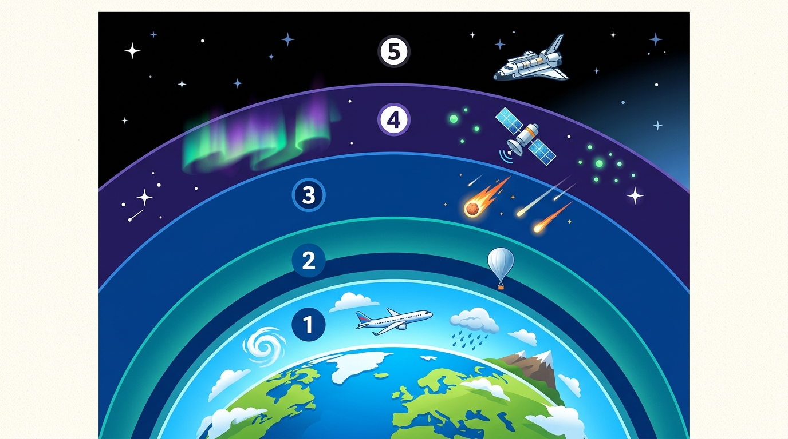

  

    ⚡ Progrés d'aprenentatge (8.2)
    0 / 3 reptes resolts
  

  

    

  

# 8.2 Les Capes de l'Atmosfera: De la Troposfera a l'Exosfera

L'atmosfera no és una massa de gas uniforme: a mesura que pugem en altura, la densitat de l'aire i la pressió disminueixen ràpidament. Atenent a com varia la **temperatura amb l'altitud**, distingim cinc capes principals:

*Figura 8.1: Distribució en altitud de les cinc capes de l'atmosfera terrestre: **(1)** Troposfera (vida, fenòmens meteorològics i navegació aèria), **(2)** Estratosfera (capa d'ozó $\text{O}_3$ absorbent de raigs UV), **(3)** Mesosfera (desintegració de meteoroides i estels fugaços), **(4)** Termosfera / Ionosfera (aurores boreals i satèl·lits artificials), **(5)** Exosfera (transició cap a l'espai exterior).*

---

## 1. La Troposfera ($0 - 12\text{ km}$)

- **La capa de la vida:** És la capa més baixa, en contacte directe amb el sòl i els oceans. Concentra el **$80\%$ de tot el pes de l'aire** i pràcticament el **$100\%$ del vapor d'aigua** de la Terra.
- **Fenòmens meteorològics:** Tots els canvis de temps que coneixem (núvols, pluges, tempestes, boira, vent i neu) ocorren exclusivament en aquesta capa.
- **Comportament de la temperatura:** A mesura que pugem en altura fa més fred: la temperatura **baixa aproximadament $6{,}5\text{ }^\circ\text{C}$ per cada quilòmetre** d'ascens, arribant fins a uns **$-55\text{ }^\circ\text{C}$** al sostre de la troposfera (on volen els avions de línia comercial per estalviar combustible evitant tempestes).

---

## 2. L'Estratosfera ($12 - 50\text{ km}$)

- **Ambient tranquil:** L'aire s'hi mou en corrents horitzontals sense turbulències verticals ni núvols d'aigua.
- **La Capa d'Ozó ($\text{O}_3$):** Entre els $20$ i els $30\text{ km}$ d'altitud se situa la màxima concentració d'ozó (l'ozonosfera). L'ozó absorbeix la perillosa radiació ultraviolada (UV) del Sol evitant que desseque i danye el material genètic dels éssers vius a terra.
- **Temperatura:** Com que l'ozó capta directament l'energia del Sol, en aquesta capa la temperatura **puja a mesura que ascendim**, fins a assolir aproximadament els $0\text{ }^\circ\text{C}$.

---

## 3. La Mesosfera ($50 - 80\text{ km}$)

- **La capa més gèlida:** La densitat de l'aire és ja molt baixa i la temperatura cau en picat a mesura que pugem, arribant fins a **$-90\text{ }^\circ\text{C}$ o $-100\text{ }^\circ\text{C}$ sota zero**.
- **Escut contra meteoroides:** Quan xicotetes partícules de pols i roques espacials entren a la mesosfera a desenes de milers de quilòmetres per hora, la fricció amb els gasos les incinera per complet, creant els **estels fugaços** que veiem a la nit.

---

## 4. La Termosfera o Ionosfera ($80 - 500\text{ km}$)

- **Aire ionitzat i temperatures extremes:** Els gasos residuals absorbeixen els raigs gamma i raigs X solars d'alta energia, provocant que les temperatures superen els **$1.000\text{ }^\circ\text{C}$**.
- **Telecomunicacions:** Les partícules de gas tenen càrrega elèctrica (ions), la qual cosa permet reflectir les ones de ràdio i emetre senyals de telecomunicacions d'un continent a un altre.
- **Aurores Polars:** Les partícules carregades del vent solar canalitzades pel camp magnètic terrestre xoquen contra la ionosfera generant cortines de llum fluorescent de colors verds i vermells (aurora boreal al nord i austral al sud).

---

## 5. L'Exosfera ($> 500\text{ km}$)

- És la capa externa que es difumina gradualment amb el buit de l'espai exterior.
- Les partícules de gas (principalment hidrogen i heli) estan tan separades que amb prou feines col·lideixen entre si.
- En aquesta regió orbiten la majoria dels satèl·lits artificials meteorològics i de comunicacions, així com l'**Estació Espacial Internacional (ISS)** a uns $400-420\text{ km}$ d'alçada.

---

## 💡 Resum de les Capes

| Capa | Altitud | Temperatura | Fet Clau |
| :--- | :---: | :---: | :--- |
| **Troposfera** | $0 - 12\text{ km}$ | Baixa fins a $-55\text{ }^\circ\text{C}$ | Vida i fenòmens del temps (pluja, núvols). |
| **Estratosfera**| $12 - 50\text{ km}$ | Puja fins a $0\text{ }^\circ\text{C}$ | **Capa d'ozó** (protecció contra radiació UV). |
| **Mesosfera** | $50 - 80\text{ km}$ | Baixa fins a $-90\text{ }^\circ\text{C}$ | La més freda; s'hi desintegren els **estels fugaços**. |
| **Termosfera** | $80 - 500\text{ km}$| Puja a $>1.000\text{ }^\circ\text{C}$| **Aurores polars** i reflex de telecomunicacions. |
| **Exosfera** | $> 500\text{ km}$ | Variable | Trànsit a l'espai; satèl·lits artificials. |

## 🎯 Activitats i Autoavaluació Interactiva

  

    🎮 <strong>Zona d'Entrenament FPB:</strong> 0 reptes resolts
    ⭐ 0 punts
  

  

### 1. Qüestionari d'Autoavaluació Tipus Test (MCQ)

  
<strong>1. En quina capa de l'atmosfera tenen lloc tots els fenòmens meteorològics com els núvols, el vent i la pluja?</strong>

  

    <button type="button" class="btn-mcq-opt" data-opt="A">A) A la troposfera (la capa en contacte directe amb la superfície)</button>
    <button type="button" class="btn-mcq-opt" data-opt="B">B) A l'estratosfera</button>
    <button type="button" class="btn-mcq-opt" data-opt="C">C) A la mesosfera</button>
    <button type="button" class="btn-mcq-opt" data-opt="D">D) A l'exosfera</button>
  

  

  
<strong>2. A quina capa atmosfèrica es localitza la concentració màxima d'ozó (capa d'ozó protectora)?</strong>

  

    <button type="button" class="btn-mcq-opt" data-opt="A">A) A la troposfera, arran de terra</button>
    <button type="button" class="btn-mcq-opt" data-opt="B">B) A la mesosfera</button>
    <button type="button" class="btn-mcq-opt" data-opt="C">C) A l'estratosfera (entre 15 i 35 km d'altitud)</button>
    <button type="button" class="btn-mcq-opt" data-opt="D">D) A la termosfera</button>
  

  

---

### 2. Activitats de Vertader (V) o Fals (F)

  <strong>a) A mesura que ascendim per la troposfera (per exemple pujant a una muntanya alta), la temperatura de l'aire va descendint progressivament.</strong>
  

    <button type="button" class="btn-vf" data-opt="V">V</button>
    <button type="button" class="btn-vf" data-opt="F">F</button>
  

  

  <strong>b) Les aurores boreals es produeixen dins de la troposfera a menys de 2 km d'alçada sobre les platges valencianes.</strong>
  

    <button type="button" class="btn-vf" data-opt="V">V</button>
    <button type="button" class="btn-vf" data-opt="F">F</button>
  

  

---

### 3. Exercicis de Resposta Breu i Identificació

  
✍️ Com s'anomena la primera capa de l'atmosfera que s'estén des del nivell del mar fins als 12 km d'altitud?

  

    <input type="text" class="quiz-input" placeholder="El teu resultat...">
    <button type="button" class="btn-quiz-check">Comprovar</button>
  

  

  
✍️ En quina capa d'elevadíssima temperatura orbiten l'Estació Espacial Internacional (ISS) i es formen les aurores boreals?

  

    <input type="text" class="quiz-input" placeholder="El teu resultat...">
    <button type="button" class="btn-quiz-check">Comprovar</button>
  

  

---

### 4. Pregunta de Raonament i Desenvolupament Escrit

  
✍️ <strong>Ordre i Funció de les Capes:</strong> Ordena de baix a dalt (des del terra cap a l'espai) les cinc capes de l'atmosfera terrestre i assenyala a quina d'elles volen els avions comercials de llarg radi i per quina raó solen triar la part baixa de l'estratosfera.

  <textarea class="open-response-input" rows="3" placeholder="Escriu ací l'ordre de les capes i l'explicació aeronàutica (menys turbulències, estalvi de combustible...)..."></textarea>

---

  <h3 style="margin-top:0; color:#0369a1;">📦 Lliurament d'Activitats d'Aules (Act 8.2)</h3>
  
Genera el teu document de tasca d'aquest apartat amb el teu nom i puntuació obtinguda.

  

    <input type="text" class="aules-student-name" placeholder="Cognoms, Nom de l'Alumne/a" style="padding:8px 12px; border:1px solid #94a3b8; border-radius:4px; flex-grow:1; min-width:240px;">
    <button class="btn-generate-aules-pdf" data-unit="UD08" data-activity="Act02" data-module="CA" style="padding:8px 16px; background:#0284c7; color:#fff; border:none; border-radius:4px; font-weight:600; cursor:pointer;">📄 Descarregar PDF per a Aules</button>
  

