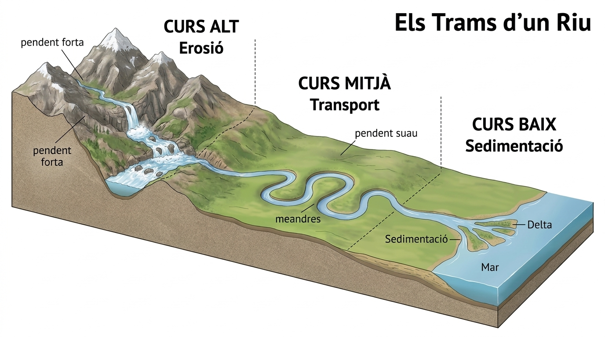

  

    ⚡ Progrés d'aprenentatge (9.2)
    0 / 3 reptes resolts
  

  

    

  

# 9.2 Les Aigües Marines i Continentals

L'aigua de la hidrosfera es distribueix en dos grans dominis amb característiques químiques i biològiques molt diferents: les **aigües marines** (oceans i mars) i les **aigües continentals** (rius, llacs, glaceres i aqüífers).

---

## 1. Les Aigües Marines: Oceans i Mars

Ocupen el $97\%$ de la hidrosfera i es caracteritzen per la seua elevada concentració de sals minerals:

- **La Salinitat:** L'aigua marina té una mitjana de **$35\text{ grams de sals}$ per cada litre d'aigua** ($35\text{ g/L}$ o $35\text{ ‰}$). La sal més abundant és el **clorur de sodi ($\text{NaCl}$)**, que és la mateixa sal comuna de cuina, acompanyada de sals de magnesi, calci i potassi.
- **Els Tres Moviments de les Aigües Oceàniques:**
  1. **Les Onades:** Ondulacions superficials provocades pel frec continu del vent sobre la làmina d'aigua. A mar obert l'aigua només puja i baixa formant cercles sense avançar, però en arribar a la costa trenca amb força modelant platges i penya-segats.
  2. **Les Marees:** Ascensos (pleamar) i descensos (baixamar) periòdics del nivell de l'aigua generats per la gravetat combinada de la Lluna i el Sol.
  3. **Els Corrents Oceànics:** Immensos "rius d'aigua dins del mar" que recorren milers de quilòmetres. Poden ser càlids o freds segons el seu origen. Per exemple, el **Corrent del Golf** transporta aigua càlida des del golf de Mèxic fins a les costes d'Europa Occidental, evitant que països com el Regne Unit o Noruega es congelen durant l'hivern.

---

## 2. Les Aigües Continentals: Aigua Dolça

Tenen una salinitat molt baixa (menys de $0{,}5\text{ g/L}$) i són la base del proveïment d'aigua de les societats humanes i dels ecosistemes terrestres:

*Figura: Perfil longitudinal d'un curs fluvial des de la capçalera a l'alta muntanya (Curs Alt, forta erosió), el tram intermedi de vall oberta amb meandres (Curs Mitjà, transport) i la plana al·luvial de desembocadura (Curs Baix, sedimentació).*

### A) Els Rius
Corrents naturals continus d'aigua dolça que desemboquen en un altre riu (com a afluent), en un llac o a la mar. En el seu recorregut es distingeixen tres trams:
1. **Curs Alt:** A les zones de muntanya. El desnivell és fort i l'aigua baixa a gran velocitat. L'acció dominant és l'**erosió**, excavant gorges profundes i valls estretes en forma de "V".
2. **Curs Mitjà:** El pendent disminueix i el cabal augmenta en rebre afluents. L'acció dominant és el **transport** de graves i arenes, formant corbes pronunciades anomenades **meandres**.
3. **Curs Baix:** A prop de la desembocadura a la costa. El corrent és molt lent i l'acció dominant és la **sedimentació** dels materials fins, donant lloc a fèrtils planes al·luvials i a **deltes** (acumulació de terra que avança cap al mar) o **estuaris**.

---

### B) Llacs i Llacunes
Masses permanents d'aigua que s'acumulen en depressions naturals del relleu terrestre. Exemples propers són l'**Albufera de València** o les llacunes de Ruidera.

---

### C) Les Glaceres
Gegantines masses de gel dolç compacte que es formen per acumulació i premsatge de neu en zones d'alta muntanya o als pols. Flueixen molt lentament per la força de la gravetat, excavant valls característiques en forma de **"U"**.

---

### D) Les Aigües Subterrànies i els Aqüífers
Quan plou, part de l'aigua s'infiltra a través dels porus de les roques permeables (com les calcàries i arenes) fins que topa amb un estrat de roca impermeable (com les argiles). L'aigua s'acumula empapant el subsòl i formant un **aqüífer**:
- **Nivell freàtic:** El nivell o alçada màxima que assoleix l'aigua subterrània dins de l'aqüífer.
- **Fonts o Manantials:** Sortides naturals per on l'aigua subterrània brolla espontàniament a la superfície quan el terreny talla el nivell freàtic.
- **Pous:** Perforacions artificials realitzades per l'ésser humà per bombejar aigua dolça cap a la superfície per a regar camps o proveir ciutats.

## 🎯 Activitats i Autoavaluació Interactiva

  

    🎮 <strong>Zona d'Entrenament FPB:</strong> 0 reptes resolts
    ⭐ 0 punts
  

  

### 1. Qüestionari d'Autoavaluació Tipus Test (MCQ)

  
<strong>1. Quina acció geològica predomina amb força al curs alt d'un riu de muntanya amb fort pendent?</strong>

  

    <button type="button" class="btn-mcq-opt" data-opt="A">A) L'erosió vertical excavant valls estretes en forma de 'V' i congostos</button>
    <button type="button" class="btn-mcq-opt" data-opt="B">B) La sedimentació massiva de fang i arena formant deltes</button>
    <button type="button" class="btn-mcq-opt" data-opt="C">C) La formació de meandres en planes d'inundació amples</button>
    <button type="button" class="btn-mcq-opt" data-opt="D">D) La desaparició completa del cabal d'aigua</button>
  

  

  
<strong>2. Quina és la concentració mitjana de sal que conté l'aigua dels oceans i mars del nostre planeta?</strong>

  

    <button type="button" class="btn-mcq-opt" data-opt="A">A) 5 grams per litre</button>
    <button type="button" class="btn-mcq-opt" data-opt="B">B) 100 grams per litre</button>
    <button type="button" class="btn-mcq-opt" data-opt="C">C) Aproximadament 35 grams de sal per litre d'aigua (35 ‰)</button>
    <button type="button" class="btn-mcq-opt" data-opt="D">D) 0 grams perquè és aigua purificada</button>
  

  

---

### 2. Activitats de Vertader (V) o Fals (F)

  <strong>a) Els meandres són pronunciades corbes fluvials característiques dels cursos mitjans i baixos dels rius on la velocitat del corrent disminueix.</strong>
  

    <button type="button" class="btn-vf" data-opt="V">V</button>
    <button type="button" class="btn-vf" data-opt="F">F</button>
  

  

  <strong>b) Les onades de la platja són causades directament per l'atracció de la gravetat lunar i mai pel vent.</strong>
  

    <button type="button" class="btn-vf" data-opt="V">V</button>
    <button type="button" class="btn-vf" data-opt="F">F</button>
  

  

---

### 3. Exercicis de Resposta Breu i Identificació

  
✍️ Com s'anomena la desembocadura fluvial de forma triangular on els sediments s'acumulen perquè el mar és tranquil?

  

    <input type="text" class="quiz-input" placeholder="El teu resultat...">
    <button type="button" class="btn-quiz-check">Comprovar</button>
  

  

  
✍️ Quants grams de sal dissolta hi ha de mitjana en 1 litre d'aigua de mar oceànica?

  

    <input type="text" class="quiz-input" placeholder="Ex: 35 g/L...">
    <button type="button" class="btn-quiz-check">Comprovar</button>
  

  

---

### 4. Pregunta de Raonament i Desenvolupament Escrit

  
✍️ <strong>Els Trams d'un Riu Valencià (Curs Alt, Mitjà i Baix):</strong> Compara el comportament d'un riu valencià (com el Xúquer o el Túria) en el seu curs alt de muntanya respecte al seu curs baix a la desembocadura. Com canvia la velocitat de l'aigua, la forma de la llera i la mida de les pedres o sediments que arrossega?

  <textarea class="open-response-input" rows="3" placeholder="Escriu ací la teua comparativa (pendent, velocitat, pedres grans vs fangs fins, deltes/albuferes...)..."></textarea>

---

  <h3 style="margin-top:0; color:#0369a1;">📦 Lliurament d'Activitats d'Aules (Act 9.2)</h3>
  
Genera el teu document de tasca d'aquest apartat amb el teu nom i puntuació obtinguda.

  

    <input type="text" class="aules-student-name" placeholder="Cognoms, Nom de l'Alumne/a" style="padding:8px 12px; border:1px solid #94a3b8; border-radius:4px; flex-grow:1; min-width:240px;">
    <button class="btn-generate-aules-pdf" data-unit="UD09" data-activity="Act02" data-module="CA" style="padding:8px 16px; background:#0284c7; color:#fff; border:none; border-radius:4px; font-weight:600; cursor:pointer;">📄 Descarregar PDF per a Aules</button>
  

