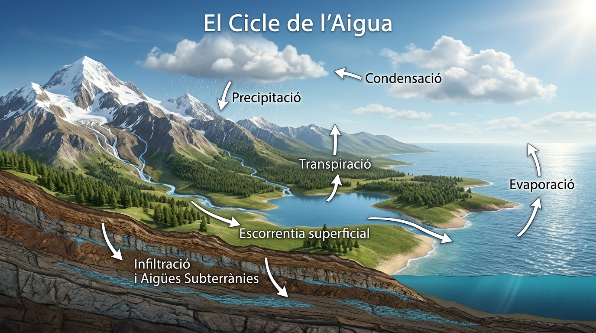

  

    ⚡ Progrés d'aprenentatge (9.3)
    0 / 3 reptes resolts
  

  

    

  

# 9.3 El Cicle Hidrològic de l'Aigua

L'aigua del nostre planeta no roman immòbil ni es perd a l'espai: es troba en un **procés continu de circulació i canvi d'estat** conegut com el **cicle de l'aigua** o cicle hidrològic.

*Figura: El Cicle Hidrològic Natural de la Terra: evaporació marítima i transpiració vegetal, condensació en núvols, precipitació en forma de pluja i neu, infiltració freàtica i retorn continu al mar.*

---

## 1. Els Dos Motors del Cicle de l'Aigua

El cicle hidrològic és possible gràcies a dues forces naturals incansables:
1. **L'Energia Solar:** El Sol escalfa la superfície del mar i de la terra, provocant l'evaporació de l'aigua i impulsant el seu ascens cap a l'atmosfera.
2. **La Força de la Gravetat:** Atreu l'aigua cap avall, fent possible que els núvols descarreguen pluja o neu, i que els rius i aqüífers subterrànis córreguen cap al mar.

> [!NOTE]
> ### Una Quantitat d'Aigua Sempre Constant
> La quantitat total d'aigua a la Terra és pràcticament la mateixa des de fa milers de milions d'anys. L'aigua que ix de la teua aixeta hui és exactament la mateixa molècula d'aigua que bevien els dinosaures o que navegaven els vaixells vikings.

---

## 2. Les Etapes del Cicle Pas a Pas

### 1. Evaporació
El calor del Sol converteix l'aigua líquida dels oceans, mars, llacs i rius en **vapor d'aigua** invisible. Com que el vapor és menys dens que l'aire circumdant, ascendeix cap a les capes mitjanes de la troposfera.

### 2. Evapotranspiració
Els éssers vius de la biosfera també participen activament: les plantes absorbeixen aigua del sòl per les arrels i n'expulsen una part en forma de vapor a través dels estomes de les fulles (*transpiració vegetal*). Els animals també alliberem vapor d'aigua a través de la respiració i la suor.

### 3. Condensació
A mesura que el vapor d'aigua puja per la troposfera, la temperatura disminueix. En refredar-se, el vapor canvia d'estat i passa a ser aigua líquida formant gotetes microscòpiques que suren en l'aire. Aquestes gotetes s'agrupen formant els **núvols** i la boira.

### 4. Precipitació
Quan les gotetes d'aigua dels núvols xoquen entre si, creixen i es fan massa pesades per a continuar surant. Aleshores cauen per gravetat en forma de:
- **Pluja:** Si la temperatura ambiental és superior a $0\text{ }^\circ\text{C}$.
- **Neu o Calamarsa:** Si la temperatura a l'atmosfera és igual o inferior a $0\text{ }^\circ\text{C}$ (precipitació sòlida).

### 5. Escolament Superficial (Esgorrentia)
L'aigua de la pluja o del desglaç de la neu que no és absorbida pel terreny flueix sobre la superfície per la força de la gravetat, unint-se en torrents, barrancs i rius que la transporten de retorn cap als llacs o als oceans.

### 6. Infiltració i Circulació Subterrània
Una part important de l'aigua precipitada penetra verticalment a través dels porus de la terra i les esquerdes de les roques (**infiltració**). Aquesta aigua dolça alimenta els aqüífers i flueix lentament de manera subterrània fins a brollar en fonts o desembocar directament al mar, tancant completament el cicle.

## 🎯 Activitats i Autoavaluació Interactiva

  

    🎮 <strong>Zona d'Entrenament FPB:</strong> 0 reptes resolts
    ⭐ 0 punts
  

  

### 1. Qüestionari d'Autoavaluació Tipus Test (MCQ)

  
<strong>1. Quins són els dos motors naturals que impulsen sense parar el cicle hidrològic de l'aigua a tot el planeta?</strong>

  

    <button type="button" class="btn-mcq-opt" data-opt="A">A) El vent i la rotació de la Lluna</button>
    <button type="button" class="btn-mcq-opt" data-opt="B">B) La pressió de les marees i els terratrèmols submarins</button>
    <button type="button" class="btn-mcq-opt" data-opt="C">C) L'energia radiant del Sol (calor d'evaporació) i la gravetat de la Terra</button>
    <button type="button" class="btn-mcq-opt" data-opt="D">D) La combustió dels boscos i les corrents elèctriques</button>
  

  

  
<strong>2. Com s'anomena el procés pel qual la vegetació dels boscos allibera vapor d'aigua cap a l'atmosfera a través de les seues fulles?</strong>

  

    <button type="button" class="btn-mcq-opt" data-opt="A">A) Sublimació inversa</button>
    <button type="button" class="btn-mcq-opt" data-opt="B">B) Evapotranspiració vegetal</button>
    <button type="button" class="btn-mcq-opt" data-opt="C">C) Infiltració capil·lar</button>
    <button type="button" class="btn-mcq-opt" data-opt="D">D) Condensació fotosintètica</button>
  

  

---

### 2. Activitats de Vertader (V) o Fals (F)

  <strong>a) El cicle de l'aigua és un cicle biogeoquímic tancat: la quantitat total d'aigua a la Terra és pràcticament la mateixa des de fa milions d'anys.</strong>
  

    <button type="button" class="btn-vf" data-opt="V">V</button>
    <button type="button" class="btn-vf" data-opt="F">F</button>
  

  

  <strong>b) Quan l'aigua de mar s'evapora pel Sol, els núvols s'omplin d'aigua salada i per això plou aigua de mar sobre els camps de cultiu.</strong>
  

    <button type="button" class="btn-vf" data-opt="V">V</button>
    <button type="button" class="btn-vf" data-opt="F">F</button>
  

  

---

### 3. Exercicis de Resposta Breu i Identificació

  
✍️ Quin canvi d'estat físic es produeix quan el vapor d'aigua calent puja, es refreda en altura i forma els núvols?

  

    <input type="text" class="quiz-input" placeholder="El teu resultat...">
    <button type="button" class="btn-quiz-check">Comprovar</button>
  

  

  
✍️ Com s'anomena el procés pel qual l'aigua de la pluja travessa el sòl permeable per a recarregar els aqüífers subterranis?

  

    <input type="text" class="quiz-input" placeholder="El teu resultat...">
    <button type="button" class="btn-quiz-check">Comprovar</button>
  

  

---

### 4. Pregunta de Raonament i Desenvolupament Escrit

  
✍️ <strong>Urbanització i Escorrentia Superficial:</strong> Quan s'asfalta completament un poble o polígon industrial sense zones verdes, com afecta això a les fases d'infiltració i d'escorrentia del cicle de l'aigua durant una DANA o gota freda? Quins riscos d'inundació genera?

  <textarea class="open-response-input" rows="3" placeholder="Escriu ací la teua anàlisi (sòl impermeable, impossibilitat d'infiltrar, torrentada ràpida de l'aigua...)..."></textarea>

---

  <h3 style="margin-top:0; color:#0369a1;">📦 Lliurament d'Activitats d'Aules (Act 9.3)</h3>
  
Genera el teu document de tasca d'aquest apartat amb el teu nom i puntuació obtinguda.

  

    <input type="text" class="aules-student-name" placeholder="Cognoms, Nom de l'Alumne/a" style="padding:8px 12px; border:1px solid #94a3b8; border-radius:4px; flex-grow:1; min-width:240px;">
    <button class="btn-generate-aules-pdf" data-unit="UD09" data-activity="Act03" data-module="CA" style="padding:8px 16px; background:#0284c7; color:#fff; border:none; border-radius:4px; font-weight:600; cursor:pointer;">📄 Descarregar PDF per a Aules</button>
  

