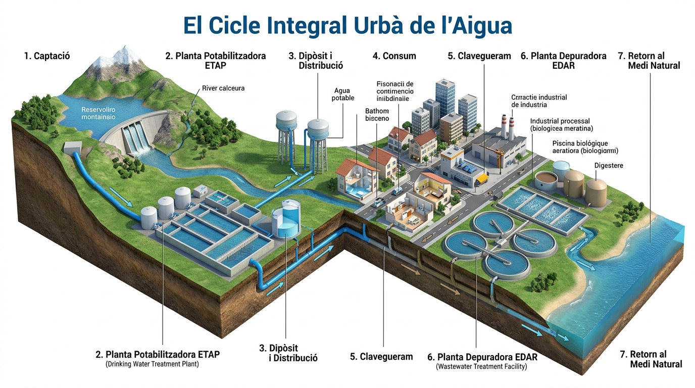

# 9.4 Gestió Sostenible de l'Aigua, Contaminació i Activitats

L'aigua dolça neta és un recurs natural essencial, fràgil i limitat. El creixement de la població mundial, la intensificació agrícola i el canvi climàtic converteixen la gestió de l'aigua en un dels reptes més urgents del segle XXI.

---

## 1. El Cicle Urbà de l'Aigua

L'aigua que utilitzem cada dia a les nostres cases passa per un complex recorregut tecnològic conegut com el **cicle integral de l'aigua**:

*Figura: El cicle de l'aigua en les societats humanes: captació des del medi natural, tractament de potabilització (ETAP), xarxa de distribució domèstica i industrial, xarxa de clavegueram, estació depuradora (EDAR) i retorn d'aigua depurada al riu o mar.*

1. **Captació:** L'aigua s'extrau de rius, embassaments, aqüífers subterranis o directament del mar mitjançant plantes dessaladores.
2. **Potabilització (a la planta ETAP):** L'**Estació de Tractament d'Aigua Potable (ETAP)** transforma l'aigua bruta natural en aigua apta per al consum humà sense cap risc per a la salut:
   - Desbast (reixes que lleven branques i plàstics).
   - Floculació i decantació (es precipita la terra i el fang al fons).
   - Filtratge per capes de sorra i carbó actiu.
   - **Cloració o Desinfecció:** Addició de clor o ozó per a eliminar tots els microbis, bacteris i virus patògens.
3. **Distribució i Consum:** L'aigua viatja per canonades a pressió fins a les aixetes de llars, hospitals i indústries.
4. **Xarxa de Clavegueram:** L'aigua utilitzada i bruta (aigües residuals) s'evacua pels desguassos i clavegueres.
5. **Depuració (a la planta EDAR):** L'**Estació Depuradora d'Aigües Residuals (EDAR)** neteja l'aigua bruta abans de retornar-la als rius o a la mar perquè no contamine els ecosistemes:
   - Tractament físic (separació de greixos i sòlids en suspensió).
   - Tractament biològic (bancs de bacteris que es mengen la matèria orgànica).
   - Desinfecció final (per a poder reutilitzar-la en el reg de parcs i agricultura).

---

## 2. Principals Fonts de Contaminació de l'Aigua

| Tipus de Contaminació | Causes Principals | Conseqüències per al Medi Ambient |
| :--- | :--- | :--- |
| **Agrícola i Ramadera** | Ús excessiu d'adobs químics (nitrats i fosfats) i purins d'animals. | Filtració a aqüífers i **eutrofització**: proliferació massiva d'algues a llacs i llacunes que consumeixen tot l'oxigen de l'aigua, provocant la mort massiva de peixos per asfíxia. |
| **Industrial** | Abocament de productes químics, hidrocarburs, dissolvents i metalls pesants (plom, mercuri, cadmi). | Toxicitat greu i bioacumulació a la cadena tròfica marina fins a arribar als humans en menjar peix contaminat. |
| **Urbana i Domèstica** | Aigües fecals sense tractar, detergents, olis de cuina llençats per l'aigüera, tovalletes humides i **microplàstics**. | Embús del clavegueram, propagació de malalties infeccioses i ingestió de microplàstics per la fauna aquàtica. |

---

## 3. Què Podem Fer? Hàbits d'Estalvi i la Petjada Hídrica

La **petjada hídrica** és el volum total d'aigua dolça utilitzat directa o indirectament per a produir els béns, roba i aliments que consumim:
- Per a produir una samarreta de cotó es necessiten uns **$2.500\text{ litres}$ d'aigua**.
- Per a obtindre $1\text{ kg}$ de carn de vedella es necessiten vora **$15.000\text{ litres}$ d'aigua**.

### Decàleg Ciutadà per a Estalviar Aigua:
1. **Dutxa't en lloc de banyar-te:** Una dutxa curta de 5 minuts gasta uns $50\text{ L}$; omplir la banyera en gasta més de $200\text{ L}$.
2. **Tanca l'aixeta:** Mentre et rentes les dents, t'afaites o ensabones els plats (estalviaràs fins a $12\text{ litres}$ per minut).
3. **Cisternes de doble polsador:** Utilitza la descàrrega xicoteta ($3\text{ L}$) en lloc de la sencera ($6\text{ L}$).
4. **Electrodomèstics eficients:** Posa la rentadora i el rentavaixella només quan estiguen completament plens.
5. **No tires oli ni tovalletes pel vàter:** L'oli usat contamina milers de litres d'aigua; diposita'l en un punt net. El vàter no és una paperera.

---

## 📝 Butlletí d'Activitats d'Avaluació

  

    🎮 <strong>Zona d'Entrenament FPB:</strong> 0 reptes resolts
    ⭐ 0 punts
  

  

### 1. Activitats de Vertader (V) o Fals (F) sobre la Hidrosfera

  <strong>a) L'aigua dolça superficial líquida (rius i llacs) representa menys de l'1% de tota l'aigua dolça del planeta.</strong>
  

    <button type="button" class="btn-vf" data-opt="V">V</button>
    <button type="button" class="btn-vf" data-opt="F">F</button>
  

  

  <strong>b) El gel d'aigua té una densitat anòmala menor que la de l'aigua líquida, motiu pel qual sura protegint la vida aquàtica inferior del fred extrem.</strong>
  

    <button type="button" class="btn-vf" data-opt="V">V</button>
    <button type="button" class="btn-vf" data-opt="F">F</button>
  

  

  <strong>c) Una EDAR és la instal·lació que recull l'aigua bruta d'un pantà o riu per potabilitzar-la i enviar-la a les aixetes.</strong>
  

    <button type="button" class="btn-vf" data-opt="V">V</button>
    <button type="button" class="btn-vf" data-opt="F">F</button>
  

  

---

### 2. Qüestionari d'Autoavaluació Tipus Test

  
<strong>1. Quin sector econòmic concentra aproximadament el 70% del consum d'aigua dolça global de la humanitat?</strong>

  

    <button type="button" class="btn-mcq-opt" data-opt="A">A) El sector energètic</button>
    <button type="button" class="btn-mcq-opt" data-opt="B">B) L'agricultura i els cultius de regadiu</button>
    <button type="button" class="btn-mcq-opt" data-opt="C">C) L'ús domèstic a les llars</button>
    <button type="button" class="btn-mcq-opt" data-opt="D">D) La mineria industrial</button>
  

  

  
<strong>2. A quina temperatura exacta té l'aigua líquida la seua màxima densitat física (1.000 kg/m³)?</strong>

  

    <button type="button" class="btn-mcq-opt" data-opt="A">A) A 0 °C</button>
    <button type="button" class="btn-mcq-opt" data-opt="B">B) A 4 °C</button>
    <button type="button" class="btn-mcq-opt" data-opt="C">C) A 20 °C</button>
    <button type="button" class="btn-mcq-opt" data-opt="D">D) A 100 °C</button>
  

  

---

  <h3 style="margin-top:0; color:#0369a1;">📦 Lliurament d'Activitats d'Aules (Act 9.4)</h3>
  
Genera el teu document de tasca d'aquest apartat amb el teu nom i puntuació obtinguda.

  

    <input type="text" class="aules-student-name" placeholder="Cognoms, Nom de l'Alumne/a" style="padding:8px 12px; border:1px solid #94a3b8; border-radius:4px; flex-grow:1; min-width:240px;">
    <button class="btn-generate-aules-pdf" data-unit="UD09" data-activity="Act04" data-module="CA" style="padding:8px 16px; background:#0284c7; color:#fff; border:none; border-radius:4px; font-weight:600; cursor:pointer;">📄 Descarregar PDF per a Aules</button>
  

