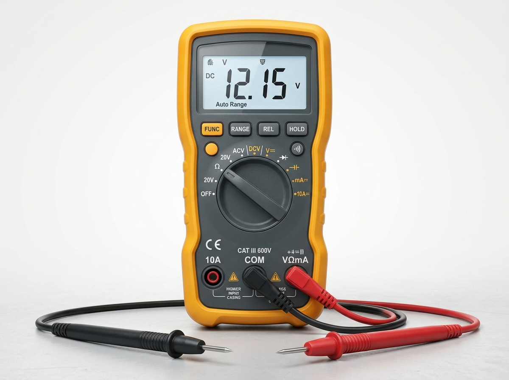

# 1.4 Codi de colors de resistències i mesura amb el polímetre

Al taller d'informàtica, el **polímetre (o multímetre digital)** és l'eina de diagnòstic elèctric més important. Permet comprovar si una font d'alimentació lliura els voltatges correctes (12 V, 5 V, 3,3 V), si un cable té un fil tallat per dins mitjançant la prova de continuïtat sonora, o esbrinar el valor d'una resistència.

---

## 🎨 1. El Codi de Colors de les Resistències

A les resistències tradicionals amb patilles (through-hole), el seu valor en Ohms ($\Omega$) s'identifica mitjançant franges o bandes de colors impreses al cos:

| Color de la Banda | Xifra (1a i 2a Banda) | Multiplicador (3a Banda) | Tolerància (4a Banda) |
| :--- | :---: | :---: | :---: |
| **Negre** | 0 | $\times 10^0$ ($1$) | - |
| **Marró** | 1 | $\times 10^1$ ($10$) | $\pm 1\%$ |
| **Roig** | 2 | $\times 10^2$ ($100$) | $\pm 2\%$ |
| **Taronja** | 3 | $\times 10^3$ ($1.000$ / $1\text{ k}\Omega$) | - |
| **Groc** | 4 | $\times 10^4$ ($10.000$) | - |
| **Verd** | 5 | $\times 10^5$ ($100.000$) | $\pm 0,5\%$ |
| **Blau** | 6 | $\times 10^6$ ($1.000.000$ / $1\text{ M}\Omega$) | $\pm 0,25\%$ |
| **Violeta** | 7 | $\times 10^7$ | $\pm 0,1\%$ |
| **Gris** | 8 | $\times 10^8$ | - |
| **Blanc** | 9 | $\times 10^9$ | - |
| **Or (Daurat)** | - | $\times 0,1$ | **$\pm 5\%$** (Més comú) |
| **Plata** | - | $\times 0,01$ | **$\pm 10\%$** |

### Procediment de Lectura de 4 Bandes:
1. Posa la resistència amb la franja daurada o platejada (tolerància) cap a la **dreta**.
2. **1a Banda:** Primera xifra significativa.
3. **2a Banda:** Segona xifra significativa.
4. **3a Banda:** Multiplicador (nombre de zeros que s'afigen).
5. **4a Banda:** Percentatge de tolerància de fabricació.

> [!TIP]
> **Exemple Pràctic:**
> Una resistència té els colors: **Marró - Negre - Roig - Or**.
> - Marró = $1$
> - Negre = $0$ (forma el número $10$)
> - Roig = $\times 100$ ($10 \times 100 = 1.000\ \Omega = 1\text{ k}\Omega$)
> - Or = $\pm 5\%$ de tolerància.
> - **Valor nominal: $1\text{ k}\Omega \pm 5\%$** (pot mesurar entre 950 $\Omega$ i 1050 $\Omega$).

---

## 🕹️ Mini-Simulador Interactiu: Descodificador de Codi de Colors

Pots calcular qualsevol resistència de 4 bandes seleccionant els colors:

  <h4 style="margin-top:0;">🧮 Calculadora de Resistències de 4 Bandes</h4>
  

    

      <label style="font-size: 0.85rem; font-weight: 600;">1a Banda (Dècades):</label>
      <select id="res-b1" style="width: 100%; padding: 6px; border-radius: 6px; border: 1px solid var(--border);">
        <option value="1">Marró (1)</option>
        <option value="2">Roig (2)</option>
        <option value="3">Taronja (3)</option>
        <option value="4">Groc (4)</option>
        <option value="5">Verd (5)</option>
        <option value="6">Blau (6)</option>
        <option value="7">Violeta (7)</option>
        <option value="8">Gris (8)</option>
        <option value="9">Blanc (9)</option>
      </select>
    

    

      <label style="font-size: 0.85rem; font-weight: 600;">2a Banda (Unitats):</label>
      <select id="res-b2" style="width: 100%; padding: 6px; border-radius: 6px; border: 1px solid var(--border);">
        <option value="0">Negre (0)</option>
        <option value="1">Marró (1)</option>
        <option value="2">Roig (2)</option>
        <option value="3">Taronja (3)</option>
        <option value="4">Groc (4)</option>
        <option value="5">Verd (5)</option>
        <option value="6">Blau (6)</option>
        <option value="7">Violeta (7)</option>
        <option value="8">Gris (8)</option>
        <option value="9">Blanc (9)</option>
      </select>
    

    

      <label style="font-size: 0.85rem; font-weight: 600;">3a Banda (Multiplicador):</label>
      <select id="res-b3" style="width: 100%; padding: 6px; border-radius: 6px; border: 1px solid var(--border);">
        <option value="1">Negre (x1)</option>
        <option value="10">Marró (x10)</option>
        <option value="100" selected>Roig (x100)</option>
        <option value="1000">Taronja (x1k)</option>
        <option value="10000">Groc (x10k)</option>
        <option value="100000">Verd (x100k)</option>
        <option value="1000000">Blau (x1M)</option>
      </select>
    

    

      <label style="font-size: 0.85rem; font-weight: 600;">4a Banda (Tolerància):</label>
      <select id="res-b4" style="width: 100%; padding: 6px; border-radius: 6px; border: 1px solid var(--border);">
        <option value="5" selected>Or (±5%)</option>
        <option value="10">Plata (±10%)</option>
        <option value="1">Marró (±1%)</option>
      </select>
    

  

  

    Valor Resultant: 1.000 Ω (1 kΩ) ± 5%
  

---

## 📟 2. L'ús del Polímetre (Multímetre Digital) al Taller

El polímetre digital és l'instrument fonamental de diagnòstic a taller. Disposa d'una pantalla digital LCD, una roda selectora de magnituds i diverses bornes de connexió per a les puntes de prova:

*Figura 1.4: Polímetre digital de taller configurat per a mesurar tensió contínua (DCV). La punta negra està connectada al port de referència COM i la punta roja al port de mesura de voltatge i resistència (V/Ω/mA).*

### Connexió correcta de les puntes de prova:
- **Punta NEGRA:** Sempre es connecta al connector **`COM`** (Common / Massa de referència).
- **Punta ROJA:** Es connecta al connector **`V / Ω / Hz`** per a mesures de voltatge, resistència i continuïtat. *(Només es mou al connector de 10A/20A quan es va a mesurar un corrent elevat en sèrie)*.

### Les tres proves imprescindibles a taller de muntatge:
1. **Prova de Continuïtat (Símbol de díode / xiulet 🔊):**
   - Si les dues puntes es toquen o hi ha un camí metàl·lic continu, el polímetre emet un **xiulet sonor** i marca $0{,}00\ \Omega$.
   - **Aplicació a taller:** Comprovar si un fusible està fos, si les pistes d'una placa estan tallades o si els fils d'un connector Power Switch fan contacte net.
2. **Mesura de Tensió Contínua (DCV ⎓):**
   - Selecciona l'escala de **20 V DC**.
   - Col·loca la punta negra al xassís metàl·lic o a un cable negre (GND) del connector de la font ATX.
   - Col·loca la punta roja al cable groc (+12 V), roig (+5 V) o taronja (+3,3 V).
3. **Mesura de Resistència (Ohmímetre $\Omega$):**
   - **Molt important:** La mesura de resistència s'ha de fer **SEMPRE AMB EL CIRCUIT DESCONNECTAT I SENSE CAP TENSIÓ**. Mesurar resistències amb corrent pot cremar el fusible intern del polímetre.

---

## 🎯 Zona d'Entrenament FPB: Comprovació Ràpida (4 Reptes)

  

    🎯 <strong>Zona d'Entrenament FPB:</strong> 0 reptes resolts
    🏆 0 punts
  

  

  
1️⃣ A quin connector o borna del polímetre s'ha d'endollar sempre la punta de prova negra?

  

    <input type="text" class="quiz-input" placeholder="Escriu les 3 lletres...">
    <button type="button" class="btn-quiz-check">Comprovar</button>
  

  

  
2️⃣ Què val una resistència amb les bandes Groc - Violeta - Roig - Or?

  

    <button type="button" class="btn-mcq-opt" data-opt="A">A) 470 Ω ± 5%</button>
    <button type="button" class="btn-mcq-opt" data-opt="B">B) 4,7 kΩ (4.700 Ω) ± 5%</button>
    <button type="button" class="btn-mcq-opt" data-opt="C">C) 47 kΩ ± 10%</button>
  

  

  
3️⃣ Quina funció del polímetre utilitzem per saber ràpidament si un fusible està trencat o un cable està tallat?

  

    <button type="button" class="btn-mcq-opt" data-opt="A">A) Prova de continuïtat sonora (bip)</button>
    <button type="button" class="btn-mcq-opt" data-opt="B">B) Mesura de capacitat en Farads</button>
    <button type="button" class="btn-mcq-opt" data-opt="C">C) Freqüència en Hertz</button>
  

  

  
4️⃣ Abans de mesurar la resistència d'un component amb el polímetre, l'ordinador ha d'estar completament desconnectat de la xarxa elèctrica.

  

    <button type="button" class="btn-vf" data-opt="V">Vertader</button>
    <button type="button" class="btn-vf" data-opt="F">Fals</button>
  

  

---

## 📋 Llista de Comprovació de Taller (Checklist Pràctic)
- [ ] Sé col·locar les puntes del polímetre (negra a COM, roja a V/Ω).
- [ ] He practicat la descodificació de resistències amb el mini-simulador.
- [ ] Sé utilitzar el test de continuïtat sonora per verificar cables i fusibles.
- [ ] Recorde que la mesura de resistències es fa sempre sense tensió.

---

## 📥 Comprovant de Lliurament per a Aules

  <h3>📥 Comprovant de Lliurament per a Aules (Act 1.4)</h3>
  
En acabar els reptes interactius i les fitxes de taller d'aquest apartat, genera el teu informe oficial per adjuntar-lo al lliurament de la tasca d'Aules:

  

    <label for="aules-student-name">Nom i Cognoms de l'alumne/a:</label>
    <input type="text" id="aules-student-name" placeholder="Ex: Pere Martí Soler">
  

  

    Calculant resultats dels reptes...
  

  

    <button type="button" class="btn-aules-copy">📋 Copiar Resum per a Aules</button>
    <button type="button" class="btn-aules-dl" data-module="MMSCI" data-unit="UD01" data-activity="Act04">📄 Descarregar Comprovant (.pdf)</button>
  

  

