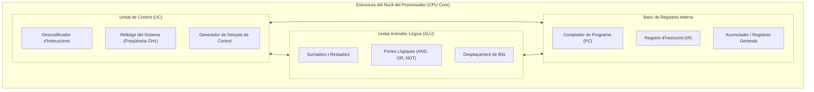

# 2.2 La CPU: Unitat de Control (UC), ALU i Registres

El microprocessador o **CPU (Central Processing Unit)** és el component més complex d'un ordinador. Dins d'un xip de silici de pocs centímetres quadrats hi ha integrats milers de milions de transistors microscòpics que treballen a velocitats de milers de milions de cicles per segon (Gigahertz, GHz).

---

## 🧠 1. Estructura Interna del Processador

Dins de qualsevol nucli modern de CPU trobem tres elements clau:

1. **Unitat de Control (UC):** Coordina totes les activitats. Llig la instrucció de la memòria, la descodifica i envia ordres elèctriques a la resta de components.
2. **Unitat Aritmeticològica (ALU):** La «calculadora» física. Fa operacions aritmètiques (suma, resta, multiplicació) i lògiques (AND, OR, NOT, comparacions de major/menor).
3. **Registres Interns:** Xicotetes cel·les de memòria ultraràpides situades dins mateix del silici. Són les memòries més ràpides que existeixen al PC (temps d'accés de fracció de nanosegon).

---

## ⚡ 2. Nuclis, Fils i Freqüència de Rellotge

En triar un microprocessador per a un ordinador de taller (com un Intel Core i5 o un AMD Ryzen 5), ens fixem en:

| Característica | Què significa tècnicament? | Exemple Pràctic |
| :--- | :--- | :--- |
| **Nuclis Físics (Cores)** | Processadors independents complets dins del mateix xip de silici. Cada nucli pot executar una tasca simultània real. | 6 nuclis = 6 tasques pesades paral·leles. |
| **Fils (Threads / Multithreading)** | Tecnologia (Intel Hyper-Threading o AMD SMT) que permet a cada nucli físic gestionar 2 cues de tasques quan una d'elles espera dades de la RAM. | 6 nuclis / 12 fils lògics. |
| **Freqüència Base (GHz)** | Velocitat normal de funcionament del rellotge intern (1 GHz = 1.000 milions de cicles/segon). | 3,5 GHz = 3.500 milions d'impulsos per segon. |
| **Freqüència Turbo / Boost** | Velocitat màxima que assoleix un nucli quan una tasca requereix màxima potència i la temperatura és segura. | 4,8 GHz en pic de rendiment. |

---

## 🎯 Zona d'Entrenament FPB: Comprovació Ràpida (4 Reptes)

  

    🎯 <strong>Zona d'Entrenament FPB:</strong> 0 reptes resolts
    🏆 0 punts
  

  

  
1️⃣ Quina part interna de la CPU s'encarrega de descodificar les ordres i coordinar la resta d'elements?

  

    <input type="text" class="quiz-input" placeholder="Escriu el nom o sigles...">
    <button type="button" class="btn-quiz-check">Comprovar</button>
  

  

  
2️⃣ Quina és la memòria més ràpida que existeix a l'arquitectura d'un ordinador?

  

    <button type="button" class="btn-mcq-opt" data-opt="A">A) El disc dur SSD NVMe</button>
    <button type="button" class="btn-mcq-opt" data-opt="B">B) La memòria RAM DDR5</button>
    <button type="button" class="btn-mcq-opt" data-opt="C">C) Els registres interns de la CPU</button>
  

  

  
3️⃣ Si un microprocessador té 6 nuclis físics amb Hyper-Threading actiu, quants fils (threads) veurà el sistema operatiu?

  

    <button type="button" class="btn-mcq-opt" data-opt="A">A) 6 fils</button>
    <button type="button" class="btn-mcq-opt" data-opt="B">B) 12 fils lògics</button>
    <button type="button" class="btn-mcq-opt" data-opt="C">C) 24 fils</button>
  

  

  
4️⃣ Un processador que funciona a 3,6 GHz genera 3.600 milions d'impulsos de rellotge cada segon.

  

    <button type="button" class="btn-vf" data-opt="V">Vertader</button>
    <button type="button" class="btn-vf" data-opt="F">Fals</button>
  

  

---

## 📋 Llista de Comprovació de Taller (Checklist Pràctic)
- [ ] He identificat les funcions de la Unitat de Control, l'ALU i els Registres.
- [ ] Sé distingir entre nuclis físics (Cores) i fils lògics de processament (Threads).
- [ ] Entenc el concepte de freqüència en GHz com a impulsos del rellotge del sistema.

---

## 📥 Comprovant de Lliurament per a Aules

  <h3>📥 Comprovant de Lliurament per a Aules (Act 2.2)</h3>
  
En acabar els reptes interactius i les fitxes de taller d'aquest apartat, genera el teu informe oficial per adjuntar-lo al lliurament de la tasca d'Aules:

  

    <label for="aules-student-name">Nom i Cognoms de l'alumne/a:</label>
    <input type="text" id="aules-student-name" placeholder="Ex: Pere Martí Soler">
  

  

    Calculant resultats dels reptes...
  

  

    <button type="button" class="btn-aules-copy">📋 Copiar Resum per a Aules</button>
    <button type="button" class="btn-aules-dl" data-module="MMSCI" data-unit="UD02" data-activity="Act02">📄 Descarregar Comprovant (.pdf)</button>
  

  

