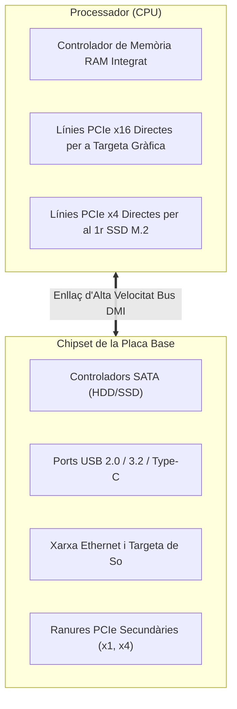

# 3.3 El conjunt de xips (Chipset PCH) i ranures d'expansió PCI Express

Tots els components d'una placa base necessiten coordinar-se i comunicar-se amb el processador. Aquesta tasca la realitzen el **Chipset** (concentrador de controladors PCH) i el bus d'alta velocitat **PCI Express (PCIe)**.

---

## 🧩 1. Què és el Chipset de la placa base?

El **chipset** és el conjunt de circuits integrats que actua com a centre de comunicacions entre la CPU i la resta de perifèrics del PC:

- **Famílies de Chipset habituals:**
  - **Bàsics d'oficina (Sèrie H d'Intel com H610, sèrie A d'AMD com A620):** Econòmics, suficients per a oficines i aules. Menys ports USB i sense suport d'overclocking.
  - **Equilibrats / Gamma mitjana (Sèrie B com B760 o B650):** Els més recomanats per a la majoria d'usuaris; gran quantitat de línies PCIe i ports d'alta velocitat.
  - **Entusiastes / Gamma alta (Sèrie Z com Z790, sèrie X com X670):** Màxim nombre de línies, refrigeració avançada i suport complet per a modificar voltatges.

---

## ⚡ 2. El Bus PCI Express (PCIe)

El **PCI Express** és l'estàndard universal de ranures d'expansió sèrie punt a punt:

| Ranura | Nombre de Línies (*Lanes*) | Mida Física | Ús habitual al taller |
| :--- | :---: | :---: | :--- |
| **PCIe x16** | 16 línies | La ranura més llarga amb pestanya de bloqueig | **Targeta Gràfica dedicada (GPU)**. |
| **PCIe x4** | 4 línies | Mida mitjana | Targetes de xarxa 10 Gbps, targetes de captura de vídeo o adaptadors SSD. |
| **PCIe x1** | 1 línia | Ranura molt curta (uns 2,5 cm) | Targetes Wi-Fi internes, targetes de so dedicades o ports USB addicionals. |

### Generacions PCIe i velocitat per línia:
- **PCIe 3.0:** ~1 GB/s per línia (x16 = ~16 GB/s).
- **PCIe 4.0:** ~2 GB/s per línia (x16 = ~32 GB/s). L'estàndard més estès actualment.
- **PCIe 5.0:** ~4 GB/s per línia (x16 = ~64 GB/s). Present a les plaques d'última generació.

> [!NOTE]
> **Compatibilitat cap arrere:** El bus PCIe és 100% compatible cap arrere: pots punxar una targeta gràfica PCIe 4.0 en una ranura PCIe 3.0 o 5.0 i funcionarà perfectament ajustant-se a la velocitat comuna més alta.

---

## 🎯 Zona d'Entrenament FPB: Comprovació Ràpida (4 Reptes)

  

    🎯 <strong>Zona d'Entrenament FPB:</strong> 0 reptes resolts
    🏆 0 punts
  

  

  
1️⃣ A quina ranura d'expansió de la placa base es connecta obligatòriament la targeta gràfica dedicada (GPU)?

  

    <button type="button" class="btn-mcq-opt" data-opt="A">A) A la ranura PCIe x16</button>
    <button type="button" class="btn-mcq-opt" data-opt="B">B) A una ranura PCIe x1 curta</button>
    <button type="button" class="btn-mcq-opt" data-opt="C">C) Al sòcol de la pila CR2032</button>
  

  

  
2️⃣ Quin xip principal de la placa base s'encarrega de controlar els ports USB, discs SATA i la xarxa integrada?

  

    <input type="text" class="quiz-input" placeholder="Escriu el nom del component...">
    <button type="button" class="btn-quiz-check">Comprovar</button>
  

  

  
3️⃣ Quin dispositiu és habitual instal·lar en una ranura menuda PCIe x1?

  

    <button type="button" class="btn-mcq-opt" data-opt="A">A) La targeta gràfica per a jocs 4K</button>
    <button type="button" class="btn-mcq-opt" data-opt="B">B) Una targeta d'expansió Wi-Fi amb antenes</button>
    <button type="button" class="btn-mcq-opt" data-opt="C">C) El microprocessador principal</button>
  

  

  
4️⃣ Una targeta gràfica PCIe 4.0 pot funcionar correctament en una placa base que només tinga PCIe 3.0.

  

    <button type="button" class="btn-vf" data-opt="V">Vertader</button>
    <button type="button" class="btn-vf" data-opt="F">Fals</button>
  

  

---

## 📋 Llista de Comprovació de Taller (Checklist Pràctic)
- [ ] He localitzat el dissipador metàl·lic del Chipset a la part inferior dreta de la placa.
- [ ] Sé identificar una ranura PCIe x16 i la seua pestanya de seguretat de retenció.
- [ ] Puc distingir les ranures PCIe x16, x4 i x1 a simple vista.

---

## 📥 Comprovant de Lliurament per a Aules

  <h3>📥 Comprovant de Lliurament per a Aules (Act 3.3)</h3>
  
En acabar els reptes interactius i les fitxes de taller d'aquest apartat, genera el teu informe oficial per adjuntar-lo al lliurament de la tasca d'Aules:

  

    <label for="aules-student-name">Nom i Cognoms de l'alumne/a:</label>
    <input type="text" id="aules-student-name" placeholder="Ex: Pere Martí Soler">
  

  

    Calculant resultats dels reptes...
  

  

    <button type="button" class="btn-aules-copy">📋 Copiar Resum per a Aules</button>
    <button type="button" class="btn-aules-dl" data-module="MMSCI" data-unit="UD03" data-activity="Act03">📄 Descarregar Comprovant (.pdf)</button>
  

  

