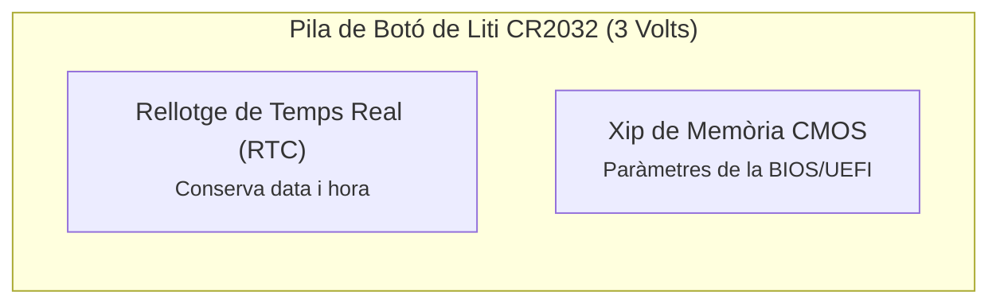
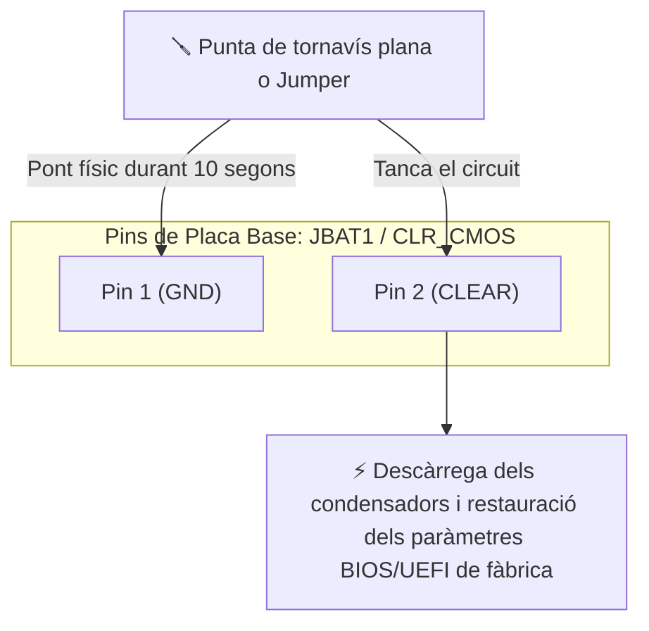

# 3.5 El firmware BIOS/UEFI, la pila CR2032 i el procediment Clear CMOS

Quan un ordinador no encén, es queda encallat amb una pantalla negra o té la data i hora desconfigurades, l'origen de l'avaria sol trobar-se al sistema d'alimentació del rellotge en temps real (RTC) o a paràmetres corruptes de la **BIOS/UEFI**.

---

## 🔋 1. La Pila de Botó de Liti CR2032

Totes les plaques base incorporen un sòcol amb una pila de botó de liti de tipus **CR2032**:

- **Tensió nominal:** **3 Volts (3 V)** continu.
- **Funció:** Mantindre alimentat el xip del rellotge de temps real (**RTC** - *Real Time Clock*) i la xicoteta memòria CMOS quan l'equip està desconnectat de la xarxa elèctrica.
- **Símptomes de pila gastada a taller:**
  1. Cada vegada que s'engega el PC apareix un missatge tipus: *«CMOS Date/Time Not Set»* o *«Press F1 to Run Setup»*.
  2. L'hora del sistema operatiu torna a l'any 2000 o 2010.
  3. Es perden les configuracions personalitzades de perfils de memòria (XMP) o ordre d'arrencada.

> [!TIP]
> **Comprovació amb el polímetre:**
> Selecciona l'escala de **20 V DC**. Posa la punta negra a la cara inferior (negativa) i la punta roja a la cara superior plana marcada amb el signe $(+)$. Si la mesura és **inferior a 2,7 V**, la pila està esgotada i s'ha de substituir immediatament.

---

## 🔄 2. El Procediment de Reset de Taller: Clear CMOS

Quan s'introdueix una contrasenya de BIOS que ningú recorda, o quan una configuració errònia impedeix que l'ordinador puga fer l'arrencada (POST), cal fer un **Clear CMOS** per restaurar tots els valors de fàbrica.

### Protocol de taller pas a pas per fer un Clear CMOS:
1. **Desendolla el cable d'alimentació de 230 V** de la font del PC.
2. Prem el botó d'encesa durant 5 segons per descarregar els condensadors.
3. Localitza els dos pins metàl·lics serigrafiats com **`CLR_CMOS`**, **`JBAT1`** o **`RESET_BIOS`** a prop de la pila.
4. **Fes un pont:** Toca els dos pins alhora amb la punta metàl·lica d'un tornavís pla durant **10 segons**. *(A les plaques de gamma alta hi ha un botó físic a l'exterior que fa la mateixa funció)*.
5. Si la placa és antiga i no té jumper: extreu la pila CR2032 fent palanca suaument amb la pestanya metàl·lica, espera 5 minuts i torna-la a col·locar.
6. Connecta el cable de corrent i engega el PC: la BIOS carregarà els valors per defecte de fàbrica.

---

## 🎯 Zona d'Entrenament FPB: Comprovació Ràpida (4 Reptes)

  

    🎯 <strong>Zona d'Entrenament FPB:</strong> 0 reptes resolts
    🏆 0 punts
  

  

  
1️⃣ Quin model estàndard de pila de botó de liti de 3 V utilitzen les plaques base d'ordinador?

  

    <input type="text" class="quiz-input" placeholder="Escriu el codi (ex: CR...)">
    <button type="button" class="btn-quiz-check">Comprovar</button>
  

  

  
2️⃣ Quin és el símptoma més evident que la pila de la placa base està completament gastada?

  

    <button type="button" class="btn-mcq-opt" data-opt="A">A) L'ordinador fa soroll fort de ventiladors</button>
    <button type="button" class="btn-mcq-opt" data-opt="B">B) Cada vegada que s'encén l'ordinador la data i l'hora s'han esborrat o tornat al passat</button>
    <button type="button" class="btn-mcq-opt" data-opt="C">C) La pantalla es posa en blanc i negre</button>
  

  

  
3️⃣ Què aconseguim quan realitzem el procediment de taller anomenat Clear CMOS?

  

    <button type="button" class="btn-mcq-opt" data-opt="A">A) Esborrar configuracions corruptes i restaurar la BIOS als valors per defecte de fàbrica</button>
    <button type="button" class="btn-mcq-opt" data-opt="B">B) Formatatar el disc dur i esborrar Windows</button>
    <button type="button" class="btn-mcq-opt" data-opt="C">C) Netejar la pols de la memòria RAM</button>
  

  

  
4️⃣ El pont amb el tornavís als pins de Clear CMOS s'ha de fer sempre amb el cable de corrent de 230 V desendollat.

  

    <button type="button" class="btn-vf" data-opt="V">Vertader</button>
    <button type="button" class="btn-vf" data-opt="F">Fals</button>
  

  

---

## 📋 Llista de Comprovació de Taller (Checklist Pràctic)
- [ ] Sé mesurar la tensió de la pila CR2032 amb el polímetre en escala de 20 V DC.
- [ ] Sé localitzar els pins JBAT1 / CLR_CMOS al manual i a la placa física.
- [ ] Recorde desendollar sempre el cable de corrent abans de fer un Clear CMOS.

---

## 📥 Comprovant de Lliurament per a Aules

  <h3>📥 Comprovant de Lliurament per a Aules (UD3)</h3>
  
En acabar els reptes interactius i les fitxes de la UD3, genera el teu informe PDF per adjuntar-lo a la tasca d'Aules:

  

    <label for="aules-student-name">Nom i Cognoms de l'alumne/a:</label>
    <input type="text" id="aules-student-name" placeholder="Ex: Pere Martí Soler">
  

  

    Calculant resultats dels reptes...
  

  

    <button type="button" class="btn-aules-copy">📋 Copiar Resum per a Aules</button>
    <button type="button" class="btn-aules-dl" data-module="MMSCI" data-unit="UD03" data-activity="Act05">📄 Descarregar Comprovant (.pdf)</button>
  

  

