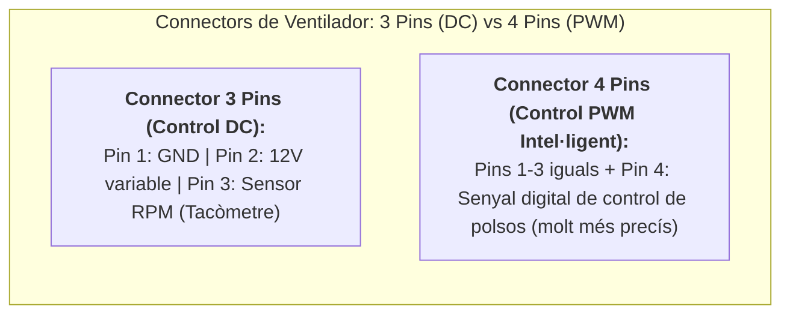
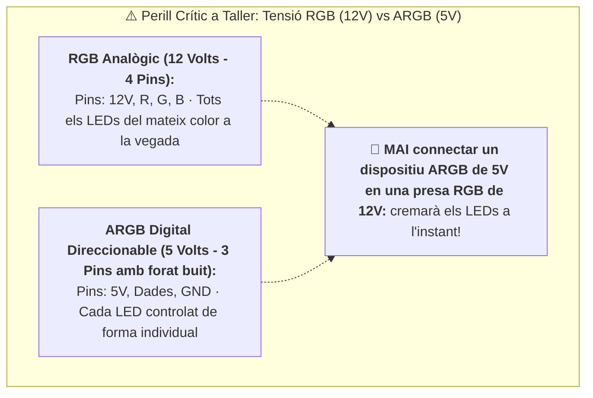

# 5.4 Connectors de ventiladors (DC vs PWM) i il·luminació RGB (12V vs 5V ARGB)

El control acústic (evitar que l'ordinador semble un avió en funcionament) i la gestió de la il·luminació requereixen conèixer els connectors de ventiladors i la diferència crítica entre sistemes RGB analògics i digitals.

---

## 🌀 1. Connectors de Ventilador: 3 Pins (DC) vs 4 Pins (PWM)

A la placa base trobem connectors com **`CPU_FAN`**, **`SYS_FAN`** o **`CHA_FAN`**:

- **Ventiladors de 3 Pins (Regulació DC per voltatge):**
  - Pin 1: Terra (GND).
  - Pin 2: Alimentació (varia de 5 V a 12 V per canviar la velocitat).
  - Pin 3: Tacòmetre (*Tacho*), envia a la placa les revolucions per minut (RPM).
- **Ventiladors de 4 Pins (Control intel·ligent PWM - *Pulse Width Modulation*):**
  - Manté sempre 12 V continus al Pin 2.
  - El **Pin 4 (PWM)** envia polsos d'alta freqüència que permeten a la placa regular la velocitat del ventilador amb precisió absoluta de l'1% al 100%, fins i tot a revolucions molt baixes sense parar el motor.

---

## 🌈 2. Perill Crític a Taller: RGB Clàssic (12 V) vs ARGB Digital (5 V)

> [!CAUTION]
> **MAI connectis un dispositiu ARGB de 5 V en una presa RGB de 12 V:**
> - El connector **RGB de 12 V té 4 pins junts**. Tots els LEDs de la tira s'il·luminen amb el mateix color alhora.
> - El connector **ARGB de 5 V (Addressable RGB) té 3 pins amb un espai buit al mig (format [o][o][ ][o])**. Permet controlar el color de cada LED de manera individual creant efectes d'ona o arc de Sant Martí.
> - **Si endolles un ventilador ARGB de 5 V a una presa de 12 V, cremaràs a l'instant tots els xips LED de la tira.**

---

## 🎯 Zona d'Entrenament FPB: Comprovació Ràpida (4 Reptes)

  

    🎯 <strong>Zona d'Entrenament FPB:</strong> 0 reptes resolts
    🏆 0 punts
  

  

  
1️⃣ Quin avantatge ofereixen els ventiladors de 4 pins amb tecnologia PWM sobre els de 3 pins?

  

    <button type="button" class="btn-mcq-opt" data-opt="A">A) Que consumeixen el doble d'energia</button>
    <button type="button" class="btn-mcq-opt" data-opt="B">B) Regulació precisa de velocitat per polsos digitals a qualsevol rang de revolucions</button>
    <button type="button" class="btn-mcq-opt" data-opt="C">C) Que no necessiten estar connectats a la placa</button>
  

  

  
2️⃣ A quin connector exacte de la placa base s'ha d'endollar el ventilador del dissipador del processador?

  

    <input type="text" class="quiz-input" placeholder="Escriu el codi serigrafiat...">
    <button type="button" class="btn-quiz-check">Comprovar</button>
  

  

  
3️⃣ Quants pins físics té un connector d'il·luminació ARGB Digital direccionable de 5 V?

  

    <button type="button" class="btn-mcq-opt" data-opt="A">A) 3 pins amb un espai buit intermedi</button>
    <button type="button" class="btn-mcq-opt" data-opt="B">B) 4 pins continus</button>
    <button type="button" class="btn-mcq-opt" data-opt="C">C) 24 pins</button>
  

  

  
4️⃣ Connectar una tira de LEDs ARGB de 5 V a un connector RGB de 12 V crema els components immediatament.

  

    <button type="button" class="btn-vf" data-opt="V">Vertader</button>
    <button type="button" class="btn-vf" data-opt="F">Fals</button>
  

  

---

## 📋 Llista de Comprovació de Taller (Checklist Pràctic)
- [ ] Connecte el ventilador de la CPU a la presa CPU_FAN (mai a una auxiliar SYS_FAN).
- [ ] Identifique la tensió de les tires d'il·luminació abans d'endollar (12 V RGB vs 5 V ARGB).
- [ ] Fixe els cables de ventiladors amb brides per evitar que freguen amb les aspes en girar.

---

## 📥 Comprovant de Lliurament per a Aules

  <h3>📥 Comprovant de Lliurament per a Aules (Act 5.4)</h3>
  
En acabar els reptes interactius i les fitxes de taller d'aquest apartat, genera el teu informe oficial per adjuntar-lo al lliurament de la tasca d'Aules:

  

    <label for="aules-student-name">Nom i Cognoms de l'alumne/a:</label>
    <input type="text" id="aules-student-name" placeholder="Ex: Pere Martí Soler">
  

  

    Calculant resultats dels reptes...
  

  

    <button type="button" class="btn-aules-copy">📋 Copiar Resum per a Aules</button>
    <button type="button" class="btn-aules-dl" data-module="MMSCI" data-unit="UD05" data-activity="Act04">📄 Descarregar Comprovant (.pdf)</button>
  

  

