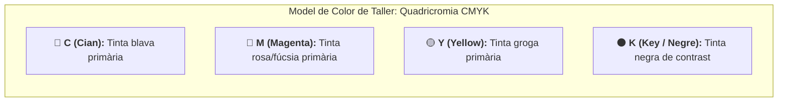

# 7.1 Consumibles d'impressió: cartutxos de tinta CMYK i tòners làser

Els **consumibles d'impressió** són aquells elements que s'esgoten amb l'ús diari de l'equip i requereixen ser reemplaçats pel servei tècnic. El model de color utilitzat a la impremta i a les impressores és el **model sostractiu CMYK**:

---

## 🛠️ 1. Manteniment i Substitució de Cartutxos de Tinta

1. **Obstrucció de broquets (*Nozzles*):** Si una impressora d'injecció ha estat molt de temps parada, la tinta s'asseca als microorificis del capçal d'impressió provocant línies blanques horitzontals als fulls.
2. **Procediment de neteja de capçals:** S'activa des del menú de manteniment de la impressora. L'equip bombeja una quantitat xicoteta de tinta a pressió per dissoldre les restes seques.
3. **Cartutxos originals vs compatibles:**
   - **Originals:** Màxima durabilitat dels capçals i garantia oficial del fabricant.
   - **Compatibles / Rellenables:** Cost molt inferior, però risc ocasional de fuites de líquid o rebuig del xip electrònic per part del firmware de la màquina.

---

## 📄 2. Resolució d'Embussos de Paper (*Paper Jam*)

> [!CAUTION]
> **Norma estricta per alliberar fulls encallats:**
> - **Estira SEMPRE en el sentit natural d'avanç del paper.** Mai estires en sentit contrari (cap enrere) perquè pots trencar els engranatges de plàstic o desajustar els sensors òptics de pas.
> - Si el paper s'ha trencat dins del fusor, espera que es refrede (el corró assoleix els 200 °C) i utilitza unes pinces de plàstic per extreure les restes sense ratllar el tambor.

---

## 🎯 Zona d'Entrenament FPB: Comprovació Ràpida (4 Reptes)

  

    🎯 <strong>Zona d'Entrenament FPB:</strong> 0 reptes resolts
    🏆 0 punts
  

  

  
1️⃣ Quins són els 4 colors primaris que componen el model d'impressió CMYK?

  

    <button type="button" class="btn-mcq-opt" data-opt="A">A) Cian (blau), Magenta (rosa), Groc (yellow) i Negre (key)</button>
    <button type="button" class="btn-mcq-opt" data-opt="B">B) Roig, Verd, Blau i Blanc</button>
    <button type="button" class="btn-mcq-opt" data-opt="C">C) Taronja, Gris, Marró i Violeta</button>
  

  

  
2️⃣ Quina funció del menú de manteniment de la impressora s'activa quan les lletres surten tallades per tinta seca?

  

    <input type="text" class="quiz-input" placeholder="Escriu l'operació...">
    <button type="button" class="btn-quiz-check">Comprovar</button>
  

  

  
3️⃣ En quina direcció s'ha d'estirar un full de paper encallat a l'interior d'una impressora?

  

    <button type="button" class="btn-mcq-opt" data-opt="A">A) Cap enrere amb força sobtada</button>
    <button type="button" class="btn-mcq-opt" data-opt="B">B) En diagonal tallant el full pel mig</button>
    <button type="button" class="btn-mcq-opt" data-opt="C">C) Sempre suaument en el sentit natural d'avanç del paper cap a l'eixida</button>
  

  

  
4️⃣ Cal esperar que la unitat fusora d'una impressora làser es refrede abans de manipular un embús a la seua zona per evitar cremades.

  

    <button type="button" class="btn-vf" data-opt="V">Vertader</button>
    <button type="button" class="btn-vf" data-opt="F">Fals</button>
  

  

---

## 📋 Llista de Comprovació de Taller (Checklist Pràctic)
- [ ] Comprove els nivells de tinta o tòner des del panell de l'equip abans d'iniciar tasques massives.
- [ ] Extraic el full encallat amb suavitat sense deixar trossos esquinçats als rodets.
- [ ] Alinee les guies laterals de la safata de paper a la mida exacta del full A4.

---

## 📥 Comprovant de Lliurament per a Aules

  <h3>📥 Comprovant de Lliurament per a Aules (Act 7.1)</h3>
  
En acabar els reptes interactius i les fitxes de taller d'aquest apartat, genera el teu informe oficial per adjuntar-lo al lliurament de la tasca d'Aules:

  

    <label for="aules-student-name">Nom i Cognoms de l'alumne/a:</label>
    <input type="text" id="aules-student-name" placeholder="Ex: Pere Martí Soler">
  

  

    Calculant resultats dels reptes...
  

  

    <button type="button" class="btn-aules-copy">📋 Copiar Resum per a Aules</button>
    <button type="button" class="btn-aules-dl" data-module="MMSCI" data-unit="UD07" data-activity="Act01">📄 Descarregar Comprovant (.pdf)</button>
  

  

