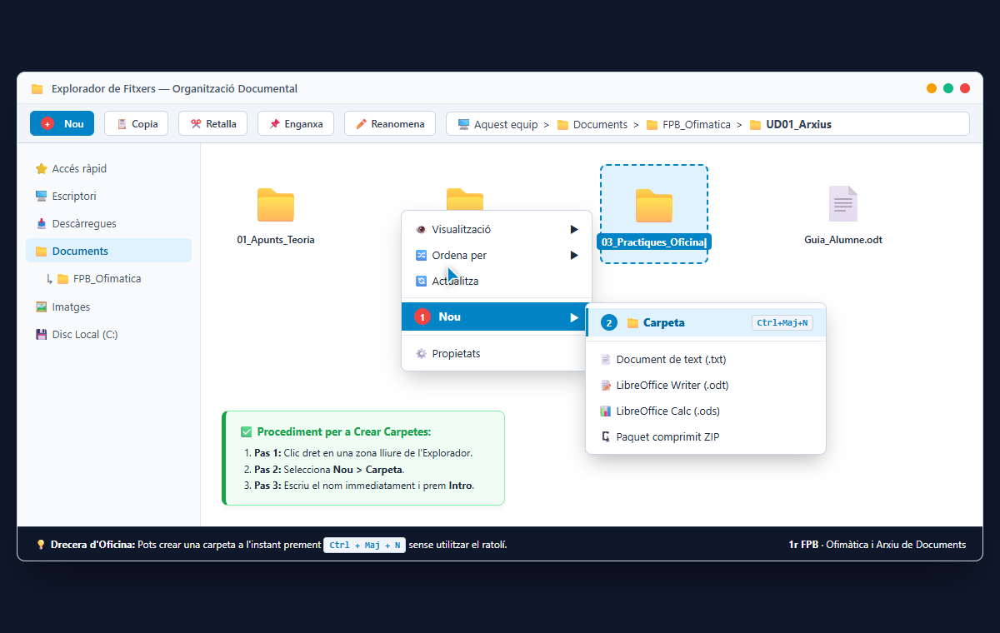
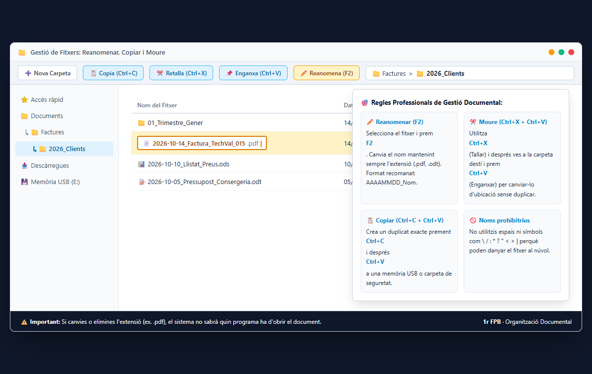
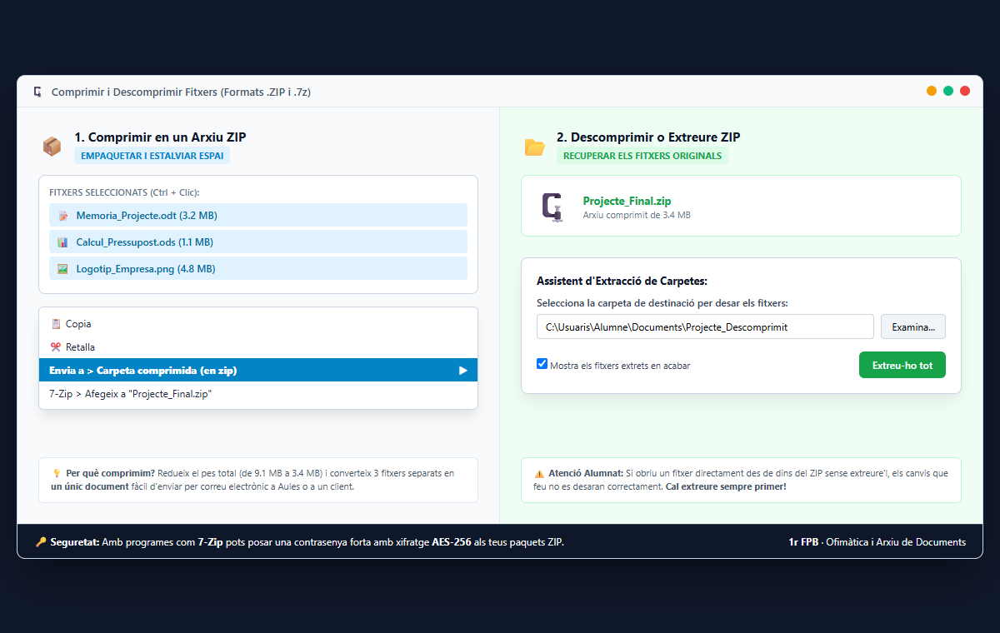

# 📁 UT01: Organització d'Arxius i Gestió Documental

Benvingut/da a la **Unitat Temàtica 1** del mòdul professional d'**Ofimàtica i Arxiu de Documents (OAD)**. En aquesta unitat aprendràs com organitzar la informació digital d'una oficina o empresa amb criteri professional: aprendràs a dissenyar estructures de carpetes en arbre, aplicaràs pautes de nomenclatura documental que eviten pèrdues de temps, reconeixeràs les extensions de fitxer i els seus programes associats, comprimiràs fitxers per estalviar espai i aprendràs a protegir les dades amb la regla de còpies de seguretat 3-2-1.

<div style="margin: 2rem 0; overflow-x: auto; text-align: center;">
<svg viewBox="0 0 860 260" xmlns="http://www.w3.org/2000/svg" style="max-width: 100%; height: auto; font-family: 'Segoe UI', system-ui, sans-serif; background: linear-gradient(135deg, #0f172a 0%, #1e293b 100%); border-radius: 12px; border: 1px solid #334155; box-shadow: 0 10px 25px -5px rgba(0, 0, 0, 0.4);">
  <defs>
    <linearGradient id="g-tree" x1="0%" y1="0%" x2="100%" y2="100%">
      <stop offset="0%" stop-color="#38bdf8" stop-opacity="0.25"/>
      <stop offset="100%" stop-color="#0284c7" stop-opacity="0.05"/>
    </linearGradient>
    <linearGradient id="g-ext" x1="0%" y1="0%" x2="100%" y2="100%">
      <stop offset="0%" stop-color="#818cf8" stop-opacity="0.25"/>
      <stop offset="100%" stop-color="#4f46e5" stop-opacity="0.05"/>
    </linearGradient>
    <linearGradient id="g-zip" x1="0%" y1="0%" x2="100%" y2="100%">
      <stop offset="0%" stop-color="#34d399" stop-opacity="0.25"/>
      <stop offset="100%" stop-color="#059669" stop-opacity="0.05"/>
    </linearGradient>
    <linearGradient id="g-321" x1="0%" y1="0%" x2="100%" y2="100%">
      <stop offset="0%" stop-color="#f59e0b" stop-opacity="0.25"/>
      <stop offset="100%" stop-color="#d97706" stop-opacity="0.05"/>
    </linearGradient>
  </defs>

  <!-- Capçalera -->
  <text x="430" y="32" text-anchor="middle" fill="#f8fafc" font-size="16" font-weight="700" letter-spacing="1">ORGANITZACIÓ DOCUMENTAL: ARXIUS, EXTENSIONS, COMPRESSIÓ I REGLE 3-2-1</text>
  <text x="430" y="50" text-anchor="middle" fill="#94a3b8" font-size="12">Estructures en arbre, nomenclatura normalitzada, formats oberts i protecció d'informació</text>

  <!-- Bloc 1: Estructura en Arbre -->
  <g transform="translate(25, 70)">
    <rect width="185" height="165" rx="10" fill="url(#g-tree)" stroke="#38bdf8" stroke-width="1.5"/>
    <rect x="15" y="14" width="28" height="28" rx="6" fill="#38bdf8" fill-opacity="0.2"/>
    <text x="29" y="33" text-anchor="middle" fill="#38bdf8" font-size="14" font-weight="bold">🌳</text>
    <text x="52" y="33" fill="#f8fafc" font-size="13" font-weight="bold">Jerarquia en Arbre</text>
    <text x="15" y="62" fill="#38bdf8" font-size="11" font-weight="600">Gestió de Carpetes</text>
    <text x="15" y="84" fill="#cbd5e1" font-size="11">• Unitat arrel: C:\ o /home</text>
    <text x="15" y="104" fill="#cbd5e1" font-size="11">• Subdirectoris temàtics</text>
    <text x="15" y="124" fill="#cbd5e1" font-size="11">• Nomenclatura: AAAAMMDD</text>
    <text x="15" y="144" fill="#cbd5e1" font-size="11">• Sense espais ni caràcters rars</text>
  </g>

  <!-- Bloc 2: Extensions i Formats -->
  <g transform="translate(230, 70)">
    <rect width="185" height="165" rx="10" fill="url(#g-ext)" stroke="#818cf8" stroke-width="1.5"/>
    <rect x="15" y="14" width="28" height="28" rx="6" fill="#818cf8" fill-opacity="0.2"/>
    <text x="29" y="33" text-anchor="middle" fill="#818cf8" font-size="14" font-weight="bold">📄</text>
    <text x="52" y="33" fill="#f8fafc" font-size="13" font-weight="bold">Formats i Extensions</text>
    <text x="15" y="62" fill="#818cf8" font-size="11" font-weight="600">Tipologia de Dades</text>
    <text x="15" y="84" fill="#cbd5e1" font-size="11">• Text: .odt / .docx</text>
    <text x="15" y="104" fill="#cbd5e1" font-size="11">• Full càlcul: .ods / .xlsx</text>
    <text x="15" y="124" fill="#cbd5e1" font-size="11">• PDF: Estàndard no editable</text>
    <text x="15" y="144" fill="#cbd5e1" font-size="11">• Imatge: .png / .jpg / .webp</text>
  </g>

  <!-- Bloc 3: Compressió ZIP/7z -->
  <g transform="translate(435, 70)">
    <rect width="195" height="165" rx="10" fill="url(#g-zip)" stroke="#34d399" stroke-width="1.5"/>
    <rect x="15" y="14" width="28" height="28" rx="6" fill="#34d399" fill-opacity="0.2"/>
    <text x="29" y="33" text-anchor="middle" fill="#34d399" font-size="14" font-weight="bold">🗜️</text>
    <text x="52" y="33" fill="#f8fafc" font-size="13" font-weight="bold">Compressió de Dades</text>
    <text x="15" y="62" fill="#34d399" font-size="11" font-weight="600">Empaquetat d'Arxius</text>
    <text x="15" y="84" fill="#cbd5e1" font-size="11">• Formats .zip i .7z</text>
    <text x="15" y="104" fill="#cbd5e1" font-size="11">• Reducció de pes per correu</text>
    <text x="15" y="124" fill="#cbd5e1" font-size="11">• Xifratge AES-256 amb clau</text>
    <text x="15" y="144" fill="#cbd5e1" font-size="11">• Descompressió sense pèrdues</text>
  </g>

  <!-- Bloc 4: Regla Backup 3-2-1 -->
  <g transform="translate(650, 70)">
    <rect width="185" height="165" rx="10" fill="url(#g-321)" stroke="#f59e0b" stroke-width="1.5"/>
    <rect x="15" y="14" width="28" height="28" rx="6" fill="#f59e0b" fill-opacity="0.2"/>
    <text x="29" y="33" text-anchor="middle" fill="#f59e0b" font-size="14" font-weight="bold">🛡️</text>
    <text x="52" y="33" fill="#f8fafc" font-size="13" font-weight="bold">Regla Backup 3-2-1</text>
    <text x="15" y="62" fill="#f59e0b" font-size="11" font-weight="600">Seguretat de Dades</text>
    <text x="15" y="84" fill="#cbd5e1" font-size="11">• 3 Còpies de seguretat totals</text>
    <text x="15" y="104" fill="#cbd5e1" font-size="11">• 2 Suports físics diferents</text>
    <text x="15" y="124" fill="#cbd5e1" font-size="11">• 1 Còpia al núvol / fora seu</text>
    <text x="15" y="144" fill="#cbd5e1" font-size="11">• Proves de restauració</text>
  </g>
</svg>
</div>

---

## 📑 Apartats de la Unitat Didàctica

| Apartat | Títol de la Secció Didàctica | Enllaç Directe |
| :---: | :--- | :---: |
| **1.1** | Concepte d'arxiu, directori i estructura en arbre | [**📘 Llegir Apartat 1.1 →**](./ut0101.html) |
| **1.2** | Nomenclatura i bones pràctiques d'organització documental | [**📘 Llegir Apartat 1.2 →**](./ut0102.html) |
| **1.3** | Extensions de fitxer més comunes i el seu significat | [**📘 Llegir Apartat 1.3 →**](./ut0103.html) |
| **1.4** | Compressió d'arxius (ZIP, 7z) i enviament de fitxers | [**📘 Llegir Apartat 1.4 →**](./ut0104.html) |
| **1.5** | Còpies de seguretat (Backup) i la Regla 3-2-1 | [**📘 Llegir Apartat 1.5 →**](./ut0105.html) |

---

## 🎯 Resultats d'Aprenentatge Treballats

- **RA 1:** Gestiona fitxers i carpetes aplicant criteris d'organització, cerca i seguretat de la informació.
  - *CE a:* S'ha identificat l'estructura organitzativa dels sistemes d'arxius en suport digital.
  - *CE b:* S'han creat, mogut, copiat i eliminat fitxers i directoris seguint normes de nomenclatura.
  - *CE c:* S'han utilitzat utilitats de compressió i descompressió de fitxers.
  - *CE d:* S'han planificat i executat còpies de seguretat bàsiques per protegir la informació de l'empresa.

---

## 📊 Matriu Comparativa de Formats de Fitxer i Aplicacions d'Oficina

| Extensió de Fitxer | Tipus de Contingut | Suite Lliure Recomanada | Suite Comercial (Microsoft 365) | Format Obert / Estàndard ISO? | Ús Recomanat a l'Oficina |
| :--- | :--- | :--- | :--- | :---: | :--- |
| **.odt** | Document de text editable | LibreOffice Writer | Word (amb compatibilitat) | **Sí (OpenDocument)** | Redacció d'informes i cartes oficials |
| **.docx** | Document de text editable | LibreOffice Writer | Microsoft Word | No lliure (XML propietari) | Intercanvi comercial i corporatiu |
| **.ods** | Full de càlcul editable | LibreOffice Calc | Excel (amb compatibilitat) | **Sí (OpenDocument)** | Pressupostos, inventaris i comptabilitat |
| **.xlsx** | Full de càlcul editable | LibreOffice Calc | Microsoft Excel | No lliure (XML propietari) | Facturació i taules dinàmiques |
| **.pdf** | Document d'impressió final | Okular / Evince / Navegador | Adobe Acrobat / Edge | **Sí (ISO 32000-1 / PDF/A)** | **Factures finals i contractes no editables** |
| **.zip / .7z** | Paquet comprimit de fitxers | 7-Zip / PeaZip | Explorador de fitxers | **Sí (Deflate / LZMA2)** | Agrupar carpetes per enviar per correu |
| **.csv** | Text pla separat per comes | Bloc de notes / Calc | Excel / Bloc de notes | **Sí (Text pla ANSI/UTF-8)** | Exportació de llistats de clients i bases de dades |

---

## 📌 Resum Didàctic i Idees Clau

1. **Estructura en Arbre:** El sistema de fitxers s'organitza de manera jeràrquica a partir d'una unitat arrel (`C:\` a Windows o `/` a Linux). Les carpetes i subcarpetes han d'agrupar la informació per criteris lògics (Departament > Any > Projecte).
2. **Nomenclatura Professional:**
   - Evitar caràcters especials (`/`, `\`, `?`, `*`, `:`, `|`, `<`, `>`), espais en blanc (utilitzar guió baix `_` o guió mitjà `-`), accents i la lletra "ç" o "ñ" que puguen donar errors en sistemes al núvol.
   - Començar sempre amb dates en format ISO **AAAAMMDD** (Any-Mes-Dia) perquè els arxius s'ordenen cronològicament sols a qualsevol carpeta.
3. **Extensions:** L'extensió (3 o 4 lletres després del punt final) indica al sistema quin programa ha d'obrir el fitxer. Mai s'ha de canviar l'extensió manualment perquè el fitxer podria quedar inaccessible per al programa associat.
4. **Compressió:** Redueix la mida dels arxius que contenen text i permet empaquetar centenars de documents en un únic arxiu `.zip` per enviar-lo per correu electrònic o protegir-lo amb contrasenya forta mitjançant xifratge **AES-256**.
5. **Regla de Còpia de Seguretat 3-2-1:**
   - **3 còpies:** L'original de treball i 2 còpies de seguretat idèntiques.
   - **2 suports diferents:** Per exemple, el disc dur intern de l'ordinador i un disc dur extern USB / servidor NAS.
   - **1 còpia fora de la seu:** Una còpia emmagatzemada al núvol (OneDrive, Google Drive) o en una altra ubicació física per protegir-se davant robatoris, incendis o infeccions de ransomware.

---

## 📸 Guies Visuals Pas a Pas del Treball amb Fitxers i Carpetes

### 1. Com Crear Carpetes i Fitxers a l'Explorador


### 2. Com Reanomenar (F2), Copiar i Moure Fitxers


### 3. Com Comprimir i Descomprimir Fitxers en Format ZIP


---

## 📝 Quadern d'Activitats Pràctiques i Reptes de Laboratori


### Bloc A: Fonaments, Dimensionament i Diagnòstic Tècnic

#### Exercici 1: Disseny d'Arbre de Carpetes per a un Departament Administratiu
L'empresa de serveis informàtics "TechVal S.L." necessita reorganitzar el disc compartit del seu departament de gestió. Actualment tenen 400 fitxers barrejats a la carpeta "Escriptori" i "Descàrregues" dels seus equips.
1. Dissenya una estructura jeràrquica en arbre de carpetes d'un mínim de 3 nivells de profunditat que continga com a carpetes principals: `01_COMPTABILITAT`, `02_CLIENTS`, `03_PROVEIDORS` i `04_PERSONAL`.
2. Dins de la carpeta `01_COMPTABILITAT`, crea la subdivisió necessària per als exercicis fiscals de l'any passat, l'any actual i les subcarpetes per a `Factures_Emeses`, `Factures_Rebudes` i `Impostos_IVA`.
3. Escriu la **ruta absoluta completa** a Windows per accedir al fitxer de la factura emesa número 45 de l'any actual 2026 si la unitat de xarxa és `Z:`. Compara aquesta ruta amb una **ruta relativa** si ens trobem situats dins de la carpeta de l'any 2026.

#### Exercici 2: Càlcul de Ràtio de Compressió i Estalvi d'Espai en Disc
La taxa o ràtio de compressió percentual d'un arxiu es calcula amb la fórmula:
$$Ràtio = \left(1 - \frac{\text{Mida de l'arxiu comprimit}}{\text{Mida de l'arxiu original}}\right) \times 100\%$$
Un administratiu disposa d'un lot de fitxers d'oficina i els comprimeix en un arxiu ZIP amb el programa 7-Zip:
- Fitxer 1: Un document de base de dades en text pla de $80\text{ MB}$ que després de comprimir ocupa $16\text{ MB}$.
- Fitxer 2: Una carpeta de 50 fotografies JPEG que ocupa $150\text{ MB}$ i després de comprimir ocupa $144\text{ MB}$.
1. Calcula la ràtio de compressió aconseguida en cadascun dels dos casos.
2. Explica per què el fitxer de text ha assolit una reducció de més del 75% mentre que la carpeta de fotos pràcticament no s'ha reduït gens. (Pista: el format JPEG ja incorpora compressió algorísmica interna).
3. Si hem d'enviar per correu electrònic un informe que ocupa 45 MB i el servidor només admet fitxers adjunts de fins a 25 MB, quina utilitat de 7-Zip permet dividir l'arxiu en dos volums ZIP independents de 23 MB?

#### Exercici 3: Auditoria i Disseny d'un Pla de Còpies de Seguretat (Regla 3-2-1)
Una clínica dental compta amb una base de dades de fitxes de pacients i radiografies digitals que ocupa un volum inicial de **180 GB**. Cada setmana s'incorporen nous expedients que generen un increment de **4 GB addicionals**.
1. Desglossa com s'ha d'aplicar estrictament la **regla 3-2-1** en aquesta clínica:
   - On s'ubica la còpia 1 (original)?
   - En quin suport físic es guardarà la còpia 2 a la mateixa clínica?
   - On s'emmagatzemarà la còpia 3 fora de les instal·lacions de la clínica?
2. Si comprem un disc dur extern USB de 2 TB (2.000 GB) per a les còpies de seguretat locals, calcula quants mesos de feina podrà allotjar abans d'omplir-se completament.
3. Si un virus xifra el disc de l'ordinador principal (atac de *ransomware*), per què el disc extern només ha d'estar connectat a l'ordinador durant l'estona que s'executa la còpia i desconnectar-se immediatament després?

---

### Bloc B: Reptes Pràctics de Laboratori i Taller

#### Repte 1: Creació i Gestió d'Estructures en Arbre mitjançant Consola i Explorador
- **Objectiu:** Crear una estructura corporativa de carpetes i verificar la seua jerarquia mitjançant comandes de terminal de Windows (PowerShell) o Linux.
- **Material de laboratori:** Ordinador amb sistema operatiu Windows o Linux.
- **Passos d'execució:**
  1. Obre la consola de **PowerShell** a Windows.
  2. Navega fins a la carpeta de Documents o crea una carpeta de pràctiques anomenada `Taller_OAD`:
     ```powershell
     cd ~
     mkdir Taller_OAD
     cd Taller_OAD
     ```
  3. Crea l'estructura d'arbre de carpetes corporativa amb la comanda `mkdir`:
     ```powershell
     mkdir 2026\01_Comptabilitat\Factures_Emeses
     mkdir 2026\01_Comptabilitat\Factures_Rebudes
     mkdir 2026\02_RRHH\Contractes
     mkdir 2026\03_Projectes\Web_Corporativa
     ```
  4. Executa la comanda `tree /f` a la consola per visualitzar gràficament l'arbre complet de directoris generat.
  5. Crea un fitxer de text buit a la carpeta de factures emeses utilitzant la comanda:
     ```powershell
     New-Item -Path "2026\01_Comptabilitat\Factures_Emeses\20260215_Factura_001.txt" -ItemType File
     ```
  6. Fes una captura de pantalla de la sortida de la comanda `tree` per incloure-la a la teua memòria de pràctiques.

#### Repte 2: Normalització de Noms i Conversió Documental a PDF/A
- **Objectiu:** Reanomenar un lot d'arxius desorganitzats aplicant regles de nomenclatura i exportar documents a format estàndard de preservació digital PDF/A.
- **Material de laboratori:** LibreOffice Writer o Microsoft Word, lot d'arxius d'exemple amb noms incorrectes (com ara `pressupost 1 def.docx`, `fotos cliente!!!.jpg`).
- **Passos d'execució:**
  1. Descarrega el lot d'arxius desorganitzats de la carpeta compartida de laboratori.
  2. Aplica les normes de nomenclatura professional reanomenant cadascun d'ells amb el patró: `AAAAMMDD_Tipus_Assumpte_v1`:
     - Canvia `pressupost 1 def.docx` per `20261013_Pres_ClientGarcia_v1.0.docx`.
     - Canvia `fotos cliente!!!.jpg` per `20261013_Img_ObraInstal_v1.0.jpg`.
  3. Obre el document de text a **LibreOffice Writer**:
     - Ves al menú **Fitxer > Exporta com a > Exporta com a PDF**.
     - A la finestra d'opcions, marca la casella **Arxiu PDF/A (ISO 19005-1)**.
     - Fes clic a Exporta i desa l'arxiu resultant amb l'extensió `.pdf`.
  4. Obre el PDF generat amb un visor: comprova que el programa indica que el document compleix l'estàndard PDF/A per a conservació a llarg termini i que els textos no es poden modificar accidentalment.

#### Repte 3: Creació d'un Paquet Comprès i Xifrat amb Contrasenya Segura
- **Objectiu:** Empaquetar un conjunt de fitxers confidencials d'empresa i aplicar xifratge d'alta seguretat AES-256 amb l'eina 7-Zip.
- **Material de laboratori:** Programari 7-Zip instal·lat a l'equip, carpeta amb 3 documents de prova.
- **Passos d'execució:**
  1. Selecciona la carpeta que conté els documents a protegir.
  2. Fes clic dret sobre la carpeta i selecciona **7-Zip > Afegeix a l'arxiu...**.
  3. A la finestra de configuració de 7-Zip:
     - Tria el format d'arxiu **7z** o **zip**.
     - Nivell de compressió: **Ultra**.
     - A la secció *Encriptació*: escriu una contrasenya robusta de més de 8 caràcters (amb majúscules, minúscules, números i símbols).
     - Mètode d'encriptació: **AES-256**.
     - Marca la casella **Encripta els noms dels fitxers** (només disponible en format 7z).
  4. Fes clic a D'acord per generar l'arxiu `.7z`.
  5. Intenta obrir el fitxer comprimit fent doble clic: comprova que el programa demana la contrasenya fins i tot abans de mostrar la llista de documents continguts.
  6. Introdueix la contrasenya correcta i extreu els fitxers a una carpeta nova de destí.

---

### Bloc C: Llista de Verificació i Rúbrica d'Avaluació Competencial

#### Llista de Verificació de Gestió Documental
- [ ] L'estructura en arbre s'ha dissenyat amb lògica temàtica i sense barrejar fitxers a la carpeta arrel.
- [ ] Tots els fitxers segueixen la nomenclatura ISO amb dates `AAAAMMDD` i guions baixos sense espais.
- [ ] No s'han utilitzat caràcters especials ni accents que puguen donar errors en sistemes al núvol.
- [ ] Les extensions de fitxer estan visibles al sistema operatiu i es comprenen els seus programes associats.
- [ ] S'ha generat un arxiu PDF/A apte per a la conservació legal i no editable de documents.
- [ ] S'ha comprimit el paquet amb 7-Zip i s'ha verificat la contrasenya de xifratge AES-256.
- [ ] S'ha documentat la planificació d'una còpia de seguretat seguint la regla 3-2-1.

#### Rúbrica d'Avaluació Tècnica (FP Bàsica OAD - UT01)

| Criteri d'Avaluació | Excel·lent (9-10) | Notable (7-8) | Aprovat (5-6) | No Assolit (0-4) |
| :--- | :--- | :--- | :--- | :--- |
| **Disseny d'Estructures en Arbre** | Crea estructures jeràrquiques impecables mitjançant l'explorador i comandes CLI (`mkdir`, `tree`), amb rutes clares. | Dissenya un arbre de carpetes organitzat amb bona subdivisió per departaments i anys. | Crea carpetes organitzades bàsiques amb ajuda de l'esquema de referència. | Guarda tots els documents a l'escriptori o a la carpeta d'arrel sense cap estructura. |
| **Nomenclatura Documental Normalitzada** | Reanomena tots els fitxers amb format `AAAAMMDD_Assumpte_vX`, evitant espais i caràcters especials amb rigor absolut. | Aplica la nomenclatura amb dates en la majoria d'arxius amb petits descuits de majúscules o guions. | Modifica els noms dels arxius per fer-los més entenedors seguint el model de classe. | Utilitza noms com "arxiu1", "definitiu", deixa espais o caràcters no permesos. |
| **Compressió i Xifratge de Fitxers** | Utilitza 7-Zip amb nivell Ultra, aplica xifratge AES-256 amb clau forta i calcula ràtios de compressió exactes. | Empaqueta fitxers en format ZIP/7z i configura la contrasenya correctament. | Comprimeix fitxers utilitzant l'eina integrada de Windows amb suport docent. | No sap com comprimir una carpeta o oblida la contrasenya establerta al paquet. |
| **Planificació de Còpies de Seguretat 3-2-1** | Explica i dimensiona la regla 3-2-1 amb càlculs d'espai en disc, suports diferents i protocols de desconnexió anti-ransomware. | Descriu la regla 3-2-1 satisfactòriament i distingeix la còpia local de la còpia al núvol. | Reconeix la necessitat de fer còpies de seguretat periòdiques en un llapis USB o núvol. | Desconeix la regla 3-2-1 o creu que guardar dues còpies al mateix disc dur és segur. |
