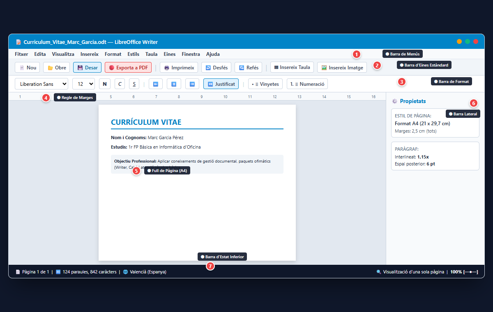
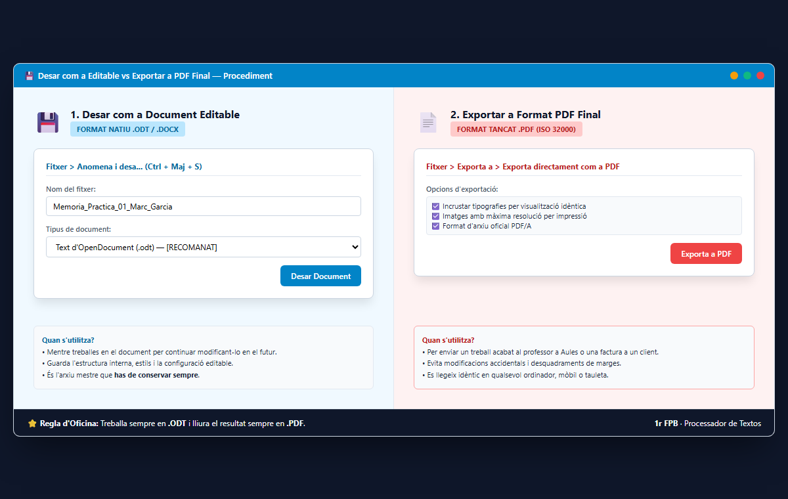

# 2.1 Interfície de treball, creació i desat de documents

El processador de textos és l'aplicació ofimàtica utilitzada per redactar cartes, memòries, informes i manuals formatius.

### 1. Entorn de Treball de LibreOffice Writer
- **Barra de menús:** Menús tradicionals (*Fitxer, Edita, Visualitza, Insereix, Format, Taula...*).
- **Barra d'eines Estàndard:** Dreceres d'accés ràpid a accions comunes (Nou, Obre, Desar, Imprimeix, Exporta a PDF, Desfés, Refés).
- **Barra d'eines de Format:** Controls de tipografia, cos de lletra, negreta, cursiva, subratllat i alineació.
- **Regle horitzontal:** Per visualitzar i ajustar marges de pàgina i sagnies.
- **Barra lateral de propietats:** Controls ràpids per al disseny de pàgina, estils i paràgraf.
- **Barra d'estat inferior:** Mostra el nombre de pàgines, paraules, idioma de correcció ortogràfica i zoom.

---

### Guia Pràctica Visual: Interfície Completa de LibreOffice Writer

#### 🔍 Zones Principals Identificades a la Captura:
1. **➊ Barra de Menús:** Accés a tots els comandaments del programa agrupats per categories.
2. **➋ Barra d'Eines Estàndard:** Botons d'accés ràpid per a desar, imprimir, desfer/refer i exportar directament a PDF.
3. **➌ Barra de Format:** Selecció de tipografia (Liberation Sans / Arial), cos de font (12 pt), negreta (**N**), cursiva (*C*), subratllat (<u>S</u>) i justificació de text.
4. **➍ Regle de Marges:** Permet veure els 2,5 cm de marge superior i laterals del full.
5. **➎ Full de Treball (A4):** Àrea blanca on es redacta i maqueta el document.
6. **➏ Barra Lateral de Propietats:** Panell emergent dret per canviar el format de la pàgina i l'espaiat de paràgrafs ràpidament.
7. **➐ Barra d'Estat:** Mostra que som a la *Pàgina 1 de 1*, el recompte de paraules i l'idioma del corrector (*Valencià*).

---

### 2. Formats de Desat: Desar com a Editable (.odt) vs Exportar a PDF

- **💾 Document Editable (.odt / .docx):** Menú `Fitxer > Anomena i desa...` (`Ctrl + Maj + S`). És el fitxer de treball amb el qual continuaràs redactant i modificant el document demà.
- **📄 Document Final no Editable (.pdf):** Menú `Fitxer > Exporta a > Exporta directament com a PDF` (o clicant a la icona vermella de PDF de la barra estàndard). És el document que s'envia a clients o es puja a la tasca d'Aules perquè ningú puga alterar el contingut ni es moguen els marges.

> [!IMPORTANT]
> **Regla d'Or de l'Ofimàtica:** Guarda sempre primer la còpia de treball en **`.odt`**, i només quan el treball estiga totalment acabat i revisat ortogràficament, genera l'arxiu **`.pdf`** per lliurar-lo.

