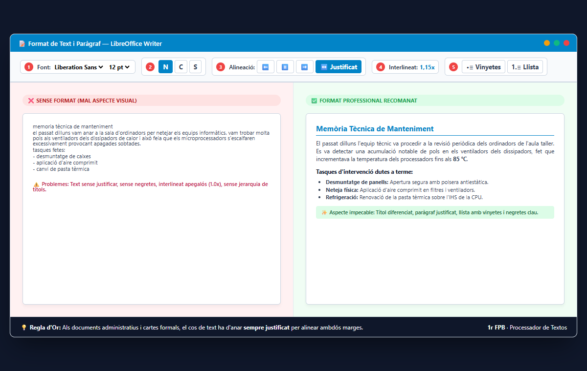

# 2.2 Format de caràcter i paràgraf (Tipografies, sagnies i interlineat)

Un document ben maquetat ha de ser net, llegible i jerarquitzat.

### A. Format de Caràcter:
- **Tipografia (*Font*):** Lletres amb serifa com *Times New Roman* (formals) o de pal sec com *Arial*, *Calibri* o *Liberation Sans* (modernes i molt llegibles en pantalla).
- **Mida de lletra (Punts):** Per a cos de text es recomanen 11 o 12 punts; per a títols, 14 a 18 punts.
- **Estils:** **Negreta** (destacar conceptes clau), *Cursiva* (paraules estrangeres o cites) i <u>Subratllat</u>.

### B. Format de Paràgraf:
- **Alineació:**
  - *A l'esquerra:* L'alineació més natural i fàcil de llegir.
  - *Centrada:* Reservada per a títols i portades.
  - *A la dreta:* Per a dates, números de pàgina o signatures al final de cartes.
  - *Justificada:* Alinea el text exactament als dos marges (esquerre i dret). Molt utilitzada en informes formals i llibres.
- **Interlineat:** L'espai vertical entre línies de text (normalment 1,15 o 1,5 línies).
- **Sagnies (*Indents*):**
  - *Sagnia de primera línia:* Desplaça només la primera línia de cada paràgraf cap a la dreta (1 a 1,25 cm).
  - *Sagnia esquerra / dreta:* Desplaça tot el paràgraf per destacar blocs de text o cites.

---

### Guia Pràctica Visual: Format de Text i Justificació de Paràgraf

Observa la diferència radical d'aspecte professional entre un text sense format i un document correctament maquetat:

#### 🛠️ Eines Clau de la Barra de Format de Writer:
1. **➊ Selecció de Tipografia i Mida:** Per al cos de text es recomana **Liberation Sans o Arial a 12 pt** (o 11 pt). Evita usar tipografies de fantasia o excessivament recarregades.
2. **➋ Estils de Caràcter:**
   - **Negreta (`Ctrl + B` a Writer / `Ctrl + N` en Word):** Fes-la servir només per ressaltar paraules o xifres clau. No posis paràgrafs sencers en negreta.
   - *Cursiva (`Ctrl + I`):* Per a tecnicismes en anglès o citacions textuals.
   - <u>Subratllat (`Ctrl + U`):* Útil per a enllaços o títols secundaris.
3. **➌ Alineació Justificada (`Ctrl + J`):** Ajusta les lletres perquè el text forme un bloc recte i net tant al marge esquerre com al marge dret. **És el requisit obligatori per a informes i memòries de feina.**
4. **➍ Interlineat (1,15x):** Separa lleugerament les línies perquè el text no quede atapeït ni canse la vista durant la lectura.
5. **➎ Llistes amb Vinyetes (`Shift + F12`):** Agrupa procediments o punts d'un informe de manera ordenada amb punts o guions nets.

