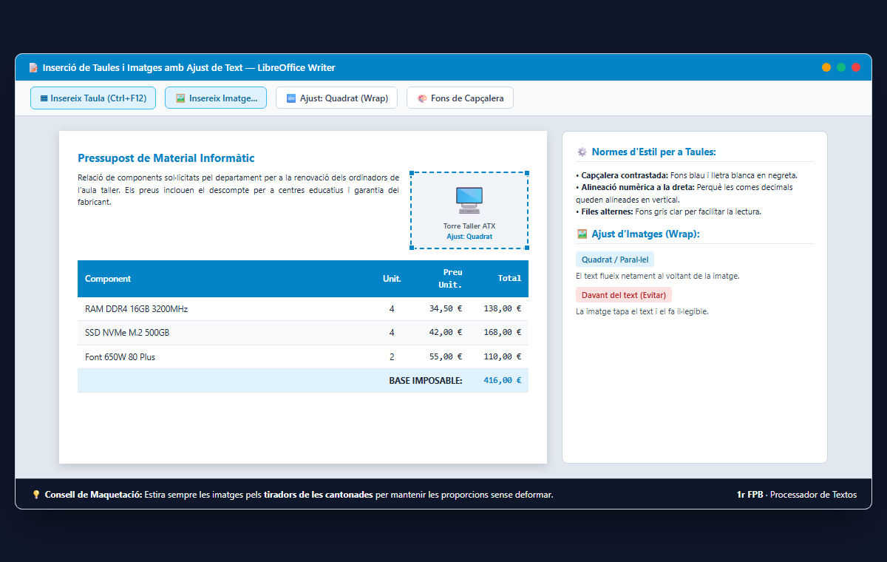

# 2.4 Inserció i disseny de taules i imatges

Les taules permeten mostrar dades estructurades i les imatges il·lustren el contingut.

### 1. Treball amb Taules:
- **Inserció:** Menú *Taula > Insereix una taula* indicant nombre de columnes i files.
- **Format de taula:** Definir capçaleres amb fons ombrejat de color fosc i text clar.
- **Combinar cel·les:** Unir dues o més cel·les contigües per a títols generals.
- **Distribuir files/columnes uniformement:** Assegura que totes les caselles tinguen la mateixa amplada.

### 2. Inserció d'Imatges:
- Menú *Insereix > Imatge*.
- **Ajust de text (*Wrap*):**
  - *Paral·lel / Continu:* El text envolta la imatge de manera fluida.
  - *Dalt i Baix:* El text s'atura abans de la imatge i continua a sota, sense ocupar els laterals.
  - *Com a caràcter:* La imatge es comporta com si fóra una lletra més dins de la línia.

---

### Guia Pràctica Visual: Inserció de Taules i Ajust d'Imatges (Wrap)

#### ▦ Disseny Professional de Taules:
1. **Drecera ràpida:** Prem **`Ctrl + F12`** (o ves a *Taula > Insereix una taula...*) i indica les columnes i files que necessites.
2. **Capçalera visible:** Aplica sempre un color de fons sòlid a la primera fila (per exemple, blau marí amb text blanc en negreta).
3. **Alineació numèrica a la dreta:** Totes les columnes amb preus en euros o quantitats s'han d'alinear **a la dreta** perquè les unitats i els decimals queden perfectament enquadrats.

#### 🖼️ Maquetació d'Imatges i Ajust de Text (*Wrap*):
- Després d'inserir la fotografia des de `Insereix > Imatge...`, fes-hi clic a sobre. Apareixeran 8 punts verds o blaus a les vores (*tiradors*).
- **Redimensionar:** Fes clic i arrossega **sempre des d'un tirador de la cantonada** per canviar la mida sense deformar ni aplanar la imatge.
- **Tipus d'Ajust:** Fes clic dret sobre la imatge > *Ajust* i selecciona **Quadrat / Pàgina**. Això farà que el text s'adapte netament al voltant de la fotografia sense tapar cap paraula.

