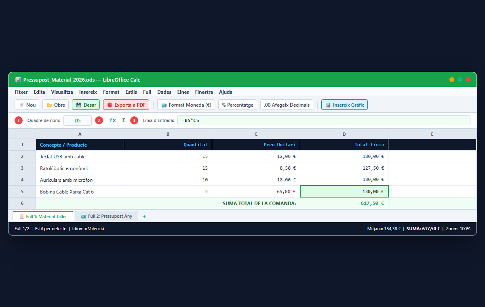

# 📊 UT03: Full de Càlcul (LibreOffice Calc / Excel)

Benvingut/da a la **Unitat Temàtica 3** d'**Ofimàtica i Arxiu de Documents (OAD)**. El full de càlcul és l'eina imprescindible del departament d'administració per a gestionar dades numèriques, elaborar pressupostos, controlar l'estoc del magatzem, liquidar nòmines i analitzar l'evolució del negoci mitjançant gràfics visuals. En aquesta unitat aprendràs a dominar la quadrícula de LibreOffice Calc i Microsoft Excel, utilitzaràs operadors aritmètics començant sempre amb el signe `=`, dominaràs les referències absolutes amb el símbol de dòlar (`$`), aplicaràs funcions estadístiques i lògiques com `=SI()`, i dissenyaràs gràfics informatius per a la presa de decisions.

<svg viewBox="0 0 860 260" xmlns="http://www.w3.org/2000/svg" style="max-width: 100%; height: auto; font-family: 'Segoe UI', system-ui, sans-serif; background: linear-gradient(135deg, #0f172a 0%, #1e293b 100%); border-radius: 12px; border: 1px solid #334155; box-shadow: 0 10px 25px -5px rgba(0, 0, 0, 0.4);">
  <defs>
    <linearGradient id="g-c-for" x1="0%" y1="0%" x2="100%" y2="100%">
      <stop offset="0%" stop-color="#38bdf8" stop-opacity="0.25"/>
      <stop offset="100%" stop-color="#0284c7" stop-opacity="0.05"/>
    </linearGradient>
    <linearGradient id="g-c-ref" x1="0%" y1="0%" x2="100%" y2="100%">
      <stop offset="0%" stop-color="#818cf8" stop-opacity="0.25"/>
      <stop offset="100%" stop-color="#4f46e5" stop-opacity="0.05"/>
    </linearGradient>
    <linearGradient id="g-c-fun" x1="0%" y1="0%" x2="100%" y2="100%">
      <stop offset="0%" stop-color="#34d399" stop-opacity="0.25"/>
      <stop offset="100%" stop-color="#059669" stop-opacity="0.05"/>
    </linearGradient>
    <linearGradient id="g-c-gra" x1="0%" y1="0%" x2="100%" y2="100%">
      <stop offset="0%" stop-color="#f59e0b" stop-opacity="0.25"/>
      <stop offset="100%" stop-color="#d97706" stop-opacity="0.05"/>
    </linearGradient>
  </defs>

  <!-- Capçalera -->
  <text x="430" y="32" text-anchor="middle" fill="#f8fafc" font-size="16" font-weight="700" letter-spacing="1">FULL DE CÀLCUL: FÓRMULES, REFERÈNCIES $A$1, FUNCIONS I GRÀFICS</text>
  <text x="430" y="50" text-anchor="middle" fill="#94a3b8" font-size="12">Automatització matemàtica, gestió comptable, lògica condicional i visualització de dades</text>

  <!-- Bloc 1: Fórmules Bàsiques -->
  <g transform="translate(25, 70)">
    <rect width="185" height="165" rx="10" fill="url(#g-c-for)" stroke="#38bdf8" stroke-width="1.5"/>
    <rect x="15" y="14" width="28" height="28" rx="6" fill="#38bdf8" fill-opacity="0.2"/>
    <text x="29" y="33" text-anchor="middle" fill="#38bdf8" font-size="14" font-weight="bold">=</text>
    <text x="52" y="33" fill="#f8fafc" font-size="13" font-weight="bold">Fórmules i Operadors</text>
    <text x="15" y="62" fill="#38bdf8" font-size="11" font-weight="600">Sintaxi Aritmètica</text>
    <text x="15" y="84" fill="#cbd5e1" font-size="11">• Iniciar sempre amb el signe =</text>
    <text x="15" y="104" fill="#cbd5e1" font-size="11">• Suma (+), Resta (-), Mult (*)</text>
    <text x="15" y="124" fill="#cbd5e1" font-size="11">• Divisió (/), Potència (^)</text>
    <text x="15" y="144" fill="#cbd5e1" font-size="11">• Prioritat amb parèntesis ()</text>
  </g>

  <!-- Bloc 2: Referències de Cel·la -->
  <g transform="translate(230, 70)">
    <rect width="185" height="165" rx="10" fill="url(#g-c-ref)" stroke="#818cf8" stroke-width="1.5"/>
    <rect x="15" y="14" width="28" height="28" rx="6" fill="#818cf8" fill-opacity="0.2"/>
    <text x="29" y="33" text-anchor="middle" fill="#818cf8" font-size="14" font-weight="bold">$</text>
    <text x="52" y="33" fill="#f8fafc" font-size="13" font-weight="bold">Referències i Dòlar</text>
    <text x="15" y="62" fill="#818cf8" font-size="11" font-weight="600">Comportament d'Arrossegament</text>
    <text x="15" y="84" fill="#cbd5e1" font-size="11">• Relativa (A1): Canvia lliurement</text>
    <text x="15" y="104" fill="#cbd5e1" font-size="11">• Absoluta ($A$1): Bloquejada</text>
    <text x="15" y="124" fill="#cbd5e1" font-size="11">• Mixta ($A1 o A$1): Fila/Col</text>
    <text x="15" y="144" fill="#cbd5e1" font-size="11">• Tecla ràpida: F4 (Windows)</text>
  </g>

  <!-- Bloc 3: Funcions Estàndard -->
  <g transform="translate(435, 70)">
    <rect width="195" height="165" rx="10" fill="url(#g-c-fun)" stroke="#34d399" stroke-width="1.5"/>
    <rect x="15" y="14" width="28" height="28" rx="6" fill="#34d399" fill-opacity="0.2"/>
    <text x="29" y="33" text-anchor="middle" fill="#34d399" font-size="14" font-weight="bold">fx</text>
    <text x="52" y="33" fill="#f8fafc" font-size="13" font-weight="bold">Funcions i Lògica</text>
    <text x="15" y="62" fill="#34d399" font-size="11" font-weight="600">Biblioteca Estàndard</text>
    <text x="15" y="84" fill="#cbd5e1" font-size="11">• =SUMA(A1:A10) / =MITJANA()</text>
    <text x="15" y="104" fill="#cbd5e1" font-size="11">• =MAX() / =MIN() / =COMPTA()</text>
    <text x="15" y="124" fill="#cbd5e1" font-size="11">• =SI(prova; cert; fals)</text>
    <text x="15" y="144" fill="#cbd5e1" font-size="11">• Format condicional cromàtic</text>
  </g>

  <!-- Bloc 4: Gràfics Estadístics -->
  <g transform="translate(650, 70)">
    <rect width="185" height="165" rx="10" fill="url(#g-c-gra)" stroke="#f59e0b" stroke-width="1.5"/>
    <rect x="15" y="14" width="28" height="28" rx="6" fill="#f59e0b" fill-opacity="0.2"/>
    <text x="29" y="33" text-anchor="middle" fill="#f59e0b" font-size="14" font-weight="bold">📈</text>
    <text x="52" y="33" fill="#f8fafc" font-size="13" font-weight="bold">Gràfics i Formats</text>
    <text x="15" y="62" fill="#f59e0b" font-size="11" font-weight="600">Presentació Visual</text>
    <text x="15" y="84" fill="#cbd5e1" font-size="11">• Format moneda (€) i %</text>
    <text x="15" y="104" fill="#cbd5e1" font-size="11">• Gràfic de columnes / barres</text>
    <text x="15" y="124" fill="#cbd5e1" font-size="11">• Gràfic circular (Sectors %)</text>
    <text x="15" y="144" fill="#cbd5e1" font-size="11">• Títols d'eixos i llegenda</text>
  </g>
</svg>

---

## 📑 Apartats de la Unitat Didàctica

| Apartat | Títol de la Secció Didàctica | Enllaç Directe |
| :---: | :--- | :---: |
| **3.1** | Estructura d'un full de càlcul: Cel·les, files, columnes i formats de dades | [**📘 Llegir Apartat 3.1 →**](./ut0301.html) |
| **3.2** | Fórmules aritmètiques i referències de cel·la | [**📘 Llegir Apartat 3.2 →**](./ut0302.html) |
| **3.3** | Funcions estadístiques i matemàtiques: SUMA, MITJANA, MAX, MIN i CONTAR | [**📘 Llegir Apartat 3.3 →**](./ut0303.html) |
| **3.4** | La funció condicional SI (IF) i formats condicionals | [**📘 Llegir Apartat 3.4 →**](./ut0304.html) |
| **3.5** | Creació i interpretació de gràfics en fulls de càlcul | [**📘 Llegir Apartat 3.5 →**](./ut0305.html) |

---

## 🎯 Resultats d'Aprenentatge Treballats

- **RA 3:** Gestiona fulls de càlcul aplicant formats, fórmules i funcions per a resoldre problemes de gestió administrativa i comptable.
  - *CE a:* S'han introduït i organitzat dades assignant formats adequats (moneda, percentatge, data).
  - *CE b:* S'han elaborat fórmules emprant operadors aritmètics i referències relatives i absolutes.
  - *CE c:* S'han utilitzat funcions matemàtiques, estadístiques i lògiques per analitzar conjunts de dades.
  - *CE d:* S'han generat gràfics estadístics adequats al tipus de dades per representar la informació de manera clara.

---

## 📊 Matriu de Funcions Estàndard de Full de Càlcul

| Nom de la Funció (Valencià / En) | Sintaxi Oficial | Descripció de l'Argument | Exemple Pràctic Empresarial | Valor que Retorna |
| :--- | :--- | :--- | :--- | :--- |
| **=SUMA()** / `=SUM()` | `=SUMA(núm1; núm2; ...)` | Un rang continu com `A1:A20` o cel·les soltes | `=SUMA(D2:D15)` | El total acumulat de la columna |
| **=MITJANA()** / `=AVERAGE()` | `=MITJANA(rang)` | Rang de cel·les amb valors numèrics | `=MITJANA(E2:E30)` | La mitjana aritmètica de vendes |
| **=MAX()** / `=MAX()` | `=MAX(rang)` | Rang numèric | `=MAX(B2:B50)` | El valor més alt (factura màxima) |
| **=MIN()** / `=MIN()` | `=MIN(rang)` | Rang numèric | `=MIN(B2:B50)` | El valor més baix trobat |
| **=COMPTA()** / `=COUNT()` | `=COMPTA(rang)` | Rang de cel·les a inspeccionar | `=COMPTA(A2:A100)` | El nombre de cel·les amb contingut numèric |
| **=SI()** / `=IF()` | `=SI(condició; si_cert; si_fals)` | Prova lògica, resposta si es compleix, resposta si no | `=SI(D2>=1000; "PREMI"; "NORMAL")` | El text o càlcul segons la condició |
| **=ARRODONIX()** / `=ROUND()` | `=ARRODONIX(nombre; decimals)` | Cel·la numèrica i nombre de xifres decimals | `=ARRODONIX(F2; 2)` | El número arrodonit a 2 decimals |

---

## 📌 Resum Didàctic i Idees Clau

1. **Estructura de la Quadrícula:** Les **columnes** s'identifiquen amb lletres majúscules (A, B, C...) i les **files** amb números enters (1, 2, 3...). La intersecció d'una columna i una fila és una **cel·la** (per exemple, `B4`).
2. **Fórmules i Signe Inicial:** Tota fórmula ha de començar obligatòriament amb el símbol de l'igual **`=`**. Si s'escriu directament `A1+B1` sense l'igual, el programa ho interpretarà com un simple text i no calcularà res.
3. **Referències Absolutes ($A$1):**
   - Una **referència relativa** (`A1`) canvia de fila i columna quan s'arrossega la fórmula cap avall o cap a la dreta amb el controlador d'ompliment.
   - Una **referència absoluta** (`$A$1`) bloqueja tant la columna com la fila amb el símbol de dòlar `$`. S'utilitza per multiplicar sempre per una cel·la fixa que conté un paràmetre global (per exemple: el tipus d'IVA del 21%, un descompte fix o el preu de l'hora).
4. **Funció Condicional `=SI()`:** Avalua una comparació lògica (`>`, `<`, `>=`, `<=`, `=`, `<>`). Si la condició és certa, retorna el primer resultat; si és falsa, retorna el segon. Exemple: `=SI(C2>=5; "Aprovat"; "Suspès")`.
5. **Tipus de Gràfics:**
   - **Gràfic de columnes / barres:** Ideal per comparar magnituds entre elements diferents (per exemple, vendes de cada mes).
   - **Gràfic circular de sectors:** Ideal per visualitzar com es reparteix un total del 100% en percentatges (per exemple, quota de mercat o despeses d'un pressupost).

---

## 📸 Guies Visuals Pas a Pas de LibreOffice Calc

### 1. Interfície de Treball, Cel·les i Barra de Fórmules

### 2. Fórmules i Funcions Fonamentals (SUMA, MITJANA, MAX, MIN)

### 3. Assistent de Creació de Gràfics de Columnes i Sectors

---

## 📝 Quadern d'Activitats Pràctiques i Reptes de Laboratori

### Bloc A: Fonaments, Dimensionament i Diagnòstic Tècnic

#### Exercici 1: Càlcul de Nòmina d'Empleats amb Referències Absolutes
En un taller de reparació informàtica hem de liquidar la nòmina mensual de 4 tècnics. A la capçalera del full s'han definit dues cel·les fixes de paràmetres:
- Cel·la `$B$1`: Tipus de retenció d'IRPF = **12%** (`0,12`)
- Cel·la `$B$2`: Tipus de cotització a la Seguretat Social (SS) = **6,4%** (`0,064`)
A la taula d'empleats tenim:
- Fila 5: Tècnic 1 (Joan) té un Sou Brut de $1.400,00\text{ €}$ a la cel·la `B5`.
- Fila 6: Tècnic 2 (Marta) té un Sou Brut de $1.650,00\text{ €}$ a la cel·la `B6`.
- Fila 7: Tècnic 3 (Carles) té un Sou Brut de $1.350,00\text{ €}$ a la cel·la `B7`.
- Fila 8: Tècnic 4 (Sara) té un Sou Brut de $1.500,00\text{ €}$ a la cel·la `B8`.
1. Escriu la fórmula exacta que s'ha d'escriure a la cel·la `C5` per calcular l'import d'IRPF de Joan utilitzant una **referència absoluta** a la cel·la `$B$1` perquè es puga arrossegar cap avall a la resta d'empleats.
2. Escriu la fórmula per a la cel·la `D5` per calcular la deducció de la Seguretat Social bloquejant la cel·la `$B$2`.
3. Escriu la fórmula per a la cel·la `E5` que calcule el **Sou Líquid a Percebre** (Sou Brut - IRPF - Seguretat Social).
4. Explica què passaria si no posàrem el símbol de dòlar (`$`) i escriguérem `=B5*B1`: quin error es produiria en arrossegar la fórmula a la fila de Marta (`C6`)?

#### Exercici 2: Lògica Condicional i Comissions de Vendes amb `=SI()`
L'empresa atorga un incentiu econòmic extraordinari de **150 €** a aquells comercials les vendes mensuals dels quals superen els **8.000 €**. Si no assoleixen aquesta xifra, la bonificació és de **0 €**.
La taula conté:
- Columna A: Nom del comercial.
- Columna B: Import total de vendes del mes.
- Columna C: Bonificació (€).
- Columna D: Missatge d'avaluació.
1. Escriu la fórmula amb la funció `=SI()` que s'ha d'introduir a la cel·la `C2` per assignar automàticament els 150 € o 0 € segons si `B2 > 8000`.
2. Escriu a la cel·la `D2` una fórmula `=SI()` que mostre el text `"OBJECTIU ASSOLIT"` si les vendes són majors o iguals a 8.000 € i `"NO ASSOLIT"` en cas contrari.
3. Si la direcció decideix que els comercials amb vendes inferiors a 8.000 € han de rebre un 2% de les seues vendes com a consolació, com es modifica la fórmula de la cel·la `C2`?

#### Exercici 3: Diagnòstic i Resolució d'Errors de Pantalla al Full de Càlcul
Identifica la causa tècnica i la solució immediata que s'ha d'aplicar per a cadascun dels següents missatges d'error comuns a LibreOffice Calc o Excel:
1. **Missatge `###`:** Una cel·la mostra una fila de símbols de coixinet en lloc del número. Està malament la fórmula matemàtica? Com se soluciona amb el ratolí a la capçalera de columna?
2. **Missatge `#DIV/0!`:** Què significa aquest error i com es produeix en fer una mitjana o divisió de cel·les que estan buides o valen 0?
3. **Missatge `#REF!`:** Què ha passat amb una de les cel·les que formava part de la fórmula (per exemple, s'ha eliminat físicament una fila o columna)? Com es repara?
4. **Missatge `#VALOR!`:** Per què apareix aquest avís si intentem sumar `=A1 + B1` i la cel·la `B1` conté la paraula "Pendent"?

---

### Bloc B: Reptes Pràctics de Laboratori i Taller

#### Repte 1: Creació d'un Full de Caixa i Facturació Diària
- **Objectiu:** Crear una plantilla de control d'ingressos i despeses d'un negoci aplicant formats monetaris i càlculs de saldo acumulat.
- **Material de laboratori:** LibreOffice Calc o Microsoft Excel.
- **Passos d'execució:**
  1. Obre un nou full de càlcul i dóna nom a la pestanya inferior: `Caixa_Febrer`.
  2. Crea a la fila 3 la següent capçalera de taula:
     `[A3: Data] [B3: Concepte] [C3: Ingressos (€)] [D3: Despeses (€)] [E3: Saldo (€)]`
  3. Fica un fons blau fosc a les cel·les de capçalera amb lletra blanca en negreta.
  4. Introdueix un saldo inicial a la fila 4: Data `01/02/2026`, Concepte `Saldo Inicial`, Ingrés `500,00`, Saldo `500,00`.
  5. A la fila 5, introdueix el primer moviment: Data `02/02/2026`, Concepte `Reparació PC Client 01`, Ingrés `85,00`, Despesa `0,00`.
  6. Introdueix la fórmula de saldo dinàmic a la cel·la `E5`:
     `= E4 + C5 - D5`
  7. Arrossega la fórmula de la cel·la `E5` cap avall fins a la fila 15.
  8. Afegeix 6 moviments reals més combinant compres de recanvis (despeses) i cobraments de reparacions (ingressos). Comprova com el saldo s'actualitza automàticament a cada fila.
  9. Selecciona tot el rang numèric de les columnes C, D i E i assigna el **Format de Moneda (€)** amb dos decimals.
  10. A la fila 16, calcula el total d'ingressos sumats amb `=SUMA(C5:C15)` i el total de despeses amb `=SUMA(D5:D15)`.

#### Repte 2: Quadre de Comandament d'Inventari amb Format Condicional
- **Objectiu:** Utilitzar funcions estadístiques i aplicar regles de format condicional que alerten visualment quan l'estoc d'un component estiga sota mínims.
- **Material de laboratori:** LibreOffice Calc o Microsoft Excel.
- **Passos d'execució:**
  1. Crea una taula amb 10 components de taller amb les columnes: `Codi`, `Descripció`, `Estoc Actual`, `Estoc Mínim`, `Preu Cost`, `Valor Total`.
  2. A la columna `Valor Total`, calcula la multiplicació d'estoc actual per preu de cost.
  3. A sota de la taula, crea una petita àrea de mètriques utilitzant:
     - `=SUMA()` per al valor total de l'estoc de la botiga.
     - `=MITJANA()` per a la mitjana d'unitats disponibles.
     - `=MAX()` per a localitzar l'article amb major nombre d'unitats.
     - `=MIN()` per a l'article amb menor estoc.
  4. Selecciona la columna d'**Estoc Actual**:
     - Ves a **Format > Format condicional > Condició...**
     - Afegeix la regla: *Si el valor de la cel·la és menor o igual que la cel·la d'Estoc Mínim*, aplica un **Estil d'alerta amb fons roig clar i text roig fosc**.
     - Afegeix una segona regla: *Si el valor de la cel·la és superior al doble de l'Estoc Mínim*, aplica un **Estil de seguretat amb fons verd clar**.
  5. Canvia manualment l'estoc d'un dels articles reduint-lo a 1 unitat i comprova com la cel·la es pinta immediatament de color roig automàticament.

#### Repte 3: Generació de Gràfic de Sectors i Gràfic de Columnes
- **Objectiu:** Convertir dades numèriques en gràfics visuals fàcilment comprensibles per a una reunió d'empresa.
- **Material de laboratori:** LibreOffice Calc o Microsoft Excel amb les dades de vendes per categories.
- **Passos d'execució:**
  1. Introdueix la següent taula resum de facturació per línies de negoci:
     - Ordinadors i Portàtils: 18.500 €
     - Components i Recanvis: 9.200 €
     - Perifèrics i Monitors: 5.400 €
     - Serveis i Mà d'obra: 12.100 €
  2. Selecciona la taula completa amb les seues etiquetes de text.
  3. Fes clic a **Insereix > Gràfic...**:
     - Tria el tipus de gràfic **Columna (Barres verticals 2D)**.
     - Afegeix el títol al gràfic: "Facturació Anual per Línia de Negoci".
     - Assigna un títol a l'eix Y: "Euros (€)".
     - Finalitza i ubica el gràfic a la dreta de la taula.
  4. Crea un segon gràfic amb les mateixes dades:
     - Tria el tipus de gràfic **Circular (Format de sectors / Pastís)**.
     - A les opcions de sèrie de dades, activa la casella **Mostra etiquetes de dades** i selecciona que mostre el **Percentatge (%)** en lloc de la xifra en euros.
     - Separa lleugerament el sector que tinga el major percentatge per destacar-lo visualment.
  5. Exporta el full de càlcul complet a format **PDF** assegurant que tant la taula com els dos gràfics s'ajusten a un únic full A4 horitzontal.

---

### Bloc C: Llista de Verificació i Rúbrica d'Avaluació Competencial

#### Llista de Verificació del Full de Càlcul
- [ ] Totes les fórmules matemàtiques s'inicien amb el signe igual `=` sense espais previs.
- [ ] S'han assignat els formats correctes a cada cel·la (moneda amb símbol de l'euro `€`, percentatge `%`, dates curtes).
- [ ] S'han emprat referències absolutes (`$`) en fórmules que depenen de cel·les de paràmetres fixes.
- [ ] Les columnes tenen l'amplada suficient i no mostren símbols d'error `###` ni `#DIV/0!`.
- [ ] Les funcions estadístiques (`SUMA`, `MITJANA`, `MAX`, `MIN`) utilitzen rangs complets i tancats amb parèntesis.
- [ ] S'ha utilitzat correctament la funció lògica `=SI()` amb punt i coma `;` com a separador d'arguments.
- [ ] El format condicional s'activa automàticament en canviar les dades d'origen.
- [ ] Els gràfics tenen títols clars, eixos retolats i etiquetes de dades o percentatges visibles.

#### Rúbrica d'Avaluació Tècnica (FP Bàsica OAD - UT03)

| Criteri d'Avaluació | Excel·lent (9-10) | Notable (7-8) | Aprovat (5-6) | No Assolit (0-4) |
| :--- | :--- | :--- | :--- | :--- |
| **Ús de Fórmules i Operadors Aritmètics** | Escriu fórmules complexes amb parèntesis i operadors sense errors, comprenent l'ordre de prioritat matemàtica. | Utilitza operadors bàsics (+, -, *, /) i comença sempre amb `=` de manera sistemàtica. | Escriu fórmules simples amb ajuda de la guia de classe. | Oblida posar el signe `=` abans de calcular o escriu operacions amb errors de sintaxi greus. |
| **Gestió de Referències Absolutes ($A$1)** | Distingeix referències relatives i absolutes, bloqueja cel·les amb `$` i utilitza la tecla ràpida F4 amb precisió. | Utilitza el símbol de dòlar per bloquejar cel·les fixes de paràmetres amb poques vacil·lacions. | Aplica la referència absoluta amb suport docent en arrossegar la fórmula. | No comprèn el concepte de cel·la bloquejada i obté errors en arrossegar fórmules cap avall. |
| **Aplicació de Funcions i Lògica Condicional** | Domina `=SUMA()`, `=MITJANA()`, `=MAX()`, `=MIN()` i la funció condicional `=SI()` imbricada sense cap error. | Aplica les funcions bàsiques i la funció `=SI()` simple de manera autònoma i correcta. | Utilitza la funció de suma i mitjana amb suport del botó d'autosuma. | Incapaç d'aplicar funcions sobre rangs o s'equivoca en la sintaxi de la funció condicional `=SI()`. |
| **Formats de Dades i Representació Gràfica** | Aplica formats moneda i percentatge impecables, configura formats condicionals i crea gràfics de sectors/columnes clars. | Assigna format de moneda i crea gràfics representatius amb títol i etiquetes visibles. | Canvia el format numèric a euros i insereix un gràfic bàsic guiat pas a pas. | Deixa números sense format, crea gràfics il·legibles o és incapaç de seleccionar el rang de dades adient. |
