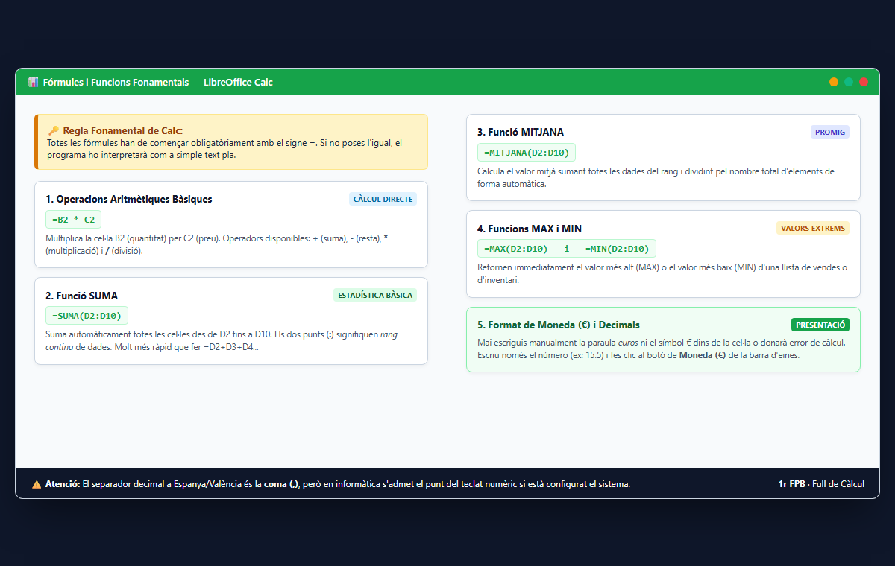

# 3.2 Fórmules aritmètiques i referències de cel·la

La màgia del full de càlcul resideix en les fórmules automàtiques.

### Regla Fonamental: El signe igual (=)
Per indicar a Calc o Excel que volem fer un càlcul, la cel·la ha de començar **SEMPRE amb el signe igual (=)**. Si no es posa `=`, el programa ho interpretarà com a simple text.

### Operadors Aritmètics Bàsics:
- Suma: `+`
- Resta: `-`
- Multiplicació: `*` (asterisc)
- Divisió: `/` (barra inclinada)
- Potència: `^`

### Exemple de Fórmula:
A la cel·la C1 volem calcular el preu amb IVA d'un producte que costa 100 € (situat a A1) amb un IVA del 21%:
$$=A1 * 1{,}21$$

### Referències Relatives vs Absolutes ($):
- **Referència Relativa (`A1`):** En arrossegar la fórmula cap avall amb la creu negra (*controlador d'ompliment*), la referència canvia automàticament a `A2`, `A3`, `A4`...
- **Referència Absoluta (`$A$1`):** Els signes de dòlar bloquegen la cel·la perquè quede fixa encara que arrosseguem la fórmula.

---

### Guia Pràctica Visual: Fórmules i Funcions Fonamentals de Calc

#### 🧮 Les 5 Funcions que tot Tècnic d'Oficina ha de Dominar:
1. **Començar sempre amb l'igual (`=`):** Qualsevol càlcul comença amb `=`, per exemple `=B2*C2` per multiplicar el preu per les unitats.
2. **Funció SUMA (`=SUMA(rang)`):** `=SUMA(D2:D10)` suma automàticament totes les cel·les entre D2 i D10 sense haver d'escriure `D2+D3+D4...`.
3. **Funció MITJANA (`=MITJANA(rang)`):** `=MITJANA(D2:D10)` calcula el consum mitjà o la nota mitjana del grup.
4. **Funcions MAX i MIN:** `=MAX(D2:D10)` troba el producte més car o la despesa màxima, i `=MIN(D2:D10)` el valor mínim.
5. **Format de Moneda (€):** Mai escriguis "euros" o el símbol "€" manualment amb el teclat perquè el full de càlcul donarà error de valor (`#VALOR!`). Escriu només el número (p. ex. `12,5`) i fes clic a la icona **Format de Moneda (€)** de la barra d'eines.

