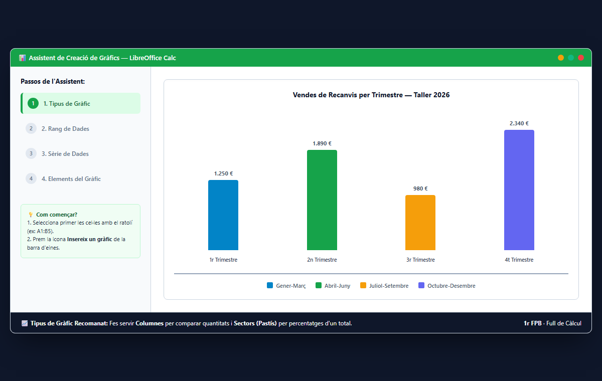

# 3.5 Creació i interpretació de gràfics en fulls de càlcul

Un gràfic transforma una taula de xifres fredes en una imatge visual fàcil d'entendre.

### Tipus de Gràfics Habituals:
1. **Gràfic de Columnes / Barres:** Ideal per comparar quantitats entre diferents elements (vendes per departament, notes per matèria, consums per mes).
2. **Gràfic de Línies:** Ideal per veure l'evolució d'una variable al llarg del temps (temperatures mensuals, evolució del preu de la llum).
3. **Gràfic de Sectors (Format Formatge / Pastís):** Representa el percentatge que aporta cada part respecte al total (distribució del pressupost d'una empresa).

### Passos per crear un gràfic:
1. Selecciona les cel·les amb les dades i els títols de les etiquetes.
2. Fes clic a la icona d'**Insereix un gràfic**.
3. Tria el tipus de gràfic i afegeix títol general i llegendes dels eixos.

---

### Guia Pràctica Visual: L'Assistent de Creació de Gràfics

#### 📊 Passos Guiats per a l'Alumnat:
1. **Pas 1 (Selecció):** Selecciona amb el ratolí la taula que vols representar (incloent els títols de les columnes i de les files, per exemple `A1:B5`).
2. **Pas 2 (Obrir l'Assistent):** Fes clic a la icona **Insereix un gràfic** de la barra d'eines estàndard.
3. **Pas 3 (Tipus de gràfic):** Tria el disseny més adequat segons les teues dades:
   - **Columnes / Barres:** Per comparar vendes, notes o quantitats físiques.
   - **Sectors (Pastís):** Per veure el repartiment d'un pressupost (en percentatges).
   - **Línies:** Per veure l'evolució al llarg del temps (mesos o anys).
4. **Pas 4 (Títols i llegenda):** Afegeix un títol clar que explique què representa el gràfic (ex: *Vendes de Recanvis per Trimestre — Taller 2026*).

