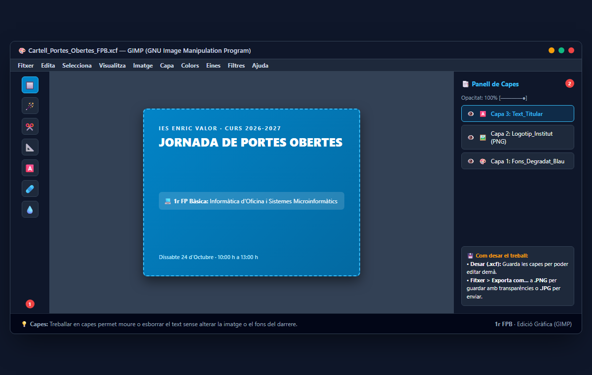

# 🎨 UT04: Disseny Gràfic i Edició d'Imatges (GIMP i Canva)

Benvingut/da a la **Unitat Temàtica 4** d'**Ofimàtica i Arxiu de Documents (OAD)**. La imatge digital és una de les eines més potents de comunicació visual d'una empresa: cartells publicitaris, catàlegs de productes, fotografies per a la pàgina web i gràfics per a xarxes socials. En aquesta unitat comprendràs com funcionen els píxels i la resolució d'impressió (DPI), aprendràs a utilitzar l'editor professional de programari lliure **GIMP** per treballar amb capes, seleccions i màscares de transparència, i dissenyaràs presentacions i fullets corporatius d'alta qualitat utilitzant **Canva**.

<svg viewBox="0 0 860 260" xmlns="http://www.w3.org/2000/svg" style="max-width: 100%; height: auto; font-family: 'Segoe UI', system-ui, sans-serif; background: linear-gradient(135deg, #0f172a 0%, #1e293b 100%); border-radius: 12px; border: 1px solid #334155; box-shadow: 0 10px 25px -5px rgba(0, 0, 0, 0.4);">
  <defs>
    <linearGradient id="g-g-pix" x1="0%" y1="0%" x2="100%" y2="100%">
      <stop offset="0%" stop-color="#38bdf8" stop-opacity="0.25"/>
      <stop offset="100%" stop-color="#0284c7" stop-opacity="0.05"/>
    </linearGradient>
    <linearGradient id="g-g-for" x1="0%" y1="0%" x2="100%" y2="100%">
      <stop offset="0%" stop-color="#818cf8" stop-opacity="0.25"/>
      <stop offset="100%" stop-color="#4f46e5" stop-opacity="0.05"/>
    </linearGradient>
    <linearGradient id="g-g-gmp" x1="0%" y1="0%" x2="100%" y2="100%">
      <stop offset="0%" stop-color="#34d399" stop-opacity="0.25"/>
      <stop offset="100%" stop-color="#059669" stop-opacity="0.05"/>
    </linearGradient>
    <linearGradient id="g-g-cnv" x1="0%" y1="0%" x2="100%" y2="100%">
      <stop offset="0%" stop-color="#f59e0b" stop-opacity="0.25"/>
      <stop offset="100%" stop-color="#d97706" stop-opacity="0.05"/>
    </linearGradient>
  </defs>

  <!-- Capçalera -->
  <text x="430" y="32" text-anchor="middle" fill="#f8fafc" font-size="16" font-weight="700" letter-spacing="1">DISSENY GRÀFIC I IMATGE DIGITAL: PÍXELS, GIMP, CAPES I CANVA</text>
  <text x="430" y="50" text-anchor="middle" fill="#94a3b8" font-size="12">Edició de mapa de bits, formats gràfics, retoc fotogràfic i composició de cartelleria</text>

  <!-- Bloc 1: Píxels i Resolució -->
  <g transform="translate(25, 70)">
    <rect width="185" height="165" rx="10" fill="url(#g-g-pix)" stroke="#38bdf8" stroke-width="1.5"/>
    <rect x="15" y="14" width="28" height="28" rx="6" fill="#38bdf8" fill-opacity="0.2"/>
    <text x="29" y="33" text-anchor="middle" fill="#38bdf8" font-size="14" font-weight="bold">🔍</text>
    <text x="52" y="33" fill="#f8fafc" font-size="13" font-weight="bold">Píxels i Resolució</text>
    <text x="15" y="62" fill="#38bdf8" font-size="11" font-weight="600">Fonaments de Ràster</text>
    <text x="15" y="84" fill="#cbd5e1" font-size="11">• Píxel: Unitat mínima de color</text>
    <text x="15" y="104" fill="#cbd5e1" font-size="11">• Resolució: 72 PPI per a pantalla</text>
    <text x="15" y="124" fill="#cbd5e1" font-size="11">• Resolució: 300 DPI impressió</text>
    <text x="15" y="144" fill="#cbd5e1" font-size="11">• Models RGB vs CMYK</text>
  </g>

  <!-- Bloc 2: Formats Gràfics -->
  <g transform="translate(230, 70)">
    <rect width="185" height="165" rx="10" fill="url(#g-g-for)" stroke="#818cf8" stroke-width="1.5"/>
    <rect x="15" y="14" width="28" height="28" rx="6" fill="#818cf8" fill-opacity="0.2"/>
    <text x="29" y="33" text-anchor="middle" fill="#818cf8" font-size="14" font-weight="bold">🖼️</text>
    <text x="52" y="33" fill="#f8fafc" font-size="13" font-weight="bold">Formats d'Imatge</text>
    <text x="15" y="62" fill="#818cf8" font-size="11" font-weight="600">Compressió i Ús</text>
    <text x="15" y="84" fill="#cbd5e1" font-size="11">• JPG: Fotos (amb pèrdua)</text>
    <text x="15" y="104" fill="#cbd5e1" font-size="11">• PNG: Fons transparent (Alfa)</text>
    <text x="15" y="124" fill="#cbd5e1" font-size="11">• WebP: Format web d'alta eficiència</text>
    <text x="15" y="144" fill="#cbd5e1" font-size="11">• SVG: Vectorial escalable</text>
  </g>

  <!-- Bloc 3: Editor GIMP -->
  <g transform="translate(435, 70)">
    <rect width="195" height="165" rx="10" fill="url(#g-g-gmp)" stroke="#34d399" stroke-width="1.5"/>
    <rect x="15" y="14" width="28" height="28" rx="6" fill="#34d399" fill-opacity="0.2"/>
    <text x="29" y="33" text-anchor="middle" fill="#34d399" font-size="14" font-weight="bold">🦊</text>
    <text x="52" y="33" fill="#f8fafc" font-size="13" font-weight="bold">Retoc amb GIMP</text>
    <text x="15" y="62" fill="#34d399" font-size="11" font-weight="600">Eines de Programari Lliure</text>
    <text x="15" y="84" fill="#cbd5e1" font-size="11">• Capes independents no destructives</text>
    <text x="15" y="104" fill="#cbd5e1" font-size="11">• Selecció difusa (Vareta màgica)</text>
    <text x="15" y="124" fill="#cbd5e1" font-size="11">• Tampó de clonar per a neteja</text>
    <text x="15" y="144" fill="#cbd5e1" font-size="11">• Escalat i retall de llenç</text>
  </g>

  <!-- Bloc 4: Disseny Canva -->
  <g transform="translate(650, 70)">
    <rect width="185" height="165" rx="10" fill="url(#g-g-cnv)" stroke="#f59e0b" stroke-width="1.5"/>
    <rect x="15" y="14" width="28" height="28" rx="6" fill="#f59e0b" fill-opacity="0.2"/>
    <text x="29" y="33" text-anchor="middle" fill="#f59e0b" font-size="14" font-weight="bold">✨</text>
    <text x="52" y="33" fill="#f8fafc" font-size="13" font-weight="bold">Disseny amb Canva</text>
    <text x="15" y="62" fill="#f59e0b" font-size="11" font-weight="600">Composició Visual</text>
    <text x="15" y="84" fill="#cbd5e1" font-size="11">• Plantilles de cartelleria i xarxes</text>
    <text x="15" y="104" fill="#cbd5e1" font-size="11">• Paleta de colors corporativa</text>
    <text x="15" y="124" fill="#cbd5e1" font-size="11">• Alineació i regles de disseny</text>
    <text x="15" y="144" fill="#cbd5e1" font-size="11">• Exportació a PDF per a impremta</text>
  </g>
</svg>

---

## 📑 Apartats de la Unitat Didàctica

| Apartat | Títol de la Secció Didàctica | Enllaç Directe |
| :---: | :--- | :---: |
| **4.1** | Fonaments de la imatge digital: Píxels, resolució i formats | [**📘 Llegir Apartat 4.1 →**](./ut0401.html) |
| **4.2** | L'entorn de treball de GIMP i les eines de selecció | [**📘 Llegir Apartat 4.2 →**](./ut0402.html) |
| **4.3** | Treball amb capes a GIMP: Creació, ordre i màscares | [**📘 Llegir Apartat 4.3 →**](./ut0403.html) |
| **4.4** | Retoc d'imatge bàsic: Escala, retall, clonat i ajust de color | [**📘 Llegir Apartat 4.4 →**](./ut0404.html) |
| **4.5** | Disseny ràpid de presentacions i cartelleria amb Canva | [**📘 Llegir Apartat 4.5 →**](./ut0405.html) |

---

## 🎯 Resultats d'Aprenentatge Treballats

- **RA 4:** Edita i prepara elements gràfics i multimèdia per a la seua integració en documents i canals de comunicació digital.
  - *CE a:* S'han diferenciat els tipus d'imatge digital (mapa de bits vs vectorial) i els seus formats comuns.
  - *CE b:* S'han utilitzat utilitats de retoc d'imatge amb GIMP per ajustar mides, retallar i aplicar correccions bàsiques.
  - *CE c:* S'ha gestionat l'estructura de capes per crear composicions gràfiques complexes.
  - *CE d:* S'han creat cartells i materials promocionals mitjançant aplicacions de disseny gràfic col·laboratiu (Canva).

---

## 📊 Matriu Comparativa de Formats Gràfics i Característiques Tècniques

| Format d'Imatge | Tipus de Gràfic | Admet Transparència? (Canal Alfa) | Algorisme de Compressió | Pèrdua de Qualitat? | Ús Idoni a l'Empresa |
| :--- | :---: | :---: | :---: | :---: | :--- |
| **JPEG / JPG** | Mapa de bits (Ràster) | **No** (Fons sempre sòlid) | DCT (Discrete Cosine Transform) | **Amb pèrdua** (*Lossy*) | Fotografies reals per a web i catàlegs impresos |
| **PNG** | Mapa de bits (Ràster) | **Sí** (Transparència completa 8/24 bits) | Deflate (Sense pèrdua) | **Sense pèrdua** (*Lossless*) | **Logotips, icones, captures i gràfics d'oficina** |
| **WebP** | Mapa de bits (Ràster) | **Sí** | Predictiva intra-frame (Google) | Admet amb i sense pèrdua | Imatges per a llocs web d'alta velocitat de càrrega |
| **GIF** | Mapa de bits (Ràster) | Sí (Només binària 1-bit, sense degradat) | LZW (Límit de 256 colors) | Sense pèrdua dins de 256 colors | Animacions senzilles i gràfics molt bàsics |
| **SVG** | **Vectorial pur** | **Sí** (Totalment transparent) | Text basat en XML (Corbes Bézier) | **Cap pèrdua** (Infinita escala) | Logotips corporatius, esquemes tècnics i infografies |
| **XCF** | Mapa de bits (Treball) | Sí | Compressió interna del projecte GIMP | Sense pèrdua (Conserva capes) | **Arxiu mestre editable de GIMP** (no apte per a publicar) |

---

## 📌 Resum Didàctic i Idees Clau

1. **Mapa de Bits vs Vectorial:**
   - Una imatge de **mapa de bits** (ràster) està formada per una quadrícula de punts de colors anomenats **píxels**. Si s'amplia massa, perd definició i es veuen les dents de serra (*pixelat*).
   - Una imatge **vectorial** està formada per fórmules matemàtiques (línies, polígons i corbes); es pot ampliar fins a la mida d'una tanca publicitària sense perdre mai ni un mil·límetre de nitidesa.
2. **Resolució de Pantalla vs Impressió:**
   - Per a pantalles digitals, pàgines web i xarxes socials, la resolució estàndard és de **72 a 96 PPI** (*Pixels Per Inch*).
   - Per a impressió en paper professional d'impremta o revista, la resolució obligatòria és de **300 DPI** (*Dots Per Inch*).
3. **El poder de les Capes a GIMP:** Les capes funcionen com a làmines d'acetat transparents superposades una sobre l'altra. Permeten moure un text, aplicar ombra o retallar un personatge sense danyar la fotografia de fons.
4. **Format de Treball vs Format de Publicació:** El projecte es desa sempre en format natiu **.xcf** a GIMP per conservar totes les capes i poder fer canvis en el futur. Quan el treball està acabat, s'exporta a **.png** (si té fons transparent) o a **.jpg** (si és una foto completa per imprimir).
5. **Canva i Disseny Ràpid:** Permet compondre cartells equilibrats respectant la **regla dels terços**, utilitzant combinacions de colors que contrasten (text fosc sobre fons clar o a la inversa) i mantenint un màxim de dues tipografies per evitar el desordre visual.

---

## 📸 Guia Visual Pas a Pas d'Edició d'Imatges (GIMP)

### Interfície de Treball, Caixa d'Eines i Panell de Capes

---

## 📝 Quadern d'Activitats Pràctiques i Reptes de Laboratori

### Bloc A: Fonaments, Dimensionament i Diagnòstic Tècnic

#### Exercici 1: Càlcul de Megapíxels i Mida de Memòria en Brut (Sense Compressió)
Una càmera fotogràfica de taller pren una imatge amb una resolució nativa de **4.000 píxels d'amplada per 3.000 píxels d'alçada**. Cada píxel emmagatzema 3 canals de color (Roig, Verd i Blau - RGB), ocupant exactament **3 bytes per píxel** (24 bits de profunditat de color).
1. Calcula el nombre total de píxels de la fotografia i expressa el resultat en **Megapíxels (MP)** tenint en compte que $1\text{ MP} = 1.000.000\text{ píxels}$.
2. Calcula quant ocuparà aquesta imatge a la memòria RAM de l'ordinador sense cap mena de compressió en Megabytes (MB):
   $$\text{Mida (bytes)} = \text{Amplada} \times \text{Alçada} \times 3\text{ bytes}$$
   Converteix el resultat a Megabytes ($1\text{ MB} = 1024 \times 1024\text{ bytes}$).
3. Si desem la imatge en format JPEG amb una qualitat del 85%, el fitxer passa a ocupar només $2,8\text{ MB}$ al disc. Quina ha estat la ràtio de reducció d'espai aconseguida?

#### Exercici 2: Càlcul de Mida Màxima d'Impressió Física a 300 DPI
Per calcular la mida màxima en centímetres que pot tenir una impressió en paper amb qualitat d'impremta (300 DPI) s'utilitza la fórmula de conversió de polzades a centímetres ($1\text{ polzada} = 2,54\text{ cm}$):
$$\text{Mida física (cm)} = \frac{\text{Nombre de píxels}}{300\text{ DPI}} \times 2,54$$
Un alumne descarrega d'Internet una fotografia que té una resolució de **1200 × 900 píxels** i la vol imprimir com a cartell a mida completa **DIN A4 (21 × 29,7 cm)**:
1. Quina és la mida màxima en centímetres (amplada i alçada) a la qual es pot imprimir aquesta imatge garantint els 300 DPI de resolució professional?
2. Podem imprimir-la a mida DIN A4 completa sense que es veja pixelada o borrosa? Justifica la resposta comparant els centímetres obtinguts amb les mides del full A4.
3. Quants píxels hauria de tenir una imatge per poder omplir exactament un full DIN A4 a 300 DPI?

#### Exercici 3: Models de Color: Additiu RGB vs Subtractiu CMYK
Analitza la següent incidència de disseny: un alumne crea un cartell per a les portes obertes de l'institut utilitzant colors verds i blaus elèctrics molt cridaners en el model de color **RGB**. Quan s'imprimeix a la impressora làser d'oficina, els colors apareixen apagats, foscos i sense la brillantor que es veia al monitor.
1. Quina és la diferència física fonamental entre el model de color **RGB** (llum) i el model de color **CMYK** (tinta i pigments)?
2. Quins són els 4 colors primaris que formen la sigla **CMYK**?
3. Per què un monitor pot reproduir tons brillants i fluorescents que una impressora mai no podrà plasmar sobre paper blanc?
4. Com es pot configurar el mode de color a les eines de disseny per veure a la pantalla una previsualització real de com quedarà el document imprès?

---

### Bloc B: Reptes Pràctics de Laboratori i Taller

#### Repte 1: Retall, Ajust de Color i Neteja de Fotografia amb GIMP
- **Objectiu:** Obrir una fotografia real de taller, redreçar l'enquadrament, equilibrar brillantor/contrast i eliminar taques o defectes mitjançant el tampó de clonar.
- **Material de laboratori:** Editor GIMP instal·lat a l'ordinador, imatge d'exemple amb un equip microinformàtic amb defectes o cables desordenats.
- **Passos d'execució:**
  1. Obre GIMP i carrega la fotografia des del menú **Fitxer > Obre...**.
  2. Selecciona l'**Eina de Retall (Maj + C)**: configura la proporció a fixa (per exemple `16:9`), selecciona la zona d'interès de la imatge i prem `Enter` per eliminar els marges sobrants.
  3. Ves al menú **Colors > Brillantor i contrast...**: augmenta lleugerament el contrast (+10) per donar profunditat a la imatge i ajusta la brillantor si la foto està massa fosca.
  4. Selecciona l'**Eina Tampó de clonar (C)** a la caixa d'eines:
     - Tria un pinzell suau amb vores difuminades (*dureza 050*).
     - Mantén premuda la tecla `Ctrl` i fes clic sobre una zona neta del xassís per establir el punt d'origen de la mostra.
     - Deixa anar la tecla `Ctrl` i pinta amb cura sobre una ratllada o mota de pols de l'equip fins a fer-la desaparèixer de manera imperceptible.
  5. Exporta la imatge netejada a format JPEG amb una qualitat del 90%: **Fitxer > Exporta com a... > `equip_restaurat.jpg`**.

#### Repte 2: Retall de Logotip i Creació de Fons Transparent amb Canal Alfa a GIMP
- **Objectiu:** Eliminar el fons blanc quadrat d'un logotip per deixar-lo transparent i poder-lo superposar sobre qualsevol fons de cartell o web.
- **Material de laboratori:** GIMP, imatge d'un logotip sobre fons blanc pla.
- **Passos d'execució:**
  1. Obre la imatge del logotip a GIMP.
  2. Mira el panell lateral de **Capes**: si el nom de la capa està en lletra negreta, significa que no té canal alfa de transparència.
  3. Fes clic dret sobre la capa al panell de capes i selecciona **Afegeix canal alfa**.
  4. Selecciona l'**Eina de Selecció Difusa o Vareta Màgica (U)**:
     - Al panell d'opcions d'eina, fixa el llindar (*Threshold*) a un valor de 15.
     - Fes clic sobre el fons blanc que envolta el logotip. Veuràs la línia de selecció animada ("formigues marxant").
  5. Prem la tecla `Supr` o `Delete` del teclat. Observa com el fons blanc desapareix i és substituït per un patró de **quadres grisos i blancs** (indicador visual universal de transparència).
  6. Si queden forats blancs tancats (com ara a l'interior de la lletra "O" o "P"), fes-hi clic amb la vareta màgica i torna a prémer `Supr`.
  7. Exporta el resultat exclusivament en format **PNG**: **Fitxer > Exporta com a... > `logotip_transparent.png`** (comprova que mai s'ha d'exportar en JPG perquè aquest format no admet transparència i tornaria a pintar el fons de blanc).

#### Repte 3: Composició d'un Cartell Publicitari d'Oficina amb Canva
- **Objectiu:** Dissenyar un cartell promocional de taller informàtic seguint regles d'harmonia cromàtica, contrast i jerarquia de lectura.
- **Material de laboratori:** Navegador web amb accés a Canva (compte gratuït), logotip amb fons transparent generat al Repte 2.
- **Passos d'execució:**
  1. Entra a Canva i crea un disseny nou amb el format predefinit **Cartell (DIN A4: 21 × 29,7 cm)**.
  2. Tria un fons sobri en color corporatiu (blau marí fosc o gris pissarra) o selecciona una plantilla neta de serveis tecnològics.
  3. Puja el fitxer `logotip_transparent.png` a la secció *Elements pujats* i col·loca'l a la cantonada superior amb bona visibilitat.
  4. Afegeix el títol principal del servei utilitzant una tipografia d'alta llegibilitat (com ara Montserrat o Bebas Neue) en color clar contrastat:
     `"SERVEI TÈCNIC INFORMÀTIC: MANTENIMENT I REPARACIÓ D'EQUIPS"`
  5. Insereix un bloc de 3 punts forts utilitzant icones vectorials de la biblioteca de Canva:
     - Icona 1: Neteja interna i substitució de pasta tèrmica.
     - Icona 2: Ampliació a disc SSD i memòria RAM.
     - Icona 3: Eliminació de virus i optimització de sistema.
  6. Afegeix un peu de cartell ben definit amb les dades de contacte: Adreça, telèfon, correu i un codi QR de contacte.
  7. Descarrega el cartell acabat fent clic a **Comparteix > Descarrega** i seleccionant el format **PDF per a impressió**.

---

### Bloc C: Llista de Verificació i Rúbrica d'Avaluació Competencial

#### Llista de Verificació de Disseny Gràfic
- [ ] S'ha respectat la diferència entre mapa de bits (ràster) i format vectorial (SVG).
- [ ] La resolució s'ha dimensionat correctament (72-96 PPI per a pantalla, 300 DPI per a impressió).
- [ ] S'ha afegit el canal alfa a la capa de GIMP abans d'eliminar fons per assolir transparència.
- [ ] Els logotips sense fons s'han exportat en format PNG (i no en JPG).
- [ ] S'ha utilitzat el tampó de clonar amb mostres adequades sense deixar taques artificials visibles.
- [ ] El cartell a Canva manté un contrast cromàtic nítid (fons fosc/lletra clara o viceversa).
- [ ] No s'han utilitzat més de dues famílies tipogràfiques diferents a la composició del cartell.
- [ ] El document final s'ha descarregat en format PDF d'alta resolució per a impremta.

#### Rúbrica d'Avaluació Tècnica (FP Bàsica OAD - UT04)

| Criteri d'Avaluació | Excel·lent (9-10) | Notable (7-8) | Aprovat (5-6) | No Assolit (0-4) |
| :--- | :--- | :--- | :--- | :--- |
| **Conceptes de Resolució i Formats** | Explica amb rigor la diferència entre ràster i vectorial, calcula mides d'impressió a 300 DPI i tria el format idoni (JPG/PNG/SVG). | Reconeix la resolució DPI i distingeix clarament els usos de JPG i PNG. | Identifica que el PNG serveix per a transparències i el JPG per a fotos amb ajuda. | Confon píxels amb vectors o creu que qualsevol imatge d'internet es pot imprimir en A4 sense deformar-se. |
| **Maneig d'Eines i Capes a GIMP** | Utilitza capes independents, afegeix canal alfa, domina la vareta màgica i el tampó de clonar amb resultat professional. | Retalla, elimina fons de logotips i aplica retocs bàsics a GIMP de manera autònoma. | Realitza un retall d'imatge i elimina el fons blanc seguint el procediment guiat pas a pas. | Danya la imatge original per no utilitzar capes, deixa vores blanques lletges o no sap exportar en PNG. |
| **Composició de Cartelleria a Canva** | Dissenya cartells amb harmonia visual excel·lent, regla de terços, tipografies coherents i jerarquia de lectura clara. | Compon un cartell promocional net i ben estructurat aprofitant les plantilles de Canva. | Utilitza una plantilla de Canva i canvia els textos i imatges bàsics amb suport. | Crea dissenys caòtics amb colors que no contrasten, textos il·legibles o elements desalineats. |
| **Exportació i Acabat Gràfic** | Exporta cadascun dels arxius en el seu format tècnic correcte (.xcf de treball, .png transparent, PDF per a impressió). | Genera els fitxers finals amb resolució adequada i noms d'arxiu normalitzats. | Desa els arxius en formats compatibles amb indicacions del docent. | Exporta logotips transparents en JPG perdent la transparència o lliura arxius corruptes o de baixa qualitat. |
