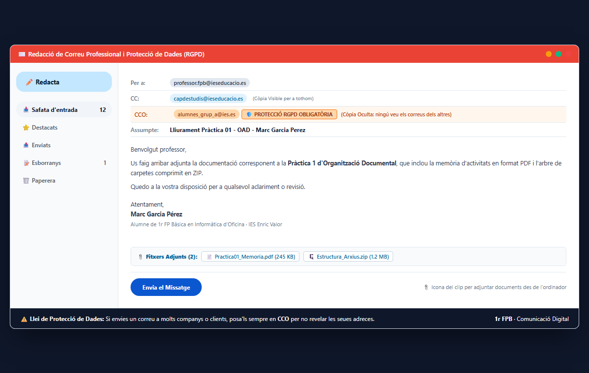

# 5.1 Estructura d'un compte de correu i adreces electròniques

El correu electrònic (*e-mail*) és el canal oficial de comunicació escrita de les empreses i administracions públiques.

### 1. Parts d'una Adreça de Correu Electrònic:
Una adreça estàndard té l'estructura:
$$\text{usuari@domini.extensio}$$
- **Nom d'usuari (*Username*):** Identifica la persona o departament (p. ex., `joan.garcia` o `consergeria`).
- **Arrova (`@`):** Separa el nom d'usuari del servidor on està allotjat (en anglès significa "a" o "en").
- **Nom de domini:** L'empresa o proveïdor que gestiona el servei (p. ex., `ieselport`, `gmail`, `gva`).
- **Extensió de domini:** `.es` (estatal), `.com` (comercial), `.org` (organització) o `.edu` (educativa).

### 2. Clients de Correu vs Webmail:
- **Webmail:** Accés al correu directament a través del navegador web (com Gmail o Outlook.com).
- **Client de correu d'escriptori:** Programa instal·lat localment al PC (com Microsoft Outlook o Mozilla Thunderbird) que descarrega i sincronitza els missatges mitjançant protocols **IMAP** o **POP3**.

---

### Guia Pràctica Visual: Redacció Professional de Correu i Protecció de Dades (RGPD)

#### ✉️ Camps Clau a l'Hora d'Enviar un Missatge:
1. **Per a (*To*):** L'adreça de la persona a qui va adreçat directament el missatge i de qui s'espera resposta o acció.
2. **CC (*Amb còpia*):** Adreces de persones que han d'estar informades del tema però no cal que responguen (per exemple, el cap d'estudis o un company d'equip). **Tots els destinataris poden veure aquestes adreces.**
3. **CCO (*Amb còpia oculta*):** **MOLT IMPORTANT PER A LA LLEI DE PROTECCIÓ DE DADES (RGPD).** Les adreces posades en CCO no les pot veure cap altre destinatari. S'ha d'utilitzar **obligatòriament** quan s'envia un comunicat a múltiples persones, famílies, alumnes o clients per evitar filtrar correus personals.
4. **Assumpte (*Subject*):** Ha de ser curt, clar i identificar qui ets i de què tracta el missatge (Exemple: *Lliurament Pràctica 01 - OAD - Marc Garcia Perez*). Mai deixis l'assumpte en blanc ni hi posis només "Hola".
5. **Icona del Clip (📎 Adjunts):** Permet afegir documents PDF, paquets ZIP o imatges des de l'ordinador.
6. **Estructura del Text:**
   - Salutació formal (*Benvolgut professor / Estimada tutora,*).
   - Cos del missatge concís i ben explicat.
   - Comiat educat (*Atentament,*).
   - Signatura professional amb nom complet, curs i centre educatiu.

