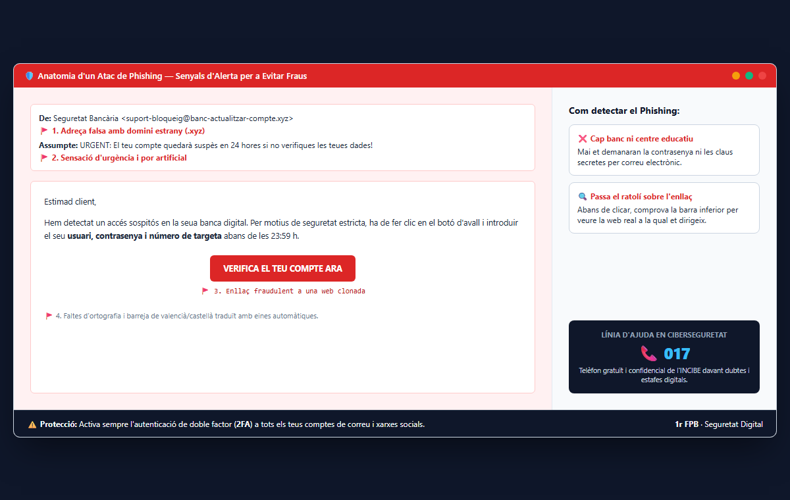

# 6.2 Enginyeria social i pesca electrònica (Phishing)

L'**enginyeria social** és la manipulació psicològica de les persones perquè facen accions que comprometen la seua seguretat, com revelar contrasenyes o fer transferències bancàries.

### Què és el Phishing?
Un frau en què els ciberdelinqüents envien correus electrònics o missatges de text (**Smishing**) fent-se passar per entitats legítimes (el banc, Correus, Hisenda, Netflix, l'institut).

### Senyals d'alerta per detectar un missatge de Phishing:
- **Sensació d'urgència extrema:** "El teu compte serà bloquejat en 24 hores!", "Tens un paquet retingut, paga 1,50 € ja!".
- **Errors gramaticals o traduccions automàtiques estranyes.**
- **Enllaços sospitosos:** En passar el ratolí per damunt de l'enllaç sense fer clic, la barra d'estat mostra una URL que no pertany al banc real.
- **Adjunts perillosos:** Fitxers `.zip`, `.exe` o `.iso` que instal·len virus tipus *ransomware* o *troià*.

---

### Guia Pràctica Visual: Anatomia d'un Atac de Phishing i Senyals de Perill

#### 🚩 Les 5 Banderes Vermelles per Identificar el Frau:
1. **🚩 1. Adreça del remitent estranya:** Fixa't en el domini després de l'arrova. Si diu que és el teu banc o Correus però l'adreça acaba en `.xyz`, `.top` o números arbitraris, és una estafa.
2. **🚩 2. Amenaces d'urgència:** T'obliguen a actuar en menys de 24 hores perquè no tinguis temps de pensar ni de consultar amb un adult o professor.
3. **🚩 3. Enllaç fraudulent a una web clonada:** Si passes el ratolí per damunt del botó sense fer clic, veuràs que la pàgina real a la qual et porta no és la de l'entitat oficial.
4. **🚩 4. Redacció sospitosa:** Faltes d'ortografia, barreja d'idiomes o frases incoherents creades amb traductors automàtics.
5. **🚩 5. Cap banc ni centre oficial et demanarà contrasenyes per correu:** Si et demanen el PIN, la contrasenya o les dades completes de la targeta, és un engany segur.

> [!TIP]
> **📞 Telèfon Gratuït d'Ajuda en Ciberseguretat (017):** Si tens qualsevol dubte davant d'un missatge sospitós, pots telefonar gratuïtament al **017 de l'INCIBE** (Institut Nacional de Ciberseguretat) de 8:00 a 23:00 h cada dia.

